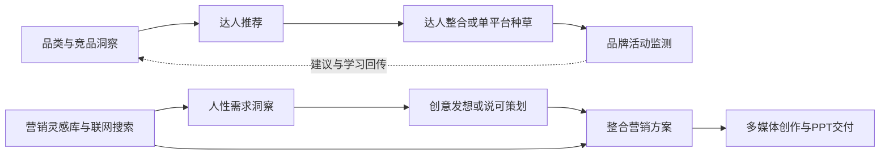

# 因赛AI客户端业务能力全景与实现盘点

初始盘点日期：2026-10-08；本次补全至 **2026-10-09 的 1.0.6 Stable 对外发布**（Asia/Shanghai），保留原文件名与能力编号，便于后续 Agent 连续追踪。用途：供产品审核、官方 Desktop 迁移评估及后续 Agent 梳理。本文是实现事实与证据的快照，架构取舍部分为待评估建议；不修改现行 ADR，不把 Shell + Core + Plugin 作为必须保留的最终形态。

**当前交付结论**：1.0.6 已公开为正式版，三平台 Stable 更新入口通过签名与下载验证；复用已验收的 Candidate 字节，未重新构建。正式 Shell 固定 `29718822…`，Core 固定 `c3aaab2…` / `insight-runtime-v0.2.1-alpha.1-insight.3`。本轮完成了 Core 升级后的历史兼容、插件安装源保存与故障归因修复；不意味着 12 条营销业务链、所有第三方插件组合或三平台人工 GUI 升级全部验证完毕。后续 Agent 先读 **2.1、2.4、8.1 和 10.2**，不要继续依据第 2.3 节历史阶段的“未发布”状态安排重复发布。

## 1. 先看业务全貌

我们已经做出的产品是一个**使用因赛账号、企业模型与业务技能的 AI 桌面工作台**。员工通过短信或密码登录，在自己的本地工作区中使用 Harness 对话和工具，选择营销专家技能，调用企业搜索、社媒数据及媒体/PPT 服务，并通过因赛控制的安装包和更新源获得功能迭代。

目前最清楚的业务资产有四组：

1. **企业身份与数据连续性**：因赛登录、恢复、退出、环境分区、账号目录、凭证桥接。
2. **业务服务接入**：企业模型 Gateway、联网搜索、技能请求代理；员工无需自行提供厂商 Key。
3. **营销专业能力**：12 个随包技能的入口、正文、脚本、参考资料和展示信息，以及提示词增强等配套插件。
4. **可交付客户端**：品牌、跨平台窗口、启动与插件恢复、确定的 Runtime 组合、签名制品、Candidate/Stable 投放和安装更新。

其中，营销技能已成为可发现、可加载的业务资产，但**12 个技能的全部真实业务链路尚无统一验收证据**。把 Skill 放入安装包、菜单能选择、模型能读到正文，分别证明不同的事情，不能直接推导“TikHub 取数、图片生成、PPT 交付已经全部可用”。

共享项目空间、Artifact 血缘、评论协作、租户权限和后台治理仍是知识库中的产品方向。独立桌面画布插件已有 `0.3.0-alpha.8` 的安装、页面/资源鉴权与新旧 Core 兼容验证，见 2.4.4；它是可选本地插件，不是 1.0.6 新增的出厂模块，也不足以证明知识库中的 Canvas/项目资产/多人协作整体闭环。本清单不作全公司业务系统完成度判断。

### 1.1 用业务过程理解现有能力

| 用户阶段 | 客户端实际承担什么 | 当前证明到哪里 |
| --- | --- | --- |
| 进入产品 | 短信/密码登录、图形验证码、恢复会话、网络错误恢复 | 有代码、自动检查及历史本机人工记录；真实服务异常仍需分场景验证 |
| 进入自己的工作空间 | 根据环境和账号选择数据目录，串行启动 Runtime/View | 历史多账号人工确认；新版隔离账号桌面验证有记录 |
| 与 Agent 工作 | 企业默认模型、流式回复、原生工具与会话、取消、图片输入适配 | 复用 Core；新版 Gateway 进程测试使用 HTTP 替身，不能代替真实企业模型验收 |
| 使用专业方法 | 菜单多选技能，草稿写入原生 `/name`，Core 加载正文与资源 | 12 项菜单与代表性技能加载有证据；不是 12 条业务流程全部验收 |
| 使用外部数据/生成服务 | 搜索 Provider 和技能代理复用当前账号凭证 | 客户端接入及模拟服务测试成立；后端部署、授权、费用与真实产物需独立验证 |
| 改善输入与沉淀 | 提示词增强；可选 Memory Evolve | 增强已有真实桌面组件链路测试；记忆插件新版兼容仍有缺口 |
| 持续使用与升级 | 数据留在安装目录外；Profile 迁移、恢复、更新、诊断 | 1.0.6 已正式发布；三原生包启动/会话恢复、Mac 签名公证、旧版协议发现/下载通过；人工验收与未覆盖组合见 2.4.3 |

### 1.2 怎样阅读本文

- 第 2–3 节适合先审核范围和完成状态。
- 第 4–7 节解释每项能力做了什么，以及业务代码和通用底座各自承担什么。
- 第 8–9 节用于找缺口、填写迁移取舍和安排验证。
- 第 10 节给出证据入口与后续 Agent 的复核方式。

能力编号是本文的追踪标识，不是已建立的 Issue，也不代表新增开发任务已被批准。

## 2. 基线、范围与判断方法

### 2.1 必须区分的版本与制品截面

| 截面 | 固定值 | 可作出的结论 |
| --- | --- | --- |
| 1.0.6 正式 Shell | 不可变 `v1.0.6` / `29718822b36a232eeabe202b77fed6ae44256338`；[PR #25][e-pr25] 已合入 main；package `1.0.6` | 已发布身份；后续 main 或本地 HEAD 变化不得解释为该安装包变化 |
| 1.0.6 正式 Core | `c3aaab2e76ddfad6163478687287774ad7233374`；package `0.2.1-alpha.1`；官方基准 `dsh-v0.2.1-alpha.1` / `5badb15009ae1756c3afe0ae0cef1faafc290ccc` | 保留因赛增量，并包含旧历史兼容修复；Session writer **4**；不是持续跟踪上游 master |
| 当前正式 Runtime lock | `insight-runtime-v0.2.1-alpha.1-insight.3`；三目标 Core 均为 `c3aaab2…`；Node `24.9.0`、pnpm `11.7.0` | [公开 Runtime][e-runtime106] 与 lock 一致，三平台固定 URL/SHA-256；普通构建已消费新 Runtime |
| 当前线上版本 | Stable `1.0.6`，`active/stable/optional`；三个 Candidate 指针仍为 `active/candidate/optional/1.0.6`；[GitHub Release][e-106] 非 Draft、非 prerelease、public latest | 2026-10-09 16:51 正式晋升；16:52 旧协议公网复核通过；Candidate 与 Stable 共用同批安装包 |
| 1.0.4 历史恢复基线 | Shell `1c443ea3ee2eb7d1f8eee9e0f8205271d1a44713`；Core `25a49c53c4e0c003a8469ee243aa5d1365df80cd` / Runtime `insight.1` | 2026-10-09 01:19 已转 Stable，使 Schema 2 有可读恢复基线；不是当前最新 Stable，也不包含 1.0.6 历史修复 |
| 1.0.5 历史 Candidate | Shell `53fd15e0dbbd87402c2a24cb30fc95cb7272cb0a`；Core/Runtime 与 1.0.4 相同 | 已投放内测、未转 Stable；不能把 1.0.5 当历史修复版本 |
| 1.0.3 历史旧 Core | Runtime `insight-runtime-v0.1.6-alpha.2-insight.4`；Core `5f668026071a5c2f2a0796aff1900be62b0aebe4`；Session writer **3** | 用作历史写入器与升级来源；只读整体 Schema 1，不能直接恢复已经写入 V4 的会话 |
| 10 月 8 日隔离开发阶段 | Shell `57add147…`；功能修复基线 `688ee18c…`；内部 lock 固定 Core `25a49…` / run `37752148518` | 第 2.3 节保留此阶段问题与修复；内部 artifacts、Dev DMG 和 local manifest 不代表当前线上身份 |
| 本地源码与忽略缓存 | Shell 工作分支曾停在 `1f052742…`，其改动已通过 PR #25 合入；`build/runtime-manifest.json` / `dist*` 可随联调变化 | 复核发布时先取 tag、正式 lock、签名 Manifest 与具体 run；不能用本机缓存或分支名替代制品事实 |
| 历史完整 Stable 转正记录 | `1.0.2`，2026-09-28，Shell `90bc842b94ca97892f1a5d3f02467c62e18ab894`，仍使用旧 Runtime | 保留历史三目标验收与转正证据，不将其当线上最新版本 |

来源：[正式锁][release-lock]、[内部锁][release-internal-lock]、[Core 格式常量][core-session]、[升级记录][e-upgrade]、[1.0.4 恢复接受记录][e-recovery104]、[1.0.5 记录][e-105]、[1.0.6 正式发布核验][e-106-stable-proof]。[整体数据兼容声明][release-compatibility]现为 `writesDataSchema=2`、`readsDataSchema=1..2`；独立 Profile/账号存储 Schema 仍为 1。它们与 Profile 第 8 代、Session V4、App `1.0.6` 和 Core `0.2.1-alpha.1` 是不同维度，不能相互代替。

9 月 30 日平台分析只作为历史参考。它当时关于因赛 Core V3、直连 DeepSeekAdapter、旧插件组合等事实不能直接套用到今天的源码；本次保持原文不变。

### 2.2 盘点范围与证据强度

已读取 Shell 主进程、preload、认证 Renderer、第一方集成 Host/Client、Profile/恢复/更新/构建脚本、随包技能；读取 Core 相对官方 `dsh-v0.2.1-alpha.1` 的差异、Runtime 装配和相关公共接口；读取知识库产品路线、契约草案及 FE-001–005 相关记录中的当前说明和历史边界。

本文按以下方式表述完成度：

| 标记 | 含义 |
| --- | --- |
| 已实现 | 当前代码存在明确实现和调用入口；不自动意味着已发布、真实服务通过或全平台通过 |
| 部分实现 | 入口/适配/资产已有，业务闭环或兼容仍缺一部分 |
| 复用 | 来自官方 Core 或固定社区包；因赛完成组合/适配，不把原能力算成自研 |
| 目标/未见闭环 | 知识库有意图，但本次检查范围没有完整实现证据 |
| 历史退役 | 曾实现或预装，当前迁移代码已移除其受管组成 |

证据另外注明“静态源码”“仓库既有自动验证记录”“真实桌面但服务替身”“用户人工确认”“原生 CI 实际包验证”和“公网旧客户端协议验证”。本次文档补全使用已经保存的 1.0.6 发布结果与当前源码，没有重新执行真实账号、付费 API、安装升级或全套产品测试。不能把引用的 918、926 或 955 项通过写成本文这轮新跑的结果；签名接受记录不自动等于三个目标的人工 GUI 验收，见 2.4.3。

### 2.3 历史阶段：1.0.4 Core 升级与隔离内测准备

**阶段目的**：把因赛 Core 从当时正式锁的 `0.1.6-alpha.2` 升级到选定官方 `dsh-v0.2.1-alpha.1`，保留因赛增量，并解决集成、桌面运行和原生构建中暴露的问题。这些是既有能力的升级适配和回归修复，没有新增 Canvas、协作或企业治理业务模块。“最新”指这次选定并固定的官方目标，不是对未来上游 HEAD 的持续保证。

**历史完成边界**：截至 10 月 8 日该记录，源码升级、macOS arm64 隔离桌面回归和三目标 Runtime 构建已有证据，内部安装包最终验收仍未收口。此状态已被第 2.4 节的恢复基线、Candidate 与 1.0.6 Stable 结果覆盖；不能继续读成“当前新 Core 未发布”。现行产品仍沿用 Shell + Core + Plugin 组合，这次升级不构成采用官方 Desktop 的迁移结论。

#### 2.3.1 Core 升级与功能兼容：具体保住了什么

以下 R104 编号用于追踪本次版本工作；它们关联既有能力，不重复计算为新增业务功能。

| ID / 类型 | 具体做了什么 | 实现或恢复的结果 | 证据、限制与关联能力 |
| --- | --- | --- | --- |
| R104-01 / 上游升级 | 合入官方 tag `dsh-v0.2.1-alpha.1`（`5badb150…`），合并提交 `dbe72fa…`，该阶段 Core `25a49c5…`；处理上游变化与因赛增量的冲突，重新构建 Host/Client/native/Web | 使用新 Core 底座，同时保留企业集成、品牌、技能输入/目录及 Runtime 接缝 | [升级记录][e-upgrade]；Core 完整构建、42 项文档同步检查和 345 项通用模型适配器测试有记录；后续 `c3aaab2…` 的历史修复见 R106-01。C01–C10/P11 |
| R104-02 / 设置与输入接口适配 | 采用新版共享设置与输入区接口，保留 `settingsDialog.open(section?)`；改用 `settings.launcher` 插槽，延续原生技能选择与草稿引用行为 | 因赛账号菜单仍能打开统一设置，完整工作窗口和 12 技能入口继续可用，避免重复官方设置/账号入口 | [升级记录][e-upgrade]、[Client][b-client]、[输入 facade][c-input]；桌面普通/安全模式有隔离验证。B04/B08/B09 |
| R104-03 / 模型传输适配 | 新官方直连 DeepSeekAdapter 仅支持 Messages，企业 Gateway 改接公开 `PiAiAdapter(openai-completions)`；Core 公开所需构造接口，Shell 延续按请求 token 桥、默认模型、历史别名和推理档位 | 保持企业 `/v1/chat/completions`、流式回复/工具/取消，避免要求企业服务改成 Messages；登录后的用户无需填 Key | [Gateway][b-model]、[PiAi exports][c-piai]、[升级记录][e-upgrade]；模型进程测试使用 HTTP 替身，真实服务资格仍见 G03。B05/C10 |
| R104-04 / 图片与技能读取适配 | 图片采用 Chat Completions inline 输入；Skill 展示读取改用 workspace `readBytes` 的 `range` 和原始 Uint8Array，保留 8 KiB 限制、完整窗口检查、严格 UTF-8 解码和失败回退 | 图片不调用未证明支持的 Messages Files API；随包技能说明在新版读取契约下仍能展示 | [升级记录][e-upgrade]、[技能目录读取][b-catalog]；沿用官方图片限制/重试，不能声称 PiAi 提供原直连适配器的精确图片报价。B05/B08/B09 |
| R104-05 / Runtime 闭包修复 | 移除上游已删除的 invariant 依赖，补齐新必需 peers；修复 pnpm deploy 预建空目录造成 workspace 包漏装，复核布局与实际运行依赖 | 生产 Runtime 可独立装配和启动，避免开发 node_modules 掩盖发行缺包 | [升级记录][e-upgrade]、[装配入口][c-artifact]、[Runtime root][c-runtime-root]；此时为内部 CI；后续公开 Runtime 与正式 lock 已完成，见 2.4。P01/C01 |
| R104-06 / 主题回归修复 | 显式识别 Core light/dark/system 来源，去重原生主题与 IPC 更新，协调主、关于、更新窗口的主题同步 | 消除窗口阴影/主题持续闪烁和原生主题反馈循环 | [主题记录][e-theme]、[主进程][p-main]；修复前记录 12 秒内 971 次 IPC/原生更新，修复后各模式 30 次采样无空闲变化；这是 macOS 本机证据，不扩展为 Windows 主题验收。P07 |
| R104-07 / 增强插件兼容修复 | 从旧 0.2.1 兼容补丁推进到固定上游 `dsh-prompt-enhance@0.2.7`，改接公开默认模型服务，并适配 configForms/附件/主题；受管 0.1.9/0.2.1 自动迁移，保留用户移除与自选其他版本 | 提示词增强重新使用当前企业默认模型；预览、应用、撤销、失败保留原文、重试和取消恢复可用 | [增强记录][e-prompt]、[Profile][p-profile]、[插件 patch][p-prompt-patch]；真实旧 Profile 迁移和桌面组件链路有记录，登录/模型响应为替身。B10/P03 |

Memory Evolve 0.1.0 的旧模型/设置 API、同步与编排兼容尚未收口，不能因为主工作区或提示词增强恢复正常就把 B11 写成新版全部通过（见 G09）。

#### 2.3.2 数据格式与内测路线：升级为何不能直接按旧发布流程投放

这次已做实际隔离复现：旧 Core 创建/读取 Session v3 → 新 Core 读取并写入 v4 → v3 前驱文件仍在 → 旧 Core 再读同一个会话，拒绝 `uses log format v4, but this harness reads only v3`。读取会选择最高代；保留旧文件不等于能够降级恢复。样本是生成的测试会话，尚不是生产用户数据全面迁移验收。

因此整体数据声明升级到写 Schema 2、读 Schema 1..2。当时线上 v1.0.3 三目标只读 Schema 1，发布器与客户端的 `assertCandidateRecoveryCompatible()` 会拒绝这组 Candidate/恢复组合。后来按操作者授权建立 1.0.4 新 Core 恢复基线，才允许 1.0.5/1.0.6 Candidate；当前 Stable 已是 1.0.6。**旧 Core 不能读取 V4 的事实没有因新基线发布而消失**；不能虚报 Schema、篡改旧签名 Manifest 或删除门禁。

该阶段实现的 R104-08 是**隔离内测构建入口**：沿用 App ID `com.insight-aigc.desktop.dev`、产品名「因赛AI Dev」、独立 userData 和关闭生产自动更新的开发身份，不自动导入正式数据。`core-runtime.internal.lock.json` 固定 Core、CI 来源和三个目标摘要；装配入口校验 SHA-256、Core/version/target 与 Node/pnpm 后生成带来源的 local manifest。当时正式 lock 保持旧值；现在正式 lock 已推进到 `insight.3`，内部锁不能替代它。

[内部工作流][p-internal-workflow]在三个原生 runner 上读取固定 Core CI artifacts，构建集成/Profile、打包前 Runtime 冒烟、生成未签名/未公证的隔离安装器，并对包内资源再次做身份/摘要及业务冒烟。它没有生产发布权限，不创建桌面 tag，不公开 Release，不上传 OSS。R104-08 支撑 P01/P09/P10/P11；来源见 [内部锁][release-internal-lock]、[装配入口][p-internal-runtime]、[整体声明][release-compatibility]、[版本说明][e-104]和[准备记录][e-prep104]。

#### 2.3.3 原生构建中暴露的问题与修复

这些问题是在升级后的交付验证中发现的；有的是锁文件/平台工具问题，有的是新增预检自身遗漏，不能全部归因为新 Core 的业务回归。

| ID / 问题 | 已完成的修复 | 证明到哪里，仍待什么 |
| --- | --- | --- |
| R104-09 / 三平台 `npm ci` 缺 esbuild、Rollup 可选平台包 | `7574473…` 在无 node_modules 的临时目录生成完整锁，只补 72 个缺失的可选平台条目，保留已有版本和摘要 | 初次 run `37757341795` 三目标失败；修复后 run `37757880297` 三目标实际 `npm ci` 通过。不是新增业务依赖选择 |
| R104-10 / Windows tar 将 `D:` 当远端主机 | `6714c05…` 将归档 basename 传给 tar，以归档目录作为 cwd；相应测试同样约束路径，加入含空格目录的实际创建/解压/来源回归，CI 先执行原生归档预检 | run `37757880297` 的 `Cannot connect to D: resolve failed` 已复现；run `37758582073` 三目标归档预检、实际 Runtime 装配、全量测试及安装器打包通过，后续仍在冒烟失败 |
| R104-11 / Windows Gateway 冒烟未满足路由条件 | `cc7adf3…` 增加最长 30 秒、500 ms 间隔的模型目录就绪检查，要求默认 `yinsai-gateway/deepseek-flash`、Gateway 可路由、模型存在且无工厂 `deepseek/pi-ai` 路由；超时输出目录诊断。相同冒烟前移到打包前，包后继续检查真实资源 | 新回归证明延迟注册可通过，永久缺失、错误默认模型及工厂路由会拒绝；已有本地 Dev 包完整冒烟通过。Windows“HTTP Session API 早于 Adapter 注册”的解释仍是假设，缺失败目录快照，不能写根因已确认/问题已解决 |
| R104-12 / Windows 新临时预检漏复制 helper | `57add14…` 补入 `windows-hidden-console.mjs` 与 `windows-child-process-hide.mjs`；实际安装包 extraResources 原本已含它们 | run `37760161275` 在模型 API 就绪前失败；这项修复解决预检目录缺件，不证明 R104-11 的时序假设。后续正式三平台 CI 已通过，见 2.4；不追认失败/取消的内部轮次为成功 |

各 CI 失败后的全平台构建按操作者要求停止；已取消的作业不能当通过。Core run `37752148518` 的三平台 Runtime 成功，与 Shell run `37758582073` 的安装器打包步骤通过、最终 Gateway 冒烟失败，是三个不同结论；本文不将阶段成功写成最终内测制品全部合格。提交、run 链接和原始检查范围见 [准备记录][e-prep104]；模型就绪逻辑见 [包内冒烟][p-packaged-smoke]，定向检查入口为 `test/prepare-internal-runtime.test.ts`、`test/packaged-harness-smoke.test.ts`。

#### 2.3.4 对后续迁移评估的直接输入

1. **需要保留的业务结果**：因赛账号与 home、企业 Gateway/凭证、技能目录/资源、品牌设置入口、增强行为；用 B01–B10 的实际行为验收，不按旧接缝数量估算任务。
2. **需要重新判断的框架修复**：settings/input/readBytes/PiAi/peers/Windows helper 等修复与当前消费方式有关；官方 Desktop 若已有等价入口或完整资源闭包，可以替代或退役相应 Shell/Core 补丁。先证明结果，不机械重复 R104 全部实现。
3. **不会随换构建自动消失的工作**：Session v4 与旧用户恢复路径、第三方插件组合、Memory Evolve 兼容取舍、真实企业业务输出和各平台安装升级边界。恢复基线与 1.0.6 修复已解决本轮明确阻断项；内部工作流本身仍只提供隔离验证入口。

### 2.4 1.0.4 恢复基线 → 1.0.5 Candidate → 1.0.6 正式发布

#### 2.4.1 发布链已经完成的节点

| 节点 | 固定身份与证据 | 截止本次发布的结果 |
| --- | --- | --- |
| 新 Core 恢复基线 | 1.0.4 / Core `25a49…` / Runtime `insight.1`；[接受记录][e-recovery104] | 三平台原生包启动、历史迁移/恢复续写、Mac 签名公证及分发验证通过；2026-10-09 01:19 转 Stable，写 Schema 2、读 1..2 |
| 第一轮新 Core Candidate | 1.0.5 / Shell `53fd15e…`；[版本记录][e-105] | 三平台构建与内测投放成功，恢复基线为 1.0.4；没有转 Stable；随后真实升级暴露下述历史数据和旧插件问题 |
| 历史修复 Runtime | Core `c3aaab2…` / `insight-runtime-v0.2.1-alpha.1-insight.3`；[Core run 37881665990][e-core106-ci] | 三平台成功，兼容测试在裁剪开发依赖前执行，正式 lock 固定三个归档；本轮没有把 Core 再下载到本地重复验证 |
| 1.0.6 Shell 合入与构建 | [PR #24][e-pr24]、[PR #25][e-pr25]；[run 37891766871][e-shell106-ci]；Shell `29718822…` | 2026-10-09 14:05:51–14:32:21，一次完整构建三平台；17 个目标资产与三个实际包恢复报告齐全 |
| 1.0.6 Candidate 投放 | [run 37899940279][e-candidate106-ci]；`publish-candidate-all` | 15:35:54–16:10:28，三个指针均 active/candidate/optional/1.0.6；此阶段 Stable 保持 1.0.4，GitHub 仍 Draft |
| 用户接受与正式晋升 | 用户明确确认“已手动验收完成 1.0.6 candidate版本，为它转正”；[run 37907418690][e-stable106-ci] | 16:50:10–16:51:10，执行 `promote-stable-all`，写三目标签名接受记录，公开 Release，最后切换 Stable；发布器执行约 60 秒 |
| 公网与旧版协议复核 | [旧版 Stable 解析证明][e-106-stable-detection]、[正式发布汇总][e-106-stable-proof] | 16:52 三平台 Stable 签名链、平台元数据、安装器及 Mac 更新 ZIP 的 HEAD/Range 通过；匿名 API 确认 public latest v1.0.6 |

以上时间统一为上海时间；发布信封中的 `publishedAt` 是签名内容生成时间，工作流结束时间与 GitHub `published_at` 分别记录，不应混成同一个动作时间。1.0.4/1.0.5 的授权以已有 Dev 实测和自动门禁推进，未新增的三平台人工项目仍保留“未新增实测”。

#### 2.4.2 1.0.6 实际补齐的能力与修复

| ID / 类型 | 原问题和原因 | 本版行为与能力结果 | 证据与边界 |
| --- | --- | --- | --- |
| R106-01 / 旧历史兼容 | 部分 V3 日志声明两条 tool call，只启动一条、未保存结果，随后以 `UNKNOWN` / `Cannot read properties of undefined (reading 'prepare')` 结束；V4 严格校验拒绝未结算调用，表现为消息完全无法打开 | 在相邻 V3→V4 迁移中，仅凭同回合同类确切故障证据补入错误结果；已启动调用注明结果未知，未启动声明用 canonical `TOOL_NOT_STARTED`；重映射引用、保留原 V3，不执行工具、不虚构成功 | [修复记录][e-history106]、[迁移][c-history-migration]、[窄修复模块][c-failed-tool-step]；五份历史副本通过，四份受影响、一份正常；其他损坏日志和原生 V4 严格拒绝继续保留。B03/P06/C11 |
| R106-02 / 历史失败的 UI 与救援 | observe session 失败后会话模型投影与专家技能目录无法取得，界面一直加载或像技能消失 | 显式展示模型/历史加载失败与技能暂不可用原因；成功加载后恢复目录；Harness 菜单提供“只读导出会话历史…” | [导出实现][p-history-export]、[修复记录][e-history106]；文本按 Core codec 解码，JSONL 保留物理记录；输入及总解压限 32 MiB，保存不覆盖历史代际或已有文件，不接入可写 Agent。B08/P06 |
| R106-03 / 本地插件安装源保存 | 历史 `file:*.tgz` 指向已删除的下载/开发归档；升级重装依赖触发 ENOENT | 导入时原字节先保存到当前 Profile 的 `.insight-local-plugins`，每次独立文件，再调用官方 `dsh plugin add`；原下载目录移除后仍能重装 | [故障记录][e-plugin106]、[导入实现][p-import]；只修复后续归档导入，已丢失旧归档需可信原包重新导入或卸载；目录导入的开发链接行为不变。P04/P05 |
| R106-04 / 插件故障归因 | 安装源缺失或官方兼容性预检拒绝时，旧故障页只提示“无法定位具体插件” | 将 ENOENT 安装源与声明精确匹配；把预检拒绝的依赖包归因到有证据的第三方根插件，供安全模式/卸载选择 | [恢复实现][p-plugin-recovery]、[故障记录][e-plugin106]；不把 Core、必需集成或无归属依赖当卸载目标，不绕过官方预检。P05/P06 |
| R106-05 / 画布插件宿主依赖兼容 | 可选画布 `0.3.0-alpha.7` 以普通依赖安装旧 `dsh-tools`，hoist 后遮蔽新 Core；agent-loop 无法取得 tools | 插件独立升级为 `0.3.0-alpha.8`，改为宿主 peer，保留 Profile `autoInstallPeers: false`；原 Profile 副本在新 Runtime 正常启动 | [故障记录][e-plugin106]；41 项插件测试与新旧 Core 安装/鉴权/卸载通过，用户自行重装后正常。此项不在客户端包里自动替换第三方插件。P04/P05 |
| R106-06 / 三平台实际包资格 | 仅验证开发依赖、干净 Profile 或本机目录包，不足以证明正式安装包资源闭包 | 同一 Core/Shell 身份在三个原生 runner 构建，检查实际包内 Runtime 启动及正常/故障 V3 迁移、恢复续写、再次读取 | [构建 run][e-shell106-ci]、[构建证明][e-106-build-proof]；Mac 两架构签名、公证、staple 必需步骤成功；Windows 仍不宣称 Authenticode。P01/P10 |
| R106-07 / 内测转正与旧版连续升级 | 不能用新源码模拟器替代旧版协议，也不能重建一个“正式包”改变验收字节 | 提取 v1.0.3 原更新源码与公钥/配置，读取真实 CDN；1.0.0–1.0.5 对应代码 Git 对象一致；转正仅追加 Release Index/签名并改变投放状态 | [Candidate 协议证明][e-106-candidate-detection]、[Stable 协议证明][e-106-stable-detection]、[发布报告][e-106-stable-report]；原 17 个资产 ID/长度/摘要不变，转正后共 19 个；此证据不冒充各旧版逐台 GUI 升级。P08/P09 |

**历史问题的准确结论**：这轮升级暴露了旧日志中已有的工具调度不一致，以及旧本地插件的安装源/共享依赖问题。历史消息没有被迁移删除，专家技能资源没有因该历史加载错误被卸载；二者的“消失”来自会话读取失败后的投影阻断。1.0.6 修复的是有明确证据的情况，不承诺自动修复任意损坏历史。需要再次执行旧工具时，应先核查副作用，因为旧已启动调用的结果仍是未知。

#### 2.4.3 验收证明到了哪里

| 证明类型 | 已完成的事实 | 不应扩写成什么 |
| --- | --- | --- |
| 真实历史副本 | 五份本地 V3 历史可迁移、保存 V4 后继、再次打开与只读导出；原 V3 哈希不变；已安装 1.0.4 的原始 V4 reader 接受五份新产物 | 全量用户数据、任意损坏日志和旧 V3 reader 兼容 |
| 三平台 CI 实际包 | bundled Runtime 的 startup、正常迁移、故障工具历史、native V4、恢复追加和重启读取通过；Mac 签名公证校验通过 | 三个平台真实用户桌面、付费服务、完整 GUI 覆盖安装均人工通过 |
| 1.0.6 CI 恢复字段 | previous 为旧 `5f668…` / writer 3；candidate 与 recovery 都是修复后的 `c3aaab2…` / writer 4；两份 V3 源哈希不变，恢复后完整事件数组一致 | 实际安装旧 1.0.4 完整 App 再升级回 1.0.6 的三端 GUI 往返；旧 1.0.4 reader 资格来自上一行独立验证 |
| 本机人工记录 | macOS ARM64 用户确认重装插件后正常进入，旧会话与专家技能恢复；随后确认 1.0.6 Candidate 手动验收完成并授权转正；本机画布为 alpha.8 | 自动赋予 Intel/Windows、新增三端真实模型或全部插件组合通过记录 |
| 公网旧协议 | 三目标签名 rollout→Index/Target→更新元数据；同批 Candidate 字节；DMG/NSIS 与 Mac ZIP 长度、206 Range；匿名 public latest | 本次文档工作新做了 GUI 安装、全量安装包下载或全产品业务验收 |

原生 CI JSON 在 `release-proof-<target>` artifacts 中，本机已保存副本；精确文件与 run 入口见 10.3。签名接受记录表示操作者接受发布决定与固定 Manifest，不是自动测量所有业务质量的证明。

#### 2.4.4 现有用户与后续 Agent 的操作边界

- **普通用户升级**：正式 `1.0.0–1.0.5` 客户端通过普通“检查更新”发现 Stable 1.0.6，策略 optional。后台仍按既有启动/六小时/系统恢复机制检查 Stable。内测入口仍是更新窗口 Logo 在 3 秒内点 5 次并确认，只检查 Candidate，不产生自动内测推送。
- **已安装同版 Candidate**：应用与数据身份不变，不重新下载安装。若通过内测更新安装且留有 Candidate 安装标记，Stable 检查会清标记并显示“当前版本已转为正式版”；手动安装未留下标记时也不会重复提示同版本升级。
- **画布插件**：alpha.7 需独立更新到 alpha.8，客户端不会自动升级用户第三方插件。已确认的是安装、页面/资源鉴权、登录保护、卸载与 Core 兼容，不是项目/Canvas/Artifact 统一对象及协作闭环。
- **已缺失的旧插件归档**：先定位具体 `file:` 来源与插件，再由用户提供可信原包重导入或卸载；不能从 ENOENT 推导账号损坏，不自动恢复已主动卸载的 `social-publisher`。
- **历史救援**：只在副本上调查新的模式；32 MiB 导出边界与原生 V4 严格校验保留。安全模式共享账号历史，它不能绕过 V4 迁移资格，也不是数据隔离备份。
- **钥匙串提示**：本机覆盖安装时曾出现 macOS Safe Storage 授权提示；这不是上述插件启动失败的根因。重复授权需独立核对签名身份、应用路径和 safeStorage，不能据此清除凭证或历史来证明升级成功。
- **版本维护**：本轮构建、Candidate、Stable 投放均已完成，两个监控已暂停。后续缺陷使用新的更高最终版本；不移动 v1.0.4/v1.0.5/v1.0.6 tag，不覆盖 Release Asset/OSS 不可变对象，不把这页当作再次触发发布或上游升级的授权。

## 3. 能力地图与完成状态

### 3.1 企业业务接入

| ID | 能力 | 状态 | 主要实现位置 | 关键边界 |
| --- | --- | --- | --- | --- |
| B01 | 因赛账号登录 | 已实现 | Shell Auth API/IPC/Renderer | 不含注册、找回密码、完整 SSO/租户切换 |
| B02 | 恢复、过期、离线与本地撤销 | 已实现 | AuthSessionManager、CredentialStore | 离线缓存不授予进入 Harness 的权限 |
| B03 | 环境及账号范围的数据与工作区生命周期 | 已实现 | account-scope、WorkspaceLifecycle | 按账号，不是已完成租户 RBAC 或恶意插件隔离 |
| B04 | 统一品牌、账号菜单与设置入口 | 已实现 | 第一方 Client 集成 + Core slots | 不含完整业务首页或设计系统 |
| B05 | 免用户 Key 的企业模型 Gateway | 已实现并随 1.0.6 发布；真实服务资格待补 | 第一方 Host + Main 凭证桥 | 模型服务授权由后端决定；完整容量/图片/工具/付费资格独立验收 |
| B06 | 企业联网搜索 | 已实现；真实结果待补 | DeepSeekSearchProvider 适配 | 搜索使用 Messages 路由，与模型 Chat Completions 路由不同 |
| B07 | 登录态技能请求代理 | 已实现；逐连接业务待补 | Host 私有 HTTP + JS 客户端 | 不持久化异步任务，不自动重试付费操作 |
| B08 | 内置专家技能菜单与原生调用 | 已实现；1.0.6 恢复旧历史场景 | SkillPicker、Core 输入/目录扩展 | 目录依赖会话成功打开；加载失败有明确状态；外部技能仍走 Core 规则 |
| B09 | 12 个营销技能资产 | 已集成；整体部分完成 | bundled-skills | 详见 S01–S12；资产存在不等于真实服务成功 |
| B10 | 提示词增强 | 复用并适配；已随新 Core 正式发布 | dsh-prompt-enhance 0.2.7 | 专项自动链路服务响应使用替身；保留用户移除与自行选版 |
| B11 | 记忆、Todo 与方法沉淀插件 | 复用；兼容部分完成 | dsh-memory-evolve 0.1.0 | 旧模型配置接口未全迁移；共享技能目录有账号边界问题 |

### 3.2 承载业务的客户端能力

| ID | 能力 | 状态 | 迁移时要保持的结果 |
| --- | --- | --- | --- |
| P01 | 固定 Runtime 和依赖闭包 | 已实现；insight.3 三目标正式锁与发行完成 | 产品能确定实际执行的 Core、目标和工具链 |
| P02 | Harness 进程启动、认证回环与退出 | 已实现 | 已登录才启动、旧实例退出、只载入期望的本地服务 |
| P03 | Profile 初始化与升级修复 | 已实现 | 新账号可用、既有数据和可选插件选择可延续 |
| P04 | 本地插件导入与卸载 | 已实现 | 通过当前账号 Profile 操作、可恢复、必需集成保留 |
| P05 | 安全模式与插件故障恢复 | 已实现 | 第三方故障时仍能登录并使用企业集成/恢复入口 |
| P06 | 启动过程、日志与缓存维护 | 已实现 | 用户能区分准备、修复、启动、加载与失败 |
| P07 | 平台窗口、主题与渲染恢复 | 已实现；平台证据分版本 | Mac/Windows 窗口可操作、无主题循环和无限恢复循环 |
| P08 | 客户端更新体验与策略 | 已实现 | 受信版本发现、显式下载、安装反馈、候选偏好和强制策略 |
| P09 | Update v2 可信发布与投放治理 | 已实现；1.0.6 新 Core Candidate→Stable 已走通 | 制品不变、目标接受、签名链、撤回与防回放；接受不等于全业务验收 |
| P10 | 三平台打包、签名和诊断工具 | 1.0.6 三原生包通过并已正式发布 | Mac 签名公证、包内恢复与分发通过；Windows OS 签名/各端人工范围单列 |
| P11 | 本地联调与上游接收 | 已实现基础入口；高级组合开发未完成 | 开发能复现准确组合，正式包不混入本机覆盖 |

### 3.3 直接复用的 Harness 能力

官方 Core 提供 Agent 循环、工具调用、流式输出、会话/工作区、文件/终端/Git/浏览器相关插件、附件、上下文压缩、计划/Goal/Jobs/调度、子代理、插件装载和 UI。因赛通过 Runtime、Profile 和第一方集成承接其中的已启用部分。

**仓库包含某个 package 不代表当前客户端已启用或验收该能力。** 当前 Profile、预设和插件配置才决定可用组合。迁移时应复用官方基础能力并检查产品流程，不应把全仓 package 目录转成因赛“已完成业务功能数”。Core 的能力说明入口见 [架构][core-architecture]与 [web-app 组合][core-web-app]。

## 4. 企业业务能力的逐项说明

### B01 因赛账号登录

**核心做了什么**：Shell Main 封装现有用户中心接口；Renderer 只提供表单与安全状态投影；preload/IPC 校验来源主 frame、手机号和输入字段。短信验证码与密码/图形验证码走同一登录会话所有者，登录成功再取用户资料。

**用户得到什么**：短信或密码进入因赛AI；头像、昵称及脱敏手机号用于账号菜单，不需要另登录官方 DeepSeek 账号。

**输入与输出**：手机号/短信码，或手机号/密码/图形验证码 → `/user-server/loginV3` → access token 留在 Main，Renderer 只收到 SessionView 与 AccountSummary。请求使用构建选择的用户中心环境。

**实现与证据**：[认证 API][a-api]、[状态管理][a-session]、[认证 IPC][a-ipc]、[状态字段][a-contract]；`test/auth-api-client.test.ts`、`auth-ipc.test.ts`、`auth-form-model.test.ts`。历史用户确认见 [认证基线][e-auth]；今日桌面回归用测试登录响应。

**边界与迁移核对**：保留因赛用户中心语义和验证码流程；官方账号入口不能视为等价替代。不包含注册、忘记密码、企业 SSO、组织切换或账号资料编辑。

### B02 会话恢复、过期、离线和本地撤销

**核心做了什么**：AuthSessionManager 是认证状态唯一写入者。启动恢复并校验当前用户；只有明确过期才刷新一次再校验。用 session revision 拒绝过时响应，用串行 credential writes 避免“退出后在途保存又写回 token”。生产加密保存凭证并使用隔离 Electron Cookie Session；DEV 凭证不持久化。

**用户得到什么**：正常重启可恢复登录；过期与断网分开处理；离线可以重试或清理本地认证状态。退出不依赖远端 logout 成功，本地立即撤销；本地重置只清认证凭据与 Session，不清账号业务目录。

**输入与输出**：恢复/登录/退出/网络结果 → `restoring / unauthenticated / authenticating / authenticated / offline / expired`。模型请求校验与 UI 状态使用同一会话。

**实现与证据**：[会话管理][a-session]、[加密存储][a-store]、[Electron 认证组合][a-electron]；`test/auth-session-manager.test.ts`、`credential-store.test.ts`、`electron-auth.test.ts`；[平台修复记录][e-platform]。

**边界与迁移核对**：保留 safeStorage 可访问性、Cookie 分区、应用身份和撤销竞态保护。网络失败不能当成账号过期，也不靠缓存账号放行 Harness。真实禁用账号、权限变化和跨设备撤销仍需后端场景验收。

### B03 环境、账号目录及工作区生命周期

**核心做了什么**：用 `SHA-256(insight-account-v1 + environment + userId)` 的前 32 个十六进制字符派生目录键。当前账号的 `shell / harness / cache / launch-root` 放在 `userData/insight/accounts/<scope>/`。WorkspaceLifecycle 串行处理认证变化；启动期间若账号状态变化，停止过期实例；退出/换号销毁旧 View 和 Runtime。

**用户得到什么**：同一账号重新登录继续自己的会话；账号 B 不通过客户端复用 A 的工作区视图与 Profile。测试/生产数据分开，安装升级不覆盖安装目录外的数据。

**输入与输出**：环境 + 用户中心稳定 userId + 认证状态 → 当前 DSH_HOME 和唯一活跃工作区。不是只切换左下角的用户名。

**实现与证据**：[目录派生][a-scope]、[工作区生命周期][a-workspace]、[控制器][a-controller]、[视图][a-view]；`test/account-scope.test.ts`、`workspace-lifecycle.test.ts`、`harness-workspace-controller.test.ts`。旧版用户人工确认及新版替身登录双账号桌面回归分别见 [认证基线][e-auth]、[升级记录][e-upgrade]。

**边界与迁移核对**：隔离的是客户端选用的目录和状态，不是操作系统级隔离；Host 插件运行于当前 OS 用户权限。目录键没有 tenantId，不能称为租户级授权。用户选择的外部工作目录、Memory Evolve 的设备级技能路径还要分别审核。

### B04 品牌、单侧栏、账号菜单和统一设置

**核心做了什么**：登录后由全窗口 Harness WebContentsView 接管；第一方 Client 插件通过 slots 接入因赛标志、空白会话标题、侧栏品牌区域、账号 footer、客户端设置和 Mac 拖动区。账号菜单用 Portal 避免折叠裁剪；设置调用 Core `settingsDialog.open(section?)`。新版用 `settings.launcher` 隐藏重复官方设置入口。

**用户得到什么**：只有一套工作区导航；账号菜单可设置、退出；关于、更新及客户端信息在一致的因赛界面中出现；官方账号与用户填 Key 的入口由 Profile 配置禁用。

**实现与证据**：[Client 集成][b-client]、[组件][b-components]、[产品 patch][b-patch]、[Core 设置控制][c-settings]；`test/desktop-integration-client.test.ts`、`authenticated-sidebar-contract.test.ts`、`brand-assets.test.ts`；[今日桌面回归][e-upgrade]。

**边界与迁移核对**：品牌是资产与挂载方式两部分；品牌资产可继续使用，Core 扩展槽需逐项适配。不把统一设置误写成完整业务管理后台；没有独立 Dashboard、Canvas 导航闭环或跨项目业务信息架构。旧 Better Sidebar 已由原生 Core UI 替代，不应为“恢复旧外观”默认补装。

### B05 企业模型 Gateway 与按请求凭证桥

**核心做了什么**：第一方 Host 注册 `yinsai-gateway`。Host 经私有父子 IPC 向 Main 取当前账号短期 token；Main 核对当前进程/账号与会话，必要时刷新；退出即撤销旧通道。token 不交给 Renderer、Skill 参数、环境变量或 Profile。

新版官方直连 DeepSeekAdapter 仅提供 Messages，因此当前 Shell 使用官方 `PiAiAdapter(openai-completions)` 请求企业 `/v1/chat/completions`，复用其流转换、工具参数、取消与附件处理。默认模型 ID `deepseek-flash`，展示 `DeepSeek-V4.1-Flash`；兼容 `deepseek-v4-flash`、`deepseek-v4-flash-vision-exp` 历史 wire ID，但不把旧别名重复列成在售模型。推理档位保留 off/low/high/max；容量、图片预算和重试配置取锁定 Core 的官方定义。

**用户得到什么**：登录后即可选择企业默认模型，不自行填写 API Key；旧模型 ID 的会话仍有路由。图片走 Chat Completions inline 输入，不请求企业未证明支持的 Messages Files API。

**实现与证据**：[Gateway Adapter][b-model]、[凭证桥][b-bridge]、[凭证客户端][b-credential]、[环境选择][b-environment]；`test/model-gateway-runtime.test.ts`、`model-credential-bridge.test.ts`、`model-credential-client.test.ts`；[原接入证据][e-gateway]与 [新版升级证据][e-upgrade]。

**边界与迁移核对**：用户中心有效不保证模型额度/权限有效；不把模型 401/403 当成上传 STS 问题。新 PiAi 适配不提供直连 Adapter 精确 `imageRequestPricing`。企业模型实际容量、usage、图片、工具闭环、长上下文与错误行为仍应通过真实服务核对；Core 的模型规格不是企业 Gateway 的自动承诺。

### B06 企业联网搜索

**核心做了什么**：向 `ctx.web` 注册官方 DeepSeekSearchProvider，禁用默认直连 Provider，复用同一个按请求取 token 的回调。baseURL 跟随企业模型服务环境，搜索使用 `/messages`、`enterprise-search`、`maxTokens: 4096`、`maxUses: 5`。将无凭证请求信息记入 `web/deepseek-search-llm-request`。

**用户得到什么**：Agent 使用原生搜索能力获取结构化 sources/citations，普通用户不配置搜索 Key。返回没有 `web_search_tool_result` 时按失败处理，不能把模型猜测当搜索结果。

**实现与证据**：[搜索 Provider][b-search]、[搜索配置][b-search-options]、[设计及检查范围][e-search]；`test/enterprise-search.test.ts`。模型通道改为 Chat Completions并没有自动改变搜索 Messages 通道。

**边界与迁移核对**：真实企业 `/messages` 搜索授权与引用质量需独立验收；不是爬虫平台、TikHub 数据接口，也不是已建立品牌监测定时任务。迁移只需保留一个企业搜索 Provider，避免与官方默认注册重复。

### B07 技能请求代理与厂商凭证隔离

**核心做了什么**：第一方 Host 启动随机端口的 127.0.0.1 HTTP 服务，在当前 `DSH_HOME/skill-proxy/connection.json` 写入本次启动 capability。技能通过随包 JS 客户端提交 connection ID、method、path、query、body；Host 向同环境 `/insight-harness-service/api/skill-proxy/{connection_id}` 转发，每次从 Main 取 token，后台再加入厂商凭据和签名。

shell-env 提供 `DSH_SKILL_PROXY_NODE` 与 `DSH_SKILL_PROXY_CLIENT`；Main 提供真实包内 Node 路径，避免 Mac 把 Electron utilityProcess 的 `process.execPath` 当成 Node CLI。代理识别 NDJSON accepted/heartbeat/result；断开或卸载会取消本地在途请求并清理自己的描述文件。

**用户得到什么**：技能无需读取用户 token 或厂商 Key，也不依赖系统 Node 才能调用 JS 代理。描述文件有本地 capability，不含企业 token。付费请求失败或状态不确定时不自动重放。

| connection ID | 客户端承接的业务用途 | 证明边界 |
| --- | --- | --- |
| `tikhub` | 品类、达人和监测数据 | 客户端转发与技能只读调用器存在；平台数据/费用由后端及实际请求决定 |
| `ppt-text` | PPT 理解、规划和页面文本模型 | 客户端代理存在；具体模型授权、生成质量和 PPTX 链路另验 |
| `media-generator` | 图片、视频、音频等生成/解析 | 客户端代理存在；模型清单可用性和下载交付另验 |
| `call-insight-api` | 兼容 API Manager 调用协议 | 代理接口说明仍有此连接；当前 12 个出厂技能已无同名技能目录 |

**实现与证据**：[Host 代理][b-proxy]、[企业 HTTP 转发][b-proxy-http]、[代理环境][b-proxy-env]、[JS 客户端][b-proxy-cli]、[代理说明][e-proxy]；`test/skill-proxy.test.ts`、`skill-proxy-runtime.test.ts`、`skill-proxy-http.test.ts`、`skill-proxy-client.test.mjs`。

**边界与迁移核对**：请求限制 2 MiB、SDK 响应限制 9 MiB、默认总等待 1250 秒；无 CORS，拒绝错误 Host、缺失 capability、Origin/Sec-Fetch-Site；禁止重定向。后台负责连接权限、方法/path 白名单、厂商凭据和计费；本文未读取或验证后端实现。它不是持久任务服务，连接取消不保证厂商任务撤销；JS 代理可独立运行不代表所有 Python 业务脚本无需 Python。

### B08 专家技能菜单、展示与原生调用

**核心做了什么**：第一方菜单从 Core 当前会话的共享 skillCatalog 读取已解析优先级的技能；缺少共享服务时有 Remote 回退。产品菜单要求名称存在于内置展示表且**实际生效路径**位于对应 `bundled-skills`。外部同名覆盖获胜时不伪造一个内置可调用条目，也不删除外部技能。

菜单支持多选，使用 Core `toggleSkill(name)` 对原生编辑器局部增删 `/name`，不重建文件引用/附件节点。发送成功随草稿清空，失败沿原生事务恢复；不持续注入下一轮。目录 change、预设切换和 connection reset 使缓存失效，原生斜杠菜单与产品菜单共用目录。

中文展示读取实际 SKILL.md 同目录 `ui.json`，只允许 displayName/shortDescription；8 KiB 上限、完整读取窗口与严格 UTF-8，失败回退。内置表提供有界回退；展示名不改变模型调用名和正文。

**用户得到什么**：当前源码菜单完整展示 12 项，包含“多媒体创作”；PPT 目录 `ppt-maker-new` 对应 ID `ppt-maker-new-new`。搜索匹配中文、原名与说明；菜单 360px 宽、总高不超过 360px 并适应视口。所有模式含 minimal 均可发现随包技能。

**实现与证据**：[目录适配][b-catalog]、[展示表][b-presentations]、[菜单][b-picker]、[Core 输入][c-input]、[Core skillCatalog][c-catalog]、[minimal patch][c-minimal]；[当前技能说明][e-skill-display]、[历史验收][e-skill-acceptance]和 [今日升级记录][e-upgrade]。

**1.0.6 的恢复边界**：这次修复会话 observe 失败造成的模型投影和技能目录阻断，用户已确认旧会话与专家技能恢复。失败时 UI 解释暂不可用原因；不能由某个失败会话的空菜单推断 `bundled-skills` 已丢失，也不能由恢复菜单推断 12 项业务流程全部通过。见 R106-01/02。

**边界与迁移核对**：Core 可以动态发现技能，但新增“产品菜单内置技能”还须同步展示表和 ui.json；README 中“无需改前端名单”不足以描述当前分类规则。来源判断不是安全认证。迁移要保持正文加载、资源路径、模式一致性、草稿/附件/IME/撤销与发送失败恢复，不只复刻下拉菜单。

### B09 营销业务方法、脚本和资源的随包交付

**核心做了什么**：将 Codeup `insight-desktop-skills` 提交 `dcc054102fe735956f755504883afe982b0db3a0` 的技能快照纳入 bundled-skills。12 目录、240 文件（本次可复核），正文、ui.json、脚本和 references 随应用复制到资源目录，通过 `DSH_BUNDLED_SKILL_DIR` 接入 Core。没有远端技能目录同步、技能市场或独立更新器。

**用户得到什么**：安装后能发现、加载专业方法和随包资源；不依赖源码仓库存在。方法与执行细节分别见下一节 S01–S12。

**实现与证据**：[资源打包配置][release-package]、[Runtime 启动][p-runtime]、[展示说明][e-skill-display]、[1.0.3 技能同步记录][e-103]。资源的业务承诺应以真实任务验证，而不是以文件数量或 Skill 正文中“已实测”的文字证明当前安装环境可用。

**边界与迁移核对**：Skills 有方法型 Markdown、Node 辅助程序、Python 数据调用器和完整 PPT 管线，依赖不一致。官方包内工具链只能帮助满足运行依赖，不能自动解决旧服务地址、权限、历史路径和输出工具名称的差异。

### B10 提示词增强

**核心做了什么**：固定上游 `dsh-prompt-enhance@0.2.7` 及归档摘要；Host 从 `agentDefaultModel.currentSelection()` 取当前模型，经过 Core LLM 和企业 Gateway 增强草稿。Shell 保留严格检查的客户端适配：imageIds → attachmentIds、旧 settingsScope → configForms、主题读取 Core 已解析属性。

**用户得到什么**：预览增强内容、回填、撤销、失败保留原草稿、重试与取消。既有受管 0.1.9/0.2.1 Profile 升到 0.2.7；用户已经移除或自行选择非受管版本时保持其选择。

**实现与证据**：[插件描述与归档审核][p-vendor]、[兼容脚本][p-prompt-patch]、[Profile 迁移][p-profile]；[今日专项验收][e-prompt]记录真实 Electron/Core/插件/Gateway/凭证 IPC 全链路及上一版 Profile 副本迁移。登录和模型 HTTP 用替身；不把该证据扩写成真实企业模型增强验收。

**边界与迁移核对**：这是社区能力的版本选择、企业路由和兼容接入，不是因赛重写模型增强。官方新设置/输入接口仍可能破坏插件；固定版本和明确适配须随新组合验证。

### B11 记忆、Todo、技能沉淀与可选编排

**核心做了什么**：出厂固定 `dsh-memory-evolve@0.1.0`，归档只保留运行需要的文件；通过 Core services 注册记忆、Todo、Skill 及可选编排能力。插件账号范围记录落在 DSH_HOME；部分技能和旧技能管理路径是设备级位置，多个宽泛模块默认关闭。

**用户得到什么**：获得可选的记忆/方法沉淀工具入口。不能据此宣称自动学习、同步、渠道投递和所有会话编排功能都已启用或完成。

**实现与证据**：[固定插件与能力审查][p-vendor]、[模板准备][p-profile-build]、[今日兼容限制][e-prompt]。旧包单独测试通过属于当时的包审查，不能代替新版 Core 下具体业务验证。

**边界与迁移核对**：当前部分模型配置仍引用 `ctx.settings.get()`、`llm.listConfigurableProviders()`；设置、模型选择、同步和编排需复现。共享 `~/.agents/skills` 属于需要明确审核的数据例外；不能由账号 UI 隔离推导其输出绝不会含账号业务内容。业务是否依赖该插件应先审核，再决定适配、升级或替换。

## 5. 12 个营销技能分别实现了什么

以下条目以当前 Skill 正文和脚本说明业务资产，不承诺其中列举的模型、平台或历史外部测试今天仍可用。所有条目的共同完成状态是“已随包集成、菜单已证明”，真实业务验收缺口分别列出。

### S01 品牌活动监测（brand-campaign-monitoring）

- **业务问题与输入**：品牌/产品/竞品、平台、时间窗口、风险词、战役/达人名单；需要观察口碑或投中异常。
- **已实现资产**：reputation_radar、campaign_monitor、combined 方法；跨平台路由、归一化/去重、情绪与议题判断、异常/行动建议、action_log 与 learning_return；包内 TikHub 探针、企业代理与监测规则。
- **预期输出**：口碑/风险/战役监测报告、证据、调整建议及下游学习回传。未确认执行的建议只能标 recommended。
- **依赖与限制**：tikhub + Python；持续观测须另有调度，Skill 正文不是已经启动的定时监控。不是直接媒介购买、达人发现或真实销量归因系统。
- **复核入口**：[SKILL][s01]、`references/monitoring-playbook.md`、`references/data-contract.md`、`scripts/tikhub_probe.py`。待补真实取数、费用、重复观测和告警验收。

### S02 品类与竞品洞察（category-competitor-insight）

- **业务问题与输入**：新品定位、品类机会、竞品内容、用户需求；输入品牌、产品、竞品、人群、研究窗口和平台策略。
- **已实现资产**：版本化 TikHub 端点合同、只读调用器、参数/费用/净化约束、研究输入门禁、六部分报告规范、内部证据链和 insight_handoff；包内报告与输出校验脚本。
- **预期输出**：前五部分“观点—金句—支持点”、第六部分数据/参考资料的前策报告，以及下游结构化交接。
- **依赖与限制**：tikhub + Python；公开内容不用于直接推导真实市场份额、销量或 ROI。不是持续舆情服务。
- **复核入口**：[SKILL][s02]、`scripts/tikhub_readonly.py`、`scripts/validate_business_report.py`、`scripts/validate_insight_output.py`。待补真实报告样本与下游交接验证。

### S03 创意发想（creative-generation-evaluation）

- **业务问题与输入**：客户 Brief、人性洞察、参考案例、渠道与限制；需要创意方向及评估。
- **已实现资产**：方法型 Markdown、创意概念/脚本文案/视觉 Prompt、质量得分卡、风险与优化规范、创意概念确认点；对 inspiration-api、web_search、media-generator 的组合调用说明。
- **预期输出**：若干创意方向、表达内容、视觉参考与评估建议；用户选方向后再展开执行内容。
- **依赖与限制**：方法以模型执行为主，不是本地确定性评分引擎；市场表现预测不是实际投放效果。正文仍有 OpenClaw 群聊/文件及旧工具约定，需要清理适配后验证。
- **复核入口**：[SKILL][s03]；待补一次“Brief → 方向确认 → 文案/图像 → 交付”的真实任务。

### S04 达人推荐（creator-recommendation）

- **业务问题与输入**：品牌/产品/人群/平台/预算；达人发现、背调、候选与预算组合。
- **已实现资产**：shortlist、portfolio、full_plan 方法；TikHub 只读调用器与费用护栏，候选/组合/风险及下单前核验规则，结构化输出校验、平台路由和报告模板。
- **预期输出**：可复核候选清单、达人角色/预算组合与测试建议；事实、判断、待验证事项分开。
- **依赖与限制**：tikhub + Python；不直接下单，不等于达人联系方式、真实报价或购买权限已经获取。
- **复核入口**：[SKILL][s04]、`scripts/validate_creator_output.py`、`references/report-template.md`。历史实际会话证明正文和引用资料加载；[旧验收][e-skill-acceptance]还记录过代理变量缺失，不能作为完整取数成功证据。

### S05 人性需求洞察（human-needs-insight）

- **业务问题与输入**：客户 Brief/品牌/人群；将需求转成消费者动机和创意概念。
- **已实现资产**：七类需求分类、洞察表述、概念五步推导、确认规则、案例/分类参考，以及本地 Node 分析/校验辅助文件。
- **预期输出**：人群画像、人性需求图谱、消费者洞察、候选创意概念。
- **依赖与限制**：方法型 Skill；案例数量和学习历史是资产声明，不代表此次进行模型训练。参考灵感库/搜索时还依赖对应服务；旧群聊共享文件规则不能直接当成桌面持久化契约。
- **复核入口**：[SKILL][s05]、目录中的 `index.js`、`validate.js`。待补真实 Brief、分类一致性与跨技能引用验收。

### S06 达人整合营销（influencer-integration）

- **业务问题与输入**：多平台营销 Brief、目标、人群、品牌、预算及资源。
- **已实现资产**：洞察→人群→社媒主题→核心玩法→传播→效果的六模块方法，达人矩阵、平台分工、投流/预算建议、参考案例与概念确认规则。
- **预期输出**：多平台达人营销方案、传播节奏、媒介组合、效果预估和相关视觉/文档。
- **依赖与限制**：主要为 Markdown 方法，搜索/灵感/媒体依赖其他能力。它不是已接入广告下单、排期执行或归因后端。HTML 上传、群聊/外部发送等旧约定尚需核对。
- **复核入口**：[SKILL][s06]；待补一次跨平台方案的真实输入、引用来源和文件交付验收。

### S07 达人种草策划（influencer-seeding）

- **业务问题与输入**：单平台种草 Brief、人群、竞品、投流预算及周期。
- **已实现资产**：平台趋势、竞品对标、人群洞察、种草/媒介策略、投流规划、效果预估与交付模板；平台定位与多平台整合有所区分。
- **预期输出**：单平台完整种草方案及必要的内容/视觉参考。
- **依赖与限制**：方法型 Skill；不能把预算/效果估算当成真实投放执行。网络数据、视觉生成和上传工具仍依赖外部接入及运行环境。
- **复核入口**：[SKILL][s07]；待补可追溯平台数据、方案质量和输出路径验收。

### S08 营销灵感库（inspiration-api）

- **业务问题与输入**：案例关键词、行业、创意手法、人性需求标签或案例 ID。
- **已实现资产**：Node API client、响应归一化、案例列表/详情/标签访问、数据解析与静态 fallback；附演示/提取脚本。
- **预期输出**：案例列表、详情、标签及解析结果，供其他营销技能引用。
- **依赖与限制**：当前 `api-client.js` 仍硬编码 HTTP 测试域名 `gapi-test.idealead.com/material-server`，使用 axios/CommonJS 和 OpenClaw User-Agent；**没有统一走 B07 企业代理的实现证据**。静态 fallback 不等于在线查询成功。
- **复核入口**：[SKILL][s08]、[API client][s08-client]、目录 package.json。迁移前必须确认生产地址、认证、依赖安装、响应语义和 fallback 标识，不能因菜单已展示就宣称企业案例库接入健全。

### S09 整合营销策划（marketing-integrated）

- **业务问题与输入**：品牌诊断、产品上市或全渠道营销 Brief；需要完整策略。
- **已实现资产**：品牌诊断、品类竞争、洞察、品牌定位、创意、传播、渠道、4P、品牌资产、预算与效果预估的十一模块方法；案例、概念确认、视觉及文件规范。
- **预期输出**：品牌战略和线上/线下整合营销方案。
- **依赖与限制**：以模型+方法执行为主；不等于已建设品牌资产数据库或预算管理系统。旧上传/群聊工具及路径需要核对。
- **复核入口**：[SKILL][s09]；待补一份可审阅完整方案及其真实来源、文件交付证据。

### S10 多媒体创作（media-generator）

- **业务问题与输入**：Prompt、图片/音视频素材、任务类型、模型及尺寸/时长等参数。
- **已实现资产**：generate.py/run.sh 参数封装、企业 JS 代理及 Python 兼容层；正文描述图片、视频、音频/音乐、解析及 PPT 等任务协议和模型选择规则。
- **预期输出**：生成或解析结果/URL，随后下载进入当前工作区供用户使用。
- **依赖与限制**：media-generator 后端授权；generate.py 仍需 Python。正文中不同网关和“实测可用”模型属于技能来源记录，不能推导当前客户端所有模型可用。不得从代理故障回退厂商直连。
- **复核入口**：[SKILL][s10]、`generate.py`、`scripts/enterprise_proxy.mjs`。待补至少图片生成、取消/状态不确定、产物下载和一种长任务的真实计费链路。

### S11 PPT 制作（目录 ppt-maker-new；ID ppt-maker-new-new）

- **业务问题与输入**：主题、文档、历史对话、中间资料或既有 PPTX；新建、重建或修改演示文稿。
- **已实现资产**：Python 多阶段管线、项目状态与恢复、资料提取、Brief/规划、逐页 SML/patch、依赖队列、图像管理、本地 SML→PPTX、结构检查与发布脚本。文本经 ppt-text、图片经 media-generator；模型理解/内容与本地事务/转换各有职责。
- **预期输出**：实际本地 PPTX、项目过程文件与交付结果。正文有 best-effort/strict 交付策略和恢复边界。
- **依赖与限制**：Skill 自述为 acceptance testing，非 release-certified；Python/字体/渲染转换依赖需实机 doctor 验证。`lark/` 是本地 SML backend，不是已启用飞书登录/上传。此版不以截图或视觉审查作为完成标准，不能声称已通过视觉验收。
- **复核入口**：[SKILL][s11]、`scripts/ppt.py`、`references/dsh-runtime.md`、`references/enterprise-proxy.md`、`lark/scripts/sml_to_pptx.py`。迁移时至少证明资料导入、真实模型调用、页面恢复及 PPTX 可打开。

### S12 说可策划（soccor-proposal）

- **业务问题与输入**：品牌目标、情势、障碍/机会、挑战与价值主张。
- **已实现资产**：SOCcoR+TTI、TJS 提案表达、Situation/Opportunities/Challenge/creativity/evaluation 方法、品牌屋与质量检查清单、参考资料。
- **预期输出**：品牌策略、价值主张、创意概念和提案总结。
- **依赖与限制**：方法型 Markdown，依赖模型及搜索/案例来源；不是独立项目治理或方案审批产品。
- **复核入口**：[SKILL][s12]。待补真实提案样本、事实来源与下游方案衔接。

### 5.1 跨技能业务闭环：已有方法关系，尚缺统一验收



这张图表示技能正文中的业务分工和可能的交接，不是客户端已经实现了持久化工作流、自动调度、统一业务对象或数据库。当前交接主要依赖会话、文件、结构化输出和 Agent 执行。要称为完整业务链，需提供真实输入、证据、跨技能交接、失败恢复、最终产物及费用记录；不能只看某一轮模型回答。

## 6. 客户端交付与可靠性能力

### P01 固定 Runtime、依赖闭包与可追溯构建

**已做**：Core 通过专用 production dependency root 和 pnpm deploy 装配桌面 Runtime，带 Core/version/commit/target/Node/pnpm 元数据、生产 peers、Node/pnpm 与客户端产物；压缩为独立 Release 资产。Shell 从 lock 下载，校验归档摘要、目标与身份后内置到 Resources/runtime，不在启动时从 registry 拉最新版。

**能力结果**：故障和升级能追踪实际组合；用户不必自己安装 Core/Node。10 月 8 日修复了新必需 peer、上游删除依赖和 deploy 空目录漏装；后续把历史兼容测试前移到生产依赖裁剪之前，避免测试工具被打包步骤移除。

**证据与边界**：[Core 装配][c-artifact]、[Runtime root][c-runtime-root]、[Core 发布工作流][c-release-workflow]、[Shell 准备][p-runtime-build]、[lock][release-lock]；当前正式锁为公开 `insight.3` / `c3aaab2…`，三平台原生构建及 1.0.6 实际包启动/恢复已通过。1.0.4 [内部锁][release-internal-lock]是历史隔离入口，不再代表当前生产组合；仍不能用干净 Profile 冒烟代替全部用户插件组合，见 G14。

**迁移评价对象**：若官方同仓构建能提供同样确定的完整闭包，可以评估退役独立 Runtime 发布；业务需要的是可追溯组合，不是必须保留 tar.gz 跨仓接口。是否还有其他 Runtime 消费者本次未知。

### P02 进程、回环认证、视图和退出

**已做**：Main 管理启动/停止、随机本地端口、Harness ready 与错误、受信 WebContentsView。Mac 使用 UtilityProcess，Windows 使用包内 Node；解析期望 origin 的启动 token，换取 Core 回环认证并从日志脱敏。退出用受控 stop，Windows 回收进程树，其他平台先 SIGTERM、超时 SIGKILL。

**能力结果**：只有当前已登录账号的 Host/View 能工作；Shell 页面和外部页面不能任意操作 Runtime。Node 环境和子进程适配支持包内工具执行。

**证据与边界**：[Runtime][p-runtime]、[启动 token][p-launch-auth]、[安全设置][p-security]；`test/harness-runtime-auth.test.ts`、`harness-launch-auth.test.ts`、`harness-workspace-view.test.ts`。进程停止不自动证明所有活跃任务已落盘；安装更新的任务保护缺口见 P08。

**迁移评价对象**：官方 Main/Host 启动与退出可承担通用生命周期；因赛账号门禁、home 选择、凭证 peer 绑定与旧数据处理仍需接入。

### P03 出厂 Profile 初始化、托管升级与选择保留

**已做**：构建期准备 frozen Profile 模板。新账号通过 staging 拷贝初始化；既有 Profile 按版本和是否自定义选择迁移。当前第 8 代修复必需 desktop-integration，处理受管 Memory/Prompt 归档、失效安装标记、锁和依赖目录，并清除退役组件的包声明与 patch。

**能力结果**：新账号带默认能力；安装升级更新托管代码而非覆盖整个账号数据。Prompt 升级保留可选插件已卸载/用户选版的状态。既有账号启动会刷新第一方集成，解决曾出现的旧前端技能过滤代码驻留。

**证据与边界**：[模板准备][p-profile-build]、[初始化/迁移][p-profile]、[安装标记][p-install-marker]、[旧版迁移记录][e-platform]、[Prompt 副本迁移][e-prompt]。当前仍有历史 Profile 分支；不是任意版本的自动向下兼容或全账号数据迁移系统。

**已退役的出厂组成**：dsh-better-sidebar、dshmarket、`@changfenhuang/dsh-genui`/dsh-genui。dsh-at-file 未作为额外默认包安装。当前依靠官方 web-app 原生 UI，而不是恢复旧 Market/GenUI 组合。[FE-005][k-fe005]的旧表不能用作今天补装依据。

### P04 本地插件导入、卸载和信任提示

**已做**：原生菜单选择包含 package.json/name 的绝对目录或 `.tgz`，显示本地代码权限提示；停止 Runtime 后调用包内 DSH CLI 向**当前账号 Profile** add/install，再重启。1.0.6 的 `.tgz` 先保存原始字节至 Profile `.insight-local-plugins` 独立文件，再经官方命令安装，避免原下载归档删除后升级无法重装。恢复卸载通过 DSH 命令和结果复核，按插件已声明的 entry IDs 清对应 patch，保留无关插件。

**能力结果**：可接入本地可信插件、识别失败并返回运行/恢复流程。必需第一方集成不作为普通第三方卸载对象。

**证据与边界**：[导入验证][p-import]、[Main 操作入口][p-main]、[插件命令][p-plugin-command]、[恢复卸载][p-plugin-recovery]、[1.0.6 故障记录][e-plugin106]；`test/local-plugin-import.test.ts`、`profile-plugin-command.test.ts`、`plugin-recovery.test.ts`。真实归档在两个全新 pnpm cache 中完成首次安装与删除 node_modules 后重装；旧已丢失归档不会自动恢复。目录/.tgz 验证不是代码安全审计；没有统一插件签名白名单或租户治理服务。

**尚未兑现的旧目标**：设备级共享插件代码/卸载结果见早期架构和 ADR，但现行 import 路径操作当前 DSH_HOME，FE-005 也说明阶段性 Profile 行为。不能把目标目录图写成已实现设备共享插件管理器。

### P05 安全模式、依赖修复与插件故障定位

**已做**：启动前检测损坏/未完成安装，固定 pnpm store 以免所有操作被 ERR_PNPM_UNEXPECTED_STORE 阻断；检查依赖、bundle 和 patch 一致性。故障页从明确包/entry/slot/service 证据定位可恢复对象，提供日志、重启、安全模式及卸载入口，不靠猜测删插件。

1.0.6 增加缺失 `.tgz` 安装源归属识别，并将官方预检拒绝的共享 Core 依赖映射回声明它的第三方根插件。依赖包名出现不等于应卸载该依赖；没有归属证据时保留通用错误，不提供删除 Core 的操作。画布 alpha.7 的根因是宿主服务被旧普通依赖遮蔽，alpha.8 用 peer 修正；不是关闭兼容检查后的“启动成功”。

安全模式使用独立 `desktop-safe-mode` Profile，只加载 base、web-app 与**第一方 desktop-integration**，忽略普通 Profile 的第三方 bundle 与用户 patch，但共享当前账号 DSH_HOME 的设置、会话和工作区。

**能力结果**：第三方故障不会强迫清空账号数据；新安全模式保留企业 Gateway 与品牌，恢复后可回普通模式。旧文档“安全模式不加载 Gateway”已不适用于当前代码。

**证据与边界**：[安全模式 Profile][p-safe]、[修复][p-repair]、[store 固定][p-store]、[故障处理][p-plugin-recovery]；`test/safe-mode.test.ts`、`profile-startup-repair.test.ts`、`profile-store.test.ts`、`plugin-recovery-detection.test.ts`；[今日安全模式桌面回归][e-upgrade]。安全模式不是隔离数据副本，不能用于无保护地试验 V3→V4。

### P06 启动状态、诊断与缓存维护

**已做**：StartupTracker 报告恢复认证、准备/修复 Profile、审计 Runtime、启动 Runtime、加载 Client、ready 的阶段和 elapsedMs；preload 提供加载/失败观察。维护上次回环 origin 以清理过期 HTTP cache；错误日志脱敏 token，不记录页面输入/模型凭据。

Mac 还审核插件 LaunchAgent/launch root，修复反复出现的错误时累积 ledger，达到 3 次转显式处理，避免持续静默修复；Windows 提供更新/安装诊断和清理工具。

**能力结果**：用户可看到卡在哪一步，支持账号级启动故障诊断与恢复，而非只看到白屏。

1.0.6 还把会话模型/技能加载错误与进程启动失败分开呈现，提供 Harness 菜单的只读历史导出。导出文本按 Core codec 解析，JSONL 模式保留原始记录；32 MiB 边界和禁止覆盖既有文件/代际文件由 [导出实现][p-history-export]约束。这是人工救援入口，不是批量修改/自动修复历史的后台服务。

**证据与边界**：[启动跟踪][p-startup]、[缓存维护][p-cache]、[LaunchAgent 审计][p-launch-audit]、[ledger][p-ledger]；`test/startup-tracker.test.ts`、`cache-maintenance.test.ts`、`launch-agent-audit-run.test.ts`。这是本地诊断基础，不是完整远程遥测、SLO、统一审计或自动上传用户数据服务。

### P07 窗口、系统主题和平台恢复

**已做**：Mac 交通灯/全局菜单/拖动区和 Windows titleBarOverlay/菜单分别处理；关于、更新、恢复窗口有自己的受限 preload。主题显式读取 Core 的 light/dark/system 来源并去重 IPC，二级窗口同步原生主题。Renderer 丢失最多 3 次恢复、间隔 5 秒；Windows GPU 故障有持久化降级/重启状态，退出时仍走 Runtime 撤销。

**能力结果**：跨平台可以操作窗口，空闲主题不循环重绘，白屏恢复有次数边界；Windows Node/PowerShell 隐藏控制台并回收进程树。

**证据与边界**：[主题专项][e-theme]、[Renderer 恢复][p-renderer]、[Windows GPU][p-gpu]、[Core Windows 增量][c-win32]；`test/harness-theme-sync.test.ts`、`windows-titlebar.test.ts`、`renderer-recovery.test.ts`、`windows-gpu-recovery.test.ts`；[旧 Windows 原生记录][e-platform]。今日主题桌面观察在 Mac arm64；不能据此宣称新版 Intel/Windows 都已验收。

### P08 客户端更新体验、策略与安装

**已做**：打包正式客户端启动后 15–30 秒和每 6 小时后台检查，系统恢复时按到期状态补检查；DEV 和从 DMG/AppTranslocation 运行的 Mac 不真实更新。用户显式下载，下载摘要验证后同次操作自动进入安装；更新窗口展示进度/安装反馈，不在退出应用时偷偷安装。

支持 Candidate opt-in、可选版跳过、强制更新最低版本及其签名缓存；Candidate 状态与稳定回归策略另有记录。来源由 V2ReleaseSource 提供，平台安装由 electron-updater 执行；同源完整 DMG/NSIS 可作为人工恢复入口，不自动切去 GitHub。

Candidate 检查要求人工触发并开启 opt-in；Stable 继续后台检查。同版 Candidate 转正会清除候选安装记录而不重复下载。客户端拒绝自动降级；退出内测偏好不意味着立即安装较低 Stable，人工恢复仍要审查数据格式兼容。

**能力结果**：员工通过因赛受控来源升级完整应用；偏好、政策、版本和错误状态可追踪。

**证据与边界**：[管理器][p-update]、[策略][p-update-policy]、[状态][p-update-state]、[来源][p-v2-source]；`test/update-manager.test.ts`、`required-update-policy.test.ts`、`candidate-recovery-policy.test.ts`、`update-window.test.ts`。1.0.6 新 Core 已正式发布，旧版更新协议读取真实 Stable 的签名与下载证明见 [发布核验][e-106-stable-detection]；这些不能替代三平台逐台 GUI 更新或活跃任务保护验收。

**尚缺的能力**：当前 `prepareForUpdateInstall()` 停止工作区并关闭辅助窗口，没有完整“列出活跃任务→确认中断→拒绝新请求→排空已接收请求→再检查→Host 退出确认→交接失败恢复”的协议。下载完成后自动安装使这一缺口更重要。现有代码不能被描述为任务安全更新或任意安装失败自动恢复。

### P09 Update v2、签名链与发布治理

**已做**：把不可变制品身份和可变投放状态分开。三个 Candidate 目标各有签名 Target Manifest；Stable 通过签名 Release Index 引用全部目标；签名 rollout 信封引用摘要、版本、policy 和状态。客户端校验目标、版本、Shell/Core 身份、平台元数据/安装器摘要，拒绝撤回 Candidate、回放/目标错配和已见 Stable 指针丢失异常。

发布工具先 stage 不可变资产、回读 OSS/CDN、验证长度/摘要及恢复包 HEAD/Range，再更新指针；accept-target 留操作者/时间/工作流与 Manifest 摘要。批量 build/publish/promote 仍使用同一 tag 与同批字节；Candidate 验收后转 Stable 不重新构建。支持版本 reject 和单目标补救。

**能力结果**：员工得到发布方接受的确定版本；发布方能追踪被批准的字节、目标和操作结果。[1.0.4 恢复基线][e-recovery104]先满足整体数据格式恢复资格，[1.0.6][e-106]已完成新 Core Candidate→Stable。转正保持三个 Candidate 指针与原 17 个资产不变，只追加 Index/签名，公开 GitHub 为 latest，Stable 切为 1.0.6；签名接受记录与人工范围分别阅读 2.4.3。

**证据与边界**：[协议][p-v2-contract]、[可信来源][p-v2-source]、[发布器][p-publish-v2]、[构建工作流][p-build-workflow]、[投放工作流][p-publish-workflow]、[操作者清单][e-update-checklist]；`test/update-v2-contract.test.ts`、`v2-release-source.test.ts`、`publish-update-v2.test.ts`、`release-v2-workflow.test.ts`。签名验收记录是操作者确认凭据，不是系统自动证明所有业务通过；目前没有已验证的租户/设备百分比灰度控制面。

**上传与服务凭证**：发布工作流使用 GitHub OIDC 换目录级 OSS STS；支持当前上传器中的刷新、分片/checkpoint 及恢复机制。此凭证与员工模型/技能 token 分开；旧 ADR 的“首期仅 PutObject”是历史政策，不能覆盖当前实现。[OSS 客户端][p-oss]、`test/github-oss-client.test.ts`。

### P10 三平台安装包、产品身份与签名

**已做**：Mac arm64/x64、Windows x64 在原生目标构建；electron-builder 内置 Runtime、Profile、skills、品牌、更新公钥和诊断。正式 App ID `com.insight-aigc.desktop`，开发身份/数据隔离；Mac 最低 13，Electron 44，正式 Candidate/Stable 做 Developer ID、公证、staple 和资源/签名校验。Windows NSIS 包含长路径、旧卸载器及进程占用的兼容处理。

**能力结果**：品牌客户端和数据目录有稳定身份；更新包有产品签名/摘要信任链；目标构建和历史安装故障可复现。

**证据与边界**：[打包配置][release-package]、[Mac 收口][p-finalize-mac]、[NSIS][p-installer]、[Windows 诊断][p-win-diag]；[旧三平台记录][e-102]。Windows 当前配置 `verifyUpdateCodeSignature: false`，不能称为已完成 Windows Authenticode/EV 发行资格；产品 Manifest 验证不是操作系统发布者签名。

1.0.6 已有三平台正式身份安装器：Mac 两架构 Developer ID、Apple 公证及 app/DMG staple 校验通过，Windows NSIS 原生构建/容器校验通过；三个实际包 Runtime 的历史迁移和恢复续写报告均通过。Mac 分发证明来自成功完成的 CI 必需校验步骤，本机没有另行下载完整公证日志凭证；人工 GUI 范围见 2.4.3。DEV DMG 或本地目录包仍不能替代上述资格。

R104-08–R104-12 保留历史隔离轮次的失败/取消，后来正式构建通过不改变原结果。正式 1.0.6 取 [run 37891766871][e-shell106-ci]与冻结 tag，不从内部 lock、未签名包或旧 1.0.4 暂存制品选择发布资产。

### P11 本地联调、上游跟进与门禁

**已做**：`dev:local <assembled-runtime>` 验证 Runtime 平台、commit、入口与 toggleSkill 接口，复制完整 Runtime 到忽略缓存，生成 source: local manifest，构建集成和 Profile 后启动 Electron。普通 dev/build 仍准备正式 lock。Core 合入固定官方 tag，Shell 参考 dsh-desktop 采用差异审核；集成接口/Workflow/资产校验在构建前执行。

**能力结果**：无需先发布 Runtime 就能验证本地 Core/Shell 组合，避免把源码直接塞进正式运行依赖。

**证据与边界**：[dev-local 实现][p-dev-local]、[组合开发设计][e-local-design]、[Core 升级记录][e-upgrade]、[构建 Runbook][e-build]；`test/dev-local.test.ts`、`runtime-manifest.test.ts`、`release-preflight.test.ts`。设计中的单包 watch、独立 staging/原子投影、dev:shell/core/plugin/reset 和 verify:release 并未完整实现；不把设计图计为已完成开发平台。

1.0.4 另外提供固定 CI 来源的[隔离内部构建][p-internal-workflow]；它复用原生 runner 和包前/包后冒烟验证，补足本机联调之外的入口，不等于上述高级组合开发设计已完成。

## 7. Core 的因赛增量：逐项说明目的与依赖

本次直接对比 `dsh-v0.2.1-alpha.1` 与冻结 Core `c3aaab2…`，差异为 **153 文件、2929 行新增、412 行删除**，包括文档、测试、生成目录、锁和 CI；10 月 8 日 `25a49…` 阶段统计为 134/2485/387，现由此值更新。它不是 153 个业务功能，也不能转换成人月。以下按实际职责归并，不把生成/测试配套重复计数。

| ID | 增量做了什么 | 支撑能力 | 当前源码入口 | 官方底座下的核对对象 |
| --- | --- | --- | --- | --- |
| C01 | 专用 Runtime dependency root、装配、peers/layout 检查、归档/Release 与工具链元数据 | P01/P10 | [artifact][c-artifact]、[root][c-runtime-root]、[workflow][c-release-workflow] | 是否仍有独立消费者；官方完整构建可否直接替代这条制品链 |
| C02 | Loader 从 Profile baseUrl 解析 bare 插件；internal import 的特定 ERR_MODULE_NOT_FOUND 回退 | P02/P03/P04 | [vendor loader][c-loader] | 官方 Host 的插件解析是否已覆盖，能否删除特殊回退 |
| C03 | Electron 无内部 loader 时提供仅配置监听的 HMR fallback | P02/P03 | [fallback][c-hmr]及 Shell build/dsh-desktop.patch.yml | 官方 Host 是否原生支持配置变化；不要把此实现当完整源码 HMR |
| C04 | settingsDialog 控制服务、挂载与跨插件 open；适配新版共享设置 | B04/B10 | [settings controller][c-settings]、ui-settings-general/src/client/index.ts | 官方公开设置入口是否等价；产品入口逻辑保留、重复宿主可退役 |
| C05 | sidebar.brand.control、conversation.hero.brand.title 与几何/拖动样式 | B04/P07 | [sidebar slots][c-sidebar-slots]、[hero slots][c-hero-slots] | 新官方插槽能否表达同样品牌/窗口效果，还是需要最小扩展 |
| C06 | 输入 facade 的 toggleSkill 和完整 token span；局部编辑保留引用节点 | B08 | [facade][c-input]、[token matching][c-selected-skills] | 官方原生技能交互可否复用；必须证明多选/失败恢复/附件/IME |
| C07 | SkillSummary 元数据投影、Remote 额外展示字段/随包来源；共享 skillCatalog 与 skills/change | B08/B09 | [skill summary][c-skill]、[Remote 目录][c-remote-catalog]、[Client catalog][c-catalog]、[Remote events][c-remote-events] | 哪些是产品需要，哪些只是旧传输适配；不必永久保留全部字段 |
| C08 | minimal preset 在桌面环境和 bundled 目录存在时显式挂载 skill-filesystem/tool-skill | B08/B09 | [minimal patch][c-minimal] | 新预设组合是否默认满足所有模式；桌面特例是否可配置化或删除 |
| C09 | Windows 普通 CreateProcessW Job 目标使用 CREATE_NO_WINDOW，保留受限进程语义 | P02/P07 | [win32 process][c-win32]、abi.ts | 官方是否已有等价修复；新目标必须原生验证控制台/管道/取消/ACL |
| C10 | 公开 PiAi 已有 resolveProfiles、credentialStoreFrom、authContextFrom | B05 | [PiAi exports][c-piai] | 能否形成可消费的正式公共构造接口；无需复制网络实现 |
| C11 | V3→V4 的有证据历史工具调度故障结算；测试与三个 Runtime 发布目标的历史资格检查 | B03/B08/P01/P06/P10 | [migration][c-history-migration]、[failed-tool-step][c-failed-tool-step]、[Runtime workflow][c-release-workflow] | 官方相邻迁移是否能承接同类历史；严格校验、原始代际保护、未知副作用语义及恢复 reader 资格须保留 |

生成 slot/api/config/persistence catalog、README 配对与快照是上述增量的配套。CI scope、release/vendor workflow、第三方 notices 和 Markdown gate 也有因赛差异，它们属于仓库运营/验证配置，应独立审计，不算业务模块。

上表说明今天为什么还在维护 Core fork，不意味着这些补丁永远必要。新版已使用官方 SettingsForms、PiAiAdapter、web-app 和会话迁移体系；后续按“产品结果是否得到满足”决定保留，而不是按旧文件一一搬迁。

## 8. 已完成、部分完成、目标和退役的分界

### 8.1 迁移前最应单独追踪的缺口

| ID | 事实/缺口 | 影响的能力 | 当前判断及应补证据 |
| --- | --- | --- | --- |
| G01 | **发布阻断已解除**：insight.3 正式 lock、三平台实际包、签名分发及 1.0.6 Stable 已完成；Intel/Windows 全业务人工范围仍有限 | P01/P10/P11 | 不重开“新 Core 尚未发布”；后续针对缺口补真实 GUI 安装/业务证据，区分 CI 自动证明与人工接受 |
| G02 | **恢复路线已建立、明确历史模式已修复**：1.0.4 支持整体 Schema 2；1.0.6 修复已证实旧 V3 故障，五份副本及原始 V4 reader 通过；旧 V3 reader 仍拒 V4 | B03/P03/P06/P09 | 持续调查新模式时保存原始代际和副本，不回滚到 1.0.3、不放宽原生 V4 校验；生产全量数据仍未统一验收 |
| G03 | Gateway 实际授权/容量/图片/工具/长上下文证据不完整 | B05 | 真实账号、服务 trace、错误与取消/压缩/截断后继续；不从 SDK 配置推断服务端能力 |
| G04 | 搜索 `/messages` 是独立服务路径 | B06 | 真实搜索来源、引用、错误和授权；不能因 chat/completions 成功就视为搜索通过 |
| G05 | 代理接入不等于后端连接部署和业务链路完成 | B07/S01/S02/S04/S10/S11 | 逐 connection 确认部署、白名单、费用、不确定状态、结果下载；不自动重放付费请求 |
| G06 | inspiration-api 旧测试域名和依赖/环境约定 | S08及引用它的营销技能 | 明确生产入口、鉴权、axios/Node 依赖与 static fallback；统一真实案例源 |
| G07 | 方法型技能正文仍含 OpenClaw 路径、群聊、artifact_save/de_channel_send/上传约定 | S03/S05/S06/S07/S09/S12 | 核对当前 Profile 是否有相应工具与输出服务；记录可工作的桌面输出方式，不将文字要求当已实现功能 |
| G08 | Python/字体/PPT 转换环境未形成各目标统一验收 | S01/S02/S04/S10/S11 | 安装环境独立运行、doctor、资料/PPTX 打开与恢复；包内 Node 不解决全部 Python 依赖 |
| G09 | Memory Evolve 旧 Core 模型设置调用和设备级状态 | B11 | 复现模型选择/同步/编排；确认共享技能目录内容归属与策略，决定升级/适配/不用 |
| G10 | 安装更新缺少任务准入/排空/停止确认及交接失败恢复 | P08 | 活跃长任务、队列/Job、安装失败和 Host 无响应的真实场景；优先评估官方机制接入 |
| G11 | Windows OS 发布者签名未按正式 Authenticode 证明 | P10 | 自有证书、运行时 PE、安装/更新签名与企业设备准入验证 |
| G12 | 插件设备共享目标与实际账号 Profile 操作不同；无完整权限控制面 | B03/P04 | 确认需要的产品边界；不把本地 UI/目录当后端授权或恶意代码沙箱 |
| G13 | 历史修复只覆盖严格限定的 V3 调度故障；只读导出有 32 MiB 上限 | B03/P06/C11 | 新错误/大日志在副本中给出样本、事件证据与 reader 验证；不得自动重试未知副作用工具或泛化补“成功结果” |
| G14 | 干净 Profile 可启动不代表所有用户插件组合兼容；alpha.7 与旧 file: 来源不会被客户端升级自动修复 | P03/P04/P05 | 用用户 Profile 副本复现；共享 Core 服务改宿主 peer，第三方插件独立升级；准确归因并保留用户卸载选择 |

这份清单不是要求先把旧框架所有缺口补齐再迁移。官方新框架若已解决通用问题，应直接验证产品结果；业务接口与数据缺口则不会因换构建方式自动消失。

### 8.2 尚未在本次范围发现完整闭环的业务目标

| 知识库目标 | 现有能力能提供什么 | 尚未证明什么 |
| --- | --- | --- |
| Canvas 插件、聊天结果关联 Canvas、自动定位节点 | Harness 插件基础；可选桌面画布 alpha.8 已验证安装、页面/资源鉴权与 Core 兼容 | 本页没有完整审计 CanvasDocument 持久化、编辑、会话定位和变更回执；不能因兼容修复或插件名称就写整体闭环完成 |
| Project/Canvas/Revision/Run/Artifact 统一对象 | 本地 workspace/session/文件结果 | 因赛项目资产模型、版本/血缘、跨端对象及正式契约 |
| 多人评论、分享、轻量协作与审核 | 独立本地账号数据和可生成文件 | 共享项目、权限、协作事件、评论、审批/分享闭环 |
| 企业能力目录、插件白名单、租户/角色授权 | 构建内置清单、Main 登录与远端 token | 服务端动态策略、统一授权、组织隔离与审计；不是纯前端工作 |
| 费用、Evidence、方案资产化与后台治理 | 模型 usage 基础、技能输出/费用规则 | 企业统一成本账、资产血缘、可回放证据、管理后台 |
| 业务首页和真实 Brief 到交付包闭环 | 对话入口、12 Skill 与文件工具 | 固定入口、跨技能交接、用户验收标准和业务质量回归 |

来源：[产品路线][k-route]、[研发交接][k-handoff]、[契约 Hub][k-contract]、[产品意图][k-intent]。部分知识库页保留了 8–9 月的时间承诺和 proposed/draft 状态；这些说明目标历史，不是今天已交付证据。社区插件名称含 canvas 或 todo，也不等于上述因赛产品对象已实现。

### 8.3 当前不应默认搬迁的历史实现

- 受管 Better Sidebar、Market 和 GenUI 出厂组合及其旧专用补丁：当前已退役；迁移保留对应用户需要的文件/终端/设置等结果，先检查官方原生能力。
- 独立 Shell/Core Runtime 装配形式：是一种交付方式，不是业务需求。确认消费者与新构建闭包后可减少流水线。
- 尚未实现的高级组合开发命令和多层热更新方案：不能先把设计变成必须迁移的任务。
- 临时双向通信 Demo、旧 Agentic Canvas Demo、渠道发送样例：不是现行生产业务实现。
- 新建重复 Agent loop、LLM 流解析、上下文压缩、文件/终端/基础插件市场：优先复用官方已有能力，只有有明确企业缺口才另立工作。

### 8.4 资料之间的时效差异

| 旧资料表述 | 今天应采用的事实 | 后续处理 |
| --- | --- | --- |
| README/认证基线仍提默认 Better Sidebar、Market | 第 8 代 Profile 已移除这些受管组成，使用 Core 原生 UI | 作为历史说明阅读；不要据此补装退役包 |
| README/旧验收写 media-generator 隐藏、加入技能不需改名单 | 当前展示 12 项；产品来源判断还有固定展示表 | 以 skill-display 与当前代码为准；新增产品技能要同步分类表 |
| 早期 Gateway 文档写 DeepSeekAdapter、安全模式无 Gateway | 今日用 PiAi Chat Completions；安全模式带第一方集成 | 旧段落保留原验收背景，新实现按今日记录复核 |
| 知识库 H-016 隐藏媒体技能，FE-005 曾记录 call-insight-api 展示 | 当前出厂目录移除 call-insight-api，展示 media-generator | 产品可见清单需后续在知识库更新；本文不替产品改 accepted 范围 |
| 知识库 9 月 26 日仍记 Stable 尚未创建 | 截止 1.0.6 已公开 Stable，1.0.4 是历史恢复基线，1.0.5 只走 Candidate | 采用带日期的冻结制品与发布核验；不把旧空缺当当前发布状态 |
| 本页旧稿/早期升级页写正式 lock 仍旧、新 Core 未发布 | 当前锁为 insight.3 / c3aaab2；1.0.6 三平台已构建、投放并转正 | 第 2.3 节保留历史，2.1/2.4 承载本次最新结论；不把失败轮次追认为成功 |
| 本机构建/内测 JSON 写 Draft、Stable 1.0.4 或未触发 Candidate | 它们是各阶段快照；最终 stable-publication-proof.json 写 Stable 1.0.6 / public latest / 19 assets | 按 checkedAt、run 和阶段比较；不要改写旧证明以消除差异，也不要把旧快照当线上回退 |
| 旧 ADR 上传仅 PutObject；组合开发设计描述完整投影系统 | 当前上传器已有分片恢复；dev:local 只复制完整本地 Runtime | 实现和政策分开复核，不把历史限制/设计承诺当当前能力 |

交叉来源：[认证基线][e-auth]、[FE-003][k-fe003]、[FE-004][k-fe004]、[FE-005][k-fe005]、[研发交接][k-handoff]及对应代码。本文记录差异，不批量改写历史证据或知识库决策。

## 9. 用本文重新评估官方 Desktop：核对表而非迁移结论

本轮没有重新做官方最新发布的端到端桌面比较，也没有启动官方安装器。官方构建/更新机制的详细对照仍见 [9 月 30 日参考分析][e-assessment]，但后续需针对**选定的新官方 tag/commit**再验证；不能把那一轮的结论当今天的 API 保证。

根据本次盘点与用户的评估方向，可将下一阶段目标整理为五条待审核输入：①已有用户、账号和数据能继续工作；②企业模型/搜索/技能形成有真实输出的业务闭环；③减少重复通用桌面与跨仓装配维护；④更新保护长任务并可恢复失败；⑤在新的框架能力上重新安排 Canvas 与治理范围。它们不要求继续沿用旧仓库划分、两周计划或全部补丁，也不构成迁移授权。

采用官方构建时，因赛产品版本仍须单调递增并映射到固定平台/Core/Host 组合；现有 `1.0.x` 用户不能直接被 updater 当成升级到官方 `0.2.x`。App ID、签名身份、safeStorage、userData、Windows 安装注册信息和更新公钥/来源的衔接必须列入适配，不只改产品名称。

### 9.1 从能力到处置方式

| 能力组 | 应保持的产品结果 | 候选处置方式（待验证） | 可以不继续承担什么 |
| --- | --- | --- | --- |
| B01–B03 | 因赛身份、恢复/退出、目录与数据连续 | 企业身份适配 + 官方生命周期；明确 home/数据映射 | 不必维护重复通用窗口/Host 管理；不能删账号保护来省适配 |
| B04 | 因赛品牌、单侧栏、账号/设置入口 | 适配官方公开 slots/设置服务 | 不必保留旧 UI 结构或旧 Better Sidebar |
| B05–B07 | 企业模型/搜索/技能路由与凭证权限 | 第一方 Host 能力保留，改接新 Host/IPC/API | 不必重写 LLM 传输、搜索解析和厂商服务 |
| B08–B09/S01–S12 | 菜单/原生调用/方法资源/真实业务输出 | Skills 资产保留，输入/目录/路径与运行依赖逐项适配 | 不必保留每个旧 Remote 字段；不能只迁菜单丢资源/脚本 |
| B10–B11 | 增强及真正需要的记忆行为 | 选兼容版本；必要时替换或取消未被需要的宽泛模块 | 不必为所有社区功能作无条件兼容承诺 |
| P01–P07 | 确定组合、正常启动/退出、故障可恢复 | 先复用官方构建/Host/恢复，留下必要企业接缝 | 条件满足后可退役重复 Runtime 发布、Loader/HMR 和平台通用补丁 |
| P08 | 更新前保全工作、可靠停止、失败可恢复 | 评估官方任务检查与安装协调，接入企业发布来源 | 不必同时保留两套安装协调器；不重做已有任务保护 |
| P09–P10 | 因赛版本、候选验收、Stable、签名/分发信任链 | 保留或等价映射因赛治理，再验证官方安装器 | 不必保留 OSS 工具的每个内部函数；不能丢用户升级路径 |
| P11 | 快速联调与可复现发布 | 官方 monorepo 联动构建或最小组合入口 | 不必先完成旧三层开发框架的全部设计 |
| Canvas/治理等新目标 | 新业务价值与契约 | 另立最小真实场景，基于新框架设计 | 不按旧 Demo、旧两周计划或当前仓库边界机械重建 |

区分四个决策：业务职责、源码仓库组织、最终发布组合、更新投放治理。官方 Desktop 可减少桌面维护，但因赛身份、业务服务和已发布用户数据仍需要接入；是否保留三仓库由维护成本决定，不由历史投入决定。

### 9.2 审核每项能力的统一模板

后续 Agent 针对 B/P/C/S 编号填写，不先从旧文件清单拆迁移工时：

| 字段 | 必须写清 |
| --- | --- |
| 能力 ID / 用户结果 | 哪个现有行为或新目标需要保留，哪些历史行为可以取消 |
| 当前证据 | 本文固定提交、实现入口、实际环境/样本、通过与缺口 |
| 选定官方基线 | tag、commit、Desktop/Host/Core 版本、协议与数据格式 |
| 官方可复用部分 | 实际代码/公开 API/启用配置和已完成验证，不只 README 声明 |
| 因赛仍需做什么 | 企业接口、凭证、目录、数据迁移、资源/脚本、发布治理的具体适配 |
| 可以不做什么 | 已被官方覆盖或产品确认放弃的实现，并写删除条件 |
| 验收 | 输入、步骤、可观察结果、失败/取消/恢复、各目标平台 |
| 处置 | 保留 / 适配 / 官方替代 / 退役 / 未决定；确认人、关联 Issue/PR 与日期 |

### 9.3 一个适合验证的纵向切片

建议先用隔离账号和数据副本证明：因赛登录 → 当前账号 home → 企业真实模型/工具 → 12 技能目录与代表性资源 → 一个真实业务输出 → 提示词增强 → 退出/恢复/换号 → 活跃任务下更新 → 从已安装旧版升级并保留数据。

业务任务可以选 S04 达人报告、S10 图片或 S11 PPT 中的一个，按产品目标决定，不要求一次证明所有生成模型。普通模式与安全模式分别测；真实服务与替身分别记；Mac arm64、Intel、Windows 分别给证据。

如果决定取消某个行为，应明确影响哪些用户及旧数据，而不是以官方原版没有入口作为取消理由。任何工时估计都要在选定基线、差异与验收范围明确后再做。

## 10. 证据索引、复核与后续追踪

### 10.1 本次证据的正确使用

- 认证阶段历史记录证明曾经由用户操作确认登录/恢复/退出/单侧栏/多账号；不能证明后续所有版本均未回归。
- 2026-10-08 Core 升级记录包含构建、定向回归、arm64 Runtime 和真实桌面/安全模式；Core 一轮大回归曾有失败后定向修复，不是一轮全部全绿。
- Prompt 0.2.7 功能基线为 **127 文件、918 项通过**；1.0.4 准备记录先为 128/921，tar 修复后 128/922，模型目录回归后 **128/926**；1.0.6 最后插件归因修复记录为 **955 项通过、2 项跳过**及类型检查/构建通过。这些是不同提交/范围的结果，不能相加，也不能把本机测试数量写成三端最终安装通过。
- 新桌面回归用测试登录及模型 HTTP 替身；不会证明真实企业服务、额度、生产数据迁移或 Windows/Intel 安装资格。
- [1.0.1][e-101]/[1.0.2][e-102]、线上 1.0.3 与 1.0.4 隔离准备记录各自保留原时间截面；最新正式事实由 1.0.6 tag、公开 Release、签名 Stable Index 和三目标 Manifest 确定。此次文档采用 10 月 9 日 16:52/16:55 保存的公网及发布核验，未为更新文字再操作生产投放。
- 旧 V3 writer 拒读新 V4 的结论仍有效；新 Core 恢复资格由 1.0.4 基线建立。1.0.6 使用五份真实历史副本与旧 1.0.4 V4 reader 验证窄修复，三平台实际包另有合成历史恢复证明；两种样本和 recovery Runtime 身份见 2.4.3。
- 1.0.6 构建证明中的 Draft/Stable 1.0.4、Candidate 投放证明中的 GitHub Draft，与正式发布证明的 public/Stable 1.0.6 都是正确阶段快照；按时间与动作读，不改写旧 JSON，也不以较早字段判定当前发布失败。
- 临时证据目录只用于复查细节；长期事实应由提交、仓库记录、测试入口和正式制品身份维持。

### 10.2 后续 Agent 最小复核顺序

1. **确定已发布基线**：先读 2.1/2.4，核对 v1.0.6 的 Shell `29718822…`、Core `c3aaab2…`、正式 lock 与签名 Index/Target；本地 HEAD、main 和忽略缓存另记，不混为安装包身份。本地缺 tag 时通过 GitHub ref/API 复核，不把缺本地 ref 当线上 tag 丢失。
2. **确定当前投放状态**：本页截止点是 Stable 1.0.6、三个 Candidate 1.0.6；后续工作只读查询实际指针/Release/run 并保存 checkedAt。未知 dispatch 结果先查 run，不重复触发；有新授权也不改写旧不可变字节。
3. **查能力与缺口**：找到 B/P/S/C 或 R104/R106 编号，再读 G01–G14。G01 的“新 Core 未发布”和 G02 的“无 Schema 2 恢复基线”已解除；G03–G14 的业务服务、任务保护、OS 签名、未知历史与插件组合仍按各自边界处理。
4. **先定位故障层**：用 10.4 区分进程启动、会话迁移、技能目录、模型授权与插件依赖；在用户数据副本复现，记录普通/安全 Profile、插件版本和原始代际哈希。安全模式共享账号数据，不能代替副本。
5. **复核组合约束**：Profile generation 8；独立 Profile/账号 Schema 1；整体写 2/读 1..2；Session writer 4；Prompt 0.2.7；Memory 0.1.0；可选画布 alpha.8。检查实际安装选择，不能据出厂版本覆盖已卸载或自行选版的插件。
6. **评估新框架**：固定选定官方 tag/commit 后逐项填 9.2；保留产品结果、升级数据和发布治理，不默认复制全部 Shell/Core 接缝，也不把这份盘点视为采用官方 Desktop 的决定。
7. **补证据与决策**：按“能力 ID、固定组合、平台、账号/副本、真实服务还是替身、步骤、结果/限制、时间、run/PR”记录；产品范围/服务端权限/契约仍由责任人确认，建议不是 accepted ADR 或后端最终协议。

### 10.3 1.0.6 证据定位与独立复核

| 要复核的事实 | 长期入口 | 本机保存的阶段证明 |
| --- | --- | --- |
| 正式身份、19 个资产、公开 latest | [v1.0.6 Release][e-106]、[Stable 晋升 run][e-stable106-ci] | [stable-publication-proof.json][e-106-stable-proof]；额外 Release 元数据曾保存在本机忽略目录 |
| Core 已发布及三归档固定 | [Runtime Release][e-runtime106]、[Core run][e-core106-ci]、[正式 lock][release-lock] | lock 的三平台 URL、SHA-256、Core/Node/pnpm 身份；不另下载 Core 验证 |
| 三个实际包 startup/迁移/恢复 | [Shell run][e-shell106-ci]：release-proof-darwin-arm64 / darwin-x64 / win32-x64 | [构建证明][e-106-build-proof]、darwin-arm64-session-recovery.json、darwin-x64-session-recovery.json、win32-x64-session-recovery.json |
| Candidate 资产长度与完整摘要 | [Candidate run][e-candidate106-ci]：desktop-update-v2-1.0.6-publish-candidate-all-none | [publisher-report.json][e-106-candidate-report]；本次从原 CI artifact 补存报告，保留其阶段含义；额外本机 Candidate 汇总不作为唯一长期证据 |
| 转正接受记录/Index/Stable | [Stable run][e-stable106-ci]：desktop-update-v2-1.0.6-promote-stable-all-none | [stable-publisher-report.json][e-106-stable-report]、stable-current-1.0.6.json、stable-release-index.json 及签名 |
| 旧版客户端解析真实分发源 | v1.0.0–v1.0.5 的更新源码、公钥、配置 Git 对象；[V2 来源][p-v2-source] | [Candidate 验证][e-106-candidate-detection]、[Stable 验证][e-106-stable-detection]；临时 verifier 依赖本机，跨机器需要从固定 tag 重建 |
| 历史窄修复与旧恢复 reader | [Core 修复][c-failed-tool-step]、[历史分析][e-history106]、[修复计划][e-history106-plan] | 五份副本与定向验证的原始记录；不提交用户原始历史/账号数据 |
| 旧插件来源与宿主 peer 规则 | [插件事故分析][e-plugin106]、[官方 Profile 解析指南][c-profile-resolution]、[导入/恢复代码][p-import] | 副本复现/安装链路；画布 alpha.8 验证为独立插件证据 |

**归档后证明位置**：2026-10-09 已将小型发布、原生恢复、旧协议检测及签名证据转存到 [1.0.6 证据目录](../releases/evidence/1.0.6/README.md)。原 `dist-candidate/ci-1.0.6/` 是忽略产物，本次归档期间已不可用；没有恢复整个构建目录，缺少的 Candidate 报告从原 CI artifact 只读取得，检测证明从已有临时副本保留。未留存的额外汇总与 verifier 不能假定其他机器存在。完整安装器和 Core 保持原 Release/不可变目录。本页保留 run、artifact 名称和固定源码入口；阶段文件不改写为最新状态。

三个完整安装器冻结身份如下；GitHub 资产带 `<target>--` 前缀，CDN 目标目录中的文件名不带该前缀。更新签名 Manifest 使用 SHA-512，下面的 SHA-256 是 GitHub 制品指纹，两者不要混用。

| 目标 | 安装器文件名 / 字节长度 | SHA-256 |
| --- | --- | --- |
| darwin-arm64 | insight-1.0.6-mac-arm64.dmg / 280304697 | `5337d048ed8e2df966c6c17b8bb6f95e932edb7aa0f3947b986197d01246a26a` |
| darwin-x64 | insight-1.0.6-mac-x64.dmg / 290928251 | `6ab569a3dd156f9a0eeb50e2005567c5dd3295d421bce20c2b338db21a4b2932` |
| win32-x64 | insight-1.0.6-windows-x64-setup.exe / 278943045 | `f5575357111cd42cd03831835f9829132ad1eca38bc05958562732a459888e3b` |

只读复核入口示例（需有相应网络/仓库访问条件；这些不是投放命令）：

```sh
gh api repos/Boxser567/insight-desktop-shell/git/ref/tags/v1.0.6
gh api repos/Boxser567/insight-desktop-shell/releases/tags/v1.0.6
gh run view 37891766871 --repo Boxser567/insight-desktop-shell
gh run view 37907418690 --repo Boxser567/insight-desktop-shell
```

公网当前 Stable 为 `https://updates.insight-aigc.com/desktop/stable/current.json`；三个 Candidate 为 `desktop/candidate-v2/<target>/current.json`；不可变目录为 `desktop/releases/v1.0.6/`。先按固定公钥验证信封，再验证 Index/Target 与元数据；HTTP 200 或 payloadBase64 能解码并不是签名通过。

### 10.4 新问题先分层，不从表象扩大修复范围

| 观察到什么 | 优先核查什么 | 本版可用入口与边界 |
| --- | --- | --- |
| Harness 尚未启动，file: 归档 ENOENT | 当前 Profile 中插件声明与完整缺失路径，是否仍指向旧外部下载目录 | 缺失源归因、安全模式、可信原包重导入/卸载；不会自动恢复已删归档 |
| 必需 agent-loop 未激活，日志含旧 Core 包拒绝 | 被拒依赖由哪个第三方插件声明，是否 hoist 遮蔽 Runtime；优先核查画布 alpha.7 | R106-04/05 与宿主 peer 规则；不能直接卸载 dsh-tools 或禁用官方预检 |
| 单个历史 observe 失败、未结算 tool call | Session 代际、确切相邻错误与回合、是否属于 R106-01 的 V3 模式 | 原文件/哈希保护、窄迁移与只读导出；原生 V4 或其他故障仍严格拒绝 |
| 历史失败的会话中技能/模型一直加载 | 先解决或解释会话读取错误，再读 skillCatalog/模型投影 | UI 错误状态；不先补装/重置全部 12 个技能或账号数据 |
| 会话可读，但模型/搜索/技能服务失败 | Gateway 环境、当前登录凭证、服务权限/额度及对应连接；区分 chat/completions、messages、skill-proxy | B05–B07 / G03–G08 的真实服务验证；不重放状态不确定的付费任务 |

本次只更新此盘点文档，保留用户的 README.md、README.zh.md 及其他改动；不修改业务代码、锁、用户数据、原平台评估、知识库决策或发布状态。相邻仓库链接需在多仓工作区解析；独立克隆时按仓库/路径定位。

文档校验按链接定义/使用、能力编号、冻结提交/归档/安装器摘要、12 技能目录与文件清单、Core 差异统计、Markdown 空白/围栏分别执行。本轮不新增产品测试或重复运行既有全套测试；具体校验结果另记于 10.5。

### 10.5 本次补全的文档校验

本节保留归档前补全文档的校验截面；下方“142 个本地目标可解析”指当时工作区。后续归档的路径调整与复核另见 10.6。

- 150 个来源引用定义完整、无重名或未定义引用；142 个本地目标在本工作区可解析，8 个 GitHub 长期入口与已保存发布证据对应。本次没有为校验文字重复访问线上服务；忽略产物在独立克隆中的限制已在 10.3 明示。
- 能力地图保持 B01–B11、P01–P11、S01–S12，Core 增量补入 C11；G01/G02 更新为已解除的明确阻断与剩余边界，新增 G13/G14；R104-01–12 历史编号保留，新增 R106-01–07。各主定义区域编号完整且无重复。
- 12 个随包技能目录、240 个文件与原清单一致；本轮未新增技能资产或把兼容修复重复计为营销功能。
- Shell/Core 冻结身份、正式 lock、三个安装器的长度与 SHA-256 对照发布证明通过；Core 相对固定官方 tag 的统计为 153 文件、2929 行新增、412 行删除。
- 20 张 Markdown 表列数一致、代码围栏闭合、无行尾空白、文件末尾换行存在。README.md、README.zh.md、正式/内部 Runtime lock 的 SHA-256 与补全前相同；9 月 30 日平台评估 SHA-256 仍为 `07655228f50bf2894f093a9178d0bed89c2ca6061cec2b6245d05190999de44d`。
- 以上是文档、链接与已有证据一致性校验，不是新一轮真实业务、GUI 安装或全量产品测试。

### 10.6 1.0.6 与当前版本归档回写

本次只调整已消失的忽略目录证据引用及来源可得性，不改写业务能力编号或已验收结论。[正式归档](../releases/1.0.6.md)和[本地分支归档](2026-10-09-local-branch-archive.md)记录发布身份、当前提交、完整/增量 Git bundle 与恢复入口。知识库已按工程来源别名新增 FE-006/PR-003，并更新现有入口和未决问题；README 用户改动继续保留，应用代码、Runtime lock、既有 release tag 和发布资产不变。归档提交暂只本地保存，不等于再次发布客户端。

[release-lock]: ../../core-runtime.lock.json
[release-package]: ../../package.json
[release-internal-lock]: ../../core-runtime.internal.lock.json
[release-compatibility]: ../../build/update-compatibility.json
[p-internal-workflow]: ../../.github/workflows/internal-release.yml
[p-internal-runtime]: ../../scripts/prepare-internal-runtime.mjs
[p-packaged-smoke]: ../../scripts/smoke-packaged-harness.mjs
[e-104]: ../releases/1.0.4.md
[e-prep104]: 2026-10-08-v1.0.4-release-preparation.md
[e-recovery104]: ../releases/1.0.4-recovery-acceptance.md
[e-105]: ../releases/1.0.5.md
[e-106]: https://github.com/Boxser567/insight-desktop-shell/releases/tag/v1.0.6
[e-runtime106]: https://github.com/Boxser567/insight-harness-core/releases/tag/insight-runtime-v0.2.1-alpha.1-insight.3
[e-pr24]: https://github.com/Boxser567/insight-desktop-shell/pull/24
[e-pr25]: https://github.com/Boxser567/insight-desktop-shell/pull/25
[e-core106-ci]: https://github.com/Boxser567/insight-harness-core/actions/runs/37881665990
[e-shell106-ci]: https://github.com/Boxser567/insight-desktop-shell/actions/runs/37891766871
[e-candidate106-ci]: https://github.com/Boxser567/insight-desktop-shell/actions/runs/37899940279
[e-stable106-ci]: https://github.com/Boxser567/insight-desktop-shell/actions/runs/37907418690
[e-history106]: 2026-10-09-session-history-compatibility-repair.md
[e-history106-plan]: ../superpowers/plans/2026-10-09-session-history-compatibility.md
[e-plugin106]: 2026-10-09-local-plugin-upgrade-startup-failure.md
[e-106-build-proof]: ../releases/evidence/1.0.6/build-acceptance-proof.json
[e-106-candidate-report]: ../releases/evidence/1.0.6/publisher-report.json
[e-106-candidate-detection]: ../releases/evidence/1.0.6/candidate-detection-proof.json
[e-106-stable-report]: ../releases/evidence/1.0.6/stable-publisher-report.json
[e-106-stable-proof]: ../releases/evidence/1.0.6/stable-publication-proof.json
[e-106-stable-detection]: ../releases/evidence/1.0.6/stable-detection-proof.json
[p-history-export]: ../../src/main/session-history-export.ts
[c-history-migration]: ../../../insight-harness-core/packages/session/session-format-v3-to-v4/src/migration.ts
[c-failed-tool-step]: ../../../insight-harness-core/packages/session/session-format-v3-to-v4/src/failed-tool-step.ts
[c-profile-resolution]: ../../../insight-harness-core/.agents/notes/implemented/architecture/2026-09-19-profile-resolution-lookup-order.md
[a-api]: ../../src/main/auth/auth-api-client.ts
[a-session]: ../../src/main/auth/auth-session-manager.ts
[a-ipc]: ../../src/main/auth/auth-ipc.ts
[a-contract]: ../../src/shared/auth-contracts.ts
[a-store]: ../../src/main/auth/credential-store.ts
[a-electron]: ../../src/main/auth/electron-auth.ts
[a-scope]: ../../src/main/state/account-scope.ts
[a-workspace]: ../../src/main/workspace/workspace-lifecycle.ts
[a-controller]: ../../src/main/workspace/harness-workspace-controller.ts
[a-view]: ../../src/main/workspace/harness-workspace-view.ts
[b-client]: ../../packages/insight-desktop-integration/src/client/index.tsx
[b-components]: ../../packages/insight-desktop-integration/src/client/components.tsx
[b-patch]: ../../packages/insight-desktop-integration/cordis.patch.yml
[b-model]: ../../packages/insight-desktop-integration/src/model-gateway.ts
[b-bridge]: ../../src/main/runtime/model-credential-bridge.ts
[b-credential]: ../../packages/insight-desktop-integration/src/model-credential-client.ts
[b-environment]: ../../src/shared/service-environment.ts
[b-search]: ../../packages/insight-desktop-integration/src/web-search.ts
[b-search-options]: ../../packages/insight-desktop-integration/src/web-search-options.ts
[b-proxy]: ../../packages/insight-desktop-integration/src/skill-proxy.ts
[b-proxy-http]: ../../packages/insight-desktop-integration/src/skill-proxy-http.ts
[b-proxy-env]: ../../packages/insight-desktop-integration/src/skill-proxy-environment.ts
[b-proxy-cli]: ../../packages/insight-desktop-integration/resources/skill-proxy-client.mjs
[b-catalog]: ../../packages/insight-desktop-integration/src/skill-catalog.ts
[b-presentations]: ../../packages/insight-desktop-integration/src/bundled-skill-presentations.ts
[b-picker]: ../../packages/insight-desktop-integration/src/client/SkillPicker.tsx
[p-vendor]: ../../vendor/plugins/README.md
[p-prompt-patch]: ../../scripts/patch-bundled-prompt-enhance.mjs
[p-profile]: ../../src/main/state/bundled-profile.ts
[p-profile-build]: ../../scripts/prepare-bundled-profile.mjs
[p-install-marker]: ../../src/main/state/profile-install-marker.ts
[p-runtime-build]: ../../scripts/prepare-core-runtime.mjs
[p-runtime]: ../../src/main/runtime/harness-runtime.ts
[p-launch-auth]: ../../src/main/runtime/harness-launch-auth.ts
[p-security]: ../../src/main/security.ts
[p-import]: ../../src/main/state/local-plugin-import.ts
[p-main]: ../../src/main/index.ts
[p-plugin-command]: ../../src/main/runtime/profile-plugin-command.ts
[p-plugin-recovery]: ../../src/main/state/plugin-recovery.ts
[p-safe]: ../../src/main/state/safe-mode-profile.ts
[p-repair]: ../../src/main/state/profile-startup-repair.ts
[p-store]: ../../src/main/state/profile-store.ts
[p-startup]: ../../src/main/startup/startup-tracker.ts
[p-cache]: ../../src/main/cache-maintenance.ts
[p-launch-audit]: ../../src/main/state/launch-agent-audit.ts
[p-ledger]: ../../src/main/state/component-ledger.ts
[p-renderer]: ../../src/main/renderer-recovery.ts
[p-gpu]: ../../src/main/windows-gpu-recovery.ts
[p-update]: ../../src/main/update/update-manager.ts
[p-update-policy]: ../../src/main/update/update-policy.ts
[p-update-state]: ../../src/main/update/update-state.ts
[p-v2-source]: ../../src/main/update/v2-release-source.ts
[p-v2-contract]: ../../src/main/update/v2-release-contract.ts
[p-publish-v2]: ../../scripts/publish-update-v2-to-oss.mjs
[p-build-workflow]: ../../.github/workflows/release-v2.yml
[p-publish-workflow]: ../../.github/workflows/publish-update-v2.yml
[p-oss]: ../../scripts/github-oss-client.mjs
[p-finalize-mac]: ../../scripts/finalize-mac-release.mjs
[p-installer]: ../../build/installer.nsh
[p-win-diag]: ../../scripts/diagnose-windows-update.ps1
[p-dev-local]: ../../scripts/dev-local.mjs
[core-session]: ../../../insight-harness-core/packages/core/session/src/types.ts
[core-architecture]: ../../../insight-harness-core/docs/architecture.md
[core-web-app]: ../../../insight-harness-core/packages/bundle/web-app/README.zh.md
[c-artifact]: ../../../insight-harness-core/scripts/desktop-runtime-artifact.ts
[c-runtime-root]: ../../../insight-harness-core/runtime/desktop/package.json
[c-release-workflow]: ../../../insight-harness-core/.github/workflows/runtime-release.yml
[c-loader]: ../../../insight-harness-core/vendor/loader/src/config/tree.ts
[c-hmr]: ../../../insight-harness-core/runtime/desktop/dsh-desktop-hmr-fallback/index.js
[c-settings]: ../../../insight-harness-core/packages/client/ui-settings-general/src/client/settings-dialog.ts
[c-sidebar-slots]: ../../../insight-harness-core/packages/client/ui-sidebar/src/client/contract/slots.ts
[c-hero-slots]: ../../../insight-harness-core/packages/client/ui-conversation/src/client/contract/slots.ts
[c-input]: ../../../insight-harness-core/packages/client/ui-conversation/src/client/input/facade.ts
[c-selected-skills]: ../../../insight-harness-core/packages/client/ui-conversation/src/client/input/selected-skills.ts
[c-skill]: ../../../insight-harness-core/packages/skill/skill/src/index.ts
[c-remote-catalog]: ../../../insight-harness-core/packages/api/session-controller/src/skill-catalog.ts
[c-remote-events]: ../../../insight-harness-core/packages/api/session-controller/src/remote-events.ts
[c-catalog]: ../../../insight-harness-core/packages/client/ui-skill/src/client/index.ts
[c-minimal]: ../../../insight-harness-core/packages/bundle/web-app/presets/minimal.patch.yml
[c-win32]: ../../../insight-harness-core/packages/subprocess/win32-process/src/process.ts
[c-piai]: ../../../insight-harness-core/packages/llm/llm-pi-ai/src/index.ts
[s01]: ../../bundled-skills/brand-campaign-monitoring/SKILL.md
[s02]: ../../bundled-skills/category-competitor-insight/SKILL.md
[s03]: ../../bundled-skills/creative-generation-evaluation/SKILL.md
[s04]: ../../bundled-skills/creator-recommendation/SKILL.md
[s05]: ../../bundled-skills/human-needs-insight/SKILL.md
[s06]: ../../bundled-skills/influencer-integration/SKILL.md
[s07]: ../../bundled-skills/influencer-seeding/SKILL.md
[s08]: ../../bundled-skills/inspiration-api/SKILL.md
[s08-client]: ../../bundled-skills/inspiration-api/api-client.js
[s09]: ../../bundled-skills/marketing-integrated/SKILL.md
[s10]: ../../bundled-skills/media-generator/SKILL.md
[s11]: ../../bundled-skills/ppt-maker-new/SKILL.md
[s12]: ../../bundled-skills/soccor-proposal/SKILL.md
[e-upgrade]: 2026-10-08-core-upgrade-result.md
[e-prompt]: 2026-10-08-prompt-enhance-upgrade.md
[e-theme]: 2026-10-08-theme-flicker-fix.md
[e-assessment]: 2026-09-30-official-desktop-platform-assessment.md
[e-auth]: ../authenticated-client-baseline.md
[e-gateway]: ../model-gateway-integration.md
[e-proxy]: ../skill-proxy.md
[e-search]: ../plans/2026-09-18-client-web-search-design.md
[e-skill-display]: ../skill-display.md
[e-skill-acceptance]: ../acceptance/insight-skill-picker.md
[e-platform]: ../acceptance/2026-09-21-platform-repair.md
[e-update-checklist]: ../releases/update-v2-operator-checklist.md
[e-local-design]: ../local-composed-development.md
[e-build]: ../client-build-runbook.md
[e-101]: ../releases/1.0.1.md
[e-102]: ../releases/1.0.2.md
[e-103]: ../releases/1.0.3.md
[k-route]: <../../../../BoxserObsidian-Canvas/01_Product/能力地图/DeepSeek Harness客户端与画布插件化目标草案.md>
[k-handoff]: <../../../../BoxserObsidian-Canvas/01_Product/研发追踪/产品输入到研发交接清单.md>
[k-contract]: <../../../../BoxserObsidian-Canvas/02_Contracts/Contract Hub.md>
[k-intent]: <../../../../BoxserObsidian-Canvas/01_Product/能力地图/最终产品意图收敛.md>
[k-fe003]: <../../../../BoxserObsidian-Canvas/05_Execution/前端研发/INSIGHT-FE-003 因赛AI客户端登录与单侧栏实施记录.md>
[k-fe004]: <../../../../BoxserObsidian-Canvas/05_Execution/前端研发/INSIGHT-FE-004 因赛AI客户端更新机制与签名候选版实施记录.md>
[k-fe005]: <../../../../BoxserObsidian-Canvas/05_Execution/前端研发/INSIGHT-FE-005 因赛AI出厂插件与市场生命周期实施记录.md>
