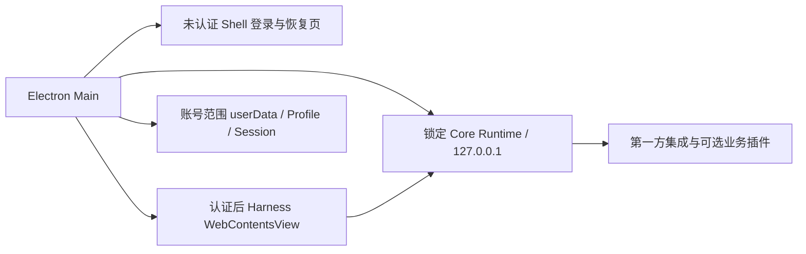

# 因赛AI Desktop 架构

Shell 是锁定 Insight Harness Core Runtime 的 Electron 宿主。职责分开：Shell拥有桌面窗口、登录/账号隔离、受限IPC、启动恢复和安装更新；Core拥有Harness执行、会话及原生工作区；第一方集成/业务插件通过既有接口接入，不把插件业务回填到Shell。

## 当前运行边界

`core-runtime.lock.json` 是正式制品来源，构建校验Release资产/哈希并内置到 `Resources/runtime`。Shell不在运行时从npm升级DSH，也不把Core包或源码软链接加入正式依赖。macOS采用UtilityProcess，Windows采用随制品提供的目标Node；Renderer不暴露Node权限。

未登录、登录失效或没有授权工作区时不显示Harness。Main保管及校验凭据，受限账号桥按需提供业务登录态；公开UI不读取Token。认证约束见 [登录设计](plans/2026-08-28-desktop-auth-architecture-design.md)，唯一Harness侧栏和公开扩展槽约束见 [单侧栏设计](plans/2026-08-28-authenticated-sidebar-integration-design.md)。

## Profile 与插件

账号范围的Profile、插件、工作区和会话在安装目录之外，更新不覆盖用户数据。出厂组合与迁移代次以 `scripts/prepare-bundled-profile.mjs`、Profile政策及实际Runtime为准；当前generation8移除退休GenUI/Market声明和旧安装锁，不恢复用户主动卸载的插件。

当前工作区采用Core原生侧栏/文件预览，不再将早期Better Sidebar预装方案当成当前事实。Shell只装配仍由其交付的第一方集成与社区插件；Core原生能力不重复内置。画布插件alpha.32随新Profile默认预装且允许卸载，既有账号不强制补装，保留用户卸载和手动升级的选择；插件自行维护Host/Client/原生Store桥，与Core及后端业务解耦，见 [画布专题](discussions/canvas-harness-scheme-b/README.md)和[制品清单](../vendor/plugins/README.md)。

启动恢复/Safe Mode只处理对应Profile范围，不删除用户工作区或会话。账号变更不得把其他账号的配置、凭据和数据混入当前账号。

## 开发、发布和参考上游

当前可执行开发命令为 `dev`、`dev:local`；后续多层组合命令在 [本地组合设计](local-composed-development.md) 中单独标记未实现。DEV覆盖不改正式锁，安装包仍必须回到校验过的不可变Runtime和正式Profile。

Shell将 `dataelement/dsh-desktop` 作为参考上游，按commit范围定向采用；不是定期整体合并。保护产品身份、账号隔离、Core lock、Profile、签名更新及第一方集成，见 [上游规范](upstream-intake.md)。Core升级与Shell宿主采用分别提交和验证。

`dzm/` 分支及 `duzhimeng` 作者/提交者的Demo代码仅供只读产品意图参考；不得复制/合并，能力从当前main独立实现。完整发布约束见 [发布说明](release-runbook.md#分支管理)。

当前维护入口见 [文档索引](README.md)；旧阶段2提案、后端候选和重复实施计划见 [历史归档](archive/README.md)，不覆盖当前代码与操作手册。
