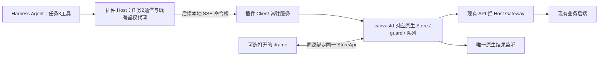

# 任务 1.4 剩余实施与 1.1–1.4 整体 Review

## 当前交付状态

1.4.4–1.4.7 的业务编码已完成，1.4.8 的自动检查、构建、本地打包、隔离安装及本机浏览器 fixture 验收已执行。真实测试账号 / 画布 / 模型生成、Electron 最小化与完整 M1–M17 人工矩阵仍待补充环境信息，**不将这些项目记为通过，也不把整个 1.4 标为生产验收完成**。

后续状态（2026-10-13）：用户将当前迭代缩小为对话创建画布/节点，并明确暂缓真实账号手测。已完成[任务 2 前置核对](2026-10-13-before-task-2.md)：补齐任务 1.5 的完成记录，定向回归126/126，已归档源文件/构建文件/安装包一致；没有剩余任务 1 编码前置。实账读取/添加/保存在真实对话验收时补齐，完整 M1–M17 继续保留为未完成的完整业务验收，不阻断任务 2 开发。本文件及原 checks 的测试数字保留此前完整检查事实。

本次修改只发生在 `desktop-canvas-plugin`；Shell 仅更新本专项文档，Core 与后端业务代码未修改。插件版本保持 `0.3.0-alpha.8`，没有升级业务依赖、发布插件、提交 Git 或修改主使用 Profile。已有 1.1–1.4.3 改动及 Shell 根 README 的用户改动均保留。

## 已落地的能力

| 步骤 | 目标与实际实现 | 主要文件（插件根目录下） |
| --- | --- | --- |
| 1.4.4 | Client 持有唯一业务上下文；原生所有权查询与 claim；登记真实 iframe window/document；UI 使用同一 vanilla Store 与账号积分 API，不再次 init/reset | `canvas-service.ts`、`canvas-context.ts`、`canvas-service-binding.ts`、`workflowTabOwnership.ts`、`useWorkflowTabGuard.ts`、`flowStore.ts`、`pointStore.ts`、`CanvasTab.tsx`、`main.tsx`、`desktop-canvas.tsx`、`canvasFlow/index.tsx` |
| 1.4.5 | 原生 debounce 在 Client realm 运行；关闭视图保留已排队输入与业务请求；空闲 prompt 同步外部保存，草稿 / 实际焦点 / 输入法继续受保护；上传校验与异步新增也进入忙碌判断 | `canvas-editor-timers.ts`、原生 `utils/debounce.ts`、`agent-editor-debounce.ts`、`agent-edit-guard.ts`、`hooks.ts`、文本 / 音频节点、`useFileUpload.ts`、媒体协调器 |
| 1.4.6 | read/add/update/delete adapter 复用真实 policy / factory / Store；严格保存返回本次响应版本与真正受影响 ID；unchanged 不保存；配置失败与成功空权限分开 | `agent-adapter.ts`、`agent-node-policy.ts`、`flowStoreCore.ts`、`flowMediaDimensionCoordinator.ts`、共享协议 |
| 1.4.7 | 原生单点生成、容量与输入预检；数量在实际队列内复检；submitted 必须有 taskId 与可信版本；loading 与非致命积分刷新；每上下文唯一原生结果监听 | `flowStoreCore.ts`、`canvas-generation-monitor.ts`、`canvas-context.ts`、原 `usePolling` 薄包装、API 可选反馈参数 |
| 1.4.8 | 统一测试日志、类型基线、service 静态依赖审计、最终 tgz 安装与本机浏览器操作；远端实账验收仍待执行 | `verify-isolated.mjs`、新增两份测试、本归档及 evidence |

读取默认最多返回 20 个节点，空画布可读。增改删只开放本期约定的普通 text/image/video/audio；技术参数仍限 image/video。生成只开放普通节点单点执行。未开放上传素材、工具节点写入、连线、模型切换、整模板执行等后续工具范围。

## 执行位置与调用链



业务增删改与提交生成实际执行在 **Shell 内的插件 Client 浏览器环境**，执行的是插件现有 Web 业务模块的方法。Host 不另写节点业务；iframe 不承担服务启动责任。没有隐藏画布 iframe，没有新 DAG 调度器，没有第二份 Agent 轮询。

UI 关闭只解绑 view，不能 reset Store、取消 Agent 保存 / invoke 或停止上下文监听。插件卸载 / 账号工作区退出才结束服务生命周期。显式 closeContext 会拒绝仍有视图、编辑、保存、生成或未知状态的上下文。

跨窗口沿用原生所有权与服务端版本保护。后台首先查询已存在的 owner，收到其他窗口 owner 后保持 inactive；显式打开 / 刷新视图使用原生 claim。这个限制继续保护另一个窗口的编辑，不能靠 Agent 偷抢所有权。

## 实际接口

契约来源是 `src/shared/canvas-service-runtime.ts`；Web 视图 binding 的强类型来源是 `canvas-app/src/canvas-service-binding.ts`。此前 Base 命名保留兼容，但已经包含真实 execute / view 方法，不是空占位。

| 方法 | 入参 | 返回 / 行为 |
| --- | --- | --- |
| `ensureContext` | `{canvasId, capability:'read'|'edit'|'run', signal?}` | `{canvasId, contextId, readiness}`；同图并发准备去重，不打开标签 |
| `execute` | `{canvasId, operation, signal?}` | `read / saved / submitted / rejected / submission_unknown`；操作与字段走 1.1 parser/policy |
| `getContextInfo` | `canvasId` | 当前上下文信息或 null；不创建新图 |
| `subscribeReadiness` | `canvasId, listener` | unsubscribe；向后续 SSE 提供主动状态通知 |
| `reloadContext` | `{canvasId, capability, signal?}` | 权威重载；保护草稿与原队列；不是 unknown 自动重试 |
| `closeContext` | `canvasId` | 仅安全空闲时释放；下次准备获得新 contextId |
| handle / runtime `registerView` | `{canvasId, viewId, frame}` | cleanup；由 Client 的 CanvasTab callback ref 登记 |
| `attachView` | `{canvasId, viewId, viewWindow, viewDocument}` | 内部 binding；来源必须匹配登记 iframe；同 document 并发 / 重复 attach 幂等 |
| `detachView` | `viewId` | 只解绑视图，不销毁业务上下文 |
| `dispose` | 无 | 释放 registry、guard、timer、monitor、所有权与积分缓存 |

binding 提供 store/guard/barrier/points、metadata/readiness 订阅、编辑根保护、原生反馈、Client-owned debounce、view cleanup 与 UI 权威刷新。monitor 留在 context 内，owned UI 的 usePolling 直接复用它。UI 的 subscription facade 只托管 unsubscribe，仍指向同一个原生 Store / points 状态，不创建第二份 Store。binding 不作为 Agent 工具入参 / 返回，也不传递账号凭证。

## 复用清单与严格事实

- 节点构造继续调用 `util.createNode` 及真实默认参数 / 权限处理；addNode 负责标题与媒体准备。
- 更新通过严格 functional patch 在 guard 等待完成后读取当前 state；复用 prepareNodeData、局部恢复、撤销记录与原写队列。
- 删除仍调用原 deleteNodes：清理入出边与空父组；回执 ID 来源于该次删除集合。
- 保存仍只调用一次原 partialUpdate。版本来自该次 HTTP 响应；较晚的轮询版本不能替代它。原生 UI 成功但未返回可信版本时保留其 UI 行为，同时阻断后续 Agent 写，要求权威重载。
- 生成继续使用 buildSingleWorkflowPayload / isAllowRun / excuteSingle。API invoke 是唯一提交点；队列中复核实际数量与必要输入。
- 原主画布 poller 的 200ms 初次、3s 运行、10s 错误重试、连续六次错误与 5s 积分兜底均保留。网络监听失败不能被 Agent 解读为已证明后端任务失败。
- 默认 standalone / preview 使用原 hook 与实例；owned iframe 使用自己的 React hook 订阅父级 StoreApi，不共享父级 React hook。

## 整体 Review 结论与修复

审查覆盖 1.1 字段与协议、1.2 回执 / 版本队列、1.3 编辑保护和全部 1.4 生命周期。基于 karpathy-guidelines 与 code-review 技能执行，没有启动子代理。下列问题已修复并加入相应回归或浏览器验证：

| 发现的问题 | 修复与证据 |
| --- | --- |
| 异步新增尚未入保存队列，刷新 / 销毁可能误判空闲 | 媒体准备计入 pending；失效上下文忽略迟到准备，真实 Store 测试覆盖 |
| iframe 的 timer 被销毁后最后输入丢失 | 复用原 debounce，由 Client 持有；真实浏览器关闭整个 iframe 后只保存一次最后输入 |
| 退役 iframe callback 使用 hook 时可能回落到空的默认 Store | pagehide 退役 binding 保留给已排队 callback；上下文仍归 Client；真实原生富文本验证 |
| 原生控件 busy 快照仍取默认 guard | 所有旧 guard 导出按 owned binding 转发；禁用状态和事件拦截共用同一锁 |
| 同 document 并发 attach 会建立重复订阅 | pending attach 去重；旧 document 迟到结果被拒 |
| 旧 inactive 视图清空新视图反馈 | 回调归属按 active view 清理；原生错误仍到正确视图 |
| 打开界面自动重载会掩盖 unknown 保存 | 打开已准备上下文不自动恢复 unknown；只允许明确权威刷新 |
| 服务中的原生预检可能拉起容量 UI，或必要输入缺失仍 invoke | 后台预检静默；复用原生 prompt / 输入模式 / SVG / 音色 / 歌词要求；不挂 PromptModel、不自动补音色 |
| Agent 显式新增标题被原生 auto 命名覆盖 | 复用现有 preserveNodeTitle 标记；原 addNode 自动分配 / 去重并剥离临时标记，默认 UI 命名不改 |
| 保存后较晚版本污染该次回执 | Store / coordinator 透传准确 outcome，不读稍后的 versionNumber 充当 saved 版本 |
| 原生自动保存缺版本却继续给 Agent 放行 | 保留 UI 原行为；标记 SUBMISSION_UNKNOWN，严格写被阻断 |
| 一个画布鉴权失效，其他画布仍能读旧缓存 | 同 Client 广播鉴权失效，停止监听 / timer、清积分；Shell 既有账号切换会关闭对应工作区和运行时 |
| 刷新中同步鉴权撤销产生未处理拒绝 | 被取消的 shared preparation 仍被观察；测试运行无 unhandled error |
| iframe 未执行 React unmount，Store / points / 编辑监听会残留 | UI 订阅 facade 委托同一 vanilla Store，由父级释放；已退役 view 不再登记新监听或影响新 view |
| 用户原生生成尚在预检，Agent 可抢先改变参数或提交 | 原生 single/group/temp 提交准备进入同一 guard 忙碌标记，不改变原生返回 / UI 行为；真实队列测试覆盖 |
| 释放视图后 readiness 覆盖 disposed / auth 状态 | context 失效状态优先，不能再报告可读 |
| UI metadata 将 Long 模板 ID 转为 Number | 保留原 number/string，相关类型透传，避免精度损失 |

在已验证的源代码、自动测试与 fixture 浏览器范围内，没有留存已知阻断项。真实业务权限 / 参数 / API / 生成及完整 Electron UI 行为尚未取得实账证据，不能用这一结论替代上线验收。

## 验收证据与边界

最终机器可读检查记录见 [checks](2026-10-13-task-1-4-checks.json)，原始日志、浏览器脚本、截图和包哈希集中在 evidence。

- Web：**167/167**；相对 1.4.3 新增 40 个用例，17 个测试文件。
- 插件：**59/59**；Host/Client 类型检查通过。
- Web / tests / build audit 类型检查仍返回 exit 2：只有原有 9 条诊断，未新增；不将其写为通过。
- 完整 plugin build、service 静态闭包审计及最终 tgz 安装 / 移除通过；保留已有大 chunk 与 peer 警告，不升级依赖。
- 使用 Shell 自带 **Core 0.2.1-alpha.1、Node 24.9.0**；本机 Chrome 执行实际 Core Client 页面及最终包。业务 API 为 fixture，阻止浏览器外部网络，没有真实模型费用。
- 浏览器证明：零 canvas iframe 的 read/add/update；打开原生 CanvasFlow 只取一次 graph；富文本草稿拒绝 Agent 写；关闭 iframe 后最后输入保存；无 iframe 的单点 invoke / 原监听回写；一次 invoke，没有页面异常。
- 已校验最终包、安装后的 lib / service / 静态 chunks 与本次 build 字节一致；只安装临时隔离 Profile，验收后移除。

外部 Playwright 工具的 Cookie 注入被自动审批拒绝，原因是接收进程边界不明确。改用获批的本机 Node + 全新本机 Chrome Profile，认证材料只用于测试 loopback，未交给外部工具；归档不含 Cookie / Token。

| 人工矩阵 | 本次证据 | 仍待实账 / Electron 手测 |
| --- | --- | --- |
| M1–M3 | 本机实际 Core 页面 + 原生 UI，fixture CRUD / 同 Store / 一次 graph；草稿保护 | 实际业务画布与接口响应 |
| M4 | 无 view 的 native monitor 回写，fixture | 实际模型生成与最小化持续运行 |
| M5–M8 | 真实 guard / timers / 队列测试；浏览器 M6/M7 | 全部实际 Shell 焦点 / 关闭场景 |
| M9–M12 | 真实隔离工厂、版本 / unknown / 配置 / 取消回归 | 实际 5011、网络丢响应、权限账号 |
| M13 | 原生 prompt / text / slider / audio / 默认 Store 兼容测试，浏览器富文本 | 撤销、拖动、连线、preview、原生生成全项 |
| M14 | native BroadcastChannel 控制器、同 Client 多视图测试 | 实际多 Shell 窗口 / iframe 刷新 |
| M15–M17 | dispose / auth / close / 可信 frame / 资源鉴权回归与隔离安装 | 实际登出换账号、插件卸载、失效资源 |

真实验收需要一个测试画布 ID、已登录的测试账号，以及可选的普通图片 / 视频生成节点 ID。没有这些信息时，不任意选用户业务节点作破坏性或付费验证。

## 开发者手动入口

在 Client 主页面 Console，既有测试画布无需打开 UI：

```js
const rt = await window.__INSIGHT_CANVAS_RUNTIME_V1__.ready;
const canvasId = '测试画布的正 Long 字符串';
await rt.ensureContext({ canvasId, capability: 'edit' });
const snapshot = await rt.execute({ canvasId, operation: { action: 'canvas.read' } });
if (snapshot.status !== 'read' || snapshot.consistency !== 'confirmed' || !snapshot.version) {
  throw new Error('画布状态尚未确认，请查看回执后处理');
}
const result = await rt.execute({ canvasId, operation: {
  action: 'node.add', expectedVersion: snapshot.version,
  node: { type: 'text', changes: { title: '1.4服务验收', text: '无界面创建' } }
}});
console.log(result);
// 仅 saved 后才以其 affectedNodeIds/version 继续 update/delete。
// submission_unknown 先核对并显式 reload，不能自动重发。
```

具体生成、清理测试节点与 M1–M17 操作继续遵循 [1.4 实施计划](../plans/2026-10-12-task-1-4-service-plan.md#9-手动验收不打开画布也可实际操作)。服务入口是内部开发接口，approvedGeneration 正式路径必须由后续 Host 可信预检提供。

## 整个业务目标是否仍然通畅

是：本次把执行位置从可见 iframe 生命周期移到插件 Client，复用业务方法、默认参数、权限、保存队列和结果监听。原来的成熟模板依赖执行仍由画布负责，未变成 Harness 自建媒体调度器。

下一步仍按以下次序交付，不在本轮提前实现：

1. **任务 2**：迁移旧 frame 协议为 context 协议；Host→Client SSE 路由直接调用 runtime；做好 connection/session/context 归属、requestId 去重、取消与 unknown、readiness 主动推送。固定 contextId 的检查与 execute 之间不能插入异步间隙；提供显式权威刷新消息并调用现有 reloadContext；不自动打开 iframe。
2. **任务 3**：canvas_create/get/node_edit/run 工具；复用现有 API 创建画布后 prepare；详情 source 为 plugin-service；同请求累计 >30 图 / >6 视频由 Host 预检后一次确认；缺输入主动询问，配置故障与用户缺信息区分。对话必须能明确触发权威刷新（例如 get 的显式 refresh 字段）；不能用重复 ensure/read 缓存恢复 unknown，也不能要求用户打开画布才能恢复。
3. **后续业务场景**：薄 Skill / 模板参数与素材引用 / 节点引用 / 结果反馈，调用原有模板导入与一键执行。旧模板仅参考，不填入未经验证的生产模型信息。连线 / 模板参数推导与特殊工具监听在扩展前要复用并迁出对应 UI 依赖，不能假定 1.4 的普通单点接口已经覆盖全部节点业务。

因此，**1.4 的服务底座通过不等于 Harness 对话已接通，也不等于完整视频模板场景已经上线**。这条阶段边界应在下一轮接口与验收中继续保持。
