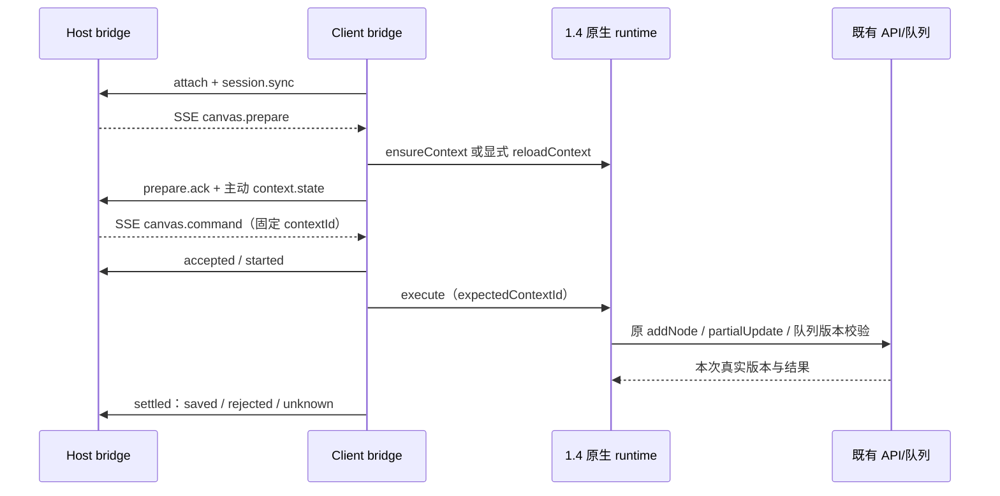

# 任务 2：最小 Host↔Client 通信桥实施与验收

## 交付状态

任务 2 的当前最小范围已完成编码和自动验收：Host 可向会话所属 Client 的已有画布发送准备、读取和添加节点命令，直接调用任务 1.4 原生服务并取得回执，执行不依赖画布 iframe。任务2交付时未注册Agent工具；后续任务3最小三工具现已完成，见[最新归档](2026-10-13-task-3.md)，真实自然语言验收仍待执行。

插件版本保持 `0.3.0-alpha.8`，无依赖升级、发布或提交。后端与 Shell/Core 业务未改；已有 1.1–1.4 和 Shell 根 README 用户改动保留。真实账号手测已恢复：实际Shell bridge三类HTTP请求返回200，用户提交的A/B/C无界面读取、新增saved和权威重载返回符合条件；UI、Network明细及完整Host命令验收仍未完成，见[实账步骤与记录](2026-10-13-task-2-live-acceptance.md)。

## 步骤与实际文件

路径相对 `/Users/boxser.shi/Documents/harness/desktop-canvas-plugin`。

| 步骤 | 实现文件 | 达成目标 |
| --- | --- | --- |
| 2.1 契约与路由归属 | `src/shared/canvas-bridge-protocol.ts`、`src/host/canvas-bridge.ts`；原 agent protocol 导出解析器/增加 context 错误码 | protocolVersion:3；唯一 Client/session/context；请求去重、原回执缓存、取消/超时/unknown |
| 2.2 本地 HTTP/SSE | `src/host/bridge-route.ts`、`src/host/index.ts` | 复用 Core requestRejection；固定登记 origin/key；单 SSE、有界背压、heartbeat/关闭清理 |
| 2.3 常驻 Client 执行 | `src/client/canvas-command-endpoint.ts`、`canvas-bridge.ts`、`sse.ts`、`index.tsx` | scope inject 获取真实 sessionId；输入区 effect 引用计数登记；懒加载原 runtime、直接执行、主动 readiness、只重连运输 |
| 2.3 固定原生上下文 | `src/shared/canvas-service-runtime.ts`、`canvas-app/src/canvas-service.ts` | execute 可选 expectedContextId；旧目标在捕获 Store 前拒绝，不能隐式创建新 Store；UI 调用兼容 |
| 2.4 回归与包验证 | 5个 bridge/endpoint 测试文件、既有 service-build/native-runtime 测试、`scripts/verify-isolated.mjs` | 独立 registry、本地真实HTTP/SSE、原生Store/队列、实际Core安装包验证 |

没有增加 iframe command 端点、第二份 Store/队列、DAG 或节点结果轮询。既有 `CanvasTab`、selection v1 和 `canvas_get` 摘要工具本轮未改。

## 实际调用链与接口

- Host `ensureContext(sessionId,canvasId,capability,requestId,signal?,refresh?)` 返回 `BridgeTarget`；只有唯一已连接且登记该会话的 Client 可以被选择。`refresh:true` 才调用权威重载。
- Host `dispatch(target,requestId,operation,signal?)` 返回原 `CanvasOperationResult`；本轮仅允许 `canvas.read`、`node.add`，不支持 update/delete/run。
- Client `retainSession(sessionId)` 返回 cleanup；重复挂载共享登记，最后解绑后不接新命令，原在途回执仍可收口。
- 路由为 `/desktop-canvas/api/bridge/{attach,events,client-event,detach}`。SSE 传命令，HTTP POST 传回执；没有面向浏览器新增公开业务 dispatch API。
- `x-canvas-bridge-origin` 补充无 Origin 的同源 GET；真实 Origin 必须相同，并且先通过 Core fence。随机桥 key 放 `x-canvas-bridge-key`，不入 URL；它不是桌面业务 Token。
- `session.sync` 使用完整快照及 revision，防止旧 HTTP 请求将已解绑会话重新登记。上下文通知来自原 `subscribeReadiness`，无 readiness 轮询。

## 回执、重连与边界

accepted/started 仅说明传输/开始事实；saved 复用本次原 partialUpdate 的可信版本、节点 ID。版本比较仍在 1.2 原保存队列内部，不由 Host 推算版本。

同 requestId、相同规范化目标/内容只执行一次；改变内容明确拒绝。Host 一旦交给 SSE writer 就保守认为可能已发送：断线/超时/调用方停止等待后，添加节点返回 submission_unknown。Client 保留原执行，重连只上报失败的回执/最新会话状态，不重放业务命令。迟到准确结果可以更新原请求的缓存，但不会再次自动唤醒 Agent。

上限：Client登记16个、每Client会话64个；Host/endpoint请求记录1024个、在途8个、缓存32MiB；单信封2MiB；SSE队列32项/8MiB。达到上限拒绝新请求，不驱逐写回执来绕过去重。请求缓存限定插件进程/Client生命周期，不承诺进程重启后的 exactly-once。显式刷新调用既有 reloadContext，仍受草稿和原队列保护。

## Review 修复

| 风险 | 本轮处理与证据 |
| --- | --- |
| 上下文检查后被释放，execute 隐式重建 Store | runtime 增加 optional expectedContextId；真实 native 测试在 started 同步回调释放目标后确认拒绝、无新 Store/API |
| 原 service 已开始执行，异常却被包装成 effect:none | 写开始后缺可信回执返回 unknown；只在原 service 明确 not_sent 时返回无副作用拒绝 |
| 运输发送抛错污染真实保存结果 | transport错误不改 native回执，不第二次执行；endpoint重放已有结果 |
| 同一准备请求的重复回执偷偷换 context | Host校验已完成的准备结果，矛盾重复回执拒绝 |
| 会话解绑和重连 HTTP 乱序 | revision快照；原在途回执仍允许收口，新命令拒绝 |
| lazy runtime 等待结束后目标/期限已失效 | 等待后再次检查deadline、会话、context；execute内部再校验 |
| 旧 HTTP flush 失败覆盖新重连的回执恢复 | stream generation检测；只在发生新重连时继续flush，不对业务写自动重试 |
| session ID 含分隔符导致误清理另一会话 | 用结构化 key，并按准确 sessionId 清理订阅 |
| 只有data行限额，巨大comment事件漏检 | 事件全部行计入SSE字节限制；畸形UTF8/不完整事件不执行 |
| 桥鉴权失效导致原OpenCanvas控件报错 | input effect隔离桥错误；原按钮/输入和selection行为保持 |

## 验证结果与未验证项

- 插件 **84/84**（比1.4新增25条）；另针对最终加强的 Client 会话解绑回归3/3通过。
- Web **170/170**（新增3条真实Store wire/原生目标释放测试）；17个文件。
- Host/Client类型通过。Web类型仍exit2，原有9条诊断的文件/行/列/代码/消息逐项相同，无新增；不称为类型全通过。
- 完整build、tgz字节比对、实际Shell自带 **Core0.2.1-alpha.1 / Node24.9.0** 临时隔离安装通过；真实Core验证新Host路由鉴权、登记、SSE握手、session同步、detach，随后卸载。
- 本地HTTP/SSE测试验证断线中原执行继续、回执恢复、一次执行和真正解绑；Web集成用原factory/Store/队列/policy，以业务API fixture验证保存一次和iframe数0。
- 构建保留原大chunk/peer警告，不升级依赖。43个原归档源文件只有本任务预期的5个变化，其余保持；Root README用户改动未覆盖。

后续实账证据：实际Electron已观察到画布runtime加载、attach / events / client-event均200且SSE持续连接；已启用当前Profile中原被禁用的画布插件。用户手测画布103136完成一次文本节点写入并取得saved，版本0→1，显式权威重载后读回同节点ID、标题、文本，三个输出的iframe数均为0。原始回传见[Console结果](evidence/2026-10-13-task-2-live-console-results.json)；本轮归档未重复新增。

未验证：原生UI显示、真实Network中保存次数与重载get明细、bridge协议及session.sync载荷、完整Host命令与人工矩阵。Console直调不替代Host→SSE命令验收。未做SSE慢接收端压力测试；背压drain/溢出关闭经过交互回归与代码审查，不夸大为压测通过。此次新增的是测试文本节点，未进行模型生成验收。

证据：[checks](2026-10-13-task-2-checks.json)、[插件测试](evidence/2026-10-13-task-2-plugin-tests.log)、[Web测试](evidence/2026-10-13-task-2-web-tests.log)、[本地Client最终回归](evidence/2026-10-13-task-2-client-final.log)、[类型/源码基线比对](evidence/2026-10-13-task-2-baseline-audit.json)、[隔离安装](evidence/2026-10-13-task-2-isolated.log)、[安装包比对](evidence/2026-10-13-task-2-package-check.json)。

## 下一步

任务 3 最小工具：把同一个 Host bridge 传给 `canvas_create`、`canvas_get` 和 `canvas_node_edit action:add`。创建画布复用现有后端 API，创建成功后prepare；工具如实返回画布/节点 ID与保存事实，出错不重复创建。接通后再进行真实自然语言验收。这段记录任务2交付时的后续方向；最小三工具现已完成，实账步骤见[任务3手测](2026-10-13-task-3-live-acceptance.md)。生成、模板或节点更新/删除工具仍未接入。
