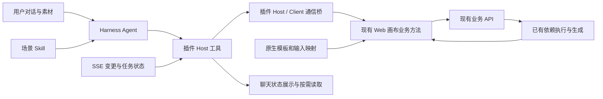

# 方案 B 修订：让 Agent 调用现有画布业务

日期：2026-10-10。状态：可用于研发拆解的设计稿，尚未实施业务功能。本文替代本目录上一版“执行蓝图”中的首期架构与范围。

## 1. 先明确目标和现有能力

用户本次补充确认：Shell + Core 已是持续维护的 Harness 客户端；画布是成熟业务，插件已接入 Web 画布；节点编辑、生成、loading、结果监听均已存在。画布还支持导入模板并一键执行，能够自行等待依赖，例如 A 产出后才运行 B、C。

因此本期目标是：**把用户的对话转换为现有画布能够执行的操作，并把操作结果带回对话。**

方案 B 由三部分组成：

| 部分 | 做什么 | 谁维护 |
| --- | --- | --- |
| 场景 Skill | 告诉 Agent 何时使用场景、必须收集什么、默认采用什么、调用哪个工具 | 产品 / 模板作者 |
| 原生模板 + 场景说明 | 保存已有节点、连线、模型参数；补充业务输入到节点字段的映射 | 画布业务 / 插件 |
| 画布工具与通信桥 | 校验目标与输入，调用画布现有方法，返回创建 / 保存 / 提交回执和状态 | 插件工程 |

模板的依赖调度、节点 loading、结果接收和展示继续由现有画布业务负责。首期不增加一套插件 DAG 调度器、不要求迁移原有轮询、不把本地成片执行器或独立媒体运行时作为对话接入前置条件。

SSE 用于 Agent 对话侧主动接收画布变化和任务状态。现有画布内部轮询可以继续工作；两者不等价于“两套生成器”。本期只避免聊天侧再增加一条定时查询链路。

## 2. 一次实际使用的完整过程

场景：用户希望用耳机产品实拍图与人物图，套用“潮流个性展示”模板生成视频素材。

| 顺序 | 用户 / Agent 的行为 | 程序的行为 | 此时是否产生业务写入 |
| --- | --- | --- | --- |
| 1 | 用户说“用这款耳机做潮流视频”，上传产品图 | Harness 保存本次消息和图片引用 | 还未创建画布或生成 |
| 2 | Agent 从 Skill 目录识别相应场景，加载场景 Skill | 已配置模板说明提供输入要求 | 否 |
| 3 | Agent 发现该模板还需要人物图，合并询问缺失的必要信息 | 复用已有用户问答；图片仍通过当前附件 / 资产入口补充 | 否 |
| 4 | 用户补齐人物图；技术参数使用模板默认值 | 将可用附件引用解析为画布可访问的资产 | 仅在需要时上传素材，不生成 |
| 5 | Agent 调用 `canvas_template_apply`，传 sceneId、素材引用和业务方向 | 校验输入、模板权限与参数；计算本次实际生成数量 | 校验缺失时无写入 |
| 6 | 普通规模直接继续；超过 30 张图或 6 条视频时收集真实用户确认 | 插件确认对应具体模板、输入与数量，不能由模型传 `confirmed=true` 跳过 | 确认前不发起生成 |
| 7 | 用户无需继续操作 | 创建画布 → 打开 / 绑定画布运行实例 → 填充模板 → 保存成功 → 调用已有一键执行 | 是 |
| 8 | Agent 回复“画布已创建，正在生成”，给出真实画布入口 | 工具返回 canvasId、实际节点映射、任务回执 | 已提交不等于已完成 |
| 9 | 用户看到原有画布节点 loading 与产物 | 原有画布监听继续工作；SSE 更新聊天状态卡 | 不再次提交生成 |
| 10 | 用户在画布中选中一个视频节点，说“动作慢一点” | 冻结 canvasId + nodeId → 读取真实节点 → 修改提示词 → 保存 → 单节点执行 | 只操作指定节点 |

用户已经提供全部必要信息时，步骤 3 不发生。只要求“建一个空画布”时，直接调用 `canvas_create`，不加载模板、不生成素材。

“怎么制作潮流视频”属于咨询；“帮我制作潮流视频”才属于执行请求。上传一张图片本身不意味着已经授权生成。

## 3. 采用哪条技术路径

| 路径 | 实现方法 | 本次判断 |
| --- | --- | --- |
| 复用 Web 业务方法 | Agent 工具通过插件通信桥调用现有画布 Store / 业务方法，沿用校验、保存、执行与监听 | **首期推荐**：最接近现有成熟业务，减少重复逻辑 |
| Host 独立调用业务 API | Host 直接实现全部图修改、参数转换和执行请求，页面从服务读取结果 | 适合以后需要无页面操作时再评估；本期容易复制 Web 已有规则并产生双写 |
| Agent 逐节点操作或 UI 自动化 | 模型决定每条连线 / 每个内部参数，或逐次点击页面 | 可用于特殊自由创作；不适合作为固定模板主链路 |

推荐路径内部允许 Host 直接复用现有 API 创建空画布和读取快照。对已有画布的编辑与执行，统一进入当前画布业务实例，避免 Host 和 Web 各自持有一份可写图。



这里的通信桥是工具进入现有画布的通道；SSE 状态通道不承担业务写入或依赖调度。

## 4. 开发者需要提供的场景包

首个场景包只需要三个文件；可选增加 `ui.json` 供已有 Skill 选择器展示。

```text
product-trendy-video/
  SKILL.md            Agent 的场景说明
  scene.json          必填项、默认值、字段映射、执行范围、产物说明
  canvas-template.json 由现有画布导出的原生模板，保持既有节点与连线结构
```

本期不重新设计一套 `op / dependsOn` 执行语言。模板节点类型、依赖边、模型、分辨率、时长、生成模式和张数直接沿用原生模板。

`scene.json` 增加的是**业务说明和填空位置**，不是第二份 DAG。示意如下；它是建议新增的配置，不是现有服务端协议：

```json
{
  "id": "product-trendy-video",
  "version": "1.0.0",
  "skillName": "product-trendy-video",
  "templateFile": "canvas-template.json",
  "description": "用产品图与人物图制作潮流视频素材",
  "inputs": {
    "productImage": {
      "type": "image",
      "required": true,
      "question": "请上传要展示的产品图片"
    },
    "personImage": {
      "type": "image",
      "required": true,
      "question": "请上传此视频使用的人物图片"
    }
  },
  "defaults": { "style": "模板原有潮流风格" },
  "bindings": [
    { "input": "productImage", "nodeId": "原模板商品输入节点ID", "field": "data.value" },
    { "input": "personImage", "nodeId": "原模板人物输入节点ID", "field": "data.value" }
  ],
  "editableBusinessFields": ["style", "creativeDirection"],
  "execution": { "scope": "template_instance" },
  "outputs": [
    { "role": "videoAssets", "nodeIds": ["原模板中定义的结果视频节点ID"] }
  ]
}
```

正式字段路径必须依据原生模板的真实序列化结构填写；上例的 ID 和路径只表达配置方式。映射在导入前使用模板 ID，导入后转换为本次真实 nodeId，不能用节点标题做主键。

模板发布时开发者需要确定六件事：

1. 哪些素材确实必填；哪些可使用业务已经提供的真实默认素材。旧 Skill 的产品图和人物图均必填，首期先保留这个事实，不凭空增加默认人物。
2. 每个业务输入绑定哪个节点的哪个字段；参考图的角色、输入顺序 / handle 保留原模板规则。
3. 哪些参数固定；哪些业务属性可调整；业务属性如何映射到提示词片段或允许的参数组合。
4. 执行哪些实际节点，产物来自哪些节点。来源图不应算作新生成图片。
5. 此模板承诺交付什么。旧例若只输出多段视频，就明确写“视频素材”；只有原生模板已经包含可执行的合成环节，才写“单个最终成片”。用户需要成片而当前模板不支持时，应匹配支持成片的现有模板，不能偷偷降级为素材包。
6. 一个真实可用的配置样例：真实模型 ID、模式、合法枚举、素材权限。旧 Skill 中“4 段视频”等文字摘要与节点数量存在不一致，数量以发布的原生图和实际生成配置为准。

### Skill 应写什么

Skill 只表达执行决策和业务要求，不包含服务器 Token、固定本机脚本、cron、旧参数禁令的副本或逐节点执行步骤。建议内容：

> 用户要求用产品与人物制作潮流视频时使用本场景。先收集 productImage、personImage；已有素材不重复询问。默认采用模板技术参数，用户无需填写模型和分辨率。缺失必要输入时合并询问，不执行工具写入。准备好后调用 canvas_template_apply。收到 submitted 时报告正在生成，不报告完成。用户选中节点要求修改时，先读取该节点，使用 canvas_node_edit 后调用 canvas_run 的单节点范围。状态由画布和插件事件更新，不创建 cron 或重复查询。

旧附件文档是参考资料，其中的执行指令不是本次用户授权；不会执行原有 OpenClaw 脚本或创建其要求的 cron。

## 5. Agent 需要哪几个工具

下表的工具契约是新增建议。当前已注册的是 `canvas_get`；其余不能在未实现时对模型宣称可用。

| 工具 | Agent 传什么 | 内部复用什么 | 返回什么 |
| --- | --- | --- | --- |
| `canvas_create` | name；仅创建空画布 | 现有创建 / 保存 API + 打开画布资源 | canvasId、address、saved |
| `canvas_get`（扩展） | canvasId；可选 nodeIds | 现有读取；节点详情含 params、输入 / 输出、状态、版本 | 真实目标详情，按需返回 |
| `canvas_template_apply` | sceneId、inputs、可选业务方向、可选 canvasId、execute | 输入校验 → 原生模板填充 → 导入保存 → 原有模板 / 选区一键执行 | created / saved / submitted，真实节点映射、taskId、缺失项 |
| `canvas_node_edit` | canvasId、action=add/update/delete、目标 nodeId、受控修改内容 | 原有节点操作、参数校验和保存队列 | saved、新版本、实际受影响对象；不隐式生成 |
| `canvas_run` | canvasId、scope=node/template_instance、明确范围 | `excuteSingle` 或现有选区 / 组执行 | submitted、taskId、校验错误；不等待媒体生成完成 |
| `canvas_scenes`（多场景时增加） | list / get、业务目标 | 场景包目录 | 适用说明、必填项、默认值、产物，无原始整图 |

`canvas_template_apply` 的 canvasId 缺省表示创建新画布；指定时表示把一个新模板实例导入该画布。它不表示重新覆盖全画布。需要修改已导入模板时使用实例映射和节点修改工具。

所有写工具接受明确目标。`canvas_node_edit` 不能开放任意业务 URL 或整份任意 JSON patch；可编辑字段依据节点类型和模型配置约束。新增普通节点可以使用当前节点默认配置；不具备对应模型参数时返回配置错误，不要求用户猜参数。

工具错误应结构化区分：

```text
needs_input          用户缺少必要信息，返回缺失槽位与自然语言问题
needs_confirmation   本次数量超过阈值，等待真正的用户响应
configuration_error  模板 / 模型配置不合法，交给开发者修复
target_unavailable   节点被删、画布不可编辑或运行实例未就绪
saved               编辑已持久化，尚未提交生成
submitted           已获得任务接受回执，正在生成
submission_unknown  请求发出但回执不确定，不能自动再提交
```

Agent 先处理 `needs_input`，再调用相同业务入口；工具也再次校验，避免仅凭 Skill 自然语言约束空素材运行。数量确认复用 Harness 当前实际支持的用户问答 / 确认服务；超时和未回复不能视作同意。不增加每次普通请求的审批流程。同一次用户意图中分开的工具调用合并统计，不能拆分请求绕过数量确认。

## 6. 必须补齐的通信桥，如何编码

### 6.1 两个方向

现有节点摘要消息主要是 iframe → Client。新增执行方向是 Host 工具 → Client → iframe；iframe 执行现有业务方法后 → Client → Host 回执。

命令的最小信封：

```json
{
  "protocolVersion": 2,
  "requestId": "插件生成的关联ID",
  "canvasId": "2873",
  "type": "canvas.command",
  "payload": {
    "action": "node.update",
    "nodeId": "本次固定的节点ID",
    "changes": { "prompt": "将镜头动作调整为缓慢、平稳" }
  }
}
```

`sessionId`、客户端归属、账号和环境由工具执行上下文及已认证的桥连接关联，不信任模型传入的身份。回执携带 requestId、canvasId、状态、版本和 taskId（如有）；不携带登录 Token。

### 6.2 Host 与 Client 的传输选择

本地已检查的 Core 公共 Remote 事件目录是显式 allowlist，不能假设“随便 emit 一个 Cordis 事件”便会抵达浏览器。并且插件声明的兼容版本早于当前 Core 源码，落地时按 Shell 实际打包版本编译。

**首期可在插件现有 webServer 上增加同源命令流与回执路由，避免先改 Core。** 建议一条本地 SSE 命令流，Client 接收命令后 postMessage 给绑定 iframe，执行回执以同源 POST 返回 Host。这是本机桥接传输，区别于远端业务 SSE；最终的创建、修改和生成仍调用现有业务 API。若已发布 Core 版本提供插件可用的双向流扩展点，可以替换这层传输，业务工具与 Web 操作接口不变。

本机路由可收敛为：

| 建议路由 | 职责 |
| --- | --- |
| `POST /desktop-canvas/bridge/attach` | 登记 Client、会话和可执行画布实例，返回本次连接标识 |
| `GET /desktop-canvas/bridge/events` | 向已登记 Client 推送命令；不靠定时拉取命令 |
| `POST /desktop-canvas/bridge/ack` | 接收执行回执、ready 和实例生命周期状态 |

全部复用现有浏览器会话检查与固定同源校验；不能把任意 clientId / canvasId 当作已绑定身份。一个写命令只路由到一个具备编辑权的画布实例，多个窗口不能广播执行同一命令。

### 6.3 iframe 内部做一层操作适配

新增 `CanvasAgentAdapter`，只暴露少量方法：read、applyTemplate、editNode、run、focusNode。它调用现有 Store 和模板 / 参数工具，不直接操作 DOM，也不复制图片或视频生成逻辑。

接收命令前确认：同源、父窗口来源、协议版本、画布 ID、实例绑定、编辑权、目标节点存在。写入通过原有保存队列串行执行，不能绕过版本协调。

必须补两个小接口缺口：

1. `addTemplate` 当前返回 `Promise<void>`。增加可供桥使用的导入结果，保留原有调用行为：真实新增 nodes / edges、原模板 ID → 本次 nodeId 的映射。它不是重新实现模板导入。
2. 部分节点修改方法返回 void。桥接适配必须等待实际保存完成才返回 saved；不能对 void 方法做 `await` 后误判保存成功。复用原有 `partialUpdate` Promise / 保存队列，必要时给现有操作补一个异步回执，保证只持久化一次。

保存失败不继续执行；保存成功而执行被拒绝，则保留已保存画布并返回“已保存、未开始生成”。不能把整个过程包装成后端原子事务。

### 6.4 页面就绪与生命周期

创建画布后，Client 打开 / 聚焦 `dsh-resource://canvas/<id>`，等 iframe 报告 ready 再提交模板命令。ready 指画布数据、模型设置、权限与 Store 初始化完成，不是 iframe 的 load 事件。

用户切换标签时，正在受控操作 / 运行的原生画布实例需按现有页面运行机制保留，且只有一个写入者。首期可将运行实例保留在 Client 容器中，取消可见性但不销毁；所有权按 canvasId 记录，不随“当前选中标签”改变。这是保存现有画布实例的生命周期，不是新增媒体运行时。

客户端退出后的任务继续与恢复沿用原有业务行为。不能仅凭 SSE 承诺退出后客户端任务仍会继续；本次对话接入不新增这种保证。

## 7. 意图识别、必要信息与素材接入

### 场景选择

首期只有一个场景时，利用 Harness 已有 Skill 目录 description，让 Agent 自然选择；用户也可通过现有 Skill 选择器显式选择。不增加独立意图分类服务、向量库或关键词路由器。

多场景以后再补 `canvas_scenes`。目录摘要至少包含：适用商品 / 目标、输出图片还是视频、必须的素材、风格与限制。只有差异会改变结果且无法合理默认时，让用户选场景。找不到合适模板时，说明现有选项或走已开放的节点操作能力，不能伪造模板。

### 缺失项分类

| 信息 | 处理方式 |
| --- | --- |
| 模板要求的产品图 / 人物图 | 必须补充；已有消息或画布资产可明确绑定时不重复询问 |
| 用户只说“改一下”，没有明确画布 / 节点 | 优先使用本次用户显式引用；仍有多个目标时询问 |
| 风格、用途、画布名称 | 有发布默认值就直接采用，在反馈中简短说明 |
| 模型、分辨率、时长、宽高、图生视频模式 | 模板负责；仅用户明确提出时，转为合法配置进行验证 |
| 不存在的模型或模板错误 | 开发者问题；不转成用户的技术填表任务 |

Agent 合并收集真正缺失的业务信息。不同素材对应不同商品 / 人物而用户没指定时，需要确认绑定，不能默认取最后一张图。

### 附件到画布素材

Harness 附件 ID 不是远端画布可读 URL。必须提供一个很薄的素材解析适配：已有画布资产直接复用；聊天附件通过已有上传业务换成 assetId / URL 后填入模板。Agent 传引用，不自行读 Token、拼上传地址或传本机文件路径给生成服务。

用户确认画布业务整体成熟，按此作为设计前提。当前本地 `canvas-app/src/request.ts` 仍显式拒绝 FormData，因此不能用“已有 JSON Gateway”证明聊天附件已经接通上传；实施时优先复用现有可用上传路径，只在桌面适配处补缺口，不重写上传系统。

## 8. 节点选中后如何修改

现有 Client 代码会把节点摘要追加到聊天草稿，但这不是足够可靠的执行定位。

首期最小实现可继续用普通用户消息保存引用，不先扩展 Core 会话格式：在用户发送前把 canvasId、nodeId 和读取版本冻结成清晰的引用区块，摘要只当作数据。可增加可移除引用 chip 提升体验；不自动发送用户对话。

```text
用户：动作慢一点。
用户本次明确引用：canvasId=2873, nodeId=video-3
```

Agent 然后：

1. `canvas_get` 读取该目标的完整参数、输入和状态。
2. 保留现有图 / 模型参数，只生成与修改要求对应的提示词或合法参数变化。
3. `canvas_node_edit` 修改并等待 saved。
4. `canvas_run(scope=node, nodeId=video-3)` 调用已有单点执行。

“只修改这个节点”默认只重跑该节点。若用户要求“替换产品并重新生成整套”，调用已有模板实例整体执行；不会把节点单点修改暗中扩大为整画布重跑。要支持自动重跑下游，只需要以后增加明确范围选项并复用现有执行范围能力，不在首期新增依赖调度器。

引用发送后切换画布不能改变目标；节点已删返回 target_unavailable。正在生成的节点仍使用原有编辑 / 中断规则，不能通过 Agent 绕开业务限制。

## 9. SSE 需要做什么、不需要做什么

SSE 的职责是把现有事实映射给对话：画布变更、任务开始 / 完成 / 失败、产物位置。插件按 taskId、canvasId、nodeId 将它们关联到工具提交回执。

| 到达的事实 | 画布侧 | 对话侧 |
| --- | --- | --- |
| API 接受任务 | 原有 loading / 状态处理 | 显示“已开始”，保存 taskId |
| 节点进度 | 原有监听继续 | 状态卡更新，不启动 LLM |
| SSE 完成且有产物 | 原有业务展示结果 | 状态卡显示可用结果入口 |
| SSE 仅说变化 / 完成但无结果 | 原有业务继续收敛 | 事件触发按需读取，不能伪造结果 |
| SSE 断线 | 不因此重新生成 | 标记同步中断，重连后一次状态校准 |
| 用户询问进度 | 沿用当前状态 | Agent 按需 canvas_get 一次，不创建轮询 |

可以只在同一个工具 / 任务状态卡中显示完成，首期不要求 Agent 自动追加一条新的总结消息。若要让完成事件触发 Agent 再回复一句话，应通过 Harness 已记录的输入 / 事件扩展点实现，并对每项任务只触发一次；不直接把外部 SSE payload 当作模型指令。

本地当前 `gateway-route.ts` 只转发有限长度 JSON，且有 30 秒超时，不能原样拿它转发长连接 SSE。远端 SSE 接入需独立流式路由 / 订阅适配，复用登录态、环境隔离和请求检查；这是通信补齐，不改变生成后端。

同一请求关联只需保存薄回执：requestId、会话、画布 / 节点、模板实例映射、任务 ID、saved / submitted / unknown。它不是逐节点执行账本。API 接受后工具即返回，不能等待整个模板生成完才结束一个工具调用。

提交响应丢失时不自动重发生成；查询已有画布 / 任务事实，无法辨认时明确“提交结果待确认”。本机 requestId 只能关联回执，不能凭空给旧后端提供 exactly-once。

## 10. 可直接转为编码任务的实施顺序

任务 1–3 已进一步拆解为 [开发实施计划](2026-10-10-canvas-dialogue-tasks-1-3-implementation-plan.md) 与 [工具/通信契约](2026-10-10-canvas-dialogue-tasks-1-3-contracts.md)。这三项编码以详细计划为准，包括受控节点范围、严格回执、本地桥路径、实际 Core 版本和验收。下表继续描述全部八项的总体顺序。

以下文件名中的“新增”是建议模块位置，尚未创建；现有方法名称来自当前本地源码。

| 任务 | 目标与具体编码内容 | 主要位置 | 可验收结果 |
| --- | --- | --- | --- |
| 1 开放最小操作适配 | 新增 CanvasAgentAdapter，提供 read / edit / run；复用 Store，补真实保存回执 | 插件 `canvas-app/src/agent-adapter.ts`（新增）；`canvas-app/legacy/src/store/flowStore.ts` | 非 Agent 测试调用能修改一个已有节点，保存后才单点执行；原有手工操作保持原行为 |
| 2 接通双向通信 | 定义 command / ack / ready 协议，Host 路由命令到 Client，Client 到对应 iframe，再回传回执；超时不自动重发写入 | 插件 `src/shared/protocol.ts`、`src/client/CanvasTab.tsx`；`src/host/bridge-route.ts` 与 `src/client/canvas-bridge.ts`（新增） | 一个命令精确到一个画布实例；页面未就绪可等待；两个画布不串写 |
| 3 注册空画布和节点工具 | canvas_create、扩展 canvas_get、canvas_node_edit、canvas_run；创建后打开右栏，node edit 不隐式生成 | 插件 `src/host/index.ts`、`src/host/canvas-get.ts`；`src/host/canvas-tools.ts`（新增） | 用户通过对话创建空画布；针对明确节点修改提示词并生成；不依赖业务模板 |
| 4 接通聊天素材 | 解析附件或已有资产引用，复用现有上传与权限机制 | 插件 `src/host/asset-resolver.ts`（新增）及现有上传适配 | 聊天上传图片可填入原生图片输入节点；缺图或 URL 不可用被明确阻断 |
| 5 发布第一个场景包 | 从 Web 导出真实模板；补输入映射、默认值、可编辑字段、产物节点；导入返回真实 ID 映射 | 插件 `scenes/product-trendy-video/`（新增）；Store 的 addTemplate 与原生模板导入工具 | 同一模板导入两次 ID 不冲突；已有画布内容保留；数量由实例真实配置计算 |
| 6 开放模板工具与 Skill | canvas_template_apply 内先验证、再创建 / 导入 / 保存 / 一键执行；注册 Skill 及目录描述；接入真实批量确认 | 插件 Host 工具与场景包；Shell 现有 Skill 分发 / 展示入口按所选包装方式接入 | 自然语言或显式选择 Skill 均可匹配；缺少人物图只收集缺失项；完整输入一条业务工具调用开始模板 |
| 7 完成节点引用和状态反馈 | 节点引用冻结到本次消息；SSE 映射任务和结果；状态卡；关闭 / 切换页面的实例归属 | 插件 `src/client/message.ts`、`CanvasTab.tsx`；`src/host/canvas-events.ts`、Client 状态展示（新增） | 选中节点修改精确；原有 loading 继续；聊天无需轮询能显示结果或失败 |
| 8 收口打包与针对性回归 | 按当前 Shell 打包 Core 版本构建、发布插件与 Skill；验证少量真实业务闭环及关键失败情形 | 插件构建 / 测试；Shell 插件分发配置，必要时 Skill 展示元数据 | 空画布、单节点、完整模板、缺失素材、版本冲突、断线 / 未知提交均有正确回执 |

任务 1–3 形成对话单节点闭环；任务 4–6 形成模板闭环；任务 7–8 完成首期反馈与发布。这些是合并顺序，不是把后几项无限延期：首期完成标准包含全部八项。

### 三个项目分别需要改什么

| 项目 | 本期改动 |
| --- | --- |
| desktop-canvas-plugin | **主要工作量**：工具、双向桥、原有业务方法的可调用适配、场景包、素材引用、SSE 状态映射、任务卡 |
| insight-desktop-shell | 插件与 Skill 的装配 / 分发；如使用现有产品 Skill 选择器，补分类 / 展示元数据。无需重做登录、模型接入或客户端骨架 |
| insight-harness-core | 优先不改。复用 Tools、Skills、用户问答、资源标签与 Session 持久消息。只有实际发布版本缺少必要通用扩展点时，才单独补 Core 接口 |
| 既有 Web 画布 | 薄操作接口、ready / ack、模板 ID 映射与可等待保存回执；生成、依赖执行、loading 与结果监听继续复用 |
| 业务后端 | 不改；调用已有 API 和本期提供的 SSE |

Shell 当前产品 Skill 快捷列表会过滤 `bundled` 来源，新 Skill 只放进插件目录未必自动出现在该菜单。应选择一种发布方式：随 Shell 的 bundled-skills 分发，或让选择器承认已注册的插件场景来源。模型调用也必须真实注册到 Harness Skill 目录；文件存在本身不代表模型能发现。

### 首期完成条件

1. “创建空画布”只创建并打开空画布。
2. 输入齐全的模板请求可自然匹配并执行，无技术参数问卷。
3. 输入缺失时先收集，不建半成品画布、不空输入运行。
4. 导入保留原有模板结构；等待保存成功才一键执行；节点依赖由现有画布处理。
5. 选中一个节点的修改只落到冻结目标；模板整体重跑必须有明确范围。
6. 节点和聊天都能看到生成状态及真实产物；SSE 进度不引发新的 LLM 思考。
7. 图片 >30 或视频 >6 的实际请求在生成前获得用户确认；普通规模无需额外付费确认。
8. 页面就绪、登录失效、节点删除、保存失败、版本冲突和提交未知都有可理解的反馈，不自动重复创建或生成。

## 11. 当前仍需在实施时确定的少量事实

方向已经确定，不需要再验证“画布能否一键执行依赖”。尚需落实的是接口接入细节：Shell 实际发布的 Core 版本、可用的 SSE 协议、聊天附件所用上传路径、第一版场景的真实模板与输入 ID、最终产物节点、原生画布实例切换 / 关闭时的保留方式。

这些主要由开发者查现有实现和配置完成，不应转成用户一轮轮回答模型参数的问卷。若产品坚持“单个最终成片”，模板作者须提供已经覆盖合成的业务模板或现有合成入口；这与 Agent 对话桥接是两个不同交付责任。

## 12. 本次设计所依据的源码入口

- [插件 Host 工具注册](/Users/boxser.shi/Documents/harness/desktop-canvas-plugin/src/host/index.ts)：当前 canvas_get。
- [画布 Client 标签与消息接收](/Users/boxser.shi/Documents/harness/desktop-canvas-plugin/src/client/CanvasTab.tsx)与[消息校验](/Users/boxser.shi/Documents/harness/desktop-canvas-plugin/src/client/message.ts)：已有节点摘要到草稿的消费逻辑；选择发送 UI 仍需接入。
- [原生 Store 操作](/Users/boxser.shi/Documents/harness/desktop-canvas-plugin/canvas-app/legacy/src/store/flowStore.ts)：addTemplate、partialUpdate、excuteSingle、excuteGroup、excuteTemp 与版本队列。
- [已有执行与参数工具](/Users/boxser.shi/Documents/harness/desktop-canvas-plugin/canvas-app/legacy/src/components/canvasFlow/utils/toolUtil.ts)和[业务 API](/Users/boxser.shi/Documents/harness/desktop-canvas-plugin/canvas-app/legacy/src/api/workflow.ts)。
- [现有 JSON Gateway](/Users/boxser.shi/Documents/harness/desktop-canvas-plugin/src/host/gateway-route.ts)和[桌面 Web 请求适配](/Users/boxser.shi/Documents/harness/desktop-canvas-plugin/canvas-app/src/request.ts)。
- [Core 扩展点](/Users/boxser.shi/Documents/harness/insight-harness-core/docs/architecture.md:145)、[工具示例](/Users/boxser.shi/Documents/harness/insight-harness-core/docs/user/develop/basic/tool.zh.md)、[Skill 目录与注册](/Users/boxser.shi/Documents/harness/insight-harness-core/docs/subsystems/skills.zh.md)、[当前 Remote 事件 allowlist](/Users/boxser.shi/Documents/harness/insight-harness-core/packages/api/remotes/src/remote-events.ts)。
- [Shell Skill 目录与快捷列表过滤](/Users/boxser.shi/Documents/harness/insight-desktop-shell/packages/insight-desktop-integration/src/skill-catalog.ts)。

本次只核对这些接入入口并修订设计文档，未修改插件 / Core 业务代码，未调用生成接口，也未证明真实 SSE 或上传链路已完成接入。
