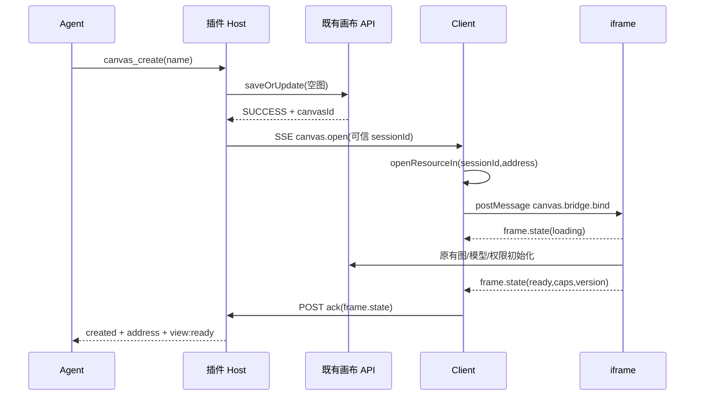
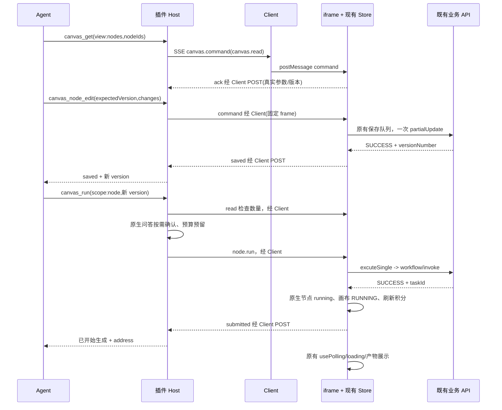

# 任务 1–3：工具与通信契约

**最新状态（2026-10-13）：** 任务1.1–1.4服务与任务2最小桥已实现。任务2通信以[最小桥专项计划](2026-10-13-task-2-minimal-bridge-plan.md)、`src/shared/canvas-bridge-protocol.ts` 和[实施归档](../implementation/2026-10-13-task-2.md)为准：protocolVersion:3、固定contextId、直接Client服务、仅read/add。本文件后面的v2 frame/open信封保留历史参考，不能用于当前业务命令。任务3最小三工具已实现，见[实际计划](2026-10-13-task-3-minimal-dialogue-tools-plan.md)及[归档](../implementation/2026-10-13-task-3.md)。当前仅create/get/add；后文完整四工具与v2执行提案为历史/后续参考，不作为实际已注册工具清单。

## 当前三工具契约（2026-10-13）

| 工具 | 入参 | 返回与执行 |
| --- | --- | --- |
| canvas_create | name可选，默认新画布，trim后1–100字符 | Host固定空图API；created含ID/address/name/version及runtime:ready/not_ready、runtimeError；服务失败保留已创建ID，创建未知为create_unknown |
| canvas_get | canvasId；view默认summary；nodes模式可选nodeIds、refresh | summary保持旧输出；nodes可不指定ID读取空图版本/前20个节点，refresh:true权威重载；read含version/consistency/source:plugin-service/缺失ID |
| canvas_node_edit | canvasId、expectedVersion、action:add、NodeDraft | 仅添加普通节点；SSE到原Client服务/Store/队列；saved、submission_unknown或rejected，工具级unknown重试提示never_auto |

输出均为JSON字符串。模型不指定sessionId、connectionId、contextId或requestId；身份从exec.agent.id/callId派生。工具不打开标签、不生成素材；canvas_run、update/delete、模板未注册。下面旧四工具接口、view/source:iframe及生成预算保留历史参考，以此节和实际源码为当前接口。

日期：2026-10-10。配套 [实施计划](2026-10-10-canvas-dialogue-tasks-1-3-implementation-plan.md)。这是拟实现的接口，不表示插件已经开放这些能力。

实施状态（2026-10-12）：任务 1.1 的共享类型、v2 解析和节点 policy 已完成，见[实施记录](../implementation/2026-10-12-task-1-1.md)。任务 1.2 严格 Store 保存回执与队列版本检查已完成，见[实施记录](../implementation/2026-10-12-task-1-2.md)。任务 1.3 的草稿保护和严格 Store 入口互斥也已完成，见[实施记录](../implementation/2026-10-12-task-1-3.md)。任务 1.4.1 的每画布 Store / barrier / guard 工厂与默认 UI 兼容已完成，见[实施归档](../implementation/2026-10-12-task-1-4-1.md)。任务 1.4.2 原生初始化 / readiness 已完成，见[实施归档](../implementation/2026-10-12-task-1-4-2.md)。1.4.3 Client服务入口与registry已完成，见[归档](../implementation/2026-10-12-task-1-4-3.md)；当前handle只暴露真实RuntimeBase六方法，完整adapter、view绑定、通信运输与工具注册尚未接通。

## 2026-10-12 服务化修订优先级

新增 [任务 1.4 服务化计划](2026-10-12-task-1-4-service-plan.md)：Agent 的执行目标是 plugin Client 的业务 context，不要求打开画布，也不创建隐藏画布 iframe。Host仍提供现有代理，UI绑定同一vanilla Store。接口 / 生命周期以该计划第4–7节为准，运输 / 工具迁移以第10节为准。

本文件已实现的1.1字段、错误与业务结果规则继续适用；1.4计划只将 canvas.read.nodeIds 改为可省略，并扩展内部严格写元数据；这两项尚未编码，目前已实现1.4.1工厂隔离、1.4.2初始化/readiness及1.4.3 Client服务入口/registry；SSE与工具信封未改。下面第4–7节中“打开页面/iframe/frameId/ensureFrame/source:iframe/view就绪”的执行要求是**服务化修订前的提案**，不再作为下一轮编码依据。它们的同源鉴权、请求归属、去重、背压、确认和unknown规则需要迁移到context运输，不能删除。

后续任务2定义独立service信封，目标字段为connectionId/sessionId/canvasId/contextId；不把contextId冒充frameId，也不无声复用现有v2解析器。旧node.selection v1保留原UI消息路径。工具创建后返回runtime就绪情况，详情source为plugin-service；原canvas_get默认摘要输出不变。正式运输版本与新增解析器由任务2显式更新；本轮不宣称这些消息已可发送。

## 1. 本轮契约边界

- Host 直接调用已有 API 创建空画布；已有画布的节点修改与执行进入 Web 的 Store。
- 新增节点先支持普通 text / image / video / audio；更新支持标题、提示词、文本内容和当前模型允许的简单参数。读取可返回任何节点类型，其他类型的写入返回明确的“不支持此操作”。
- 本轮不开放连线编辑、模型 / 模式切换、上传素材、模板导入、组执行、下游重跑、运行中断。它们分别属于后续适配或场景任务。
- 本地 SSE 传递 Host → Client 的控制命令，POST 传回执；远端业务 SSE 反馈生成进度属于任务 7。既有画布轮询保持原逻辑。
- 工具返回 JSON 字符串，沿用现有 `output.schema = { type: 'string' }` 和 text render。下面 TypeScript 描述字符串内部的 JSON，并非擅自更换 Harness 的工具输出类型。
- `canvas_get({canvasId})` 保持旧摘要形态；只有显式 `view: 'nodes'` 使用新增详情契约。

## 2. 共享数据类型

新增到插件 `src/shared/canvas-agent-protocol.ts`；只依赖纯类型与现有 `parseCanvasId`，不能引入 React、Node HTTP 或 Web Store。

```ts
export type JsonScalar = string | number | boolean | null;
export type Version = string; // 后端 versionNumber 的字符串视图，不能自行递增
export type StandardNodeType = 'text' | 'image' | 'video' | 'audio';
export interface GenerationCounts { images: number; videos: number; }

export interface NodeChanges {
  title?: string;
  prompt?: string;               // -> data.params.prompt
  text?: string;                 // -> text 节点 data.value
  params?: Record<string, JsonScalar>;
}
export interface NodeDraft {
  type: StandardNodeType;
  position?: { x: number; y: number }; // 缺省 {x:0,y:0}，沿用原生布局/视图
  changes?: NodeChanges;
}
export interface ParamHint {
  field: string;
  choices?: JsonScalar[];
  min?: number;
  max?: number;
  editable: boolean;
}
export interface NodeDetail {
  id: string;
  type: string;
  title: string;
  contentType: string | null;
  text: string | null;
  prompt: string | null;
  params: Record<string, JsonScalar>; // 仅简单参数，不输出 taskInfo 等内部对象
  paramHints: ParamHint[];
  status: string;                    // 现有原始状态，不能伪造进度
  inputs: Array<{
    nodeId: string;
    edgeId: string;
    sourceHandle: string | null;
    targetHandle: string | null;
  }>;                               // 保持现有边顺序，不重排参考图角色
  outputs: string[];                 // 已存在的产物 URL；不会读取或下载
  generation: GenerationCounts | null; // 当前单节点执行的真实数量；无法确定则 null
  truncatedFields: string[];         // 如 prompt/text 超过输出上限，明确告知
}
export type ErrorCode =
  | 'INVALID_ARGUMENT' | 'AGENT_CONTEXT_REQUIRED' | 'CLIENT_UNAVAILABLE'
  | 'CLIENT_AMBIGUOUS' | 'FRAME_NOT_READY' | 'FRAME_INACTIVE'
  | 'FRAME_GONE' | 'READ_TIMEOUT' | 'READ_ONLY' | 'NODE_NOT_FOUND'
  | 'NODE_BUSY' | 'EDITOR_BUSY' | 'UNSUPPORTED_NODE'
  | 'CONFIGURATION_ERROR' | 'VERSION_UNAVAILABLE' | 'VERSION_CONFLICT'
  | 'AUTH_REQUIRED' | 'SAVE_REJECTED' | 'RUN_REJECTED'
  | 'COUNT_CHANGED' | 'CONFIRMATION_DECLINED'
  | 'CONFIRMATION_UNAVAILABLE' | 'SUBMISSION_UNKNOWN'
  | 'DUPLICATE_REQUEST_MISMATCH' | 'BRIDGE_OVERLOADED'
  | 'CANCELLED_BEFORE_DISPATCH';
export interface Failure {
  code: ErrorCode;
  message: string;
  retry: 'read_first' | 'after_ready' | 'after_input'
    | 'developer_fix' | 'user_decision' | 'never_auto';
}
export interface ReadReceipt {
  status: 'read';
  canvasId: string;
  version: Version | null;
  consistency: 'confirmed' | 'unconfirmed'; // 保存失败/未知时不能把内存当持久状态
  nodeCount: number;
  nodes: NodeDetail[];
  missingNodeIds: string[];
}
export interface SaveReceipt {
  status: 'saved';
  canvasId: string;
  version: Version;
  affectedNodeIds: string[]; // 增加实际生成 ID；删除包含自动清理的空父组
  unchanged: boolean;       // true 时无新的业务 API 请求
}
export interface RunReceipt {
  status: 'submitted';
  canvasId: string;
  version: Version;
  nodeId: string;
  taskId: string;            // 必须有可关联的接受回执
  generation: GenerationCounts;
}
export interface UnknownReceipt {
  status: 'submission_unknown';
  canvasId: string;
  phase: 'save' | 'run';
  version: Version | null;
  affectedNodeIds: string[];
  generation?: GenerationCounts;
  nodeId?: string;
  taskId?: string; // 已观察到接受 ID，但必要回执不完整时仍保留事实
  error: Failure;
}
export interface RejectedReceipt {
  status: 'rejected';
  canvasId: string;
  version: Version | null;
  effect: 'none';            // 确知本命令未被后端应用；非“图从未变化”
  error: Failure;
}
export type CanvasOperationResult =
  ReadReceipt | SaveReceipt | RunReceipt | UnknownReceipt | RejectedReceipt;

export type CanvasOperation =
  | { action: 'canvas.read'; nodeIds: string[] }
  | { action: 'node.add'; expectedVersion: Version; node: NodeDraft }
  | { action: 'node.update'; expectedVersion: Version;
      nodeId: string; changes: NodeChanges }
  | { action: 'node.delete'; expectedVersion: Version; nodeIds: string[] }
  | { action: 'node.run'; expectedVersion: Version; nodeId: string;
      approvedGeneration: GenerationCounts };
// approvedGeneration 由 Host 从真实读取结果计算，不是模型可填写的字段。

export interface FrameReadiness {
  phase: 'loading' | 'ready' | 'failed' | 'inactive' | 'disposed';
  capabilities: { read: boolean; edit: boolean; run: boolean };
  version: Version | null;
  reason?: Failure;
}
export interface AgentWriteOptions {
  expectedVersion: Version;
  strictReceipt: true;
}
export interface AgentRunOptions extends AgentWriteOptions {
  strictTransportErrors: true;
  approvedGeneration: GenerationCounts;
}
```

`version` 允许非空字符串，长度不超过 100；与 Store 里的 `versionNumber` 用 `String(current)` 比较，发往后端时仍保留原始 number / string 类型。读取无版本返回 null；写入 / 执行返回 VERSION_UNAVAILABLE，不能补 0。

`params` 只允许当前模型配置明确暴露、权限允许、值为简单类型的字段。禁止 `model`、`modelType`、`prompt` 出现在 params 中；prompt 统一走 changes.prompt。复杂 cameraControl 对象等本轮不开放。枚举、级联参数组合、生成张数沿用当前模型规则验证；未指定项保留现值，不能回落到默认值。

前置源码核对后，首三项的 changes.params 技术编辑范围明确为 image/video；选项由真实 buildMediaNodeParamState 提供，gen_count 位于 timeParam。text/audio 使用原生默认技术参数并开放受控基础内容；其 changes.params 本轮拒绝，不将媒体 helper 强制用于这两类。读取仍可输出已有标量参数。

详情最多请求 20 个节点。title 最多 100 字符，text/prompt 各最多 32,768 字符，产物最多 20 个 URL；截断时写入 truncatedFields。最终 JSON 按 UTF-8 计算总字节数，超过 2 MiB 时继续缩短 text/prompt 和详情提示并标记；必要 ID/状态仍超限则拒绝 BRIDGE_OVERLOADED，不裁剪 Store 原数据。存在截断字段时，Agent 不能声称已保留完整内容，需缩小读取范围或让用户明确提供完整替换内容。URL 不含登录凭证，不直接当作模型指令。桥的单条 JSON 最大 2 MiB。

## 3. 四个 Agent 工具

工具在目标未能校验时也要返回结构化错误，不能伪造 address。通用工具拒绝结果如下；内部 RejectedReceipt 在已定位目标后由 Host 包装成此形态：

```ts
export interface ToolRejection {
  status: 'rejected';
  requestId: string;
  effect: 'none';
  error: Failure;
  canvasId?: string;       // 仅已校验合法时返回
  address?: string;
  version?: Version | null;
}
```

### 3.1 canvas_create

入参：

```ts
export interface CanvasCreateInput { name?: string; }
export type CanvasCreateOutput =
  | { status: 'created'; requestId: string; canvasId: string; address: string;
      name: string; version: Version | null;
      view: 'ready' | 'not_ready'; viewError?: Failure }
  | { status: 'create_unknown'; requestId: string; error: Failure }
  | { status: 'rejected'; requestId: string; effect: 'none'; error: Failure };
```

name 缺省“新画布”，trim 后为空或超过 100 字符则拒绝。无 canvasId、模板或 execute 入参。创建体固定：

```json
{
  "name": "新画布",
  "temp": false,
  "canvasType": 0,
  "version": "comfyui",
  "data": "{\"nodes\":[],\"edges\":[]}"
}
```

调用现有 POST `/game-ai-editor-center/api/canvas/saveOrUpdate`，由 Host 用当前桌面登录态发起；不暴露任意 URL。成功响应 data 允许既有 SaveFlowResult 的对象 ID 或标量 ID。number 必须为安全整数，再用既有 parseCanvasId；超过安全整数的 number 拒绝为 create_unknown，不能先 String 再宣称 ID 精确。

已得到合法 ID 后，打开页面失败仍返回 created + view:not_ready + address。不能重新创建，也不能为了打开失败自动删除已建画布。请求发出后断线 / 无法辨认 ID 返回 create_unknown，不自动重试创建。

### 3.2 canvas_get

入参：

```ts
export interface CanvasGetInput {
  canvasId: string;
  view?: 'summary' | 'nodes'; // 缺省 summary
  nodeIds?: string[];        // nodes 模式必填，1–20 个，去重后校验
}
export interface CanvasSummaryOutput {
  canvasId: string;
  name: string;
  nodeCount: number;
  nodes: Array<{id:string; title:string; type:string; value:string}>;
  address: string;
}
export type CanvasGetOutput =
  | CanvasSummaryOutput
  | (ReadReceipt & {requestId:string; address:string; source:'iframe'})
  | ToolRejection;
```

- summary：沿用当前 Host fetchCanvas，不依赖 iframe，也不自动打开。保持 `{canvasId,name,nodeCount,nodes,address}`；nodes 仍最多 20 条摘要。summary 禁止 nodeIds，避免模型误以为已读取详情。
- nodes：在本会话中打开 / 绑定该画布并等待 read 就绪，调用 canvas.read，返回 `ReadReceipt & {requestId,address,source:'iframe'}` 或相应 RejectedReceipt。不会把旧摘要的 value 当作真实模型参数。
- missingNodeIds 明确列出已删除 / 不存在对象；不把“没有找到”转成空节点。摘要不是写前版本依据。

### 3.3 canvas_node_edit

```ts
export interface CanvasNodeEditInput {
  canvasId: string;
  expectedVersion: Version;
  action: 'add' | 'update' | 'delete';
  node?: NodeDraft;       // add 唯一可用
  nodeId?: string;        // update 唯一可用
  changes?: NodeChanges;  // update 唯一可用，至少一个字段
  nodeIds?: string[];     // delete 唯一可用，1–20 个
}
export type CanvasNodeEditOutput =
  | ((SaveReceipt | UnknownReceipt) & {requestId:string; address:string})
  | ToolRejection;
```

工具 Schema 提供 action 枚举与上述字段；Host 对组合做二次判别，拒绝额外字段，不能只靠模型遵守条件。nodeId 1–100 字符；position 为有限数值；不接受模型指定新增节点 ID。

映射：add → createNode + addNode；update → updateNode / updateNodeData 的严格回执路径；delete → deleteNodes 的严格回执路径。标题走 validateNodeTitle 与原有命名规则。字段未变化时先验证版本与持久状态，再返回 unchanged:true，不制造保存请求。所有动作均不隐式执行。

示例：

```json
{
  "canvasId": "2873",
  "expectedVersion": "18",
  "action": "update",
  "nodeId": "video-3",
  "changes": { "prompt": "镜头缓慢移动，保持当前产品外观和构图" }
}
```

这只是工具入参示例，不能当作真实可执行模型配置。

### 3.4 canvas_run

```ts
export interface CanvasRunInput {
  canvasId: string;
  scope: 'node';          // 本轮唯一范围；不注册 template_instance
  nodeId: string;
  expectedVersion: Version;
}
export type CanvasRunOutput =
  | (RunReceipt & {requestId:string; address:string})
  | (UnknownReceipt & {
      requestId:string; address:string; phase:'run'; nodeId:string;
      generation:GenerationCounts;
    })
  | ToolRejection;
```

Host 先读取该节点详情，验证 expectedVersion 和真实 generation 数量，完成必要的批量确认，随后只发一次 node.run。iframe 再检查同一版本、数量及原有运行条件，调用 excuteSingle；不能自行重建 workflow/invoke 的图或按上游逐个发请求。

单节点 payload 会携带现有上游输入，沿用 `buildSingleWorkflowPayload` 的 `runningNodeIds=[nodeId]` 规则；“携带上游”不表示“逐个重跑上游”。未生成的必需输入按原有 isAllowRun 规则阻断。

已有业务接受响应但没有 taskId：设置原生运行状态后返回 submission_unknown，保留数量占用，禁止自动再提交。工具不等待视频 / 图片生成完成。

内部桥回执未知时，run 工具用已核对的 approvedGeneration 补齐 generation / nodeId，再交预算 settle 和正常 Session 日志；不能因为 iframe 已关闭就丢失这次已预留的数量。

## 4. 批量确认的最小实现

新增 `src/host/canvas-run-budget.ts`，供任务 3 的 run 工具使用，不新增调度账本。

1. 从 `exec.agent.id` 与 `sessionProjections.stateOf(agent.session,'turnBoundary').openTurnStartSeq` 取得 Host 可信的会话 / 回合键。模型不能传 sessionId、counts、confirmed。
2. 从 `agent.session.snapshotEvents()` 中本回合的 canvas_run tool/result 读取已提交 / 未知提交数量，并与当前 Host 的进行中 reservation 按 callId 去重合计。工具 execute 一进入就登记本进程 live call；预算扫描排除当前 exec.callId，同进程其他 live/preparing 调用由其自己的 reservation 纳入，不误判为历史失联。普通成功回执记录 generation，未知回执也记录；历史非 live 调用缺失 / 无可辨认结果时按未知处理，阻断继续自动运行并提示核对现有任务。这样 Host 重启不会把累计数量默认为零。
3. 在同一预算键的互斥区预留当前数量，避免并发工具各自看到旧合计。超过 images > 30 或 videos > 6 时调用现有 `ctx.userQuestions.ask`，展示“本次累计 X 张图 / Y 条视频，包括待确认提交；继续后增加 A 张 / B 条”。普通规模无确认。
4. 只接受该问题对应的真实用户选项“继续生成”；取消、信号中断、未回复均不提交。暂时没有 userQuestions 服务、caller 不是实际存活 runtime root（CALLER_NOT_LIVE / DELEGATED_CALLER）时返回 CONFIRMATION_UNAVAILABLE，无 invoke，不把确认改成模型参数或猜测另一个会话。
5. 确认后重新读取节点；版本 / 数量变化则拒绝 COUNT_CHANGED 或 VERSION_CONFLICT，释放未提交 reservation，重新读取后再判断。每一次额外跨阈值提交需覆盖其确切新合计，之前的确认不能无限复用。
6. 明确拒绝 / 尚未发送时释放 reservation；submitted / submission_unknown 保留，由工具结果落入正常 Session 日志。前一调用已完成但日志尚未追加的短窗口，也保留内存记录，按 callId 去重后再退休。

“同一次意图”在任务 1–3 的程序边界是同一用户驱动 Agent 回合，不能由 Agent 拆成多个工具调用规避阈值。跨用户消息继续同一模板请求的归并由后续场景入口持有原始请求关联；本轮不宣称仅靠自然语言能识别跨回合相同意图。节点数量不包含上传 / 来源节点，audio 不作为图片 / 视频计数；gen_count 按真实合法配置解析，未知不能默认 1。

## 5. Host / Client 的 HTTP 与 SSE

这三个路径是新路由，统一位于 `/desktop-canvas/api/bridge`。与旧设计的 `/desktop-canvas/bridge` 相比，这是具体编码时的路径收敛；不改变既有 JSON Gateway。

| 路由 | 请求 / 响应 | 规则 |
| --- | --- | --- |
| POST /attach | `{protocolVersion:2}` → `{protocolVersion:2,clientId,connectionId,bridgeKey}` | requestRejection 先行；验证 Origin 为本地页面 origin；Host 生成标识与随机 key |
| GET /events | 请求头 `x-canvas-bridge-key` → SSE | fetch 流式读取；同源 cookie；不能把 key / Token 放 URL |
| POST /ack | BridgeClientEvent → `{ok:true}` | 相同 key + cookie；仅允许连接已绑定的会话、frame 与 pending request |
| 以上各项 | 不合法请求 → HTTP 400；无会话 401/403；旧 key 410；过载 429 | 鉴权在读 body 前；JSON content-type；body 与事件上限 2 MiB |

当前 Core 的 requestRejection 已包含配置好的 Host/Origin fence 和浏览器认证；桥复用它，不另造一份允许域名配置。POST 还必须存在合法、非 null 的 Origin；attach 在 fence 通过后固定该 origin，后续 ack 必须与它相同。同源 GET 可能无 Origin，依靠既有 connection 检查及自定义 key；若携带 Origin，也必须匹配固定值。不能拿请求的 Host 头自行构造信任来源。attach 不接受模型或 Client 指定的身份标识。bridgeKey 只留在 Client 内存，不发给 iframe、不进入日志或 localStorage。

SSE 格式：

```text
event: bridge.connected
data: {"type":"bridge.connected","protocolVersion":2,"connectionId":"conn-1"}

event: canvas.open
data: {"type":"canvas.open","protocolVersion":2,"connectionId":"conn-1","requestId":"call-1:open","sessionId":"session-1","canvasId":"2873"}

event: canvas.command
data: {"type":"canvas.command","protocolVersion":2,"connectionId":"conn-1","frameId":"frame-1","requestId":"call-2:edit","sessionId":"session-1","canvasId":"2873","payload":{"action":"node.update","expectedVersion":"18","nodeId":"video-3","changes":{"prompt":"镜头缓慢移动"}}}

: heartbeat
```

SSE event 名必须与 JSON type 相同，不相同拒绝。每 15 秒注释心跳；这不是查询状态。Client 对断线以 1、2、4、8、15 秒封顶退避重连同一有效 key；不重复 attach、不定时查询节点、不重放写命令。每次流重新建立后重新登记现有 session/frame；旧 key 失效则重新 attach，所有跨连接未决写入保守为 unknown。

同一连接只允许一条活动命令流。每连接最多 32 个 pending 请求、每 frame 同时最多 1 个 Agent 修改 / 执行，超过返回 BRIDGE_OVERLOADED。Host 持有尚未发出的请求；流恢复可发送这些请求。已发送请求绝不因重连自动重发，过期请求从待发队列删除。

## 6. 消息信封与归属

```ts
export interface FrameBinding {
  protocolVersion: 2;
  connectionId: string;
  frameId: string;       // 每次实际 iframe 挂载新建，不能复用 canvasId
  sessionId: string;     // Client 从 scoped slot 得到，Host 从 exec.agent 得到
  canvasId: string;
}
export type HostEvent =
  | { type: 'bridge.connected'; protocolVersion: 2; connectionId: string }
  | { type: 'canvas.open'; protocolVersion: 2; connectionId: string;
      requestId: string; sessionId: string; canvasId: string }
  | (FrameBinding & { type: 'canvas.command'; requestId: string;
      payload: CanvasOperation });
export type FrameAck = FrameBinding & {
  type: 'canvas.command.ack';
  requestId: string;
} & (
  | { phase: 'accepted' | 'started' }
  | { phase: 'settled'; result: CanvasOperationResult }
);
export type FrameEvent =
  | (FrameBinding & { type: 'canvas.frame.state'; state: FrameReadiness })
  | FrameAck;
export type BridgeClientEvent =
  | { type: 'session.bind' | 'session.unbind'; protocolVersion: 2;
      connectionId: string; sessionId: string }
  | { type: 'canvas.open.ack'; protocolVersion: 2; connectionId: string;
      requestId: string; sessionId: string; canvasId: string;
      status: 'opening' | 'rejected'; error?: Failure }
  | FrameEvent
  | { type: 'bridge.detach'; protocolVersion: 2; connectionId: string };

export type ParentToFrame =
  | (FrameBinding & { type: 'canvas.bridge.bind' })
  | (FrameBinding & { type: 'canvas.command'; requestId: string;
      payload: CanvasOperation });
```

规则：

- Host 工具必须有真实 exec.agent；无上下文时写工具返回 AGENT_CONTEXT_REQUIRED。模型入参不能覆盖会话 / 窗口 / 账号 / 环境。
- Client 的 session.bind 来自 `slots.register({inject:(sessionId)=>...})`。不能从顶层 slots.inject 回调、当前全局标签或工具参数猜 sessionId。输入区也登记会话，因此还没打开画布时可以处理 canvas.open。
- Host 先选择已登记该会话的连接；若恰好一个有可写目标 frame，选择它。无目标 frame 且恰好一个连接登记会话，可请求它打开。多个候选都可执行时返回 CLIENT_AMBIGUOUS，不能广播或按最近窗口猜测。
- Client 通过 `sidebarRight.openResourceIn(sessionId,address)` 打开；该会话未被 UI 承接时该 API 可能不创建页面，必须由 ready 超时判断，不能把 API 调用本身当作打开成功。
- Frame 路由严格固定 connectionId + frameId + sessionId + canvasId；操作期间切换标签不改变目标。原生 useWorkflowTabGuard 返回 inactive 的 frame 不可写。
- Client 接收 postMessage 必须同时检查 origin === location.origin、source === 注册 frame.contentWindow、完整绑定身份与 requestId。iframe 检查 source === window.parent、同源和已握手身份；postMessage targetOrigin 使用具体 origin，禁用 *。
- 新增 v2 类型独立解析；旧 node.selection v1 继续走原有解析，不让旧消息误触发写命令。
- canvas.bridge.bind 到达时立即返回当前 readiness；就绪早于握手不会丢失。
- 会话、frame 的登记按引用计数与 effect cleanup 释放；不是只在组件初次 render 时登记。iframe 被实际销毁报告 disposed，Host 清理 pending；隐藏标签不自动当作销毁。
- AUTH_EXPIRED_EVENT、插件卸载、连接替换后撤销旧归属；未发送请求拒绝，已发送写入未知。每次业务请求仍由既有 desktopToken 获取当前登录态，不缓存 Token。当前接口未提供稳定 accountId，本轮不声称已实现账号 ID 级任务恢复。

## 7. 命令回执、超时与重复处理

| 状态 | 含义 | 超时 / 断线后处理 |
| --- | --- | --- |
| queued | Host 还未发送 | 可移除并返回 effect:none |
| dispatched | 命令已写入 SSE 流 | 写入 / 执行可能发生；丢回执即 unknown |
| accepted | iframe 已校验并登记 requestId | 尚不等于业务 API 接受 |
| started | 已开始现有业务方法 | 不等于 taskId 已返回 |
| settled: saved | 保存 API 已成功，版本确定 | 可以下一次 run |
| settled: submitted | invoke 接受且取得 taskId | 原生 loading 继续，不重复发 |
| settled: rejected | 确知未提交或服务明确拒绝 | 按 error.retry 处理 |
| settled: submission_unknown | 发送后无法辨认结果 | 只读取 / 核对，不自动再提交 |

超时常量：attach / 首次流连接 10 秒、frame ready 60 秒、read 15 秒、edit / invoke 回执 90 秒；请求的网关现有 30 秒限制保持，90 秒包含本地排队和回执等待，**不是媒体生成超时**。工具取消后不再等待，但已开始操作可以完成；不能用取消 tool wait 代替工作流中断。

requestId 由 Host 基于 exec.callId 派生：`callId:open`、`callId:read`、`callId:edit`、`callId:run`。run 的确认前后读取分别用 `callId:read:preflight` 与 `callId:read:after-confirm`，确保重读不会命中旧回执。新增节点的 ID 在一次 command 内只生成一次。iframe 保存 requestId → 原始 payload + Promise / result；相同 ID 同 payload 共享结果，相同 ID 不同 payload 拒绝 DUPLICATE_REQUEST_MISMATCH。比较规范化 JSON 字段，不能依赖属性顺序。

每 frame 保存至多 256 个回执、完成项保留 10 分钟，进行中项不得淘汰；到限额拒绝新的命令。Host 保存同样期限的回执用于迟到 ack 校准。该缓存不提供跨 iframe / 跨客户端重启的 exactly-once。

Host 接收迟到合法 settled 可更新本地回执，但不能再次 resolve 已结束工具或自动触发 LLM。工具返回 unknown 后需用户按需读取 / 查看画布；远端 taskId 的自动对话校准由任务 7 接入。重连不能等同恢复所有未决任务。

## 8. 两条完整时序

### 创建空画布



任意初始化失败不能抹掉已创建事实；返回 created + view:not_ready，并给出可重新打开的 address。

### 修改并生成一个节点



图中 W → H 的箭头均通过 Client POST，不是 iframe 直接拿 Host key。本轮媒体完成只在原画布展示；聊天自动显示完成由任务 7 加入。

