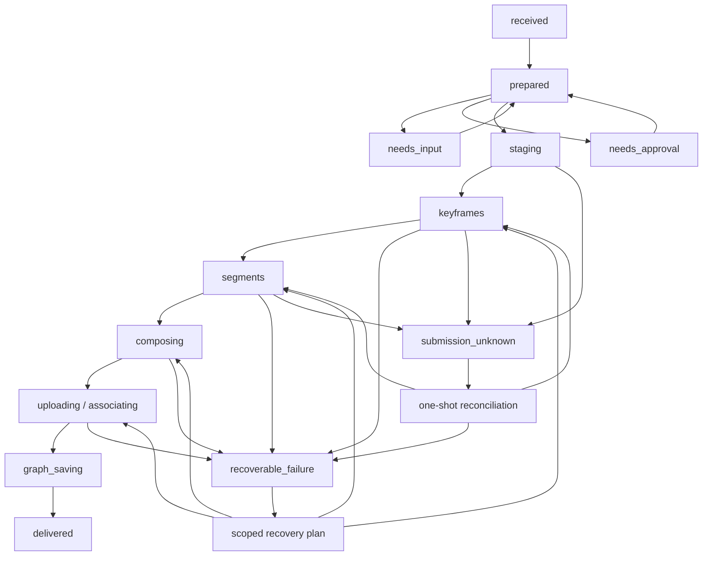
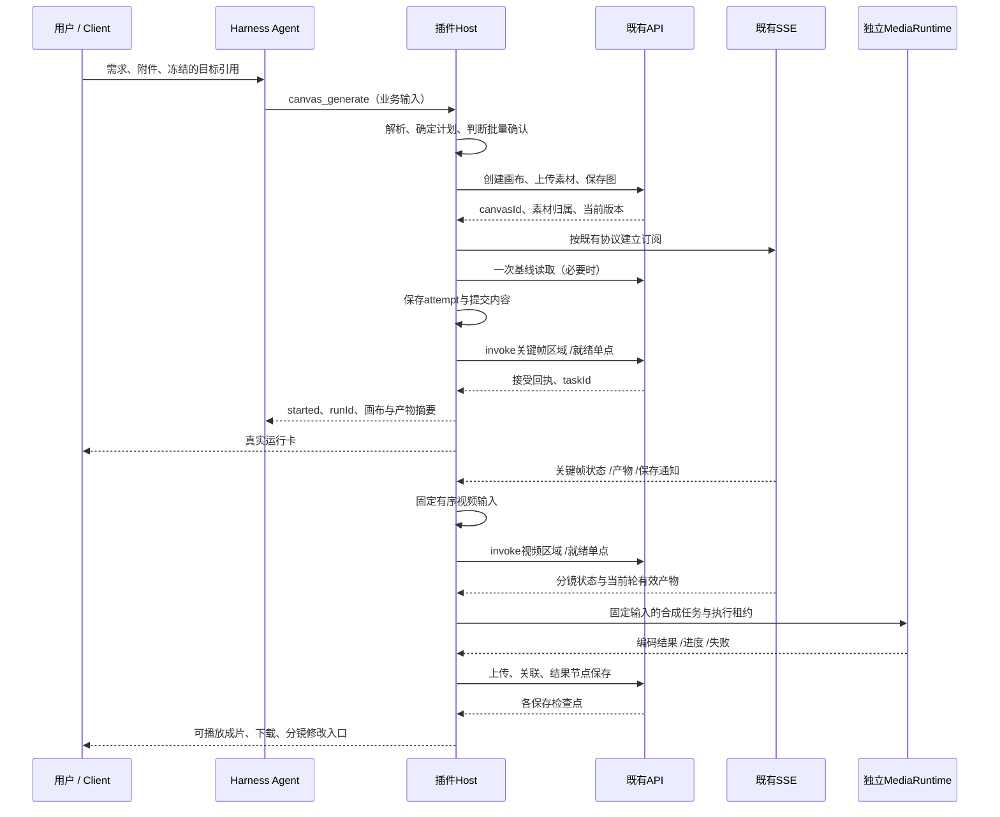

# 方案 B 执行蓝图：场景模板驱动的完整素材交付

> **已被替代。** 用户确认现有画布已经具备模板一键执行、依赖等待、生成与监听。本文的新增阶段编排和媒体运行时超出对话接入目标，保留为历史讨论，不作为首期编码依据。当前以[对话接入修订设计](2026-10-10-canvas-dialogue-bridge-design.md)为准。

日期：2026-10-10。状态：产品与技术设计，未实施业务功能。本文承接[首轮具体设计](/Users/boxser.shi/Documents/harness/insight-desktop-shell/docs/discussions/canvas-harness-scheme-b/plans/2026-10-10-canvas-skill-3c-trendy-design.md)，更新默认产物、工具入口、执行阶段和本地媒体处理生命周期。旧模板用于说明典型依赖，后续模板以本文的业务定义为准。

## 1. 定案：方案 B 应做成什么

方案 B 是一个**能解释场景、补齐业务输入、编译执行计划并交付产物的场景执行服务**。Skill 是给 Agent 的场景说明，模板是给程序的可执行业务定义，画布是计划与素材的可视编辑界面。

首期确定以下选择：

1. 用户主要表达“想得到什么”和提供素材。模型、视频模式、分辨率、首尾帧、节点顺序由模板与解析器处理。
2. Agent 的正常生成入口收敛为一次 `canvas_generate`。prepare / start 留在插件内部；缺少输入或需要批量确认时，服务保存准备计划，再继续同一请求。
3. 默认完整视频包括可播放、可保存的成片、所有必要分镜与关键帧。人物风格变体是按需素材分支：旧例的轻量视频路径生成5张关键帧和5段视频；完整素材包配置仍可生成21张图片和5段视频。
4. 运行时先按请求产物计算依赖闭包，再实例化和执行。未选分支不提交、不占生成额度；模板作者可以增加元素，而不增加每次 Agent 必须理解的内容。
5. 插件掌握阶段边界。阶段内适合既有基础 DAG 的区域调用后端 DAG；媒体选择、局部更新和本地合成由插件控制。整个模板不再无条件一次 `total` 提交。
6. API 提交命令，SSE 更新运行状态；进度不触发 LLM，不用定时轮询。需要创意或业务判断时才回到 Agent。
7. 桌面媒体执行器独立于可见画布标签。关画布仍继续本地合成；所有客户端窗口关闭或客户端退出后，本地处理暂停，重开自动恢复。
8. 后端不改。幂等、取消、跨设备恢复等能力按现有服务可实现的范围设计；明确状态与恢复动作，不用客户端重试掩盖提交结果未知。

### 1.1 完整交付的定义

| 交付面 | 完成目标 |
| --- | --- |
| 业务结果 | 请求的主要产物存在、媒体技术属性符合目标、可以播放 / 下载 / 保存 |
| 创作过程 | 用户可以查看必要输入、关键帧、分镜和各自依赖，并修改有意义的业务属性 |
| 执行过程 | 有明确任务归属、进度、失败分类、取消和恢复入口；不会遗留无说明的运行状态 |
| 扩展能力 | 增加模板、变体、音乐或字幕时复用同一执行器和用户入口 |
| Harness 成本 | 常态不读原始整图、不编排逐节点工具调用、不为进度反复思考 |

生成模型的视觉质量具有不确定性。完整交付还需要让用户能修正具体镜头、看到问题所在并复用有效素材，不能把“API 返回 success”当作业务效果已经达标。

## 2. 全步骤大纲

步骤0在模板发布时执行。步骤1–8形成一次请求的确定计划；步骤9–14完成素材交付；步骤15–16覆盖修改、恢复与取消。SSE 监听从步骤8首次执行前启动，贯穿后续阶段。

| 步骤 | 目标 | 必须留下的结果 | 主责 | 默认需要用户操作 |
| --- | --- | --- | --- | --- |
| 0 模板定义与发布 | 让模板具备完整业务含义与可用默认配置 | PublishedTemplate、目录摘要、参数配置、默认资产、兼容信息 | 模板作者 / 插件 | 否 |
| 1 请求接入 | 确定这次要做什么、针对哪个对象 | RequestEnvelope、稳定 requestKey、用户行为来源 | Client / Agent | 提出需求、上传素材 |
| 2 场景路由 | 选择真正适配的模板与输出配置 | SceneSelection、适用约束、请求产物 | Agent / 模板目录 | 仅意图冲突时选择 |
| 3 输入绑定 | 明确商品、人物、姿势、文案等业务角色 | BoundInputs、来源、缺失项 | Agent / 输入解析器 | 仅不可补全项 |
| 4 产物契约 | 明确最后交付什么、哪些素材必须生成 | DeliverySpec、画幅、时长、输出范围 | 模板 / 解析器 | 默认无需技术选择 |
| 5 创意规格 | 把自然语言变成有限、结构化的创意变化 | CreativeSpec、镜头故事、商品约束 | Agent | 默认无 |
| 6 技术参数解析 | 把业务规格映射到合法模型参数 | ResolvedOperations、参数来源与配置摘要 | 插件 | 仅业务结果须改变时 |
| 7 执行计划编译 | 得到精确依赖、阶段、调用方式与规模 | ExecutionPlan、执行闭包、planHash | 编译器 | 无 |
| 8 准入与实例化 | 准备资源、保存画布、保证可追踪地启动 | Run、canvasId、节点映射、素材URL、订阅基线 | Host / 上传服务 | 仅超过30图或6视频 |
| 9 关键帧阶段 | 生成视频所需、可明确选择的图片 | 有效关键帧与绑定版本 | Host / 既有API | 默认无 |
| 10 视频输入固化 | 避免错误图片顺序、未选结果进入视频 | 每分镜固定输入与镜头参数 | 执行器 | 仅用户主动选候选图 |
| 11 视频阶段 | 生成每个分镜，保留成功分镜 | 当前轮有效视频与分镜状态 | Host / 既有API | 默认无 |
| 12 本地合成 | 按业务时长、画幅与镜头顺序组成成片 | 本地成片、输入签名、合成记录 | 媒体执行器 | 默认无 |
| 13 结果保存 | 把可播放结果变成持久、可恢复的素材 | 上传结果、资产关联、稳定结果节点 | Host / 既有API | 无 |
| 14 交付 | 让用户先看到实际成果与可操作下一步 | 成片卡、分镜、素材包、完整状态 | Client / Agent | 观看或下载 |
| 15 定向修改 | 只改需要改的内容，复用有效上游 | EditPlan、新轮输出、更新成片 | Agent / 执行器 | 说修改需求 |
| 16 恢复与取消 | 处理断线、重启、未知提交与停止请求 | ReconciledRun、明确待办或终态 | Host / Client | 仅确需决策时 |

## 3. 每一步的详细设计

### 步骤0：先定义业务模板，再发布到目录

**目标：**模板能够自行描述何时适用、最少需要什么输入、正常生成什么、如何失败和如何修改。模板不只是节点图。

模板作者提交一个 SceneTemplate 包：Skill、目录摘要、业务定义、逻辑图、参数策略、默认素材。引用模板资源用资产键；旧节点 UUID、历史 URL、历史任务状态均不进入正式定义。

发布服务形成以下内容：

- 场景适用范围：商品类型、动作类型、可接受输入、支持产物。例如“头戴式耳机佩戴短片”与“商品独立展示”应有各自的镜头配方。
- 必需业务信息：用户需要提供的商品图，以及默认人物 / 姿势是否能够满足请求。默认素材在发布包内具备实际文件或可靠受控资产引用。
- 输出配置：每个配置有主产物、次产物、可选分支、默认画幅、时长和是否含声音。
- 参数策略：采用已配置的模型能力配置，限定模式、允许参数、默认值与可替换范围。
- 修改规则：动作、背景、商品、文案分别改变哪些逻辑输入和下游产物。
- 失败策略：关键分支、可选分支、生成失败、本地合成失败分别如何处理。

**完成条件：**目录中标为 available 的模板具有完整默认配置和实际默认资产。缺少默认模特、姿势或模型配置的模板不对用户显示为可直接生成，发布阶段集中给出作者需要补齐的项。

**判断：**把之前“运行时发现默认素材未配置”的问题移到模板发布阶段处理。运行期仍自动检查登录权限与真实输入，不要求用户反复配模板或理解内部参数。

### 步骤1：接收请求，固定对象与请求身份

**目标：**同一个用户动作在 UI 重渲染、工具重发和网络恢复后仍对应同一个请求；同时支持用户主动再做一版。

Client 在发送时保存真实用户消息 / 行为引用、附件引用、显式 Skill / 模板选择和节点引用。Host 根据真实行为、场景、目标和规范化业务操作形成稳定 requestKey，并注入调用上下文；不要求 LLM 编造请求身份字段。目标引用包含 session、canvasId、instanceId / nodeId、选中版本；切换标签不会改变已发请求的目标。

请求行为归类为 generate、edit、explain、inspect、cancel。Agent 判断的是用户行为，不能看到商品图就默认启动生成。

**产物：**RequestEnvelope；Host 保存 requestKey → plan / run 的映射。相同 requestKey 再到达返回已有运行；用户发送“再生成一版”产生新的 requestKey 和新版本输出。

同一真实动作下，相同scene /目标的调用不能因为LLM改写了一句brief就新建第二个运行。已准备计划通过continuation更新；已启动且收到不一致参数时返回request_conflict和已有运行。多版本在同一计划显式展开，新的独立生成需要新的用户行为来源。

**判断：**一次请求的本地去重可以减少重复调用；它不代表远端 API 支持写入幂等。远端回执未知仍按步骤16恢复，不自动重发。

### 步骤2：场景路由与模板选择

**目标：**选中能满足业务意图的模板，避免找到了风格词就套错商品动作。

选择优先级为：用户明确模板 → 明确绑定的节点 / 上轮场景 → 本轮语义与素材角色。画布打开本身不能覆盖用户明确的新建请求。

目录摘要只提供：sceneId、简短适用说明、必需输入、允许输出配置、业务约束、available 状态。Agent 不加载所有图和所有模型枚举。目录规模较小时直接匹配；规模增加后先通过本地字段过滤商品用途、产物类型和输入要求，返回少量候选，不先建立向量平台。

**分支决策：**

- 意图明确且存在适配模板：直接进入输入绑定。
- “想了解怎么做”或“看看模板”：解释，不启动。
- “做一个广告”而图 / 视频差异不能从上下文确认：给少量业务选项，一次补齐。
- 模板有佩戴动作，而商品是键盘：选择静物 / 手持配方；没有适配配方则说明支持范围，不把动作写死后仅替换商品名。

**完成条件：**得到明确 sceneId、revision、outputProfile 与适用解释。模板选择的结果写入本轮计划。

### 步骤3：素材与业务信息绑定

**目标：**知道每个输入是什么、来自哪里、能否用默认值补齐。

输入来源优先级：用户明确指定 → 明确节点引用 → 本次已标角色附件 → 当前场景绑定的上轮素材 → 模板默认。跨会话或其他画布的素材不自动混入。

每个槽位定义 userRequired、executionRequired、defaultSource、deriveFrom、clarifyWhen、protection。商品图可以是 userRequired；模特图可以仅 executionRequired，允许默认角色；姿势图可以采用模板默认。请求特定真人身份时，模特图转为 userRequired，默认人物不能满足这一要求。

绑定结果记录 assetRef、内容摘要 / 指纹、角色、来源、是否用户明确选择。附件仍是受控资源引用，后续由服务上传；用户不必自己制作媒体 URL。

**缺失项策略：**一次返回当前所有真正阻止完成的业务项。已明确的答案写回计划；用户补充只更新未解决项，不重新问风格、尺寸与模型。

**完成条件：**所有 executionRequired 输入可解析；有冲突的角色已经确定。可见的商品颜色、轮廓、logo 可以从图和文字汇总，未知品牌或性能不能凭空补全。

**判断：**默认角色 / 姿势的来源在素材卡中显示，采用默认配置无需额外确认。用户明确要求特定人物却未提供身份素材时，一次询问是必要交互。

### 步骤4：定义最终产物

**目标：**先确定交付，再决定执行多少节点。

DeliverySpec 包含主产物、次产物、画幅、目标时长、声音策略、版本数量、可选素材分支和失败时允许交付的部分结果。用户说“完整视频”对应 final_video，不自动理解为运行模板中的所有分支。

本例新模板提供两种配置：

| 配置 | 生成范围 | 交付 | 默认 |
| --- | --- | --- | --- |
| video_complete | 5关键帧 + 5视频分镜 + 本地成片 | 成片、5分镜、5关键帧 | 是 |
| video_with_assets | 上述内容 + 16人物风格变体 | 完整视频和21张图片素材 | 用户请求完整素材包时 |

后续可以加 music、captions、brand_endcard、additional_scenes 等具名分支；它们要声明自己如何进入成片或素材包。未请求的分支保持不激活。

用户指定12秒而模型每段只能生成较长视频时，计划明确“生成分段后按镜头节奏裁切为12秒”，不强行将不支持的 duration 传给模型。计数统计真实生成段数；成片目标时长和远端累计生成时长分开保存。

**完成条件：**请求主产物明确，必要分镜、素材、时长和音轨规则可机械解析。首期无声模板明确为无声，不能因为 prompt 提到音乐就宣称有配乐。

### 步骤5：一次结构化创意处理

**目标：**让 Agent 提供有价值的创意判断，同时限制它随意改图。

Agent 输出 CreativeSpec：商品事实、风格关键词、场景色调、各镜头叙事和用户要求保持的外观属性。模板作者指定可变创意字段，例如 shotMotion、sceneMood、copyText；未声明的字段不能进入图操作。

CreativeSpec 可以作为同一次 canvas_generate 的可选业务字段提交，不增加一个“再做创意”的工具回合。未提交时，服务采用模板声明的默认创意字段，把本轮 brief 作为受控提示补充；它不会在后台偷偷再调用 LLM 理解 brief。商品事实只采用 Agent 从用户可见素材和文字提取的内容。

模板提示词由“节点职责 + 有序参考图角色 + 受控创意字段 + 商品保护要求”渲染。将素材角色写入模板，例如 product_reference、subject_reference、first_frame、last_frame；不要让 Agent 每次从“图1 / 图2”推断语义。

**完成条件：**CreativeSpec 对全部必需镜头有效，既能解释画面又不产生隐藏新节点。正常请求只需要本轮 Agent 理解需求的一次创意决策。

**判断：**首期不让 Agent 输出任意 JavaScript、任意新节点类型或直接调用旧 Python。自研能力先表现为受支持操作的组合与新创意配方；真正的新执行操作走插件开发与发布流程。

### 步骤6：技术参数解析

**目标：**得到确定的操作参数，并保持业务语义。

解析器采用四层：业务要求 → 模板参数配置 → 当前环境能力配置 → 当前账号权限。型号枚举、大小写、seniorParams、级联参数和端口数量由对应 adapter 管理。

模型选择采用具名 capabilityProfile，例如 reference_product_image、two_frame_video、single_image_video。配置文件在部署 / 模板发布时映射到实际模型与参数；Agent 只看业务质量配置，不默认读整个模型列表。

每个最终参数保存来源 explicit_user、template、scene_default、model_default。用户明确值有效时优先；不支持的显式需求返回可完成的业务选择。允许自动替换的模型必须预先列在配置内，并满足同输入角色、同输出类型及允许的质量 / 时长约束。

视频时长要先编成镜头时间表：分配每镜头目标时长，再选择合法的远端生成时长，最后写入本地裁切区间。目标总时长超过当前配方和模型可提供的长度时，返回业务差异；只有模板已声明增补镜头或延长操作时才能展开它，并重新统计规模。不用循环旧片段或无说明减速来凑时长。

**完成条件：**ResolvedOperations 包含实际模型、模式、完整必要参数、输入限制与输出限制。保存 capabilityDigest；后续配置更新不改变正在运行的计划。

**判断：**首期模型路由采用有限配置映射。自动遍历所有模型、每轮试多个模型或让 Agent 猜最好模型，会增加费用、延迟和不确定性，不作为默认流程。

### 步骤7：编译执行计划

**目标：**把业务定义转成可执行、可追踪的有限计划。

编译器完成以下工作：

1. 从 DeliverySpec 的主 / 次产物逆向计算依赖闭包，展开已激活条件分支。
2. 解析逻辑操作及其输入，不按节点标题推依赖。
3. 将资产、关键帧、视频、本地合成和可选素材分成执行阶段。
4. 选择执行 adapter，创建操作ID、阶段ID和逻辑节点映射；确定哪些只是非生成素材 / 结果节点。
5. 固定输出选择策略。默认链路每节点只有1个候选；多候选必须有明确选择或排名步骤。
6. 统计本轮生成规模与已授权恢复额度，形成执行范围和确认摘要。
7. 保存 planHash、templateDigest、capabilityDigest、输入指纹、CreativeSpec 与所有操作参数。

ExecutionPlan 是运行的唯一依据。start、恢复和局部修改不会重新隐式补默认参数。

planHash覆盖业务输入内容 /版本、创意、参数、执行范围与额度，不把临时签名URL、登录凭据、canvasId或新建物理UUID纳入业务摘要。步骤8另建MaterializationMap，把确定的assetRef映射到已上传位置、把逻辑操作映射到物理节点。绑定位置可以更新，但不能把输入内容偷换成另一张图而沿用原批准。

阶段执行提供两条固定编译路径：现有 adapter 能准确限定区域、不破坏整图且可关联阶段任务时，采用 native_dag；否则编译为按依赖就绪顺序执行的 single_node 串行计划。后者只需要既有单节点能力，是保持后端不改的覆盖路径。选择记录在计划中；一个区域已提交后不能因超时或异常临时换成逐节点重发。

多版本请求先展开为独立版本范围，每个分镜明确属于哪一版，成片只能绑定该版选定的分镜。仅当某个上游操作的输入与参数完全相同且计划允许共享时复用它；不能因为节点同名就共享随机生成结果。实际规模从展开后的计划统计，不简单用模板节点数乘版本数。

**完成条件：**计划无悬空依赖、无环，每个输入都有提供者，每个主产物有完成路径，每个副作用有可记录的操作ID。

**判断：**逻辑操作与画布渲染节点分离。一个“拼接成片”操作首期可以呈现为普通视频结果卡，不要求新增后端节点类型；以后可换专用前端节点而不修改 Agent 调用方式。

### 步骤8：确认、创建画布与绑定资源

**目标：**从准备态进入可以安全追踪的运行态。

服务先检查真实用户生成意图和批量阈值。默认video_complete为5图/5视频，无批量确认；video_with_assets为21图/5视频也未超过。明确安排的生成重试计入该轮预算；超过30图或6视频时才获取真实用户响应。

计数以同一真实用户意图组为范围，合并它产生的所有计划、运行和恢复尝试。一次“做两版视频”不能拆成两个5段运行而绕过10段视频的确认；已接受的生成计入已用数量，已确认未被接受的请求不计数。用户明确提出新的独立需求或新的语义修改建立新意图组；对原运行补做失败镜头仍沿用原组。批准授权具体计划与数量范围，之后超出该范围的新增生成重新计算，不把一次批准当成永久豁免。

30图 /6视频规则由Host当前产品策略执行，模板只能声明自己的生成规模和恢复额度，不能提高阈值或自行填写approved。模板示例中展示的confirmation是有效系统策略说明，不是场景作者可覆盖的权限。

确认内容绑定 planHash、account、session 和输出范围；计划改变后重新计算。确认之后不再调用一个会暗中改变参数的“start”。用户未批准或批准超时，保持准备态。

接着执行：

1. 写入本地 Run 与新鲜实例ID / 节点UUID；先记录创建操作，再调用现有创建API。
2. 创建带预定节点身份的画布。远端返回canvasId后保存映射，再打开画布。
3. 解析附件与默认资产，通过现有STS / OSS上传。保存对象位置与上传状态；同一文件重传使用同一个受控对象位置。
4. 将实际媒体绑定到非生成输入节点，保存规范化图；保存实际versionNumber。
5. 建立SSE订阅并校准基线，确认这次运行的事件可以关联。
6. 调用阶段执行服务；正常生成工具返回runId、画布地址与简短产物摘要。

**完成条件：**本地记录、远端画布、已上传素材和订阅基线对应同一计划。任何时点都能说明当前停在哪个动作。

创建回执丢失时不能直接再建一个画布。用既有列表 / 读图能力做一次有限候选查找，按预定节点UUID识别；无法唯一恢复则保留create_unknown，提供恢复入口。创建本身不触发生成。

素材上传失败只重试对应文件，不重新创建画布或重新上传全部素材。Token / STS过期刷新凭据；凭据不进入Skill、图数据或模型上下文。

### 步骤9：生成必要关键帧

**目标：**先得到视频依赖的确定图片，而不是同时运行所有旁路。

插件只提交关键帧区域。本例P2/M1先就绪，再得到P1/M2/M3；采用区域路径时，阶段内部静态基础DAG交给既有执行器处理。采用串行单点路径时，Host在SSE确认前置产物后提交下一个就绪操作。两条路径使用相同输入和完成条件，Host保持本阶段操作、taskId和当前轮产物映射。

adapter为native_dag时使用现有区域执行语义，并显式列出本阶段生成节点；为single_node时使用既有单节点执行语义。adapter能力由插件实现固定声明，编译时决定，运行中不会把同一操作从DAG策略静默改为单点策略重新提交。

**完成条件：**视频依赖的图片生成成功、媒体可访问、数量符合要求、尺寸可用，已明确选定当前轮artifact。初始化的taskInfo.success不代表关键帧已生成。

**失败处理：**关键依赖失败时不开始需要它的视频；已经成功的其他图片保持可用。可选人物变体在独立低优先级阶段运行，失败不会改变成片所需关键帧状态。

### 步骤10：固定视频输入与质量处理

**目标：**阻止旧图、未选图片或错误帧顺序进入视频阶段。

每个分镜保存InputBinding：逻辑角色、artifactId / URL、生成轮次、输入摘要与顺序。V1–V4的first_frame和last_frame各占一个具名槽位；V5是单图槽位。首尾帧只有两个合法图片输入，不能靠边数组偶然位置推导。

首期技术质量处理是确定性的：空产物、文件读取失败、非图片、不可用尺寸、候选选择缺失等会阻止视频；这些问题不会交给用户猜参数。

视觉语义规则，例如logo、商品轮廓、人物身份、佩戴关系，写入模板的reviewCriteria和提示词，但普通文件检查无法判定它们。默认自动展示关键帧并继续；用户主动修正时重新固定输入。

**扩展决策：**未来有自动视觉复核需求时，增加具名agent_review阶段，通过Harness既有、可记录的模型执行接缝完成结构化判断。必须限定一次复核和有限修正次数，所有模型输入可从会话记录还原。首期不以未实现的“视觉评分”替代产品质量说明，也不让每个节点额外启动一个Agent。

**完成条件：**视频输入身份、顺序、轮次和选择均已固定。后续点击画布中的另一个候选，不改变已经提交的视频输入。

### 步骤11：生成视频分镜，持续归并SSE

**目标：**取得本轮必要视频，保留成功结果，并区分执行故障与同步故障。

在支持精确区域执行的部署中，将五个输入已固定的基础视频作为一个native_dag区域提交，复用既有后端的区域依赖与并发处理；定向修改或单点失败重试采用single_node。不支持区域执行时，使用步骤7已经编译好的单点串行计划。两种路径均不假定现有后端允许同画布同时启动多个独立工作流任务，Agent不参与逐节点调用。

Host默认同一画布只提交一个远端生成区域，待其终态再提交下一个；跨画布入场数和本地编码并发单独配置，例如本地编码同时1个。区域内部的模型并发由既有后端决定。后续adapter明确支持同画布并发单点操作时才开放该配置；本客户端控制不代表账号全局并发，数量阈值也不能拿来充当并发限制。

SSE处理顺序：识别订阅归属 → 标准化事件 → 匹配taskId / 操作尝试 → 检查版本与当前输入 → 写入本地状态 → 更新UI → 满足依赖则推进。进度不进入LLM。

**完成条件：**必要分镜都有当前轮、已持久化的有效视频artifact。五段中任意一段不可用，不能用旧段补齐后宣布新成片完成。可选人物变体在视频区域终态之后执行，与本地合成可以并行；成片结果节点落盘等待相关远端写图区域终态，成片预览不用等待旁路素材。

**失败处理：**视频失败保留其他分镜；同步断线重连校准，不标生成失败。副作用提交结果未知禁止自动重发。确定的失败如何重试由步骤16统一管理。

### 步骤12：独立媒体执行器合成成片

**目标：**交付本地合成能力，同时让用户能够关闭画布继续等结果。

桌面插件Client初始化时持有MediaRuntime，使用独立同源媒体运行页 / Worker；可见CanvasTab只是观察者。Host负责job身份、输入签名和结果记录，Worker负责下载受控输入、媒体探测、裁切、规格归一与编码。

当只有可见画布组件承载Worker时，关闭画布会中断合成。本文将独立MediaRuntime列为首期完整交付的必需改造；之前“待用户重开画布才合成”的方案作为受限Web环境恢复方式保留。

首期默认合成范围：固定镜头顺序、按目标时长裁切、统一画幅 / 帧率 / 编码、硬切、按模板定义处理音轨。若模板输出无声，不自动添加音乐；增加音乐、字幕或结尾品牌卡时，它们是显式依赖操作。

默认画面适配为contain加背景填充，保留商品完整轮廓；cover裁切必须是模板明确允许的构图策略。输出规格在DeliverySpec中固定，低内存时只能使用事先允许的编码降级配置；用户显式要求的尺寸不能在失败后悄悄降低。技术失败与视觉不满意采用不同修复入口。

**完成条件：**成片可以解码播放，镜头顺序、目标时长、画幅和音轨策略符合DeliverySpec；记录所有输入artifact及签名，生成文件可进入上传阶段。

**失败处理：**Worker死亡、编码超时、内存不足、媒体下载失败均保留分镜。逐段处理与文件清理降低峰值内存；同一个Worker编码串行。失败只恢复本地处理或上传，不重新生成所有分镜。

原有FFmpeg单源裁切代码不能直接作为多源执行器；需要唯一工作目录、多个输入挂载、分段释放、job取消和结果回收。首期采用已有浏览器引擎，避免额外引入桌面原生二进制发布链路。

### 步骤13：上传、关联与结果节点落盘

**目标：**从“有一个临时Blob”变成用户可长期使用的素材。

每个成片版本预留稳定resultNodeId和上传对象位置。本地记录区分encoded、uploaded、associated、graph_saved、delivered，崩溃恢复从最后一个明确成功动作继续。

先上传并记录URL，再使用现有资产关联，最后在已确认当前生成区域终态后，经画布队列补入普通非生成视频结果节点。预览可以先出现；状态卡在上传和保存完成前显示相应阶段。

**完成条件：**成片URL可读、资产归属明确、结果节点保存成功、artifact与当前计划对应。仅有本地Blob或“上传成功但未保存”不能标为全部完成。

相同resultNodeId已经存在且内容一致时直接确认保存；不存在才新增。保存回执丢失先读图，不重复追加相同成片。保存失败可以重做落盘步骤，不重新编码和上传已存在的媒体。

### 步骤14：交付与后续入口

**目标：**用户先看到实物结果，再按需理解画布。

聊天默认展示主成片、时长、画幅、播放 / 下载 / 打开画布，以及“修改某个镜头”的入口。分镜与关键帧可展开，人物变体只有用户请求素材包时才出现。

UI阶段使用业务语言：素材就位、关键帧生成、分镜生成、成片合成、保存完成。模型、nodeId、SSE状态码、模板revision等在详情中按需显示，不占主要交付界面。

**完成条件：**主产物已保存；用户能定位失败的可选素材或修改目标。成片成功而可选素材失败，状态为主产物完成 / 素材包部分完成，不把整次请求笼统标失败。

UI通过Host运行状态订阅更新。Agent的完成说明来自已记录结果，不能把外部事件当成未记录的模型指令；也不为每条进度生成一段聊天回复。

### 步骤15：对节点或成片做定向修改

**目标：**保留有效结果，用最小变更实现用户意图。

生成入口与修改入口分别为canvas_generate、canvas_edit。用户选中分镜后说“动作小一点”，Agent只输出业务修改；工具重新读取目标、实例绑定和当前版本，再由模板editableFields映射为受控参数与输入变化。

EditPlan先确认哪些输入变化，再计算受影响操作；由产物依赖得到更新范围。位置、缩放、标题等UI变化不改变生成输入摘要。

本例：V3动作变化只重跑V3和本地成片；M3姿势变化影响M3/V4/V5/成片；某个旁路变体变化只生成对应图片；商品变化影响所有依赖该商品的操作。

**完成条件：**修改范围明确、原结果保留为历史、新产物属于新轮输入，最终成片重新绑定正确分镜。

**运行中修改决策：**同一逻辑分镜的业务修改默认排队，当前尝试确认结束或停止后再执行。不会让两个任务写同一个当前结果。每次生成尝试具有独立attemptId和taskId；若远端事件缺少可可靠区分的任务身份，新建物理输出节点并更新逻辑映射，避免旧事件覆盖新产物。

明确修改请求不再重复问“是否重跑”；超过生成规模阈值、目标不明或请求越过可编辑范围时才需要补充选择。

### 步骤16：统一恢复、重试与取消

**目标：**正常运行、局部修改和客户端恢复共用一套状态规则。

| 情况 | 判断 | 动作与结束条件 |
| --- | --- | --- |
| 同步断线 | 不等于生成失败 | 重连并一次校准；现有任务继续观察 |
| 接受回执未知 | 不能确认未提交 | 按节点身份、taskId、输入摘要与既有读取恢复；确定之前不重新invoke |
| 确定生成失败 | 按adapter归一错误类型处理 | 可修正输入 / 参数，或仅对失败操作准备重试；保留有效依赖 |
| API明确未接受，如准入拒绝 | 没有生成副作用 | 按明确retryAfter / 配置退避入队；等待时不轮询任务 |
| 文件上传中断 | 已有对象位置可复用 | 同位置重传或续传，刷新STS；不重新生成 |
| 本地编码失败 | 分镜可复用 | 重建本地job；不重跑远端模型 |
| 已上传、落盘回执未知 | 可能已保存成功 | 一次读图确认resultNodeId，再决定是否写入 |
| 用户取消 | 停止未来动作与已提交动作分别处理 | 先停止后续调度，再interrupt已知任务；确认停止前显示取消中 |
| 客户端重启 | 本地账本存在，远端状态可能已变化 | 恢复订阅、校准任务 /图、复用已保存文件，继续未完成的可确定阶段 |
| 账号切换 | 不允许跨账号继续副作用 | 断开旧执行上下文，保留原账号账本；回到原账号再恢复 |

**自动重试定案：**默认自动恢复只覆盖读取、明确未接受的准入请求、同位置上传与本地编码。远端生成一旦确定失败，不默认增加新的生成尝试；给一个定向重试动作。用户可显式选择“允许自动重试”策略，模板以小的明确额度纳入准备计划与批量阈值。不能无限重试或悄悄更换风格。

首次重启不对所有历史运行全部查图：只恢复未终态运行和用户打开的实例；同一账号 / 画布合并校准。媒体工作区重建后接续本地任务。后台运行账本由Host拥有，首期状态卡直接订阅RunService，不依赖Agent所有的进程内Jobs。这样Agent回合结束或被释放，不会连带取消素材运行。以后接入Jobs观察投影时，需明确区分用户停止与owner teardown，不把Job生命周期当成画布运行的事实来源。

如果在后端不改、无远端幂等 /完整回放的情况下仍无法确认某次副作用，产品提供“状态待恢复”与可操作诊断，不宣称强一致或恰好执行一次。这个状态有明确归属、保留产物和下一步，不是一张永远转圈的卡。

## 4. 让Harness轻便：外部入口与内部执行分开

### 4.1 首期外部工具

| 工具 | 业务输入 | 正常返回 |
| --- | --- | --- |
| canvas_generate | sceneId、brief、inputs、可选businessOptions / creativeSpec | started：runId、资源地址、产物摘要；或needs_input / needs_approval / cannot_run |
| canvas_edit | targetRef、instruction、明确业务changes | 变更范围、更新运行与主产物引用 |
| canvas_run | runId、action=get / cancel / retry / recover | 已保存状态或相应恢复 /停止结果 |
| canvas_scene | query / sceneId、detail=summary / input_form | 按需查少量场景摘要或输入要求 |

这些是新设计工具名，现有canvas_get继续承担画布读取。普通用户生成走一个高层入口；后台按多少个节点调用API，不增加Agent工具往返。

内部仍有prepare、resolve、compile、approve、start、reconcile等函数；它们直接调用，不要求LLM依次执行十几个工具。生成入口内部计划准备失败时返回结构化缺失项，不通过异常让Agent猜修复方式。

一次调用示意：

```json
{
  "sceneId": "product.trendy-video",
  "brief": "给这款耳机做一条霓虹赛博短片，商品外观和logo保持一致",
  "inputs": {"product": "attachment:product-photo"},
  "businessOptions": {"outputProfile": "video_complete"}
}
```

工具保存缺失 /待确认计划，并返回continuationId。用户补充后调用同一业务入口继续，不丢失原输入和选择；Client还可以直接提交真实用户卡片响应给同一服务。continuation绑定账号 /会话 /计划，只允许补足相应业务项。

### 4.2 模型可见信息预算

| 信息 | Agent默认可见范围 |
| --- | --- |
| 场景目录 | 少量摘要；不包含节点图和全部参数枚举 |
| Skill | 场景触发、业务输入、默认交付、错误处理与修改方式 |
| 本次计划 | 主产物、规模、默认来源、真正缺失项；不回传几十个节点的全文 |
| 运行进度 | UI订阅，本轮模型不逐条接收 |
| 节点修改 | 仅目标节点职责、当前业务属性、依赖摘要与影响范围 |
| 复杂故障 | 归一化错误、可执行修复选项，必要时按需查单个操作 |
| 完成结果 | 主artifact、次artifact索引、状态与可操作入口 |

目标是减少不必要信息，并保持模型可判断。首期不做提示词压缩算法，不承诺具体Token降幅；后续记录每次工具结果大小、回合数与追问原因即可发现膨胀。

## 5. 新模板应增加的元素

配套[模板业务定义示例](/Users/boxser.shi/Documents/harness/insight-desktop-shell/docs/discussions/canvas-harness-scheme-b/plans/2026-10-10-canvas-scheme-b-reference/scene-template.json)刻画以下字段。示例不是直接可发往API的画布JSON，不绑定某个旧模型。

| 元素 | 解决的问题 | 最少应声明的内容 |
| --- | --- | --- |
| discovery | 场景误路由、目录过重 | sceneId、适用描述、商品用途、产物类型、目录状态 |
| inputContract | 反复追问、缺失默认素材 | 输入角色、用户 /执行必需、默认 /派生来源、冲突时追问规则 |
| outputProfiles | 旁路全部执行、数量膨胀 | 主次产物、激活分支、画幅、时长、声音、完整交付标准 |
| creativeFields | Agent随意改图、模板不灵活 | 可变化创意字段、职责、约束与提示词绑定 |
| operations | 节点标题当依赖、输出角色混淆 | 逻辑键、操作类型、有序输入、产物类型、参数配置引用 |
| stages | 全图一把提交无法插入选择或合成 | 阶段输入 /输出、允许执行adapter、完成判定与分支优先级 |
| modelPolicies | 模型变更、枚举 /大小写错误 | 能力配置、已允许替换范围、模式、参数来源与serializer |
| selectionPolicies | 多候选随机进入下游 | 固定单输出、用户选择或具名自动选择，选择在何处固化 |
| editableFields | 节点修改变成整图重跑 | 业务属性到输入 /参数的映射、失效传播、可复用产物 |
| recoveryPolicies | 失败无限重试、提交未知重发 | 每动作错误分类、可重试范围、最大尝试、用户介入点 |
| presentation | 画布太复杂、用户看不到成果 | 主产物、操作分组、默认折叠、局部修改入口、阶段文案 |
| completionContract | API成功但只有临时结果 | 必需artifact、技术属性、保存要求、部分成功规则 |
| compatibility | 模板依赖不存在的功能 | templateSchema、requiredCapabilities、默认资产目录、发布状态 |

模板增加能力时的规则：

- 新风格 /商品动作 /构图：通常增加创意配方或业务配置，无须新增工具。
- 新分支：增加逻辑操作、依赖和outputProfile；默认请求不运行它。
- 新模型：改环境能力配置与serializer，不让所有Skill复制参数表。
- 新前端节点呈现：改画布渲染映射，保持逻辑操作身份。
- 新执行操作，如专业口型或全新本地处理：先增加受控adapter，再允许模板引用。
- 模板版本更新：新运行用新版本，正在运行和已有画布绑定原revision；不原地改写旧运行。

首期模板是有限类型的数据结构。条件只能选择发布包内声明的分支，参数值不能执行脚本；agent_review等未实现能力不会以字符串写进模板后自动获得执行权限。

## 6. 关键技术归属

### 6.1 三类数据

| 类型 | 保存位置 | 含义 |
| --- | --- | --- |
| SceneTemplate | 插件发布包 /受控模板目录 | 业务定义与逻辑图，没有实例UUID、任务结果和登录信息 |
| ExecutionPlan + Run | Host账号 /环境隔离持久目录 | 一次确定执行、尝试、taskId、输入版本、输出选择和恢复信息 |
| CanvasGraph | 现有后端 | 用户可见的节点、边、合法参数和媒体结果，使用现有字段 |

不能把Run只存在Agent上下文、UI localStorage或内存Jobs里。也不能假定后端保留所有新data字段而把整个Run塞进画布。首期新业务映射以Host账本为准；远端画布保留可播放 /可编辑的基础节点。

### 6.2 模块职责

| 模块 | 职责 |
| --- | --- |
| SceneCatalog | 目录、可用状态、模板版本与Skill映射 |
| InputResolver | 素材角色、默认 /派生输入、合并缺失项 |
| PlanCompiler | 输出依赖闭包、创意字段渲染、参数解析、阶段与规模 |
| CanvasCommandService | 按画布串行写入、版本协调、操作回执 |
| RunService | 状态机、阶段推进、尝试记录、停止 /恢复；Host拥有运行 |
| ApiAdapters | 将受控操作映射到既有API，声明准确效果与错误类型 |
| EventHub | 既有SSE订阅、归一化、去重 /关联、必要快照校准 |
| AssetService | 附件 /默认资产解析、STS /OSS上传、资产关联 |
| MediaRuntime | 桌面Client独立媒体运行页与Worker、本地合成 |
| CanvasPresentation | 场景分组、主产物、明确节点引用、编辑范围 |

模块是职责边界，不要求首期拆成十个发布包。可在一个插件内以少量文件实现；共有参数 /模板逻辑保持不依赖React，Web与Host使用同一来源。

### 6.3 写入与事件竞争

桌面Agent、手工编辑、尺寸同步和自动保存都经过同一个CanvasCommandService；事件应用与命令回执合用版本规则，避免两个本地队列互相覆盖。

运行期间业务参数 /连线由当前操作快照固化；布局编辑继续可用。别的Web客户端改同一图时，现有versionNumber冲突处理或SSE变化会停止本地后续相关提交，展示范围冲突；首期不做自动整图三方合并。

本地队列只保障本客户端。后端不校验旧版本时无法实现跨客户端强写锁；新建独立场景实例、单写者使用与冲突停止是本期的产品约束，不能通过隐藏UI按钮宣称已实现远端锁。

## 7. 提前发现的问题与设计判断

| 问题 | 容易出现的半成品表现 | 本方案的判断与处理 |
| --- | --- | --- |
| 把模板当保存过的画布 | 旧结果和任务被当成新结果 | 发布包只存逻辑定义；每次实例化新身份 |
| 强制执行所有分支 | 用户只要视频，却生成几十张无关图 | 产物驱动依赖闭包，旁路具名可选 |
| 创意可变、图结构无约束 | Agent改出非法节点 /漏输入 | CreativeSpec只填声明字段，编译器拥有结构 |
| 模特 /姿势缺失 | 新用户被要求找三张专业参考图 | 模板提供实际默认角色 /姿势；特定真人身份才转用户必需 |
| 原始模板只适配耳机 | 换商品名后动作与产品矛盾 | 商品用途和镜头配方明确匹配 |
| 技术参数由LLM猜 | 枚举大小写、模式、级联字段出错 | capabilityProfile + serializer由程序确定 |
| 图有首尾帧，却没有角色 | 镜头倒序、商品与模特参考图混用 | 有序具名输入，在视频前固化artifact |
| 多候选图片没有选择步骤 | 系统随机用一张进入视频 | 默认单候选；多候选计划必须定义选择 |
| 阶段一把提交 | 插不进复核、裁切与可选输出 | 插件定义阶段，后端DAG只执行合格区域 |
| 区域执行语义不精确 | 提交一个阶段却把旁路和旧节点也运行了 | 编译时采用准确区域adapter或固定单点串行路径；提交后不切换重发 |
| 请求数量等于并发 | 超载或生成排队失控 | 独立的Host admission，明确非账号全局限制 |
| submit超时就重试 | 重复生成与重复扣额度 | 进入unknown，先恢复身份，未确定不重发 |
| SSE先于HTTP响应 | 完成通知被丢弃 | 待关联事件缓冲与attempt记录 |
| 没有回放就一直等 | 重连后永远运行中 | 一次权威校准与可恢复状态，无定时轮询 |
| 终态通知早于结果持久化 | 一次读图为空，永远等不到成片 | adapter需要能取得终态产物或后续保存通知；无法满足的部署不发布为完整自动交付 |
| 事件里只有状态 | 无法拿到媒体，错误宣告完成 | 相关通知触发一次结果读取，完成要求实际artifact |
| 网络故障算任务失败 | 用户反复重跑有效任务 | 分离sync状态与execution状态 |
| 运行中旧结果晚到 | 覆盖用户新修改 | taskId /attempt /输入摘要 /物理节点身份区分 |
| 合成绑定可见画布 | 关标签后永远拿不到成片 | 独立MediaRuntime，Client窗口级生命周期 |
| 所有片段规格假定一致 | 拼接黑屏、时长错误、音轨错位 | 真实媒体探测与规格归一，时长按DeliverySpec处理 |
| 副素材失败拖垮主产物 | 视频已做好却整轮显示失败 | 必需 /可选分支分开完成与展示 |
| Blob当最终结果 | 重启后成片丢失 | encoded /uploaded /associated /saved分别记录 |
| 改一处全部重跑 | 修改慢、素材浪费 | 模板业务字段映射与失效闭包 |
| 节点改名就改变依赖 | 编排突然找不到素材 | 逻辑键 /节点身份与显示标题分离 |
| 同名Skill /模板版本漂移 | 同一请求上下文变更后执行不同图 | 固定revision与digest，升级只影响新运行 |
| Jobs和恢复账本混为一体 | 进程重启后任务消失 | Host持久Run为事实来源，Jobs只做观察投影 |
| 高层工具返回太多 | Agent重新读完整图并分析参数 | 默认业务摘要，节点详情按需读 |
| 追求全自动视觉判定 | 凭一个分数宣称商品未变形 | 技术质量与视觉语义分别说明；复核能力受控且可选 |
| 撤销与重试语义不明 | 取消后又生成，或删除历史 | cancel停止未来副作用，历史保留；retry只针对明确操作 |
| 换设备缺本地账本 | 看到图却无法继续编排 | 跨设备观看基础图支持；接管须显式导入运行包 /重新建计划，不承诺无后端同步恢复 |

这些问题已经落实为输入、状态、模块归属或产品行为，不把它们统一留成“以后验证再决定”。现有API缺少的远端保证仍保留明确边界。

## 8. 实施顺序与每阶段的完成目标

工程验收集中在实现与发布流程；本轮不重复远端探索或生成测试。以下说明的是交付顺序和可观察成果。

| 阶段 | 实现内容 | 达到的目标 | 依赖 |
| --- | --- | --- | --- |
| A 模板业务定义 | SceneTemplate、目录摘要、outputProfiles、inputs、创意字段、操作与阶段；正式默认素材 | 作者能描述一个场景，用户目录只出现准备完整的模板 | 既有节点 /API清单 |
| B 高层入口与编译 | canvas_generate / edit / run / scene、请求去重、输入解析、参数策略、依赖闭包、批量确认 | 同一业务请求得到确定计划；普通用户不填技术参数 | A |
| C 可靠运行主干 | CanvasCommandService、Run账本、上传、API adapters、SSE EventHub、阶段推进与状态卡 | 可新建画布并交付关键帧 /分镜；失败有明确归属与定向恢复 | B |
| D 完整媒体交付 | 独立MediaRuntime、合成 /上传 /资产关联 /结果落盘、主次产物卡 | 关画布仍生成成片；下载、保存、重启恢复形成完整链路 | C |
| E 定向修改与恢复 | 编辑映射、结果历史、失效闭包、取消、未知提交恢复、阶段重启 | 用户改一个镜头只生成需要的操作；有效素材被保留 | C、D |
| F 模板扩展 | 新配方 /分支 /模板、已受支持音乐与字幕等操作 | 新场景主要是加数据配置，工具入口和运行机制复用 | A–E |

首期上线范围为A–E。C阶段的画布与分镜能力是内部阶段成果，完整产品交付要包含D与E；不能先把没有成片、没有恢复入口的界面当作方案B已经完成。

## 9. 产品与研发应对齐的结果

- 产品定义场景适用范围、主次产物、默认角色 /姿势、可修改的业务属性，以及质量需要用户关注的内容。
- 模板作者提供逻辑操作、输入角色、分支、镜头配方与素材包；不维护Token、Gateway或复制模型参数大全。
- 插件研发负责确定计划、API /SSE、上传、阶段推进与恢复；Web研发负责可视编辑、明确节点引用和独立媒体执行端。
- Harness Agent负责理解用户、选择场景、组织创意与解释结果；不承担进度监听和事务恢复。
- 模型配置维护者负责能力配置与参数serializer；更换模型时保持或明确改变业务输出。

本蓝图的首期核心不是节点数量，而是一个稳定的业务入口、一个确定的执行计划、一条可恢复的结果交付链，以及用户可以继续修改的画布。

## 10. 与首轮设计的关系

保留[旧例节点与源码调查](/Users/boxser.shi/Documents/harness/insight-desktop-shell/docs/discussions/canvas-harness-scheme-b/plans/2026-10-10-canvas-skill-3c-trendy-design.md)作为实现参考；本文件更新以下设计：

- 外部prepare /start改为高层canvas_generate，内部保留两阶段计划与执行。
- 默认完整视频用必要依赖闭包，21图素材包是明确可选输出配置。
- 以阶段为执行边界，复用精确基础DAG区域；能力不满足时编译为single_node串行路径，不把整张扩展模板一把提交。
- 首期加入独立媒体执行器，关闭画布标签不会阻止成片交付。
- 默认角色 /姿势的可用性在模板发布时完成，减少运行期追问。

本次只产生设计与声明式示例，没有调用生成API、安装新Skill或修改业务代码。

## 11. 内部阶段接口与状态规则

这些是插件内部数据约定，不要求远端后端增加字段。

### 11.1 每层传递什么

| 对象 | 关键字段 | 禁止隐含行为 |
| --- | --- | --- |
| RequestEnvelope | requestKey、sessionRef、intent、brief、attachmentRefs、targetRef | UI切换后自动变成其他目标 |
| SceneSelection | sceneId、revision、outputProfile、适用范围 | 未说明地替换镜头动作与商品用途 |
| BoundInputs | slot → assetRef、角色、来源、内容摘要、特定身份要求 | 按文件顺序猜商品 /模特，或跨会话取素材 |
| CreativeSpec | 商品事实、风格、镜头动作、受保护属性 | 顺带发明品牌性能或新增操作 |
| ResolvedOperations | 实际模型 /模式 /参数、参数来源、配置摘要 | 在执行函数里重新选模型补默认 |
| ExecutionPlan | 操作与输入、stage、adapter、产物选择、规模、planHash | 修改已批准计划却沿用旧批准 |
| MaterializationMap | 逻辑操作到物理节点、输入内容到上传位置、实际canvasId /版本 | 把上传位置变化误当创意变更，或借更新URL替换业务素材 |
| Run | runId、canvasId、实例绑定、状态、当前阶段、attempt与结果 | 仅根据画布全局taskStatus推断全部业务已完成 |
| Artifact | artifactId、生产操作 /attempt、媒体位置、类型、规格、输入摘要、保存状态 | 同一个URL出现就视为本轮结果 |
| EditPlan | 目标、前后业务变化、受影响闭包、保留artifact、规模 | 把“局部修改”扩成删除或重建全画布 |
| RecoveryDecision | 已确认事实、仍未知动作、允许继续的操作、停止条件 | 通过自动重发猜测远端是否执行过 |

原始SSE既有字段先由adapter归一为canvas_change、operation_progress、operation_terminal、connection_state等内部事件。没有远端eventId时用可确定的任务 /版本 /产物事实归并；不能捏造一个本地编号后宣称远端支持回放。

### 11.2 状态之间如何推进

Run分开保存executionState、syncState和deliveryState：同步断线不会直接把执行改失败，已生成分镜但上传未完成不会把交付改成功。



图中的循环只在补输入、用户动作或明确可恢复条件发生时执行，不是运行期查询循环。needs_input和needs_approval有完整保留的计划；过期的批准只能重新准备，不能默认通过。取消中为单独状态，禁止开始新阶段；用户可在其确认后重建新轮计划。

### 11.3 每次副作用如何记录

采用“记下意图 → 发出动作 → 记下回执 → 收到事实 → 写入结果”的顺序：

1. 操作创建时存operationId、attemptId、请求指纹、物理节点ID和expectedVersion。
2. 发出副作用前设dispatching；计划和请求内容已经落盘。
3. 收到接受回执存taskId /新版本。失败回执区分明确拒绝与未知结果。
4. 归并事件或权威读取，记录产物对应的attempt和输入摘要。
5. 条件满足后仅推进一次下一阶段；持久状态写成功后再推进已处理游标。

编码与上传也用相同的尝试记录。多个桌面窗口只有一个被Host授予的MediaJob执行租约；断开的执行端释放或过期后才能重派，迟到结果按job输入签名确认，不覆盖新的成片版本。

**无法保证的部分：**本地记录和远端接受不是同一事务。在无远端幂等键的前提下，崩溃窗口会留下unknown；记录顺序能恢复事实和避免盲目重复，不能凭空获得远端恰好一次执行。

## 12. 用六个场景走完整流程

### 12.1 只有商品图：“做一条赛博广告视频”

选用佩戴视频配方前确认商品用途适配。商品为头戴式耳机且该模板可用时，绑定默认角色与姿势，采用video_complete；CreativeSpec从商品图提取可见事实。工具内部得出5图/5视频/1次本地合成的计划并启动。

用户只做上传和提出需求。默认素材来源显示在输入组；无需问模型、分辨率、站姿图或默认人物选择。主要反馈是成片与五个可修改镜头。

### 12.2 商品图与模特图：“用这个人来展示，做完整素材包”

角色绑定为用户图，outputProfile=video_with_assets。计划生成21图/5视频；视频阶段优先，人物变体作为单独旁路。视频成片与素材包状态分别更新，整个场景仍保留完整素材交付目标。

如果两张图都包含多个商品而目标不能确定，一次问“哪款商品 /哪个人物”；用户补充后继续同一个continuation，不重新选择风格。

### 12.3 “要12秒，再加字幕和配乐”

时长成为DeliverySpec显式值；模板先生成支持的分段，再按镜头配方裁切到12秒。字幕与配乐只有模板已发布相应分支、adapter与资产配置时才激活。

首期示例未提供这两项分支，服务返回需要决定的业务差异，如“当前模板支持12秒无声成片，字幕 /配乐可以采用另一已提供的场景”。不会先生成无声片并宣称需求全部满足。以后扩展时增加caption_render与audio来源、混音输入即可，外部仍是canvas_generate。

### 12.4 “动作小一点”，选中视频3

发送时冻结V3引用。服务重读确认后修改对应shotMotion，计算V3→final_video的闭包。一次单点生成V3，再用V1/V2/V4/V5有效结果合成新版本；关键帧不用重生，旁路素材不受影响。

当前V3还在生成时排队，界面显示“当前镜头结束后更新”；用户要求立即停止则先cancel该尝试。没有额外的整图重跑确认。

### 12.5 第4镜头失败，其他四个已经完成

成片保持待补分镜，其他分镜可播放。单一恢复入口说明失败操作及可重试动作；用户重试只提交V4，保持选定的M2/M3和相同镜头规格。

重试仍属于本轮恢复额度统计：原5次视频生成加1次重试为6，不超过阈值；再准备一次新增视频生成达到7时需要批量确认。成功后才完整合成，不用历史V4替换失败产物。

### 12.6 关画布 /关窗口 /重新登录

关CanvasTab：Host与MediaRuntime仍存活，继续生成、合成并更新当前会话的运行卡。

所有桌面窗口关闭：Host若仍存活继续观察远端，浏览器媒体执行端不在时本地处理暂停。重开窗口恢复租约与Worker，从已完成分镜或已上传文件继续。

客户端退出后重启：只恢复同账号同环境的未终态运行；一次校准已接受任务与图，缺失的本地编码可重做。登录为其他账号时不会继续原运行的上传 /生成。

## 13. 插件与Web需要的具体增量

### 13.1 桌面插件

1. 增加SceneCatalog、纯InputResolver /PlanCompiler、RunService和受控API adapters；注册四个业务入口与薄Skill。区域和单点执行分别声明能力，不用工具参数假设后端支持任意子图。
2. 将画布写入收敛到CanvasCommandService。保存、执行、参数修改、连线变化与媒体尺寸落盘都遵循同一版本协调。
3. 增加上游SSE adapter与同源本地事件分发。现有JSON代理继续服务短请求，流式事件不沿用其整体缓冲与短超时。
4. 增加受控AssetService和本地二进制上传路线；Blob /文件通过二进制流交给Host，不把base64塞进工具结果或现有JSON代理。
5. Client在插件初始化层挂载独立MediaRuntime；Host通过job lease分配任务，结果按operation /artifact身份交回。
6. Run账本保存恢复事实，聊天卡从本地运行服务订阅。进度不需要Agent循环，完成与必要业务判断保持模型可见内容有日志。

### 13.2 MediaRuntime的最小协议

Host → 执行端：jobId、leaseId、runId、operationId、固定输入引用、合成规格、输出对象身份。执行端 → Host：ready /progress /encoded /failed /cancelled，以及受控结果文件引用。

媒体输入只从当前Run登记的assetRef解析。需要跨域读取时，由固定环境、受控媒体地址的服务提供同源流；不会新增接受任意URL的下载代理。桌面Token与STS不进入模板、LLM或媒体页面。

媒体页面不直接改画布、不自己启动生成；编码结果经AssetService与CanvasCommandService保存。专用二进制入口认证当前浏览器连接与job lease，限制当前job允许的结果类型、大小和存储目录。

CSP、Worker脚本 /WASM资源、浏览器运行页都随插件打包。播放预览与编码使用不同资源生命周期；关闭预览不会删除正在编码所需文件。取消操作释放Worker文件，输出Blob /文件由Host接收成功后才回收。

### 13.3 Web画布

1. 在共同源码中使用CanvasCommandAdapter /CanvasEventAdapter，桌面模式接Host，独立Web接既有API /SSE与自身认证；不复制两套业务参数解析规则。
2. 默认按场景展示输入、关键帧、分镜、输出，折叠原始参数与旁路素材；专家可展开原始节点。
3. 实现明确的节点引用和editableFields编辑入口；发送对话时冻结引用，运行中业务编辑排队，布局继续自由调整。
4. 更新状态展示：网络同步中断、生成失败、成片编码、上传和保存各有真实含义；事件应用不反向触发重复自动保存。
5. 新产物用已有基础媒体节点持久化；模板 /运行额外元信息由桌面Run账本保存。独立Web可以查看和手工编辑基础图，首期不自动拥有另一设备的Host运行记录。

跨设备完整编排接管需要显式Run导入格式或后续共享存储。首期保证用户的媒体和基础画布可以查看；运行身份、重试记录和模板控制不会在缺少事实时被猜测恢复。

## 14. 新模板的作者手册

作者按以下顺序填定义，每步都有明确目标：

1. 写交付：用户主要得到什么，最少哪些产物即可完成；列出可选素材。
2. 写适用：商品用途和动作配方，哪些输入 /商品不能直接套用。
3. 写输入：必需角色，哪些由用户提供、默认素材、可派生信息、何时才追问。
4. 写创意：允许用户与Agent变化的字段，哪些外观 /身份默认保持。
5. 写操作：仅使用已注册类型，用逻辑键和有序角色连接，声明输出类型和数量。
6. 写阶段：把基础DAG区域、本地处理、可选分支和任何选择 /复核步骤放到明确位置。
7. 绑定能力配置：模型模式与业务质量配置，通过serializer产生真实API参数。
8. 写修改：哪些业务属性影响哪些操作，布局变化排除在生成失效之外。
9. 写失败：主产物与可选产物分别判定，重试范围和停止条件明确。
10. 写呈现与发布：主结果如何展示，默认素材真实存在，所需adapter已提供；固定版本进入目录。

例如加配乐：声明音频来源（用户资产、默认资产或生成），写audio→mix /concat依赖与声音策略；生成音频计入计划，用户已有配乐只做输入绑定。加字幕：声明文案、语言与字体资产，加入本地caption_render操作，文案更新只重做字幕 /成片；不重生视频。加新商品动作：提供对应配方和适用约束，而不复制整套工具和SSE流程。

配套[薄Skill示例](/Users/boxser.shi/Documents/harness/insight-desktop-shell/docs/discussions/canvas-harness-scheme-b/plans/2026-10-10-canvas-scheme-b-reference/product-trendy-video/SKILL.md)只告诉Agent场景、输入和业务工具。节点结构、技术参数与恢复规则集中在模板和插件，避免每个Skill越写越厚、逐步变成容易漂移的执行脚本。

### 14.1 作者需要写多少内容

把场景内容和系统规则分开。作者主要填写discovery、inputContract、outputProfiles、creativeFields、operations、stages、editableFields、presentation。模型配置引用公共能力策略，默认角色引用公共资产目录；取消、账号隔离、SSE恢复、数量确认和Run状态沿用插件规则。

配套JSON是展开后的设计说明，包含这些系统规则以便审阅，不意味着每个正式模板都要复制一千多行配置。正式发布时可以采用“场景文件 +具名配方 /能力引用 →规范化发布包”的方式，由发布编译完成默认值展开；Agent仍只读取目录摘要与薄Skill。首期用一个场景文件和公共配置即可，不先设计任意继承层级。

## 15. API与SSE如何协作到每个交接点

### 15.1 命令映射与事件职责

下表沿用已经调查过的既有接口，前缀为当前登录环境的`/game-ai-editor-center/`。没有新增远端业务接口；内部Run、operationId、intentGroupId均保存在插件，不要求后端识别这些字段。

| 动作 | 既有API | 插件提交前负责 | API回执与SSE的分工 |
| --- | --- | --- | --- |
| 创建画布 | `api/canvas/saveOrUpdate` | 新实例和预定节点身份已落盘；不提交历史媒体结果 | 回执获得canvasId；缺回执先恢复创建事实 |
| 读取当前图 | `api/canvas/get` | 明确画布与读取原因 | 为准备、冲突恢复、通知取结果或重连提供权威快照，不作为周期进度接口 |
| 节点与连线增删改 | `api/canvas/partialUpdate` | 读取最新基础、应用patch、协调versionNumber；全量edges由队列重建 | 回执保存新版本；SSE确认远端变化，事件应用不再触发相同保存 |
| 阶段 /单点生成 | `api/v2/workflow/invoke` | 固定完整合法参数、精确执行范围、当前版本；落盘dispatch记录 | 回执保存任务接受事实；SSE推进进度和产物，不仅依赖HTTP等待完成 |
| 停止已接受任务 | `api/v2/workflow/interrupt` | 先停止后续调度，再传已知taskId和允许停止范围 | HTTP成功只是接受停止请求；事件或权威结果确认停止事实 |
| 参数与权限解析 | `api/v2/workflow/listNodeSetting`、`listModelNodeSetting` /既有配置资源 | 与模板能力配置交叉，解析合法值与serializer | 在准备阶段或权限变化时更新；运行用固定配置快照 |
| 文件上传与归属 | `upload/sts/token` → OSS → `upload/asset` | 受控文件来源、对象位置与输出节点身份 | 各回执形成上传 /关联检查点；不依赖SSE传文件 |

现有partialUpdate的边集提交具有覆盖性质。删除一条边、加一条边也必须在最新图上形成完整边集，不能把Agent上下文里的旧edges直接发回。canvasId与长整数身份全程按字符串处理。

native_dag adapter的必要契约是：只执行指定生成目标及允许的区域依赖、保留整幅画布和未激活分支、关联任务及输出。不能仅因为接口接收runningNodeIds就认定具备这些效果。环境不具备此契约时，编译器采用已定义的single_node串行路径；图始终保持完整，只执行当前目标，未请求分支没有生成副作用。

### 15.2 正常时序



单点路径中，SSE确认一个操作的有效产物后才提交下一操作；这段控制循环在Host运行，不增加Agent回合。HTTP响应晚于SSE时，事件先进入有界待关联缓冲；回执到达后合并。已能唯一按物理节点和当前尝试关联的事实直接归并，不能仅凭节点标题关联。

### 15.3 SSE最低完成契约与断线处理

SSE不是执行数据库。EventHub只能根据它已经提供的字段工作，订阅范围与认证沿用既有协议。连接级心跳、重连退避、执行超时计时不触发定时任务查询。

完整自动交付需要满足：

1. 事件可归属到画布、物理节点或已有任务；无法归属的通知只能触发对应范围的校准。
2. 终态后能从事件得到实际媒体，或通过已有结果读取取得媒体；如果生成完成早于保存，既有服务还需有后续保存 /结果可用通知，或现有结果接口本身提供权威终态读取。
3. 连接恢复时能通过既有读取取得已接受任务和已持久产物的当前事实。是否支持历史回放单独声明，不能从SSE协议本身推导出来。

第2项无法满足时，“只发一次success且当时查不到媒体”与“无反复轮询”无法同时形成可靠自动交付。此类adapter不标为完整自动交付可用，不能靠随机延时、不断查询或让用户最终自己拼片来补齐。本方案把这个条件写入环境能力与模板发布要求，没有要求后端新加字段，也没有把它藏到上线后的异常体验里。

重连流程是：建立新订阅并暂存相关事件 → 按账号 /画布合并一次权威读取 → 归并基线 → 应用能确定比基线更新的事实 → 恢复阶段推进。事件缺少可比较版本时，仅采用能证明当前attempt与产物的事实，其余通知按归并规则处理。只在断线、具体事件或用户恢复动作下校准，不启动interval get。

断线期间已接受任务保持running /sync_disconnected；状态长期无法恢复时给出“状态待恢复”和明确操作。超时是诊断条件，不等于后端任务已经失败，不会自动新开同一生成任务。

## 16. 节点增删改查在方案B中的边界

基础CRUD由CanvasCommandService和既有API承担。Agent优先使用业务工具；修改图的技术细节留在插件。首期实现当前场景涉及的基础节点与已声明分支，自由创建未知操作不属于模板运行能力。

| 操作 | 正常入口与完成目标 | 运行期间的处理 |
| --- | --- | --- |
| 查 | canvas_get按需读输入、目标节点、依赖、媒体和真实版本；canvas_run读业务状态 | 读状态不触发生成，也不自动给Agent发送全部进度 |
| 增 | canvas_edit增加已声明素材角色 /分支；内部生成新节点身份与受控连线，保存成功 | 增加旁路可排队；增加主链依赖形成新EditPlan，不暗改正在执行的快照 |
| 改业务 | canvas_edit或Web的editableFields；解析影响闭包并保留有效artifact | 当前目标确认终止后开始新轮；布局更改立即可用 |
| 改布局 | Web或受控layout patch；完成于保存版本确认 | 不改变生成输入摘要、不重生、不把远端进度应用反向保存 |
| 删旁路 | 删除已声明可选分支及相关边，更新交付索引 | 先停止将来的操作；已接受任务待停止 /结束后再移除对应节点 |
| 删主链 | 明确影响到主产物，形成取消 /修改计划 | 不允许删除后仍宣称原计划能完成；保留已有结果历史，不自动删除媒体资产 |

“删除节点”与“清除云端素材”分开。本期删除的是画布结构；已生成媒体和历史归属采用既有素材管理行为，不附带实现新的远端清理或回滚事务。节点删除失败只恢复图patch，不能因恢复而重生内容。

手工改了未声明的模型、prompt或连线时，若这些字段能映射回当前场景，形成新的业务输入摘要；不能映射则把该实例标为detached，继续支持基础查看 /编辑，暂停模板自动推进。用户可以明确重新绑定场景或发起新计划，系统不会把任意手工图伪装成原模板。

## 17. 前台交互、耗时与质量的明确取舍

### 17.1 追问只针对阻止结果的业务差异

每次准备返回三类内容：可直接采用的默认值、自动派生项、真正缺失项。只有最后一类进入一次合并问题；模板目录和业务表单已经定义了可问范围。

| 信息 | 首期默认决定 | 需要追问的条件 |
| --- | --- | --- |
| 商品 | 当前明确商品素材 | 没有图 /多个商品无法确定目标 |
| 人物与姿势 | 已发布默认资产 | 指定真人身份却没有对应图、用户素材角色冲突 |
| 画幅、时长、质量 | outputProfile与环境映射 | 显式业务要求无法满足，需要改交付 |
| 模型及模式 | 插件按能力配置确定 | 仅用户明确指定而不被支持时，给可完成选项 |
| 配乐、字幕 | 当前模板声明的声音与分支 | 用户要求当前没有的能力；不能默默遗漏 |
| 大批量 | 实際计划数量 | 超过30图或6视频，真实批准绑定执行范围 |

服务返回的needs_input为结构化问题，Agent一次表达并保存continuation。不要把“从模型参数配置读不出一个必填枚举”变成向普通用户追问参数；这属于模板 /环境配置缺失，由目录可用性和cannot_run归属。

### 17.2 时间预算采用关键路径

一次完整视频至少经历关键帧依赖、分镜生成和本地保存三类等待，不能承诺“上传马上完成”。目录可用性不等于当前队列有空位；运行卡分别显示queued和running。

产品首期采取以下顺序：

- 主视频必要链优先，可选变体后置；可选素材不抢主链执行入口。
- 默认单候选和一版，避免用户还没看到结果就展开大量候选。
- 关键帧成功即允许在画布预览，但默认不插入必须点击“继续”的门槛。
- 原计划生效后禁止隐式补充生成节点；实际延迟与生成规模保持可解释。
- 多版本共享完全相同的允许上游，分镜和成片版本身份独立。
- 有分镜结果就能预览；“分镜可看”与“成片已保存”保持真实不同状态。

在single_node串行路径下，速度会低于可并行区域路径。这是复用既有后端的确定代价；后续精确区域adapter可改善速度，不需要改Agent或模板业务入口。用户要求减少时长 /镜头时采用对应发布配方，不临时跳过五镜头中的任意一段。

### 17.3 商品外观保护不能只靠成功状态

首期采用角色化参考图、明确商品保护要求、有限风格变化和不裁切商品的默认合成策略。这些降低偏差，但无法保证模型不改变logo、结构或佩戴关系。

初学者默认自动生成成片并获得修正入口；对严格商用一致性场景，模板可发布checkpoint_before_video配置，先展示关键帧并允许用户一次确认 /选择，再生成分镜。两种体验共享执行器，默认模式不增加这个交互。

如果后续加入自动视觉复核，复核结果分为pass /needs_revision /uncertain，uncertain不伪装为通过；最多一次有额度的修正后仍不合格则转用户选择。视觉复核属于明确新阶段，需要Harness日志与可用adapter；不能在业务模板中声明一个字段就认为系统已经能识别商品变形。

## 18. 方案B的首期交付闭环

首期研发任务要围绕同一个纵向闭环推进：一个已准备完整的模板 → 一个业务请求 → 一个确定计划 → 一条有身份和恢复记录的API /SSE链 → 一份保存的成片 → 一次只影响目标镜头的修改。UI、模板、媒体与运行机制必须沿这个闭环交付，避免分别做好一部分却连不成完整结果。

对研发而言，A阶段给出正式输入与产物，B阶段确定计划，C阶段将计划与API /SSE连接，D阶段保证主产物持久交付，E阶段保证用户可以修正与恢复。A–E使用相同逻辑操作身份和Run事实，不在D阶段另起“拼接脚本”，也不在E阶段才重新设计任务归属。

首期保留的能力边界是：不提供跨设备自动编排接管、不承诺远端恰好一次、不执行Agent任意代码、不宣称自动视觉判断已实现。首期必须完成的是：最少输入能运行、实际成片能保存、状态能说明、失败能局部恢复、节点修改能复用上游、扩展模板不需要改每个Skill的执行步骤。

## 19. 与Harness现有扩展机制的具体结合

### 19.1 接入位置

首期不改Agent循环，结合集中在插件Host工具、Skill provider、Client呈现和会话请求上下文。模块使用当前项目公开的扩展机制，实施时以桌面锁定的runtime版本为准，不把本地另一个core checkout的未发布能力作为设计前提。

| 接入面 | 改造方向 | 需要达到的效果 |
| --- | --- | --- |
| Host工具注册 | 在现有插件Host入口中，通过公开typed tool /ctx.tools.register注册四个业务工具 | 请求参数可结构化校验；处理函数进入同一个RunService |
| Skill发现与选择 | 使用公开Skill registry /provider，根据SceneCatalog提供可用Skill和业务说明 | 仅available场景出现在可执行目录，目录与模板revision同源 |
| Skill显式触发 | 复用当前Client技能选择入口和原生请求协议 | 用户选择对应Skill后，Host拿到真实选择；不先增加另一套`@`文本解析器 |
| 自然语言触发 | Agent读取简短场景摘要后选择工具 | 用户无需知道Skill名，generate /explain行为明确区分 |
| 节点引用 | Web发出明确节点引用，Client随发送动作冻结并附到请求 | “修改这个”能落到确定节点，不只把摘要文字追加到草稿 |
| 运行呈现 | 工具结果带稳定runRef和画布 /预留结果引用，Client运行卡订阅Host状态 | 工具回合结束后继续更新，可恢复同账号的历史运行卡 |
| 持续执行 | Host RunService拥有计划和恢复事实，Client MediaRuntime提供本地执行租约 | Agent停止思考、切会话或关CanvasTab不取消运行 |
| 模型可见日志 | 本轮brief、creativeSpec、工具结果和用户后续读取走现有会话日志 | 不把SSE、隐藏复核或私有消息注入当作已经记录的模型行为 |

“输入`@skill`”属于产品呈现形式；首期可用现有Skill选择完成显式绑定。以后要做输入框`@`搜索，只需把选择结果写进相同原生请求字段，不改变模板、执行器和调用工具。

### 19.2 Agent什么时候结束，结果如何继续到用户

正常工具接受运行后返回started，Agent本轮明确说明已经启动并给出真实画布 /运行入口。它不阻塞等待五段视频完成，也不将started表达为“视频已完成”。

此后RunService推进，Client运行卡自动从生成中更新为可播放成片。卡片是稳定runRef的呈现，状态与媒体索引保存在Host账本，重新打开同账号会话可以重新加载；成片本身已保存到既有资产与画布。这条结果链不需要再调用LLM。

首期不在完成事件到达时偷偷追加一段“Agent生成”的聊天文字。用户询问“结果怎么样”或要求调整，才通过canvas_run /canvas_get读取已保存事实，工具结果进入会话日志，由Agent回答。未来需要完成后自动解说时，应使用Harness明确支持且有日志的后续模型执行接缝，不能用外部SSE直接冒充用户消息或模型输出。

### 19.3 四类工具返回的产品行为

| 结果 | 保留的事实 | Client /Agent的下一步 |
| --- | --- | --- |
| started | runRef、canvasRef、输出摘要、当前阶段 | 展示运行卡，交给Host推进 |
| needs_input | continuation、已绑定输入、全部真正缺失项 | 一次补充业务信息；继续同一准备计划 |
| needs_approval | planHash、数量与范围、真实用户批准入口 | 等真实响应；未回复保持准备态 |
| cannot_run | 业务差异、配置责任、可完成选项 | 用户可改交付或场景；配置错误不向用户追问内部枚举 |

每个结果还带归一化reasonCode和少量业务解释。故障详情按需查询，普通生成结果不包含整张原始图、所有prompt或所有模型枚举。重试同一请求返回已有runRef；不额外创建一张相同画布。
