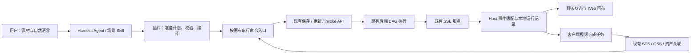
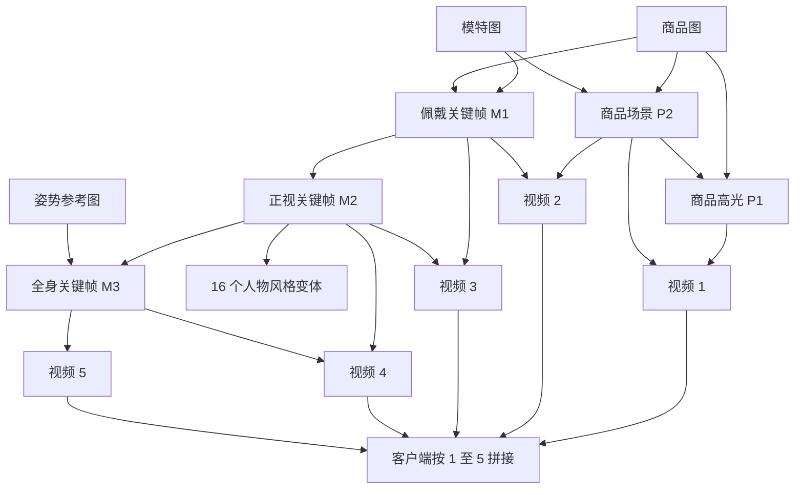
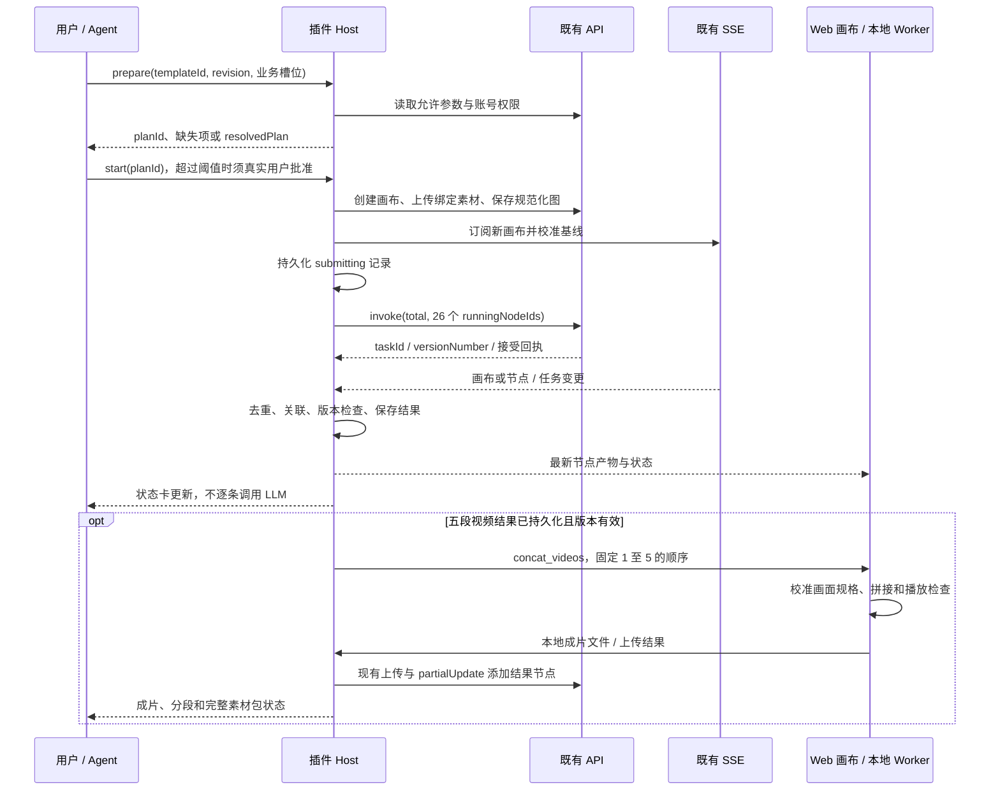

# 方案 B 首期落地设计：3C 潮流视频模板

> **历史参考，已被修订。** 节点映射保留；当前首期设计以[对话接入修订版（历史归档）](../../../archive/README.md)为准。原有画布已具备依赖执行，本期补齐对话桥接。

日期：2026-10-10，Asia/Shanghai。状态：可评审设计，未实施功能、未提交生成任务。沿用[前期调研](/Users/boxser.shi/Documents/harness/insight-desktop-shell/docs/discussions/canvas-harness-scheme-b/research/2026-10-09-canvas-harness-integration-research.md)中的接入结论，以本文件细化首期范围。

后续设计见[方案 B 执行蓝图（历史归档）](../../../archive/README.md)：已更新为业务级统一入口、按产物选择执行范围、阶段执行和独立媒体运行端。本文件中的29节点旧例映射保留作参考，默认节点数和首期产品行为以执行蓝图为准。

## 1. 交付与架构决策

首期选用归档中的 `48_潮流个性展示.json`，通过 **场景 Skill + 版本化模板 + 插件执行服务**，实现从用户提供素材到画布装配、整图生成、局部修改和最终成片的完整流程。商品海报不再是本次交付约束。

本例首次正式支持**头戴式耳机**，因为模板的佩戴、拿取、捂耳机动作都依赖这类商品。旧 Skill 泛称所有 3C，直接把商品名称替换成键盘或音箱会造成动作和画面矛盾。后续增加其他商品时，需要经过验证的动作与构图配置；首期不承诺任意 3C 自动适配。

用户上传商品图、模特图，说“做一套赛博潮流视频”，即可采用默认风格和技术参数启动。默认保留完整旧图的 **21 次生图 + 5 次生视频**，提供 16 张人物风格变体、5 个主链路关键帧、5 段视频，并新增客户端拼接成片。成片首期为无声版本；旧图没有音频节点，不能把 prompt 中“跟音乐律动”理解成已生成音乐。

本期固定边界：

- 可以修改 desktop-canvas-plugin 和 Web 画布；不新增或修改远端后端 API、任务队列、数据库、幂等服务。
- 命令调用现有 API，画布变更和任务状态来自用户已确认提供的 SSE 服务。常态下没有定时读图或任务轮询，也不创建 cron。
- 一次计划超过 30 张生成图片或 6 条生成视频时，提示用户确认；无需付费确认。这是确认阈值，不是生成数量上限，也不是并发限制。
- 旧文件中的模型、参数和命令是迁移参考；不是本次实时可用性或效果结论。当前配置、账号权限和测试环境实测共同决定可执行参数。

### 1.1 简化方案 B 的实现

优先使用现有 `workflow/invoke` 的 `total` 策略执行这张仅含基础图片、视频节点的图。后端负责图内依赖；插件负责业务槽位、节点编译、提交记录、事件归并和结果交付。首期不再复制一套逐节点付费调用的 DAG 调度器。

`single` 策略用于指定节点重跑，以及依赖已准备好的局部恢复。是否可以一次执行选定子图，要由现有接口实测决定；不能假定 `runningNodeIds` 支持任意子图调度。本设计不会对同一图同时启动 `total` 和逐节点执行。

整图执行语义是 P0 必测项。如果现有 `total` 不支持规范化后的图，应在实施前明确改为已验证的 Host 逐节点策略，并调整工期与恢复设计；不能运行时静默切换两套调度方式。



## 2. 旧资产核对：需要迁移什么

核对对象：旧 `_meta.json`、旧 `SKILL.md`、同一归档中的实际模板 JSON、`.bak`、模板批次说明和通用客户端脚本。只读取，未运行旧指令。

| 内容 | 静态核对结果 | 首期处理 |
| --- | --- | --- |
| 节点数量 | 当前 JSON：29 节点、34 边，24 image + 5 video | 以图数据为依据生成目录和说明 |
| 生成 / 素材分类 | 3 个无入边图片素材，21 个有依赖图片生成节点；旧 Skill 写 2 个上传 + 22 个生成 | 显式声明 3 个输入角色，不依靠标题猜测 |
| 视频数量 | 描述说 4 个，表格和图是 5 个 | 输出清单统一为 5 段 |
| 隐藏素材 | `bc10f860…` 标题为“图片”，是 M3 的姿势参考，旧 Skill 未列出 | 增加 pose_reference 槽位；使用经过选定的默认姿势素材，允许用户覆盖 |
| 历史数据 | 29 个节点都有 value；25 个节点有历史 taskId | 重新实例化全部 UUID，清除历史产物、状态、错误和时间 |
| 节点角色 | 29 个节点都没有显式 data.type；21 个生图节点也没有 modelType | 素材设为 upload，生成图片显式设 reference_image_to_image |
| 商品信息 | prompt 写死耳机、特定人物，并包含把 logo 改成 DYNSIGHT 的要求 | 用受控商品描述和模特角色重写；默认保留原 logo，不夹带品牌替换 |
| 首尾帧 | 4 个视频各有两个有序输入，V5 只有 M3 | 把 first_frame / last_frame 写进模板绑定，禁止自动按图片数量猜模式 |
| 最终成片 | 当前图没有合成节点；`.bak` 多一个无入边、已有 URL 的“完成视频” | 它是历史结果，不是可执行拼接逻辑；新增客户端拼接步骤 |
| 批次说明 | 写 30 节点 / 6 video，更接近 `.bak` | 作为历史说明，不覆盖当前图 |
| CLI 与监控 | 固定另一机器的 Python 路径、默认生产、cron 回查 | 改为原生工具入口、客户端环境和 SSE；不执行旧 CLI |
| canvas_id | 旧 Skill 为 Number | 全程保持正 Long 十进制字符串 |

归档中的 `prepare_template_workflow` 只按标题关键词替换输入，会漏掉姿势图；若无匹配还会把所有图片当输入。它清空输出图片，却未统一清空输出视频的 value。Skill 指向的 `template_assembler.py` 未在本次归档中找到，不能假定它已修正这些问题。

导入一次旧图后，形成受版本控制的结构化模板；正式运行不再让 Agent 阅读 29 个旧节点并临时猜哪些需要替换。

## 3. 首屏交互和业务槽位

### 3.1 输入与默认值

| 槽位 | 要求 | 取得方式 | 缺失时的行为 |
| --- | --- | --- | --- |
| product_image | 必需 | 用户附件、明确选中的商品素材、受控资产引用 | 请用户提供商品图；不使用旧模板里的商品 |
| model_image | 必需 | 用户附件或明确选中的模特素材 | 一次询问补图；首期不额外生成虚拟模特 |
| pose_reference | 必需，但用户可以不提供 | 模板配套的精选站姿参考素材；用户图覆盖默认值 | 配套素材未配置时模板预检失败，不能沿用归档 URL |
| product_description | 可自动补全 | 从商品图识别可见外观，结合用户文字 | 明显矛盾或不属于头戴式耳机时一次说明 / 澄清 |
| style_brief | 可选 | 用户描述，默认赛博、霓虹、红色空间 | 直接采用默认，不问模型参数 |
| canvas_name | 可选 | 用户命名，否则根据商品与场景生成 | 不追问 |
| canvas_id | 可选，字符串 | 明确节点引用或指定画布 | 未指定则新建；指定则检查绑定和版本，不直接替换整幅图 |

pose_reference 的角色已经可从依赖与 prompt 确定，但尚未检查旧 URL 对应的像素内容。默认素材需要在上线前由产品选定、放入模板资产包并验证可读性；这是一项素材配置工作，不需要后端新能力。

两张用户图若未标角色，Agent 可凭内容建议映射；两张图都像商品、都包含多人或存在多款耳机时，将素材角色和必要缺失信息合并成一次询问。不会按附件顺序静默绑定。

### 3.2 一次正常对话

1. 用户选“3C 潮流视频”或输入自然语言，并提供两张图。
2. Agent 加载 Skill，归纳业务输入，调用计划准备工具。模型只处理意图、商品描述和创意，不直接编造节点 UUID 或技术参数。
3. 工具返回已解析计划与缺失项。输入完整且未超过确认阈值时直接启动；计划卡说明“生成 21 张图片、5 段视频，并合成 1 个成片”。这张信息卡不额外增加确认点击。
4. 新画布打开，聊天卡按“素材已就位 → 生成关键帧 / 分镜 → 生成视频 → 合成成片”展示状态，并逐步展示可用素材。
5. 最终优先展示成片，次级入口查看 5 段视频、21 张图片和画布。只在真实成功保存后宣布完成。

完整默认计划没有超过 30 / 6 阈值，无需批量确认。客户端拼接不调用生成模型，不计入“生成视频”数量；展示时明确区分“5 次视频生成”和“1 次本地合成”。如以后增加音乐生成或模特生成，应另行纳入计划和额度统计。

用户只说“看看这个模板怎么做”，工具停在说明 / 准备，不启动生成。显式使用 Skill 并不等于授权删除既有画布、替换所有素材或重新生成不相关节点。

## 4. Skill 与模板的职责及文件结构

建议正式插件包结构如下；本次交付的草稿位于本文件旁的 `2026-10-10-canvas-phase1-reference/`，未安装进运行时：

```text
skills/skill-3c-trendy/SKILL.md          场景路由、业务槽位、必要追问与工具使用
templates/3c-trendy/v2/template.json   节点逻辑键、参数配置、显式有序输入、产物清单
assets/pose-standing-01.*             已选定的姿势素材（当前尚未提供）
src/host/template-service.ts          计划准备、实例化、校验和执行 API 适配
src/host/canvas-events.ts             上游 SSE 生命周期与事件归一化
src/host/canvas-command-service.ts    每个画布的唯一桌面写入口
src/host/run-store.ts                 本地运行记录、任务映射、恢复信息
canvas-app/.../videoCompose/          单一 concat_videos 客户端处理器
```

这些新文件名是实施建议，不代表现有模块。首期只做一个模板版本和一个拼接操作，不先建模板市场、任意代码节点系统或通用工作流语言。

| 层 | 应保存的内容 | 不负责的内容 |
| --- | --- | --- |
| Skill | 什么请求适用、需要哪些业务输入、默认创意、如何解释错误与结果 | 不写固定个人机器路径、不存 Token、不处理重连或循环查询 |
| 模板 | 可机械校验的节点、槽位、输入顺序、参数配置、输出及失效关系 | 不声明后端当前模型一定可用，不携带历史素材和任务结果 |
| 插件服务 | 解析请求为明确计划、校验、上传、调用现有 API、事件归并、本地恢复 | 不让 LLM 逐个事件判断下一步，不替远端 API 发明语义 |
| Web 画布 | 可视编辑、同源命令适配、素材预览、选中节点引用、本地拼接 | 不自行另起一套 SSE / 轮询和写入队列与 Host 竞争 |

正式注册使用 Harness 已有 Skill registry / provider 与工具接缝。现有选择器使用原生 Skill 名称；首期复用选择器和模板卡。`@skill` 展示可另加输入触发源，但不能假定现有 `@` 已支持 Skill，也不让它成为上线前置条件。

模板用 `templateId + revision + 内容摘要` 固定一次运行。Skill 版本描述行为，模板 revision 固定图；二者通过插件目录映射关联。`_meta.json` 仅作为旧发布描述参考，不能证明 Harness 会自动读取 ownerId、slug 或版本来注册 Skill。

## 5. 节点、依赖与执行顺序

### 5.1 主链路映射

以下顺序来自实际 edges 数组，也是当前 getSourceMap 的参考图片排序依据。迁移后使用逻辑角色，编译成同样有序的边。

| 逻辑键 | 旧节点 ID 前缀 / 标题 | 输入顺序与角色 | 作用 |
| --- | --- | --- | --- |
| product | 29eeb526 / 用户产品上传 | 用户商品图 | 非生成输入 |
| model | 0da5aeb5 / 用户模特上传 | 用户模特图 | 非生成输入 |
| pose | bc10f860 / 图片 | 模板姿势参考或用户覆盖 | 非生成输入 |
| P2 | dad0eff8 / 产品场景设计2 | 1 product，2 model 作为风格背景参考 | 商品场景与色调 |
| P1 | adce228d / 产品场景设计1 | 1 product，2 P2 作为构图参考 | 商品高光镜头起始帧；移除旧改 logo 指令 |
| M1 | 6b0dfdbc / 模特场景设计1 | 1 model，2 product | 佩戴耳机的模特 |
| M2 | ea752a94 / 模特场景设计2 | 1 M1 | 保持人物和商品，转为正视镜头 |
| M3 | 017e0721 / 模特场景设计3 | 1 M2，2 pose | 站姿 / 全身动作关键帧 |
| V1 | 1046b6d9 / 视频1 | first_frame=P1，last_frame=P2 | 商品悬浮、旋转、落地 |
| V2 | 0ae57dda / 视频2 | first_frame=P2，last_frame=M1 | 模特拿起并佩戴商品 |
| V3 | 743fb547 / 视频3 | first_frame=M1，last_frame=M2 | 抬头、回望、正视镜头 |
| V4 | 31d405e1 / 视频4 | first_frame=M2，last_frame=M3 | 拉远到全身红色空间 |
| V5 | 9464bd37 / 视频5 | image=M3 | 佩戴商品的舞动镜头 |

P1、P2 编号与生成顺序相反；执行时必须先 P2 后 P1，不能按标题的 1 / 2 排序。

16 个变体全部只依赖 M2，没有连接到五段视频。旧描述不能据此宣称它们已经参与成片。本次保留这一完整素材分支，并给予每个节点唯一业务名称，避免 16 个节点都叫“图片”。草稿将旧的具体人物 / 作品名改成风格描述，如冷色说唱、漫画、体素、像素、黏土等，重点是可配置人物表现，不改变商品设定。



### 5.2 有序绑定与输出选择

- 模板 `inputs[]` 每项含 source、role、order。编译出的边使用已有 `image_source` / `image_target`，并按目标与 order 稳定排序；UUID 和 UI 坐标不承担媒体顺序。
- 新建三类素材节点时显式设 `data.type=upload`，不计入运行节点。图片生成节点显式设 `modelType=reference_image_to_image`；V1–V4 固定首尾帧模式，V5 固定单图模式。
- `params.prompt` 是指令，`data.value` 是当前选定媒体，`data.product` 是结果集合。下游用明确选定的 value；`gen_count=4` 不等于自动向下游传四张图。
- 默认每个生成节点 gen_count=1。用户要更多方案时，应准备新的变体计划或明确选定输出；不能让未选择的多个候选图片随机进入视频。
- UI 的 width / height / measured 只管画布布局，不对应 2K、1080P 或成片像素尺寸。
- 全图不存在重复节点 ID、悬空边或静态环；这只证明图结构可分析，不证明模型运行成功。

### 5.3 执行优先级

完整图有 26 个生成节点。`total` 由既有后端决定具体并发，本期不声称可以通过前端控制它的并发数。首批可生成 P2 与 M1，随后推进 P1、M2 与可就绪的视频；M2 又连接 16 个变体。聊天按完成事件及时展示结果，不能把阶段进度做成全部节点都必须等待上一层的人工屏障。

当五段视频都具备有效产物时即可开始本地拼接，16 个变体不必拖延成片预览。整体仍继续生成并追踪完整 26 节点；成片成功而变体有失败时显示“成片已完成，素材包部分完成”，不会把全部运行标记为成功。

## 6. 参数处理：旧值、默认值与校验

### 6.1 参考参数配置

| 配置 | 归档值 | 本期使用方法 |
| --- | --- | --- |
| 21 个生成图片 | gpt-image-2；2K；9:16；gen_count=1 | 作为待验证候选配置，不当成实时推荐；补充参考图模式 |
| V1、V2、V3 | MiniMax-Hailuo-02；首尾帧；1080P；6 秒；1；seniorParams={} | 保留原有候选和模式；核对当前模型配置和权限 |
| V4 | 同上，但 768P | 不能顺手统一大小写或强改为 1080P；拼接阶段负责画面规格统一 |
| V5 | viduq2；单图；1080p；5 秒；1 | 必须确认模型在单图模式当前可用，不从其他模式搬参数 |
| 素材占位 | 图片模型、1K、prompt 空 | 素材角色优先；保留兼容序列化字段也不能把它们当生成任务 |

旧文件把 Hailuo 的大写 P、空 seniorParams 和禁止 aspect_ratio 写成强规则。实施时将其落实为**该模型 / 模式的配置校验与序列化规则**，不能扩展成所有视频的统一规则。不能给 Hailuo 自动塞 9:16，也不能把 1080P 一律转小写。旧文件的文字限制、参数枚举和模型列表均需与当前配置交叉检查。

本次尝试重新读取公开测试配置未成功（DNS / 访问失败），没有核实这些候选模型的当前可用性。沿用旧值只用于设计与后续测试，不声称完成实时模型调研；不存在“商品海报模型”作为本例的隐藏前提。

### 6.2 明确的 resolve 步骤

请求输入 → 当前环境模型配置 → 账号 visible / enabled 权限 → 模板业务约束 → 确定的 resolvedPlan。计划保存每个值的来源、配置摘要及最终参数；`start` 不再隐藏补默认值。

| 参数 | 解析顺序 / 决策 |
| --- | --- |
| prompt | 用户业务要求 + Skill 提取的商品事实 + 模板节点职责；不采用 Agent 猜测的性能卖点 |
| 商品 logo / 颜色 / 结构 | 用户明确要求优先；默认保留，无旧品牌替换 |
| 模型 | 用户指定且可用 → 已实测模板候选 → 经过评测的等价备选；没有合格模型则预检失败 |
| modelType | 根据模板明确的输入角色固定；改变模式就是新计划，不能连线一变就暗改 |
| 分辨率 / 时长 / 数量 | 用户明确有效值 → 模板有效默认 → 不改变产出语义的允许默认 |
| seniorParams 等 | 只保留该模型与模式允许的字段；级联参数重新解析，不携带旧模型隐藏字段 |
| 接口环境 | 当前客户端登录环境；工具和 Skill 不接受任意 `test` 或任意 Gateway URL |

预检需要验证必需素材已绑定、图片 / 视频模式及数量一致、文字长度、允许参数、模型权限、容量限制、端口、无环、运行节点清单和数量统计。JSON 格式合法只是第一层，不能代替这些业务校验。

输入完整时不问模型、分辨率、duration、seniorParams。无效的显式技术参数优先返回可选有效值；不能把用户明确的高清需求默默改低。模型不可用时只有已经评测过、且不改变输入角色和主要交付的备选能自动替换；会改变镜头、时长或画幅时用一次业务语言说明并等待选择。

生成式佩戴、动作和人物替换可能改变商品细节，本例不能保证像素级保真。上线验收要检查商品轮廓、颜色、logo、佩戴关系和跨帧稳定性；若用户要求绝对不变形，本模板不能只靠 prompt 宣称满足，应返回不适配并引导到保持原商品素材的合成场景。

## 7. API 与 SSE 协作

### 7.1 现有 API 映射

以下以当前 Web 调用为依据，不执行远端写入。前缀均为固定环境 Gateway 下的 `/game-ai-editor-center/`；准确成功响应、版本语义和状态粒度仍需 P0 样本确认。

| 动作 | 已有路径 | 插件提交重点 |
| --- | --- | --- |
| 创建画布 / 保存图 | api/canvas/saveOrUpdate | 无 id 创建；version=comfyui，canvasType=1；data 是图 JSON 字符串；返回 canvasId 保持字符串 |
| 读图 | api/canvas/get | id；读取全图、版本和持久化产物，不能只用当前 canvas_get 摘要 |
| 增删改 | api/canvas/partialUpdate | id、versionNumber；addNodes / updateNodes 为节点 JSON 字符串数组；edges 是全量边集 |
| 整图 / 单点生成 | api/v2/workflow/invoke | canvasId、versionNumber、workflowData、executeStrategy、runningNodeIds |
| 取消已提交任务 | api/v2/workflow/interrupt | taskId、nodeIds；调用成功不等于所有远端计算已停止 |
| 模型参数 / 权限 | api/v2/workflow/listNodeSetting 或既有参数 CDN；listModelNodeSetting | 与账号 enabled / visible 和模板需求交叉解析 |
| 素材与成片上传 | upload/sts/token → OSS → upload/asset | 已登录账号身份、限定目录的 STS、URL 与 canvasId / nodeId 关联 |

创建后取得实际版本，再提交上传完成的图。workflowData 只包含后端认识的基础图，runningNodeIds 明确列出 21 个生图与 5 个视频节点；三张素材不执行。后续本地拼接也不放入这份后端执行图。

### 7.2 完整时序



subscribe 和 invoke 之间必须有可校准的基线。若远端没有 ready / 游标确认，则通过订阅后的快照与提交回执校准，不能把打开 TCP 连接当成已覆盖所有事件。完成事件可能先于 invoke 的 HTTP 回执，需要先缓存再按 canvasId、nodeId 与 taskId 关联。

### 7.3 SSE 适配，不要求远端增加新字段

SSE 协议尚未提供，本设计定义的是插件内部归一化表示，不是要求后端改成某个新接口。

| 信息 | 既有 SSE / API 能提供时 | 若不能提供 |
| --- | --- | --- |
| 画布 / 任务归属 | 直接关联 canvasId、taskId、nodeId | 从订阅范围和已记录 API 回执映射；归属不能可靠确定时不推进该任务 |
| 事件游标 / 唯一 ID | 去重、记录已处理位置；按实际协议尝试重连回放 | 通过状态 / 版本 / 产物签名幂等归并，重连后一次读图校准 |
| 节点与产物数据 | 经已确认字段映射后应用 | 把通知作为触发器，一次读取既有 get / 结果接口 |
| graphVersion / inputRevision | 与提交及当前状态校验 | 本地提交快照 + 节点输入摘要 + taskId + 读图结果关联，不声称支持任意多端同时修改 |
| 完成状态与持久化一致性 | 同一权威事件判定结果可用 | 通知后一次查询；若仍未写入，等待下一相关事件或用户恢复，不转为定时回查 |
| 心跳 / 错误 | 更新连接状态和重连 | 不据此宣告生成失败或重新 invoke |

事件通知可合并突发变化，并按画布 single-flight 读取；读取结束若期间还有相关通知，做一次尾随读取。心跳、每次渲染和进度 tick 不触发读图。只有首次基线、实际变化通知、重连 / 缺口、明确恢复动作触发校准。

若 SSE 只发一次完成通知，且既无可用结果、又在读图时结果尚未落盘，现有能力不足以保证无轮询完成判定。P0 必须发现这一问题：在保持后端不改的前提下，不把该行为伪装成可靠自动完成。可以展示“生成完成通知已收到，结果待同步”，提供一次手动刷新；这不是完整自动交付的合格验收结果。

原 SSE 的 id / retry 是传输机制，不能证明服务端保存可回放历史。SSE 是单向推送；写命令继续通过 API。[MDN SSE 文档](https://developer.mozilla.org/en-US/docs/Web/API/Server-sent_events/Using_server-sent_events)

### 7.4 同源桥接与写入协调

当前 `gateway-route.ts` 是 30 秒超时、要求 JSON、读取完整 response 再返回的代理，不能拿来直接代理 SSE。新增专门的事件适配服务 / 同源事件路由，采用流式读取和符合上游协议的断线重连；上游需要自定义登录头或 POST 时用 fetch 流，不能把 Token 放进 EventSource URL。

Host 持有桌面登录 Token，重新连接时取得当前登录态；只使用固定环境地址。传给 iframe 的是规范化事件或安全的同源 SSE，不传桌面 Token。连接持有者是 Host，不随画布标签关闭而销毁；真实上游按账号还是按画布订阅由既有协议决定。退出登录 / 换账号关闭旧订阅、隔离运行记录，禁止用新账号恢复旧账号任务。

桌面内 UI 和 Agent 的写操作共同进入按 canvasId 串行的 Host 服务。Web 适配器保留操作意图与本地乐观状态，不另建一条直连 API 写路径。命令回执和 SSE 应用都遵守同一版本检查；UI 更新不反向触发自动保存形成循环。

代码已有 versionNumber 和 5011 冲突处理，但需实测服务端拒绝陈旧版本。全量 edges 在同一队列中读取最新图、应用受控变更后提交；不能拿 Agent 看过的旧边集覆盖整个画布。节点拖动等布局变化不让生成产物失效；商品、prompt、模型、输入顺序等业务变化才改变输入摘要。

首期运行时冻结参与本轮的业务参数与连线，允许布局调整；节点修改请求先排队至当前任务确认结束 / 取消，再准备局部重跑。若远端 Web 可以同时修改同一图且服务端不拒绝旧版本，只能实行新建画布 / 单写者约束；不增加后端锁服务，不承诺跨客户端并发编辑安全。

## 8. 首期工具、状态和恢复

### 8.1 建议原生工具

以下均为新设计名称，当前插件只注册了 `canvas_get`。首期用高层业务工具，内部编译 / SSE 服务不暴露给 LLM。

| 工具 | 输入 | 主要结果 |
| --- | --- | --- |
| canvas_template_prepare | templateId、revision、slots、可选 canvasId / 目标节点 | prepared：planId、规模、参数摘要、更新范围；或 missing_inputs / unsupported_product / unsupported_params |
| canvas_template_start | planId | runId、canvasId、资源地址、当前状态；或 approval_required / stale_plan / submission_unknown |
| canvas_node_update | canvasId、nodeId、expectedVersion、受控 patch、重跑范围 | 局部计划与受影响节点；共用 prepare / start 的执行规则 |
| canvas_run_get | runId | 读取本地最新状态；必要时显式 recover 才发一次 API 校准，无内置轮询 |
| canvas_run_cancel | runId | 停止本地后续动作，调用既有 interrupt；返回哪些任务已确认停止 / 仍未知 |

复用 / 扩充 `canvas_get` 供按需读完整节点、依赖和版本；不能因其现在只返回前 20 个摘要而漏掉本例最后几个关键素材。prepare 是真实模板编译服务，Agent 不可提交任意模板文件路径、任意 Python 命令或修改环境。

准备计划时不创建画布、不上传、不生成。素材尚在本机时保存附件引用；start 创建画布后，使用已授权附件和受控素材资产上传，拿到 URL，再编译绑定并保存图。不要要求用户自己把实拍图变成 HTTPS URL。

start 在任务接受后返回运行标识，由 Host 持有后续观察与交付任务。已接受的运行与一次 Agent 工具回合的 AbortSignal 分离；中断聊天回合不能被误解为取消远端生成。退出 Host 时停止本地监听与处理并保存恢复记录，用户明确取消则进入 cancel 流程。

### 8.2 批量确认

准备服务计算本次将要执行的生成次数，包括中间图、变体、明确安排的重试和用户增加的分支。正常21 / 5；21张图片各生成2张则42 / 5，要确认。涉及视频链路的多候选图片还必须明确选择规则，数量确认不代替媒体选择。视频某一节点从1变2会变6，不超过阈值；再增加一个则7，须确认。

确认绑定 account、session、planId 和 planHash；真实用户响应通过现有交互工具 / 卡片记录，start 由服务端本地审批状态校验，不接受模型传 `confirmed=true`。更换商品、增加数量、改变执行范围或重建计划后重新检查。局部重试若属于同一轮恢复，累计计入该轮已提交与准备追加的生成数；首期失败不自动付费重试。

### 8.3 最小本地运行记录

保存在插件的账号与环境隔离应用数据目录，优先复用可用存储接缝；若用 JSON，采取串行写入与原子替换。它不修改 Harness 核心会话表，也不写进代码仓库。

| 字段 | 用途 |
| --- | --- |
| localSchemaVersion、runId、account / environment / session | 本地解析与归属 |
| templateId、revision、templateDigest、planHash | 固定执行内容 |
| canvasId、baseVersion、logicalKey → nodeId | 稳定的实例绑定 |
| resolvedParams、素材引用 / 摘要、inputDigest | 恢复时识别输入变更与过期产物 |
| submitAttempt、strategy、runningNodeIds、taskId、submitVersion | 处理接受回执和提交结果未知 |
| 每节点状态、taskId、选定 artifact、结果版本 | 准备局部重跑与完成判断 |
| SSE 已处理位置 / 签名、连接状态 | 重连校准和去重 |
| 拼接 jobId、输入签名、成片上传位置、resultNodeId | 避免事件重放导致重复拼接 / 添加成片 |

客户端阶段至少区分 ready、submitting、running、sync_disconnected、awaiting_local_compose、composing、uploading、partial_success、success、failure、cancelling、cancelled、submission_unknown。远端原始状态单独记录；不向后端写入它不认识的这些新枚举。

### 8.4 异常行为

| 发生情况 | 首期行为 |
| --- | --- |
| invoke 超时 / 回执丢失 | 标记 submission_unknown，事件和一次查询校准；无后端幂等依据时不自动重发 |
| 重复完成通知 | 相同任务 / 输入签名只归并一次，不再启动拼接或新增生成 |
| 旧 taskId 成功事件晚到 | 保存为历史结果，不覆盖当前轮；没有归属证据不用于下游 |
| SSE 断线 | 显示同步中断、重连并校准；不把节点改失败、不重跑 |
| 1 个视频失败 | 其他结果可见，成片等待该分镜；只准备失败节点和真正缺失依赖的重试 |
| 1 个变体失败 | 5 段视频与成片可交付，素材包标部分完成，允许单独补图 |
| 用户更新商品 / 模特 | 不复用前轮生成结果；明确失效范围，重跑前准备新计划 |
| 当前画布标签关闭 | Host 继续接收远端任务事件；本地拼接需要 Web 执行端，缺失时进入 awaiting_local_compose，重开自动续接 |
| 客户端退出 | 已接受远端任务生命周期需实测；本地拼接与尚未提交动作暂停，重开用运行记录 + 一次读图恢复 |
| 用户取消 | 先停止本地自动后续动作，再请求 interrupt；收到远端确认前显示取消中；迟到产物保留历史 |

事件只改变插件运行状态与 UI，不逐条唤醒模型。需要补充创意或用户决策时，使用已记录的会话输入 / 工具结果；不会将未记录的外部事件直接注入模型上下文。

## 9. 成片拼接：不改后端的具体实现

新增模板内部 `concat_videos` 本地步骤，其 dependsOn 明确为 V1、V2、V3、V4、V5；它不是本期新增后端节点类型，也不通过 workflow/invoke 执行。

首期复用 Web 已有的 `@ffmpeg/ffmpeg` / Web Worker 和上传基础，增加一次串接五段视频的专用处理器。官方库当前面向浏览器，不能直接把现有 ffmpeg.wasm 模块 import 到 Node Host。[ffmpeg.wasm 官方安装说明](https://ffmpegwasm.netlify.app/docs/getting-started/installation/)

具体流程：

1. Host 判定五个本轮视频均成功、有持久化媒体、inputDigest 匹配，固化五个 artifact 及顺序。前端选择变化不得偷偷改变这次拼接输入。
2. Web 执行端接收已登记的 compose job，在 Worker 中获取媒体，探测真实尺寸、时长与编码。已有裁切代码只负责单源，不能直接当多源拼接使用。
3. 首期目标为 9:16、1080×1920、固定 30fps、H.264 / MP4，按比例缩放并补边，避免裁掉耳机。此为成片产品默认，需要设备性能实测；768P 分镜放大不增加细节质量。格式归一、时间戳归零后按 1–5 串接，默认丢弃偶发原始音轨，交付无声成片。
4. 不使用简单 `-c copy` 拼接混合分辨率 / 编码视频。FFmpeg concat 对分段时间戳与对应媒体规格有要求；分辨率等需显式归一。[FFmpeg concat 官方文档](https://www.ffmpeg.org/ffmpeg-filters.html#concat)
5. 输入分段的请求时长为 6+6+6+6+5=29 秒，实际成片时长以产物探测结果为准，不能只根据参数宣布精确 29 秒。首期硬切，不含转场、音乐、节拍自动剪辑。
6. 成片文件通过现有上传能力进入 OSS，并用现有资产关联 API 归属到本轮画布与预留的 resultNodeId，上传成功即可展示成片预览。首期等本轮后端总任务进入可核验终态后，再经队列读取最新图，通过 partialUpdate 添加一个普通 `video` 非生成结果节点（`data.type=tool`，沿用媒体结果语义），避免远端仍在更新图时覆盖新增结果。该步骤不再调用视频生成。若后端始终不提供可核验终态，属于 P0 未满足，不能以客户端估时替代。

首期无须注册新的 React Flow 节点类型。新增结果节点后画布有 30 个媒体节点，远端生成图仍是29节点 /34边；拼接依赖保存在本地运行记录和结果卡中，点击可跳到五段视频。不要向后端 graph 添加指向成片的普通生成边，否则以后 total 可能把结果错误识别成新任务。

结果卡展示“本地合成”与五个来源；普通 Web 仍能播放该基础视频节点。跨设备继续编排、模板元信息任意字段的后端持久化不在本期承诺内，不能假设后端一定保留新 data.runtime 字段。

复用既有裁切引擎时需处理 Worker / 文件系统并发：当前大文件挂载只支持单一路径、会卸载旧来源；不能原样循环挂载五个源。首期专用拼接 job 采用唯一工作目录和串行 Worker 任务，逐段归一并及时释放内存，确认一次处理五段视频可行，再确定文件大小和设备性能限制。失败只重试本地拼接 / 上传，不重新付费生成五段视频。

素材上传使用既有 STS 和 OSS，不经 JSON 代理传 Blob。桌面模式可新增受控同源文件上传入口，由 Host 持有临时凭据；Web 独立模式沿用浏览器上传提供者。真实二进制上传、身份初始化、CSP 的 Worker / 媒体域名与既有跨域设置都是 P0 / P3 验证项。

## 10. 选中节点后用对话修改

Web 提供“交给助手修改”入口，将 canvasId、nodeId、选中时版本、节点类型与有限摘要送至 Client。现有消息仅把摘要追加到草稿，需完成实际调用入口；发送时冻结引用。Agent 真正执行前重新读该节点与图，不能使用全局“当前画布 / 当前选中节点”。

| 用户请求 | 变更与重跑范围 |
| --- | --- |
| 选 V3：“转头幅度小一点” | 修改 V3 prompt，沿用已经有效的 M1、M2，单独生成 V3；完成后仅更新成片 |
| 选 M3：“全身姿势更放松” | 更新 M3；使 V4、V5 和成片失效；不重跑 V1–V3、16 个变体 |
| 选某个变体：“不要体素，换漫画” | 仅该变体图片重跑；五段视频和成片不受影响 |
| “替换商品图” | P2、P1、M1、M2、M3、16 个变体、五段视频和成片均受影响；准备完整新轮计划 |
| 调整节点位置 / 改标题 | 不改变生成输入摘要，不产生新的生成任务 |

修改运行中节点先停止 / 等待旧任务并确认状态，再开始新一轮；不能旧任务未结束就用相同 nodeId 开两个难以区分的生成。服务端不提供可靠 taskId / 版本关联时，新建对应输出实例，并在本地绑定与 UI 中呈现替代关系。

对失效产物保留历史展示并标记“基于旧输入”，不自动删除用户编辑结果，也不自动重跑整个后继闭包。更新工具返回业务影响范围；用户已经明确要求修改当前分镜时可执行该范围，超过批量阈值仍由真实用户确认。更广泛的画布图结构增删改属于后续扩展，不把本例做成任意图修改工具。

## 11. 改造清单与实施顺序

### 11.1 P0：验证既有能力与固化模板

| 责任方 | 交付 | 验收标准 |
| --- | --- | --- |
| 插件 / 现有服务维护者 | 测试环境 create、save、partialUpdate、invoke total / single、interrupt 的脱敏请求回执样本 | 本模板输入角色和26运行节点有效；仅执行指定生成节点；验证失败传播、部分结果、自动选定value、总任务终态；旧版本写入确实拒绝或落实单写者 |
| SSE 服务维护者 + 插件 | 既有 SSE 地址 / 鉴权 / 范围 / 通知 / 重连样本、产物与保存时间关系 | 可关联本轮画布与任务，事件后可靠拿到结果；不要求新增远端字段 |
| 产品 / 素材 | 头戴式耳机、模特、默认姿势测试素材，修正 prompt 与16变体 | 素材合法可读、角色一致；不引用未知历史 URL |
| 插件 / Web | 当前模型配置 + 权限 + 候选兼容检查；一次短链路样本 | 验证首尾帧顺序和 V5 单图模式；记录实际参数而非只依赖旧 Skill |
| Web | 五个本地样例视频的合成性能试验 | 既有 Worker / CSP /上传链路可处理混合分辨率五段素材 |

P0 可以先用脱敏录制数据和本地媒体做无付费验证；实际生成验证需由项目提供测试账号 / 样本和执行范围。本次只做设计，未触发这些生成。

### 11.2 P1：插件公共能力

1. 把模型解析、媒体模式校验、模板实例化和边序转换抽成不依赖 React / Zustand 的纯逻辑；只提取本例所需逻辑，不把整套 flowStore 导入 Host。
2. 新建 template-service 与高层工具，注册场景 Skill；目录打包进入插件发布产物。先实现 prepare 的 missing_inputs、参数错误与规模统计。
3. 实现固定环境 API client、按画布串行命令与运行记录；扩充全图 / 节点读取，补齐 Token 之外的当前身份与上传服务。
4. start：创建图、上传素材、规范化保存、订阅校准、记录提交、total 执行；后台任务不依赖一次工具调用持续占着 Agent 回合。
5. 新增上游 SSE adapter 和同源分发，处理鉴权、退出清理、回执早晚、重连与通知式读图；进度由本地状态卡订阅。实现现有公开接缝的工具结果 presenter 与 Client 运行卡，不通过未定义的聊天消息注入绕过会话日志。

### 11.3 P2：Web 画布写入与同步

1. 给现有请求 / flowStore 提供 CanvasCommandAdapter：桌面模式接 Host 队列，独立 Web 模式接现有 API 与自身队列。只改本例覆盖的保存、partialUpdate 和执行路径，检查尺寸保存等旁路不再绕行。
2. 将 `hooks.ts/usePolling` 替换为事件驱动的 CanvasEventAdapter。本模板在 SSE 模式没有运行期间的 interval get；旧轮询与新 SSE 不共存。其他不在本例使用的 external-tool 节点另行安排，不假称已经全部支持。
3. 将原 polling version barrier 调整为命令 / 事件 / 校准读取的协调，避免 SSE 快照覆盖 UI 未完成修改；区分网络同步中断和真实生成失败。
4. 补齐素材 upload 角色、明确首尾帧模式 / 参考图顺序，以及模板输出分组展示；默认参数面板收起。
5. 实现选中节点引用、局部修改范围卡、运行期间业务参数保护和结果历史标识。

Web 的现有画布源是一份迁移到插件内的 legacy 快照，不会自动从旧 Web 仓库同步。上述适配和参数纯逻辑应在明确的共同源中维护并构建到两端；若本期仍采用镜像同步，按文件列出双端应用和验收，不能只改插件副本便宣布 Web 完成。

### 11.4 P3：完整视频交付

1. 增加专用本地 compose job、Worker 拼接与真实媒体探测，串行资源调度、退出处理和临时文件清理。
2. 通过既有上传接口保存成片；预留稳定 resultNodeId，重放 / 恢复先检查已上传结果与图，不重复新增成片节点。
3. 聊天卡和画布展示成片、分段、完整素材包及 partial_success；实现本地拼接失败重试与标签重开续接。
4. 集成节点局部重跑和成片重新合成；通过正式锁定的 Harness runtime 安装包验证，Host 共享依赖保持 peerDependencies，避免重复工具 registry 实例。

### 11.5 P4：验收与灰度

先验证结构与协议录制，再验证测试环境短链路，最后跑一次完整模板及局部修改。最小链路用于工程验证，不替代首期完整21图/5视频/成片交付。

| 场景 | 必须可观察的结果 |
| --- | --- |
| 两张用户图 + 默认姿势素材 | 零技术参数追问；全29节点/34边角色与绑定正确；生成26节点 |
| 商品 / 模特都缺 | 一次返回合并缺失项，无写入或生成 |
| 旧模板迁移 | 无旧 URL、taskId、产品产物；所有实例 ID 新建，三输入不生成 |
| 首尾帧角色 | V1至V4顺序可核验；移动画布节点不交换输入图片 |
| 默认完整任务 | 最终5分段+成片；16变体与5关键帧可查看；不误称音乐成片 |
| SSE 正常 | 无定时 get / result 请求；通知触发读图可合并；心跳不读图 |
| 完成早于 invoke 回执 | 不漏完成、不重复执行拼接 |
| 断线、重复、旧事件 | 可恢复状态；不覆盖新任务、不重复生成和新增成片 |
| 30图/6视频 与31图/7视频 | 前者无批量确认，后者真实用户批准后执行；模型伪造批准无效 |
| 1视频 / 1变体失败 | 视频失败阻止完整成片；变体失败允许成片与部分素材交付 |
| V3 局部修改 | 只新增1次视频生成，然后本地重合成；旧有效输入复用 |
| M3 局部修改 | 只重跑M3、V4、V5与本地成片，不重跑其他分支 |
| API 提交结果未知 | 状态校准，不自动重发付费任务 |
| 本地拼接失败 | 五段媒体保留；重试只走本地处理 /上传 |
| 混合规格 / 无音轨 | 成片播放、画幅、顺序、时长正确，商品不因裁切被截断 |
| 多端旧版本写 | 现有服务拒绝或明确单写者约束，不能静默覆盖 |
| 标签关闭 /重开 /客户端重启 | 远端状态可恢复；本地待合成可续接；不承诺退出后本地继续处理 |
| 正式插件安装 | 工具、Skill、模板、Worker与上传均来自包内；不依赖个人机器文件 |

## 12. 本期具体接缝与证据

| 当前文件 / 功能 | 本期改造 |
| --- | --- |
| [Host 工具注册](/Users/boxser.shi/Documents/harness/desktop-canvas-plugin/src/host/index.ts) | 注册高层 prepare / start / update / get / cancel 与 Skill provider |
| [当前摘要读取](/Users/boxser.shi/Documents/harness/desktop-canvas-plugin/src/host/canvas-get.ts) | 加全图、节点详情、edges、版本和任务 / 产物读取，统一使用 data.title |
| [JSON 代理](/Users/boxser.shi/Documents/harness/desktop-canvas-plugin/src/host/gateway-route.ts) | 保留普通 API；单独实现事件流，不沿用30秒JSON缓冲 |
| [Token IPC](/Users/boxser.shi/Documents/harness/desktop-canvas-plugin/src/host/desktop-token.ts) | 每次连接 /重连取当前登录态；上传与退出按账号隔离 |
| [页面 CSP](/Users/boxser.shi/Documents/harness/desktop-canvas-plugin/src/host/page-route.ts) | 按同源事件、Worker、实际上传路线补齐必要源，保持固定域名 |
| [请求适配](/Users/boxser.shi/Documents/harness/desktop-canvas-plugin/canvas-app/src/request.ts) | 分离JSON命令与真实文件上传，不再期望 FormData 经现有适配器 |
| [API 请求类型](/Users/boxser.shi/Documents/harness/desktop-canvas-plugin/canvas-app/legacy/src/api/workflow.ts) | 复用已有路径和序列化格式，抓真实响应验证 |
| [flowStore 队列与单点 payload](/Users/boxser.shi/Documents/harness/desktop-canvas-plugin/canvas-app/legacy/src/store/flowStore.ts:56) | 桌面写入交给Host，保留本地视图与乐观更新；针对重跑复用single语义 |
| [旧轮询](/Users/boxser.shi/Documents/harness/desktop-canvas-plugin/canvas-app/legacy/src/components/canvasFlow/hooks.ts:690) | 由事件适配器替代，连接异常不伪造任务失败 |
| [参考图排序](/Users/boxser.shi/Documents/harness/desktop-canvas-plugin/canvas-app/legacy/src/components/canvasFlow/utils/util.ts:760) | 抽出受控的模板边序与输入校验 |
| [媒体模式规则](/Users/boxser.shi/Documents/harness/desktop-canvas-plugin/canvas-app/legacy/src/components/canvasFlow/utils/mediaNodeModelUtil.ts:440) | 固定本例模式，拒绝连线变化暗改为其他模式 |
| [FFmpeg 单源引擎](/Users/boxser.shi/Documents/harness/desktop-canvas-plugin/canvas-app/legacy/src/utils/videoClip/ffmpegEngine.ts) | 新增多源拼接处理与资源隔离；不直接复用单源挂载逻辑 |
| [裁切上传参考](/Users/boxser.shi/Documents/harness/desktop-canvas-plugin/canvas-app/legacy/src/components/canvasFlow/components/toolControl/VideoClip.tsx:86) | 复用上传思路，但修正新流程失败状态，不能沿用失败后标success的行为 |
| [STS身份提供者](/Users/boxser.shi/Documents/harness/desktop-canvas-plugin/canvas-app/legacy/src/services/upload/credentialProvider.ts) | 补齐桌面当前身份，复用现有STS/资产关联 |
| [节点消息](/Users/boxser.shi/Documents/harness/desktop-canvas-plugin/canvas-app/src/node-message.ts) / [草稿入口](/Users/boxser.shi/Documents/harness/desktop-canvas-plugin/src/client/CanvasTab.tsx) | 加实际选中入口、版本引用和送出时冻结；执行前重读 |
| [现有 Skill 选择器](/Users/boxser.shi/Documents/harness/insight-desktop-shell/packages/insight-desktop-integration/src/client/SkillPicker.tsx) | 复用原生入口，显示模板场景短说明 |
| [Skill registry](/Users/boxser.shi/Documents/harness/insight-harness-core/packages/skill/skill/README.md) | 使用已支持 provider / registration，核对正式 runtime 的公开接缝 |
| [正式 Runtime lock](/Users/boxser.shi/Documents/harness/insight-desktop-shell/core-runtime.lock.json) | 以发布锁定产物验收，不只在本地 Core 最新源码测试 |

原始参考：

- [旧 Skill](</Users/boxser.shi/Downloads/归档/e8dcc389-c738-4dba-9bec-05e6d945ab9f/skill-3c-trendy/SKILL.md>)、[旧元信息](</Users/boxser.shi/Downloads/归档/e8dcc389-c738-4dba-9bec-05e6d945ab9f/skill-3c-trendy/_meta.json>)。
- [当前29节点模板](</Users/boxser.shi/Downloads/归档/e8dcc389-c738-4dba-9bec-05e6d945ab9f/comfyui-workflow/templates-detailed-new/48_潮流个性展示.json>)、[含历史成片的备份](</Users/boxser.shi/Downloads/归档/e8dcc389-c738-4dba-9bec-05e6d945ab9f/comfyui-workflow/templates-detailed-new/48_潮流个性展示.json.bak>)。
- [旧批次说明](</Users/boxser.shi/Downloads/归档/e8dcc389-c738-4dba-9bec-05e6d945ab9f/comfyui-workflow/templates-detailed-batch/batch_10_templates_46-50.md>)、[旧通用清理脚本](</Users/boxser.shi/Downloads/归档/e8dcc389-c738-4dba-9bec-05e6d945ab9f/comfyui-workflow/scripts/comfyui_client.py:735>)。

配套[结构化模板草稿](/Users/boxser.shi/Documents/harness/insight-desktop-shell/docs/discussions/canvas-harness-scheme-b/plans/2026-10-10-canvas-phase1-reference/template.json)和[场景 Skill 草稿](/Users/boxser.shi/Documents/harness/insight-desktop-shell/docs/discussions/canvas-harness-scheme-b/plans/2026-10-10-canvas-phase1-reference/skill-3c-trendy/SKILL.md)用于评审职责、字段与依赖。它们不是现有 API 可直接接受的 workflowData；需要上述编译器、工具和姿势素材后才能运行。
