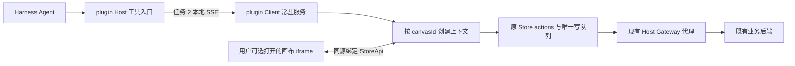

# 任务 1.4：无需展示画布的插件服务 Implementation Plan

> **For agentic workers:** 按 writing-plans 与 karpathy-guidelines 编写。2026-10-13 已完成 1.4.1–1.4.7 编码和自动回归，见[实施与整体 Review](../implementation/2026-10-13-task-1-4.md)。1.4.8 构建 / 隔离安装 / 本机 Core 浏览器 fixture 验收已执行；真实账号及完整 Electron 人工验收由用户明确暂缓，未记为通过。最新[任务 2 前置核对](../implementation/2026-10-13-before-task-2.md)已完成，服务底座可以进入任务 2 开发。未勾选项表示对应实施或验收尚未完成，不代表还有未实现的任务 1.4 业务代码；不擅自启动子代理或提交代码。

**Goal:** 让插件在未打开画布标签、未创建画布 iframe 时，对已有画布完成受控节点读取、增删改和单节点生成提交；用户打开画布后仍使用原生 UI、同一份业务状态与持久化队列。

**Architecture:** 插件 Client 的浏览器环境持有按 canvasId 分开的服务上下文。上下文复用现有 Store actions、API、媒体协调器、版本队列和生成监听；可见 iframe 只是连接上下文的视图。Host 持有工具入口、账号凭证和 Gateway 代理；Agent → Host → Client 的 SSE 命令桥在任务 2 接通，不以打开标签为前置条件。

**Tech Stack:** Cordis plugin Client、浏览器 ESM、Zustand vanilla Store + UI useStore、现有 ReactFlow / API、同源 iframe 视图绑定；后续 Host/Client SSE。沿用现有测试依赖 Vitest 4.1.7 / jsdom 29.1.1，不升级业务依赖。

## Global Constraints

- 实施目录是 `/Users/boxser.shi/Documents/harness/desktop-canvas-plugin`。本轮完成1.4剩余编码、整体review及Shell专项归档；后端与Shell/Core业务不改，不推进任务2/3。
- 1.1–1.3 已实现，严格回执、字段 policy、版本队列和防覆盖逻辑必须保留；只调整它们的上下文归属及必要的内部返回信息。
- 服务启动和 execute 不调用 `sidebarRight.openResource*`、不创建 `/desktop-canvas/view` iframe、不挂载 CanvasFlow / ReactFlow；显示画布始终是独立的用户操作。
- 不新增后端接口、DAG 调度器、媒体生成实现或第二份结果轮询；迁移现有监听的启动位置。
- 同一 Client、同一 canvasId 只有一个业务 Store / 写队列 / 版本 barrier / 编辑 guard / 生成监听。不同画布必须隔离；同画布跨窗口继续使用原生所有权协议及后端版本校验；后台服务先查询既有owner，已知其他窗口owner时不主动newclaim抢占，显式打开/刷新视图才沿原生用户claim行为。
- 默认 UI 方法的返回、参数默认值、提示、debounce、flush、撤销记录、loading 和素材处理保持。Agent 的严格方法可扩展内部回执元数据，不能改变默认 UI 调用行为。
- canvasId 使用正 Long 十进制字符串，服务端版本原始 number/string 保留；禁止 Number 转换 ID 或用本地 +1 伪造版本。
- 普通 text/image/video/audio 的受控字段和单点执行范围沿用 1.1；技术参数先限 image/video。特殊工具写入、连线、模板、上传、模型切换保持后续任务范围。
- Agent 大批量确认仍归任务 3：同一请求累计 >30 张图或 >6 条视频确认，无需付费确认。本项 approvedGeneration 是可信调用方预检结果，不是 Agent 自填参数。
- 本项只实现“Shell 已登录且 Client 存活时，无可见画布也可操作”。不承诺关闭客户端后的全流程接续或重启后的 exactly-once。
- 原始实施事实见 [1.2 归档](../implementation/2026-10-12-task-1-2.md)、[1.3 归档](../implementation/2026-10-12-task-1-3.md)：插件 48、Web 62 个测试通过；Web 9 条既有类型诊断。新验收不把旧诊断当成功，也不能新增诊断。

## 1. 为什么需要这个改动，改动到什么程度

增删改方法已经存在。当前 `CanvasFlow` 挂载时取得图、模型和权限，调用 Store.init；卸载时 reset。Store 本身初始没有 canvasId、图和版本。需要移动的是这段上下文准备与销毁责任，不重做节点业务。

当前服务不能直接放进 Node Host：媒体尺寸处理使用 Image / video 等浏览器能力，API 请求使用同源浏览器认证，而且 native 工具模块还引用 UI 对话框。选择插件 Client 的浏览器环境能保留这些业务方法；Host 继续保管 Token。该服务没有可见画布，也没有隐藏画布 iframe。

同源不等于同一份 JS 内存。Client 与 iframe 各自 import 同一文件会生成两份 Store。因此本计划明确：服务拥有 vanilla Store，iframe 的 React hook 通过可信同源绑定订阅该 StoreApi；不能在 iframe 再初始化一份可写 Store，然后只靠 SSE 同步弥补竞争。



服务初始化不需要 Viewer、画布尺寸或 requestAnimationFrame。UI 的视口、DOM 测量、菜单、节点选择引用和支付 / 容量弹窗仍属于可见视图。

## 2. 执行位置与边界

| 层 | 实际位置 | 职责 | 本项不做 |
| --- | --- | --- | --- |
| Host | Shell 承载的 Harness Host Node 进程，plugin Host 模块 | 现有页面 / Gateway 代理与桌面身份 | 不 import Web Store、不模拟 DOM、不复制节点算法 |
| Client 服务 | Harness 客户端浏览器窗口，plugin Client 生命周期 | 按需准备上下文、调用受控 adapter、维护状态与原监听 | 不通过打开标签启动服务 |
| Web 视图 | 原同源 `/desktop-canvas/view` iframe，用户打开才创建 | 原 CanvasFlow 和编辑控件；绑定服务 Store 与 UI 反馈 | 不拥有另一份写队列，不在关闭时 reset 服务 |
| 后端 | 现有画布 / workflow 服务 | 持久化与实际媒体生成 | 接口和依赖执行能力不改 |

“永久内置”在本项落实为插件 Client apply 时安装服务加载入口，ctx.effect 负责卸载；图数据仍按需加载，不启动时加载所有画布。插件是否已进入发行包属于已有打包 / 发布流程，不能以源码存在代替安装验收。

构建采取两个 Web 入口：原 `index.html` 视图入口保持；新增固定路径 `/desktop-canvas/canvas-service.js` 的 ESM 服务入口。Client 首次访问handle.ready才动态import服务入口，固定pathname附加每Client生命周期runtime UUID以隔离ESM缓存；沿用当前鉴权pageHandler静态资源服务。服务入口不 import main.tsx、canvas-router.tsx、CanvasFlow 或 eager UI dialog。无需新增 Shell IPC 或改变 Core。

## 3. 文件地图

下面均相对插件根目录，描述完整 1.4 的最终文件地图。flowStoreCore.ts、canvas-context.ts、canvas-initialization.ts、canvas-service.ts、canvas-service-entry.ts与Client loader/共享Base接口/构建audit已创建；服务 binding / adapter / monitor / ownership / timer 已实现；完整人工验收仍按未勾选步骤执行。当前实际签名与文件以各步实施归档为准。

| 文件 | 必须落地的内容与复用 |
| --- | --- |
| `canvas-app/legacy/src/store/flowStoreCore.ts` 新增 | 将现有 createFlowState 和 mutationQueue 工厂迁入，export FlowState / FlowStoreApi / createFlowStoreApi；使用 vanilla createStore，不含 React hook 或 UI bootstrap |
| `canvas-app/legacy/src/store/flowStore.ts` | 保留原 useFlowStore 导入路径、selector/getState/setState/subscribe 用法；绑定 owned context，否则使用原 standalone 默认实例；保留旧 syncCanvasVersionNumber 包装 |
| `canvas-app/legacy/src/lib/canvasVersionBarrier.ts` | 将模块变量包装为 createCanvasVersionBarrier()，默认导出行为兼容旧调用；每个 context 单独实例。isVersionConflict 的纯判断移入此文件，切断 toolUtil → UI hook 的反向依赖 |
| `canvas-app/src/agent-edit-guard.ts` | 将 1.3 状态放进 createAgentEditGuard()；DOM attach/detach 与 context dispose 分开；焦点仅检查已登记画布编辑视图的实际焦点 |
| `canvas-app/src/agent-editor-debounce.ts` | 保留原 debounce/flush/cancel；owned 视图委托 context 的 timer owner，避免 iframe 被销毁后留下永不清除的 pending 标记 |
| `canvas-app/legacy/src/store/flowMediaDimensionCoordinator.ts` | 继续每 Store 一个 coordinator；严格路径透传确认版本元数据和 init 的 media persist 选项；保证 dispose 后迟到尺寸响应不写新上下文 |
| `canvas-app/legacy/src/components/canvasFlow/utils/toolUtil.ts` | 保存 / partialUpdate 接收 context 的只读值，默认仍沿用 native 标志；容量查询逻辑保留，但 UI 对话框改为按需回调 / lazy import；Agent 失败不弹画布 UI；去掉 eager storageLimitManager import，先判 Agent interactive:false，默认 UI 通过 viewFeedback.showCapacityLimit 或 lazy import 调用原对话框，避免服务入口经 router 拉入 CanvasFlow |
| `canvas-app/src/request.ts`、`canvas-app/legacy/src/api/workflow.ts` | 只增加内部 signal / UI feedback 的可选透传，保持 1.2 requestPhase；信号与回调不进入 HTTP body；Agent 调用 silentError；owned UI 的 request/toast/auth/load-error 通过登记的 viewFeedback 展示或通知原 iframe，默认 standalone 路径保持；Host 代理不改 |
| `canvas-app/legacy/src/components/canvasFlow/utils/modelPermission.ts` | 给现有 subscription fallback 查询透传初始化 signal；normalize / migration 规则保留 |
| `canvas-app/src/canvas-initialization.ts` 新增，1.4.2 已实现 | 图 / 版本校验、原模型转换与权限 normalize 共用 loader；默认 UI 继续原生命周期与提示 |
| `canvas-app/src/canvas-context.ts` 新增，1.4.2 已实现初始化部分 | 图 / 配置加载、真实 readiness、原生 migration、context epoch、Store / barrier / guard / ownership / monitor 的组合与销毁 |
| `canvas-app/src/canvas-service.ts` 新增 | Client 内 canvasId → context registry；ensure/execute/reload/close/attach/detach/dispose；不包含 HTTP/SSE 工具注册 |
| `canvas-app/src/agent-adapter.ts` 新增 | 1.1 policy 到 native actions 的映射与 read/saved/submitted/rejected/unknown 回执；不再取得 1.3 已有的第二份锁 |
| `canvas-app/src/canvas-generation-monitor.ts` 新增 | 提取现有 usePolling 的请求 / 合并 / 错误策略；context 拥有调度，无 view 时也运行 |
| `canvas-app/legacy/src/components/canvasFlow/hooks.ts` | 原 usePolling 变薄包装：owned 模式复用已有 monitor，standalone 模式保留原启动 / 清理；useHandleSend 默认 UI 副作用保留；prompt 外部值更新只在本编辑器无草稿且不在输入/IME时同步，用户本地输入优先 |
| `canvas-app/legacy/src/hooks/workflowTabOwnership.ts` 新增、`useWorkflowTabGuard.ts` 修改 | 从原 hook 提取同样的 BroadcastChannel 所有权控制器，owned context claim 一次，view 不重复 claim；默认 standalone hook 保留原行为 |
| `canvas-app/legacy/src/store/pointStore.ts` | 暴露原积分逻辑的 vanilla API，将原模块 inFlight / 缓存变量移入 factory；owned UI 订阅服务持有的同一 API；保留原缓存 / 去重 / 退款刷新和默认 hook，内部 ownerKey 采用 workspace lifetime 标识而非暴露 Token |
| `canvas-app/src/canvas-service-binding.ts` 新增 | iframe 的可信同源绑定、原路径 hook 所需的当前 StoreApi/guard/point API；绑定先于 render，无隐式第二个 writable Store |
| `canvas-app/src/canvas-service-entry.ts` 新增 | 导出 createCanvasServiceRuntime()，不自动创建 DOM、视图或业务画布 |
| `canvas-app/src/main.tsx`、`desktop-canvas.tsx` | embedded view 先获得 parent 的指定 binding 再 render；attach DOM guard，卸载只释放 view；保留 standalone 原生路径 |
| `canvas-app/legacy/src/components/canvasFlow/index.tsx` | 增加可选 owned-context 接入；owned 模式消费现成初始化结果，不执行第二次 init/reset；原“刷新”按钮调用 binding.reloadFromUi，不能只 reload iframe而仍读旧context；保留原 UI metadata、配置错误提示、视口、tone / price 展示和原 readOnly preview 路径 |
| `src/client/canvas-service.ts` 新增、`src/client/index.tsx` 修改 | 懒加载 Web 服务 ESM、安装唯一 runtime handle、ctx.effect 清理；不因 conversation slot 或 canvas tab 卸载而销毁服务 |
| `src/client/CanvasTab.tsx` | 创建 viewId，登记实际 frameWindow，传 id/viewId；关闭时 parent detachView 保底清理；原 node.selection v1 接入保留 |
| `canvas-app/vite.config.ts`、`scripts/build.mjs` | 双入口输出稳定 service 路径；Client loader 用运行时 URL import，避免 esbuild 将其误打包或解析成本地绝对路径；既有 UI assets/CSP 保持 |
| `src/shared/canvas-agent-protocol.ts` | 保留所有已有写操作 / 结果；只扩展 canvas.read 的 nodeIds 为可省略，提供空画布与默认详情读取；运输信封调整归任务 2 |
| `canvas-app/test/agent-context.test.ts`、`agent-service.test.ts`、`agent-view-binding.test.ts`、`agent-generation-monitor.test.ts`、`agent-adapter.test.ts` 新增 | 对应上下文、无视图调用、跨 realm 同 Store、监听与真实回执测试；1.1–1.3 原测试继续回归 |
| `test/canvas-service-loader.test.mjs` 新增 | 构建服务入口、Client 加载 / ctx.effect 销毁和“execute 不打开标签”的检查 |

迁移 Store 与 singleton 是本需求所必需的边界调整，不趁机修改节点布局、模型映射或原生交互。readOnly preview / 社区嵌入不接入服务 owned 模式，继续它们原有独立只读路径。

## 4. 接口入参、出参与类型

下列保留完整服务的设计契约；实际代码类型以 `src/shared/canvas-service-runtime.ts`、`canvas-app/src/canvas-context.ts` 和 `canvas-app/src/canvas-service-binding.ts` 为准。当前 runtime Base 已包含真实 execute/registerView/attachView/detachView；binding 不暴露 monitor（由 context 唯一持有），reloadFromUi 返回 Promise<void>，另有 onRelease / createEditorDebounce / loadUiData。没有空实现。1.4.2 已实现的 context 签名见[归档](../implementation/2026-10-12-task-1-4-2.md)：新增 getInitialization / loadUiData / reload / 内部 setOwnership；monitor、point API 与所有权控制器在后续步骤组合，不以空实现占位。Agent 不直接访问 vanilla Store 或 view binding；任务 2 桥只调用 ensure/execute 并订阅 readiness。

```ts
import type { StoreApi } from 'zustand/vanilla';
import type {
  CanvasOperation, CanvasOperationResult, FrameReadiness, Version, AgentWriteOptions
} from '../../src/shared/canvas-agent-protocol';
import type { FlowState, NodeUpdate } from '../legacy/src/store/flowStoreCore';
import type { Node } from '@xyflow/react';
import type { PointStore } from '../legacy/src/store/pointStore';

export type Capability = 'read' | 'edit' | 'run';
export type CanvasContextReadiness = FrameReadiness;
export type FlowStoreApi = StoreApi<FlowState>;
export type PointStoreApi = StoreApi<PointStore>;
export interface ContextInfo {
  canvasId: string;
  contextId: string; // 每次重建新 UUID，不等于 canvasId 或 iframe/viewId
  readiness: CanvasContextReadiness;
}
export interface ContextInput {
  canvasId: string;
  capability: Capability;
  signal?: AbortSignal;
}
export interface ExecuteInput {
  canvasId: string;
  operation: CanvasOperation;
  signal?: AbortSignal;
}
export interface NativeUiFeedback {
  error(message: string): void;
  showCapacityLimit(): void;
  notifyAuthExpired(): void;
  notifyCanvasLoadError(): void;
}
export interface CanvasViewBinding {
  canvasId: string;
  contextId: string;
  viewId: string;
  store: FlowStoreApi;
  guard: AgentEditGuard;
  barrier: CanvasVersionBarrier;
  points: PointStoreApi;
  getCanvasMetadata(): CanvasMetadata;
  getReadiness(): CanvasContextReadiness;
  subscribeReadiness(listener: (state: CanvasContextReadiness) => void): () => void;
  mountEditorRoot(root: HTMLElement): () => void;
  setFeedback(feedback: NativeUiFeedback): () => void;
  reloadFromUi(): Promise<void>; // 原UI刷新入口，非Agent参数
  release(): void;
}
export interface CanvasMetadata {
  name: string; temp: boolean; thumbnailUrl: string;
  templateId: string | number;
}
export interface ViewInput {
  canvasId: string;
  viewId: string;
  viewWindow: Window;
  viewDocument: Document; // 防止 iframe reload 后旧 document 迟到 attach
}
export interface CanvasServiceRuntime {
  ensureContext(input: ContextInput): Promise<ContextInfo>;
  execute(input: ExecuteInput): Promise<CanvasOperationResult>;
  getContextInfo(canvasId: string): ContextInfo | null;
  subscribeReadiness(canvasId: string,
    listener: (state: CanvasContextReadiness) => void): () => void;
  attachView(input: ViewInput): Promise<CanvasViewBinding>;
  detachView(viewId: string): void;
  reloadContext(input: ContextInput): Promise<ContextInfo>;
  closeContext(canvasId: string): Promise<void>;
  dispose(): void;
}
export interface CanvasRuntimeHandle {
  ready: Promise<CanvasServiceRuntime>;
  registerView(input: {
    canvasId: string; viewId: string; frame: HTMLIFrameElement;
  }): () => void;
}
```

runtime每context创建一个CanvasAgentAdapter，只负责业务映射，不拥有UI生命周期或另一份写锁。

`CanvasViewBinding` 携带同一 context 的 guard/barrier 和 shared point API；monitor由context持有；PointStore 在原 pointStore.ts 中改为 export interface，业务字段不变。内部引用结构如下，不能再自行创建第二个实例：

```ts
export interface CanvasVersionBarrier {
  runPolling<T>(request: () => Promise<T>,
    onResponse: (response: T) => boolean): Promise<T>;
  beginMutation(): () => void;
  waitPollingIdle(): Promise<void>;
  consumeUncertain(): boolean;
  isUncertain(): boolean;
}
export interface AgentEditGuard {
  markEditorBusy(editorId: string, busy: boolean): void;
  isEditorBusy(): boolean;
  isOperationBusy(): boolean;
  assertOperationActive(): void;
  run<T>(operation: () => T | Promise<T>,
    awaitIdle: () => Promise<void>): Promise<T>;
  subscribeBusy(listener: () => void): () => void;
  subscribeEditors(listener: () => void): () => void;
  attachRoot(viewId: string, root: HTMLElement): () => void;
  dispose(): void;
}
export interface CanvasGenerationMonitor {
  reconcile(): void; // 按当前 Store.status 启停原生监听
  isUnconfirmed(): boolean;
  stop(): void;
}
export interface CanvasAgentAdapter {
  execute(operation: CanvasOperation,
    signal?: AbortSignal): Promise<CanvasOperationResult>;
}
export interface CanvasContext {
  readonly canvasId: string;
  readonly contextId: string;
  readonly store: FlowStoreApi;
  readonly guard: AgentEditGuard;
  readonly barrier: CanvasVersionBarrier;
  readonly monitor: CanvasGenerationMonitor;
  initialize(capability: Capability, signal?: AbortSignal): Promise<ContextInfo>;
  getInfo(): ContextInfo;
  getCanvasMetadata(): CanvasMetadata;
  subscribeReadiness(listener: (state: CanvasContextReadiness) => void): () => void;
  dispose(): void;
}
export declare function createCanvasContext(
  canvasId: string, points?: PointStoreApi
): CanvasContext;
export declare function createCanvasServiceRuntime(): CanvasServiceRuntime;
export declare function createCanvasAgentAdapter(
  context: CanvasContext
): CanvasAgentAdapter;
export interface AgentMutationOutcome {
  version: Version; // 本次确认响应版本，不能用稍后轮询到的新版本替换
  affectedNodeIds: string[]; // 删除包含原生空父组清理结果
}
```

### 4.1 结果与错误约定

- ensureContext 对合法 canvasId 返回对应 ContextInfo；所需阶段已失败时立即返回 failed/inactive 和 reason，不空等“页面 ready”。非法 ID / 错误 input 抛 CanvasAgentError(INVALID_ARGUMENT)，不创建 context、不发请求。
- execute 对合法输入返回现有 CanvasOperationResult：read、saved、submitted、rejected 或 submission_unknown；业务失败不只抛 toast。非法 envelope / ID 在边界抛 INVALID_ARGUMENT，运输层随后转换为 ToolRejection。
- context readiness 复用 FrameReadiness 的结构，含义改为业务上下文 readiness，不能以 iframe load、React loading=false 或 DOM root 存在判 ready。暂保留 FRAME_NOT_READY/INACTIVE/GONE 旧错误码兼容，message 明确指业务上下文。
- getContextInfo / readiness 只有身份、版本与能力，不包含图、Token、bridgeKey、账号凭证。StoreApi 只交给登记的可信视图。
- 请求 signal 在业务执行前取消返回 CANCELLED_BEFORE_DISPATCH。业务已开始后取消调用方等待不等于取消生成，也不立即销毁 context；迟到回执继续收口，禁止自动重发。
- 1.4 execute 不实现 requestId 去重 / Session 归属；这些仍归任务 2。手动重复 execute 是两次调用，不伪装 exactly-once。

### 4.2 两个明确的内部接口调整

**读取：** canvas.read 的 nodeIds 改为可省略。省略时按 Store 顺序返回至多 20 个详情，空画布返回空 nodes/missingNodeIds；显式 [] 仍拒绝，显式非空数组维持去重 / 上限 / missingNodeIds 规则。只改此业务输入解析，不提前更改 v2 frame 信封。

**严格写返回：** 默认 UI 返回保持。1.2 的 strict overload 从 Promise<void> 扩展为 Promise<AgentMutationOutcome>，在原持久化队列确认处生成元数据，避免 adapter 重读版本或猜测删除结果。已有严格调用 await 后忽略返回仍能运行；确实断言 undefined 的旧测试需改为断言准确元数据，同时保留原错误 / 队列断言。

```ts
// 默认 UI updateNode/updateNodeData/deleteNodes 仍返回 void；addNode 仍 Promise<void>。
// 下列严格 overload 仅给 service adapter 使用。
export interface AgentStrictActions {
  updateNode(id: string,
    patch: NodeUpdate | ((state: FlowState) => NodeUpdate),
  isRecord: boolean, isSubmit: boolean,
  options: AgentWriteOptions): Promise<AgentMutationOutcome>;
addNode(nodes: Node[] | ((state: FlowState) => Node[]),
  options: AgentWriteOptions): Promise<AgentMutationOutcome>;
deleteNodes(ids: string[],
  options: AgentWriteOptions): Promise<AgentMutationOutcome>;
}
```

NodeUpdate、Node、AgentWriteOptions 沿用现有定义，FlowState 由 core 导出。功能型 patch / node factory 只在原 guard 取得锁、awaitMutationsIdle 和版本检查之后调用一次，让 1.1 policy 读取当前状态；它们不是模型可填写的 HTTP 参数。Coordinator 严格 operation 泛型透传确认版本，默认 catch-tail / UI void 行为不变。禁止 adapter 外层再取同一锁。

## 5. 上下文初始化

`ensureContext` 按 `(Client lifetime, canvasId)` 去重。第一次生成 contextId、store、barrier、guard、ownership、monitor；同 ID 并发调用共用准备 Promise，每个调用方可以独立停止等待，不取消其他调用方的初始化。初始化fetch用context自己的AbortController；signal只取消该调用方wait，context dispose才中止共同准备。subscribeReadiness对已存在context立即交付当前snapshot再订阅；未知canvasId返回空disposer，不隐式创建上下文；任务2先ensure再订阅。

按以下顺序复用现有方法：

1. parseCanvasId 校验；原 `getFlowData({id})` 取图、taskStatus 和原始 versionNumber；查不到图 / 无权限返回明确 failure，不创建空图。
2. 检查 graph 为含 nodes/edges 数组的合法对象；合法空数组是空画布。先保存只供本次初始化用的 graph row，不提前清掉旧持久化问题。
3. 调用原 `getModelParams` + `transformModelMapWithPromptLimit`；`listModelNodeSetting` + normalize；`listToolNodeSetting` + normalize；subscription fallback 查询继续原 migration 规则。
4. 写入当前 context 的 canvasId、模型 / 权限，再调用原 actions.init(row,migration)。保留 processNodesWithMigration、processEdges、媒体预处理及必要的 native persistence。
5. 等待 native init 产生的持久化队列稳定后才开放写能力；尺寸异步处理可继续，但严格写始终经过同一队列 / barrier。记录每个初始化阶段的真实结果，init boolean 只表示迁移发生，不能当加载成功。
6. 检查 context epoch 仍有效；状态为 RUNNING 时启动原生 monitor。无需先打开 UI，也不等待 paint/rAF。

模型 / 权限请求的成功空表与失败必须分开：模型权限 SUCCESS + [] 沿原“不启用额外前端限制”的含义处理；工具权限空表仍按原独立语义。subscription fallback 查询失败沿原空映射策略记录，但不能宣称成功迁移了无法证明的模型。服务初始化不把原 catch + toast 当作成功。

图成功但模型 / 权限失败时，先用原 init 的新增可选 `{persistMediaInitialization:false}` 路径保留原 graph 的可读上下文，不使用缺配置的模型迁移替换，也不让一次失败准备触发自动媒体保存；默认 init 仍沿原 persist=true。协调器已有 resolution context.persist 必须沿该值传递，不因后续异步回调偷发保存。配置完整且本context拥有写资格时按原初始化规则恢复媒体处理；inactive context同样使用persist=false，只读准备不得触发自动媒体保存；相关写 / run 返回 CONFIGURATION_ERROR。后续显式 reload 时才重新做原生迁移。没有版本仍可 read(version:null)，write/run 为 VERSION_UNAVAILABLE。普通 text 内容修改 / 删除只要求它实际需要的图和写能力；媒体技术参数、创建生成节点和 run 另检查该类型真实配置 / 权限。全局 capabilities 是粗粒度摘要，具体操作始终按节点类型再检查。

tone 和价格表继续复用现有接口作为 UI / 音频所需数据；需要它们的 native 路径按需 await，不能等待 UI paint 才加载。生成数量由模型 params 决定，不由价格表猜测。

| 条件 | read | edit / run |
| --- | --- | --- |
| 图尚未加载 / graph 非法 | 拒绝，reason 说明 | 拒绝 |
| 合法空图 | 空 read | 合法 add；run 目标不存在 |
| 无可信版本 | 可读 version:null | VERSION_UNAVAILABLE |
| 所需模型 / 权限失败 | 图可读 | CONFIGURATION_ERROR，不发保存/invoke |
| 原生所有权 inactive | 可返回已授权图的只读内容 | FRAME_INACTIVE |
| 1.2 persistence issue / 监听版本不确定 | consistency:unconfirmed | 先刷新核对，不继续写 / run |
| 当前用户有草稿 / 正在操作 | read 可读并标注未确认情况 | EDITOR_BUSY，不自动 flush/blur |
| context disposed / auth 失效 | 不返回缓存图 | FRAME_GONE / AUTH_REQUIRED |

confirmed表示本context图/字段已被权威加载或确认保存过，不承诺其他外部Web客户端从未更新后端。5011后read必须标unconfirmed，不能反复读旧缓存再尝试旧版本写入。

reloadContext 是显式恢复入口：有 view 草稿、在途写或 guard busy 时拒绝，不丢弃用户输入；无这些状态后，在原barrier保护下暂停旧monitor调度、拉取权威数据、校验epoch，再按原reset/init重建图与undo快照，恢复monitor，方可清掉 persistence issue；拉取失败保留旧issue。API实例与contextId保持，失效的是旧异步响应epoch。ensure/execute 不自动用 reload 掩盖一次未知保存。Agent调用reload不强占已知其他窗口owner。binding.reloadFromUi由真实用户的原刷新动作触发：先让原待提交debounce自然收口、等待原队列，复用原用户ownership重新claim和权威reload；不代Agent自动flush，不只重载iframe留下versionConflict。若仍有输入组合/在途写无法收口，明确保持保护并提示，不能静默丢弃。

## 6. 生命周期、视图绑定与原生行为

| 事件 | 必须行为 |
| --- | --- |
| Client plugin apply | 安装唯一 CanvasRuntimeHandle；加载服务模块不创建图 / iframe |
| 首次 ensure/execute | 按需创建对应 context，校验真实 readiness |
| 用户打开画布 | CanvasTab 注册 viewId + frame 引用；iframe 验证 parent同源/身份后绑定既有 Store，再 render |
| 用户关闭 / 隐藏面板 | detach view、DOM guard 和 UI反馈；不 reset Store、不释放业务所有权、不停止 RUNNING monitor |
| 同画布多个视图 | 共用上下文；最多一个编辑视图，沿原先后 claim 规则让另一视图显示原 inactive 提示，不产生第二份 writable Store |
| 不同画布 A/B | 两份上下文，版本、持久化、guard、readOnly、monitor 隔离；账户积分 API 可以共用 |
| closeContext | 有 view、草稿、在途写、RUNNING 或 unknown 时拒绝释放；满足无这些状态后解除 ownership/monitor并删除 registry 项 |
| 插件卸载 / 工作区销毁 | 标记全部 context disposed，禁止新写，清理所有订阅 / 定时器 / UI引用；迟到响应不能写入后创建的 context |
| 401/403 / 已有 auth expired | 禁止返回缓存图、撤销 context 写资格；通知现有 UI auth事件，不把 Token传给视图或 Agent |

context 首期按需缓存，支持显式 closeContext，不实现自动淘汰运行中的图；不能因为 view 引用数变成 0 就释放 context。Shell 现有账号工作区生命周期在退出 / 换账号时 stop工作区，复用该边界清理 Client 服务，无需修改 Shell；测试必须覆盖，不假设只有页面刷新才会登出。

### 6.1 同源绑定的实际方法

- 插件 Client 安装 `window.__INSIGHT_CANVAS_RUNTIME_V1__`，仅包含 CanvasRuntimeHandle。iframe 不 import Parent 的 React hook，只拿 vanilla StoreApi，在自身 React 19 中调用 useStore(api,selector)，避免 Shell Client React 与 Web React版本混用。
- CanvasTab 的 registerView 固定 canvasId/viewId/frame；iframe 的 attachView 传实际 window。Runtime 同时核对登记、frame.contentWindow、frame.contentDocument===viewDocument、parent 和 origin；不能凭任意 viewId/string拿别的 Store。
- Store binding 在 React render之前固定到这个 view 的模块作用域，生命周期内不随当前标签焦点切换；getState/setState/subscribe 与原 selector用法均解析到同一 API。embedded模式找不到绑定必须显示加载失败，不静默启用第二个 writable fallback。iframe reload 时 detach 旧 document 的 DOM/反馈并 attach 新 document，contextId 不变；旧 document 的迟到 attach 被拒绝。UI binding 的业务 API 在该 document 内固定，未提交回调捕获原 API，不在关闭后切回 fallback 或新画布 API。
- standalone / readOnly preview 没有 owned binding时继续原默认 Store路径。社区只读预览不改变服务上下文的 readOnly，也不解除服务所有权。
- Parent registry只对已登记的同源插件视图暴露绑定；Agent/SSE DTO只传标量和JSON，不传Store、DOM、回调或凭证。跨realm调用 service.execute先structuredClone JSON数据，再走1.1 parser；不能用跨realmObject.prototype不相等误拒绝合法DTO，也不能以JSON stringify丢字段绕过校验。

### 6.2 1.3 编辑保护的调整

每 context一个guard；pending editor标记继续节点+字段+实例唯一ID。activeElement只检查登记的画布编辑view，并结合该view的document.hasFocus；聊天输入框和已隐藏view残留焦点不算画布草稿。pending debounce、IME组合和pointer gesture仍独立保护，不能只看焦点。

DOM根attach/detach不改变context epoch，不取消在途Agent保存。ctx.dispose/ownership失效才撤销未发操作。1.3原本对standalone DOM卸载的拒绝保持；owned view关闭只解绑展示，不等同业务销毁。

owned editor的debounce使用服务所在window的原timer实现，delay/flush/cancel不变；callback仍是原字段提交，只在同步入队后清标记。Parent保底detach清组合/pointer标记，但不取消会继续提交的debounce。iframe被移除后pending callback仍须提交到原context并释放引用；若callback访问销毁DOM，先将该四类原生提交回调调整为只读必要数据并调用Store，不能用丢草稿来解决。此项须真浏览器验收，jsdom组件unmount不能代替销毁iframe。

UI feedback由活跃view注册，仍在iframe中展示原toast/容量对话框。服务的Agent路径返回RUN_REJECTED等结果，不弹出页面；原UI默认调用仍显示原提示。积分查询复用原逻辑，UI订阅共享账户API；积分刷新失败不改写已接受的生成回执。选中节点的 prompt 面板目前只初始化一次本地值，须补空闲时外部值同步：通过原 hook 和 editor 状态通知，在无本地 pending/组合输入且未实际聚焦时接收 service 已保存的 prompt；有草稿时不覆盖、不触发自动提交。

## 7. adapter 与生成回执

- read：原describeAgentNode(state,node)，真实params、入边顺序、截断和输出URL规则不变；missingNodeIds按明确ID返回；默认读取最多20，不按标题匹配。
- add：在严格guard内版本检查后，调用原createAgentNode一次；其util.createNode已对image/video/audio采用creareDefaultParamsV2，text采用原createDefaultParams，必须用真实配置覆盖四类无UI构造回归。原addNode仍做标题、媒体尺寸和持久化；回执用严格返回的实际ID/版本。
- update：严格functional patch中，用当前state查找目标，再调用resolveAgentNodePatch；原prepareNodeData/taskInfo/value/product规则保留。无实质变化也先验证目标/版本/可写，返回unchanged:true且不保存。
- delete：原deleteNodes计算空父组/incident edges并执行一次保存；严格元数据返回真实affectedNodeIds，不能用保存后的整图差集误计其他系统更新。
- run：原isAllowCapacity、isAllowRun、buildSingleWorkflowPayload、excuteSingle。executeWorkflow在等待polling barrier后的队列位置用getAgentGenerationCounts复算并严格匹配approvedGeneration，变化返回COUNT_CHANGED/not_sent。

严格run在回执收口前补原生成功副作用：目标taskInfo.status='running'、画布RUNNING，积分刷新异步且非致命。默认UI useHandleSend原成功toast/积分流程保持，不对同一接受结果重复invoke。已有running目标仍NODE_BUSY。

submitted必须同时有taskId和可信版本。已观察到SUCCESS/taskId但缺版本、或接受响应缺taskId，返回submission_unknown并保留已观察事实，设置agentPersistenceIssue，禁止后续写绕过。观察到明确接受时可保留running；纯网络未知不伪造loading或taskId。失败容量/模型预检不会发invoke。音频等路径缺原生必填输入时返回明确RUN_REJECTED，不通过挂载PromptModel补参数、不自行选音色或改modelType；对应输入开放仍遵守本期受控字段范围。

保存的rejected/not_sent/sent_unknown分类、局部恢复与不自动重试继续沿1.2；run未知也保留未确认状态。guard锁到API回执收口即释放，不等待媒体生成或余额查询。

### 7.1 复用原生结果监听

从原usePolling提取同一个controller：首次200ms、RUNNING后3秒、请求错误10秒重试、连续6次按原UI失败处理、积分退款5秒兜底，均沿原逻辑。每context只有一个controller，Context创建时subscribe Store.status并调用monitor.reconcile，进入RUNNING时启用，离开时停旧调度，dispose释放该订阅。owned UI hook只复用；standalone仍由原effect启动/清理。它持续更新原updateNodesMap、status、版本和points。

controller更新自己的store/barrier，不使用全局syncCanvasVersionNumber误写别的图。旧hook的全局包装仅留给standalone兼容。网络错误导致监听不确定时，服务read标注unconfirmed并阻止严格写，不能把本地6次监听失败描述成已证明后端任务失败。

这不是新增Agent轮询；context readiness变更通过subscribe主动通知，任务2SSE桥订阅它。远端业务SSE替换原生结果监听仍属后续任务7，不在本项增加另一套结果查询。

## 8. 编码顺序与每步验收

1.4.1–1.4.7 已完成编码与自动回归；1.4.8 构建、隔离安装与本机 Core 浏览器 fixture 验收已执行，实账 / Electron完整人工矩阵未完成。见最新归档。每项先写失败测试，再做最小实现；不提交无关格式/依赖升级。

### 1.4.1 工厂与隔离

- [x] 在agent-context.test.ts构造真实工厂 A/B：A只读/版本不确定/草稿不影响B；同Store严格写仍使用原队列和guard；补真实默认UI hook/订阅/void返回与提示兼容断言。
- [x] 提取flowStoreCore factory、barrier factory、guard factory，所有default exports保持兼容；toolUtil解除UI hook反向import，容量弹窗按需加载；每实例注入自身readOnly/feedback。
- [x] 验收：新增17个测试，Web 79/79、插件48/48、Host/Client类型与Web构建通过；Web仍为9条旧类型诊断，无新增。见[1.4.1归档](../implementation/2026-10-12-task-1-4-1.md)。

测试应实际调用新工厂，不把Storeactions全部mock：

```ts
const makeIsolated = () => {
  const guard = createAgentEditGuard();
  const barrier = createCanvasVersionBarrier();
  return { guard, barrier, store: createFlowStoreApi({ guard, barrier }) };
};
const a = makeIsolated();
const b = makeIsolated();
a.guard.markEditorBusy('a:prompt', true);
expect(b.guard.isEditorBusy()).toBe(false);
a.store.getState().actions.setReadOnly(true);
expect(b.store.getState().readOnly).toBe(false);
```

1.4.1 直接测试工厂；1.4.2 已新增 createCanvasContext 的初始化 / readiness，完整 point API / monitor / 所有权在后续步骤组合；测试 API 传输可 mock，工厂 / 队列 / guard 使用真实实现。

### 1.4.2 真实初始化与恢复

- [x] 写缺版本、成功空权限、模型失败、合法空图、非法graph、同context并发initialize、独立等待取消和dispose迟到响应、权威reload、request反馈用例；图/配置准备失败不伪造成功、不自动保存。新增34个测试。
- [x] 从CanvasFlow提取共用模型/权限loader，context复用原API/normalize/migration/init并记录真实阶段；明确reload前草稿/原队列内保存阻断。owned UI不二次init/reset由1.4.4接绑定时落实；默认UI路径保持。
- [x] 验收：可读与生成分开，缺配置/缺版本/未获所有权不发初始化自动保存，native init队列被等待；仅显式权威reload恢复unknown，失败/缺可信版本保留旧issue。Web113/113、插件48/48、构建与Host/Client类型通过；9条旧Web诊断无新增。

### 1.4.3 服务入口与无UI启动

- [x] 写loader/registry/真实Client.apply/构建audit/静态鉴权route测试；不打开画布、不提前加载CanvasFlow；卸载立即停止等待、迟到import不创建runtime，同窗口重装隔离ESM缓存。新增25个回归用例。
- [x] 增加Web ESM入口、Client loader、纯共享RuntimeBase接口、真实registry和固定asset输出；apply独立effect安装lazy handle，API仍走旧HostGateway；旧UI提示按需加载避免服务引入样式。
- [x] 分项自动验收：Web127/127、插件59/59、完整build与本地npm包内容通过，9条旧Web诊断无新增。实际Node24.9.0执行编译ESM和npm-packed Client，fixture下ensure(read)去重、0 UI DOM；包内两个静态chunk齐全。真实Shell浏览器/登录/CSP验收仍归1.4.8，原生所有权归1.4.4、完整execute归1.4.6，不以空方法伪造成功。

```ts
const serviceUrl = new URL('/desktop-canvas/canvas-service.js', location.origin).href;
// 实际Client loader在固定路径附加每生命周期runtime UUID后单次懒加载。
const module = await import(serviceUrl);
const runtime = module.createCanvasServiceRuntime();
// Client effect在卸载时调用runtime.dispose并移除它自己安装的handle。
```

### 1.4.4 视图绑定与原生回归

代码与自动验收已完成；所有原生交互的实账手测仍见 M13 未完成项。

- [x] 写view-binding测试：parent/iframe使用同一StoreApi，API请求次数为1；伪viewId、非登记frameWindow被拒；关闭view不disposecontext。
- [x] 连接CanvasTab注册、main bootstrap、useFlowStore/point hook薄包装、owned CanvasFlow生命周期与UI反馈。extract ownership控制器，owned context claim一次。
- [x] 验收：typing/debounce/flush/undo/delete/drag/connect/manualrun/loading原行为保持；只读preview不把其他context变只读；同画布竞争view保持inactive提示；覆盖异步新增/上传尚未入持久队列时的刷新与销毁，不能只依赖hasPendingMutations。

### 1.4.5 编辑器与iframe销毁

- [x] 写实际焦点/隐藏焦点、聊天输入框、不同context草稿、parent-owneddebounce、在途Agent写关闭view、空闲prompt面板接收外部修改且草稿不被同步覆盖的回归。
- [x] 将editor helper按owned binding委托同一guard/timer；DOM detach与业务dispose分离；销毁iframe后Parent保底释放view。
- [x] 验收：用户草稿仍EDITOR_BUSY；点击聊天且原生保存结束后不会一直busy；关闭iframe前最后一次已排队输入不丢、不覆盖后续Agent修改。

### 1.4.6 adapter 与严格元数据

- [x] 写读/增/改/删的真实policy与真实Store用例，包括四类原生factory在未挂载PromptModel时的默认参数与必要输入校验；并发poll在保存后推进版本时回执仍是本次响应版本；删除含自动空父组；unchanged不发更新。
- [x] 实现adapter并透传AgentMutationOutcome；按节点/字段检查1.4.2配置阶段，模型权限加载失败的null不能当作成功空权限，edit:true不能直接放行媒体参数/创建生成节点。更新严格overload元数据断言和coordinator泛型，原错误/队列回归全部保留。
- [x] 验收：每命令一次原保存，无第二次partialUpdate；unknown不伪造saved；明确拒绝仅恢复本命令字段。

### 1.4.7 单节点生成与唯一监听

代码 / 自动回归与本机 fixture 浏览器已验证；实际模型生成与最小化场景尚未验证。

- [x] 写COUNT_CHANGED在队列内阻断、accepted缺taskId/版本、积分失败、无view监听、view开关不增第二个poller的用例。
- [x] 在原executeWorkflow队列中数量复检；接受时补原成功副作用；context持有从usePolling提取的controller。
- [x] 验收：submitted要有taskId+可信版本；网络unknown不重复invoke；目标loading更新且UI锁已释放；关闭面板后素材仍回写。

### 1.4.8 构建、手工验收与归档

- [x] 使用符合项目要求的Node运行插件测试、Web test:agent、Host/Client types和Web types；后者对照9条旧诊断，不允许新增。
- [x] 运行完整plugin build和最终包隔离安装，确认service入口可在Shell自带Core 0.2.1-alpha.1 / Node24.9.0 的实际Client页面、本机Chrome中加载并执行fixture链路；未将其当作真实Electron账号工作区 / 远端业务验收。
- [ ] 执行下一节手动矩阵，保存API请求/回执/界面证据、版本和未验证项到implementation/任务1.4归档；勾选只依据实际证据。2026-10-13 用户明确暂缓真实账号手测，不作为任务 2 开发前置；当前缩小范围的实账读取/添加/保存验收合并到任务 2/3 接通后的真实对话验收，其余完整矩阵保留后续项。

```sh
# desktop-canvas-plugin；先让PATH使用符合要求的Node
npm test
npm run typecheck
pnpm --dir canvas-app test:agent
pnpm --dir canvas-app exec tsc --noEmit
npm run build
npm run verify:isolated
npm run pack:plugin
```

## 9. 手动验收：不打开画布也可实际操作

以下接口已实现，可在安装新版插件的Client中使用；不是Harness对话工具。本轮已完成本机Core页面fixture验证，仍未调用真实业务生成API。实账验收需安装最终插件、登录Shell、使用测试账号和测试画布；截图记录版本，生成用已有权限的真实模型，不写死旧模板模型。

在Shell Harness客户端主页面的DevTools Console执行，不选画布iframe执行上下文。Runtime handle是插件内部集成对象，不包含凭证，也不作为Agent工具公开。

```js
const rt = await window.__INSIGHT_CANVAS_RUNTIME_V1__.ready;
const canvasId = '替换为测试画布正Long字符串';
const visibleFrames = () => [...document.querySelectorAll('iframe')]
  .filter(frame => frame.src.includes('/desktop-canvas/view'));
const before = visibleFrames().length;
const info = await rt.ensureContext({ canvasId, capability: 'read' });
const read = await rt.execute({ canvasId, operation: { action: 'canvas.read' } });
console.log(info, read, { before, after: visibleFrames().length });
```

若当前原本没有canvas iframe，before/after都必须0；页面侧栏也不弹出canvas tab。API Network可见原get/model/permission路径，经 `/desktop-canvas/api/legacy` 转发，没有新后端路径。

### 9.1 增、改、查、删的可复现命令

```js
const latest = () => rt.execute({ canvasId, operation: { action: 'canvas.read' } });
const add = await rt.execute({ canvasId, operation: {
  action: 'node.add', expectedVersion: (await latest()).version,
  node: { type: 'text', changes: { title: '服务验收', text: '未打开画布创建' } }
}});
const nodeId = add.affectedNodeIds[0];
const update = await rt.execute({ canvasId, operation: {
  action: 'node.update', expectedVersion: add.version, nodeId,
  changes: { text: '服务修改已保存' }
}});
const detail = await rt.execute({ canvasId, operation: {
  action: 'canvas.read', nodeIds: [nodeId]
}});
console.log(add, update, detail);
// 先打开UI核对，完成矩阵后再清理这个测试节点。
```

每条写入只有一次原API请求，saved版本来自该响应。调用前read如果不是status:read/confirmed或version为空，应停止写验收并查看reason，不手工补0或猜版本。显式删除：

```js
const current = await latest();
const deleted = await rt.execute({ canvasId, operation: {
  action: 'node.delete', expectedVersion: current.version, nodeIds: [nodeId]
}});
console.log(deleted);
```

### 9.2 生成命令

先使用测试画布中参数完整、合法gen_count=1且当前未running的普通image/video节点；参数配置依据当前后端，不使用旧模板中的模型名称。

```js
const targetId = '替换为已有普通图片或视频节点ID';
const target = await rt.execute({ canvasId, operation: {
  action: 'canvas.read', nodeIds: [targetId]
}});
const node = target.nodes[0];
const generation = node.type === 'image'
  ? { images: 1, videos: 0 } : { images: 0, videos: 1 };
const run = await rt.execute({ canvasId, operation: {
  action: 'node.run', expectedVersion: target.version,
  nodeId: targetId, approvedGeneration: generation
}});
console.log(run);
```

先确认target.status/read/confirmed、node.type和params.gen_count=1，再执行。approvedGeneration在此是开发者手工验收输入；正式Agent路径必须由任务3Host预算预检提供。submitted后不重发run，通过已有monitor观察；参数或数量不符应COUNT_CHANGED或RUN_REJECTED，不能自动换模型。

### 9.3 验收矩阵

| 编号 | 操作 | 必须看到的结果 / 证据 |
| --- | --- | --- |
| M1 | 从未打开canvas，ensure+read+add+update | canvas iframe数0；saved和真实版本；只有旧业务API |
| M2 | 操作后通过原OpenCanvas按钮打开同ID | 文本/节点/版本正确；绑定同contextId；不重复get/init迁移保存 |
| M3 | Console经已登记 frame 的 id/viewId/window/document 取得幂等attachView结果，观察binding.store与UI/服务变化 | 同一StoreApi；UI手工修改只发一个保存请求，服务read能看到；service更新prompt后空闲面板同步，有草稿时拒绝Agent写 |
| M4 | 调用run后不打开画布，并分别保持前台/最小化窗口等待完成 | 原监听继续；read得到真实产物；再打开UI显示同样产物 |
| M5 | Agent保存/invoke等待期间关闭UI面板 | 回执继续收口，context未disposed；无自动重发；UI关闭不制造业务取消 |
| M6 | 在UI输入prompt后立即关闭整个canvas iframe | 原debounce期限后最后一次内容保存；pending清掉；无永久EDITOR_BUSY |
| M7 | UI文字尚未提交时调用update | EDITOR_BUSY，无乐观改动/API；不自动flush/blur；保存完成且焦点转聊天后可调用 |
| M8 | 保持聊天输入框焦点，画布未展示 | 服务写可执行；聊天输入框不触发画布EDITOR_BUSY |
| M9 | 开启A/B两图，A有草稿/只读/版本不确定 | B正常可写；A受保护，内容和版本不串图 |
| M10 | 记录旧版本后手工保存，再带旧版本写；另注入真实后端5011后点原刷新按钮 | 本地VERSION_CONFLICT/not_sent无第二次更新；服务端5011后的owned刷新确实reload权威图、清冲突，iframe绑定仍是同StoreApi |
| M11 | Network离线或阻断保存响应 | submission_unknown，不saved；后续严格写blocked；联网显式reload后核对实际持久化再恢复 |
| M12 | 模型/权限接口失败、成功空表、缺版本 | readiness如第5节，不把loading结束当ready、不白等iframe |
| M13 | native UI生成、撤销、拖动、连线、只读preview | 原toast/弹窗/loading/debounce/flush保持，readonly preview不影响另一服务context |
| M14 | 同画布两个窗口/多个视图、重载同一iframe | 原ownership/inactive规则；没有广播式双写；后端版本冲突仍保护 |
| M15 | 登出并换账号/卸载插件后旧调用晚返回 | oldcontext disposed，不向新workspace写入，不返回旧缓存图；无残留timer/iframe/订阅 |
| M16 | 显式closeContext，分别存在view/running/unknown | 拒绝销毁忙碌context；无这些状态时释放；下次新contextId |
| M17 | service asset缺失、假viewId、跨origin绑定 | 明确失败；不偷建fallback writable Store，不泄露图/凭证 |

记录格式：操作输入、canvasId/contextId/viewId、开始/结束时间、原API请求次数、响应版本、回执JSON、iframe数和截图；不记录Token/bridgeKey。getContextInfo结果和console变量都需检查status后再取version/ID；上面的简写示例默认前一步已按矩阵确认成功。测试素材清理由上述真实删除命令执行并核对saved；未知写先读后处理，不自动再删。

## 10. 与后续任务2/3的衔接修订

旧计划的“ensureFrame → 打开标签 → postMessage命令”不再是执行路径。下一次任务2/3实施前必须按以下表更新未接通的运输/工具契约；不能沿旧章节重新引入UI前置条件。本轮只标明迁移，不编码运输层。

| 项目 | 新契约方向 | 保留能力 |
| --- | --- | --- |
| Host ensureFrame | 改ensureContext，目标为connectionId/sessionId/canvasId/contextId | 唯一路由、会话归属、ready时限、歧义拒绝 |
| SSE canvas.open | 执行准备使用canvas.prepare；显示画布是独立用户动作 | SSE推送，无ready轮询 |
| Client命令执行 | bridge直接调用本文件rt.execute，不经CanvasTab/postMessage业务命令 | accepted/started/settled、requestId去重、取消/未知语义 |
| frameId生命周期 | 业务目标使用contextId；viewId只用于UI引用和v1 selection | 目标固定、旧generation失效、不同窗口隔离 |
| canvas_get详情 | source:'plugin-service'；默认read不打开UI | 旧summary形态完全保持 |
| canvas_create | 创建成功后准备服务context；输出runtime readiness，不声称已展示UI | 保留创建事实/ID/address，初始化失败不重建或删除 |
| canvas_node_edit / run | ensureContext能力检查后调用service | expectedVersion、真实数量、>30图/>6视频确认、未知不重发 |
| UI关闭 | 只释放view；Hostpending仍归context收口 | 不切目标、不伪造后端取消 |

已有1.1 v2 frame解析器未实际接通，可保留作为旧契约测试；正式service信封需在任务2明确新增/迁移及版本兼容，不能把contextId伪装成frameId。旧node.selection v1继续原postMessage路径，Agent资源完成主动回报仍按后续任务7实施。

## 11. 计划验收与本轮停点

初次仅修订计划时的历史完成条件：执行位置、拟修改文件、签名、初始化、生命周期、UI绑定与手动矩阵一致；当时只做文档检查，没有业务编码。当前1.4.1–1.4.7编码与自动回归已完成，1.4.8构建 / 最终包隔离安装 / 本机Core浏览器fixture验收完成；最新状态见[整体实施与review](../implementation/2026-10-13-task-1-4.md)。真实业务 / Electron完整人工矩阵仍待测试画布信息，未发真实生成请求。

后续1.4完成条件：安装到真实Shell后M1–M17通过并归档，Agent未接桥时可在Client服务入口直接验收；任务2/3接通后再做真实对话验收。创建空画布的Host工具、模板场景和素材输入仍由各后续任务交付，不把服务底座通过宣称为全部对话能力已上线。

2026-10-13 当前阶段调整：用户只要求先验收对话创建画布和节点，且明确暂缓真实账号手测。任务 1 的编码、自动检查、构建及 fixture 服务验收前置已闭环，可以开始任务 2；上段完整 M1–M17 仍是完整业务验收标准，不冒充已通过，也不要求在本次最小对话链路开发前全部执行。
