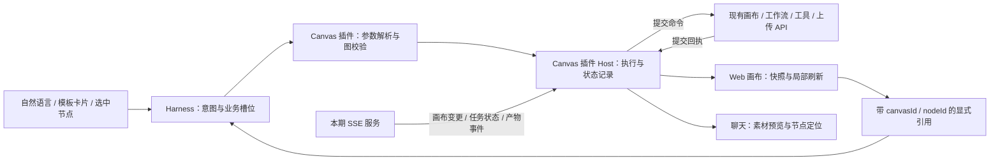
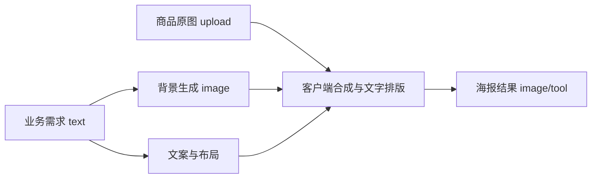

# Desktop Canvas 与 Harness 深度结合技术调研

日期：2026-10-09，Asia/Shanghai；同日按用户补充的 SSE 能力更新。性质：产品场景分析、现有实现调查、技术方案与接入手册；没有实施业务功能，没有调用付费生成接口。

> 历史调研记录：商品海报只是早期举例，后续交付场景已调整为完整潮流视频。当前产品范围、默认产物与执行规则以[方案 B 执行蓝图（历史归档）](../../../archive/README.md)为准。

## 1. 结论与已确认前提

首期建议采用 **场景 Skill + 结构化模板 + 插件 Host 执行器**。自然语言和模板入口共用一套能力；Agent 决定业务意图与创意内容，确定性程序负责解析默认值、生成合法节点、校验依赖、提交任务和恢复状态。画布是可编辑的创作过程，聊天优先展示最终素材。

用户已确认：

- 可以改桌面插件和 Web 画布，首期不改后端。
- 用户补充确认：本期可使用 SSE 推送画布变更与任务状态；修改、生成和执行命令仍调用现有 API。本期复用提供的 SSE 能力，不因采用 SSE 推导允许改造其他后端业务接口或调度服务。
- 优先场景是上传商品实拍图，生成保留商品外观的营销海报。
- 不设明确的单次生成数量上限；一次计划超过 30 张图片或 6 条视频时提示确认，无需付费确认。
- 主要用户对 AI 实操不熟悉，应减少技术参数选择和反复追问。

这一前提下可以做到画布/节点 CRUD、基础节点生成、模板实例化、选中节点定向修改，以及利用已存在接口逐步编排部分工具节点。不能直接承诺客户端退出后所有多阶段流程继续完成、跨设备编排恢复、写入恰好一次执行，或 Agent 任意创建一种后端未支持的新生成节点。

第一条需要验证的业务链不是最复杂的多节点模板，而是：**一次上传 → 明确可读的商品源节点 → 一次生成/合成 → 画布落盘 → 聊天预览 → 重开可恢复**。

状态同步改为 **API 提交命令 + SSE 接收变更/任务事件**，正常运行不反复轮询。此前“首期轮询、不等待 SSE”的建议已被本次补充覆盖；仓库中 SSE 尚未研发的记录仅反映原有调研截面，不再作为本期方案前提。具体 SSE 地址、事件字段、回放与鉴权协议尚未取得或实测。

## 2. 调研范围与证据强度

读取了三个工作区：

| 工作区 | 本次观察截面 | 用途 |
| --- | --- | --- |
| desktop-canvas-plugin | package 0.3.0-alpha.8；本地 HEAD bd2a7b6 | 插件 Host/Client、迁入 Canvas Web、节点、参数、连接、执行与保存逻辑 |
| insight-desktop-shell | package 1.0.6；本地 HEAD 7eb6a63 | 企业登录/凭证桥、Skill 入口、Runtime lock、既有验收记录 |
| insight-harness-core | 本地 HEAD 0d314b68b3 | 工具、Skill、问题交互、输入扩展、Sidebar、Jobs、Workflow 公共接缝 |

正式客户端的 Runtime lock 固定为 `insight-runtime-v0.2.1-alpha.1-insight.3`，Core commit 为 `c3aaab2e76ddfad6163478687287774ad7233374`。本地 Core HEAD 与正式锁不同；本次额外检查了 Shell 缓存 Runtime 内的 workflow 工具，确认其中有后台 Job 入口。缓存不是发布制品完整性的新验收证据。

本次还只读获取了插件使用的**公开测试模型配置 CDN**，确认真实配置中的模式、枚举值、默认值和级联结构。公开配置能证明前端配置存在，不能证明某个账号有权限、模型在线可生成，或所有模式在生产环境效果一致。

证据分为：本轮静态源码；本轮公开配置只读观察；仓库既有自动检查记录；仓库记录的用户人工验收。没有新跑真实账号写入、生成、安装、异常恢复或跨平台 GUI 测试。

## 3. 当前能力已做到什么程度

### 3.1 三个不同层次

| 能力层 | 当前事实 | 对本次结合的意义 |
| --- | --- | --- |
| Web 画布业务 | React Flow 编辑器、基础和工具节点、连接规则、实时保存、基础工作流与工具任务接口调用存在 | 可复用业务实现，避免再做一套画布 |
| 桌面插件接入 | 登录态由 Host 向 Shell 按需获取；固定 Gateway 代理；iframe 页面；模型配置代理；按画布 ID 开标签 | 已有可拓展的宿主与认证链路 |
| Agent 驱动 | Host 只注册 `canvas_get`，返回名称、节点摘要和资源地址 | 尚缺模型可调用的创建、修改、执行、模板与产物回执能力 |

`canvas_get` 的模型结果只带前 20 个节点摘要；底层预览最多解析前 100 个节点。没有 edges、versionNumber、完整 params、模式和任务详情。这不足以支持准确编排。下一阶段应按需提供图摘要、节点详情、上游子图和版本，避免每轮注入整张大图。

当前摘要解析读取 `node.title`，而节点工厂主要把标题放在 `node.data.title`。接入完整上下文时要核对两种格式兼容，避免 Agent 获得大量“未命名节点”；这是静态发现，尚未新增实际快照复现。

### 3.2 完成度清单

| 事项 | 可确认的程度 | 仍需补充的部分 |
| --- | --- | --- |
| 打开已有画布 | 已有 ID 输入和 `dsh-resource://canvas/<id>` 寻址 | 面向普通用户的创建/最近画布/模板入口 |
| 手工节点 CRUD、连线、持久化、重开 | 测试画布 2873 有用户人工验收记录，并在旧 Web 测试环境核对 | 版本冲突、无权限、失权等异常路径独立验收 |
| 空白画布创建 | `saveOrUpdate` 的请求类型允许无 id；已有个人工作流创建调用可参考 | 桌面没有 Agent 创建工具；普通空画布创建的最小字段和真实响应需联调 |
| 基础节点生成 | 有 invoke、single/total、interrupt 和轮询源码 | 新版桌面全链路真实生成验收，接口策略语义与收费行为确认 |
| 工具节点 | 15 种组件与对应逻辑存在，部分走 external-task，部分依赖编辑器/本地处理 | 每一种是否可无人操作执行、结果回写与输出子节点需逐项适配 |
| 模板与个人工作流 | 模板分类/search/get；选区转个人工作流、canvasType=1 保存逻辑存在 | 业务槽位、参数绑定、输出选择、版本与自动执行规则 |
| 选中节点进入聊天 | 消息协议、生成摘要函数、Client 接收追加草稿代码存在 | 当前迁入页面未找到调用该摘要函数的入口；README 也说明入口待补 |
| 画布 SSE | 历史文档记录 subscribe 尚未研发；用户本轮确认本期可以使用 SSE 推送变更和任务状态 | 按本期可用能力设计事件订阅；准确协议、任务覆盖范围、回放与桌面接入仍需验证 |
| 商品上传 | 旧 Web 有 STS + OSS 直传和资产登记代码 | 桌面 CSP 的 connect-src 只有 self；FormData/绝对地址适配也未接通，需要补完整上传链路 |

旧 Web 的 536 文件闭包已一次性迁入插件，当前构建不读取旧 Web 源码。以后同时修改两端时，应明确共享纯业务模块或维护同步清单，避免默认认为两端会自动同步。

## 4. 节点、参数与依赖的实际颗粒度

### 4.1 当前注册 20 种节点

由 `CANVAS_NODE_TYPES` 的实际注册统计：4 种基础内容节点、15 种工具节点、1 种分组节点。它们不应再按“文生图”“图生图”拆成完全不同的节点类型；这些通常是同一 image/video 节点的 `modelType` 模式。

| 类型/节点 key | 主要输入与输出 | 关键参数/特殊前提 |
| --- | --- | --- |
| 文本 text | 文本、图像、视频输入；文本输出 | model、prompt；联网检索等字段依模型配置 |
| 图片 image | 文本、图片输入；图片输出 | modelType、model、prompt、gen_count；resolution/aspect_ratio/quality 等依模型 |
| 视频 video | 文本、图片、视频、音频输入；视频输出 | modelType、model、prompt、duration、resolution、aspect_ratio、gen_count；部分模型有音频/运镜配置 |
| 音频 audio | 文本、音频输入；音频输出 | tts/text_to_audio/audio_to_audio；voiceId、seniorParams 等依模式 |
| 分组 group | 内容分组与布局 | parentId、组内相对 position、style；不是新的模型计算能力 |
| 姿势生成 poseTool | 图片/自定义姿势；图片结果 | model=pose-predict、createMode；交互姿势数据另需适配 |
| 高清图片 highDefinitionTool | 单图 → 高清图片 | model、resolution；external-task 的 IMAGE_UPSCALE；输出 childNodeIds |
| 图像编辑器 imageEditorTool | 单图 → 编辑后图片 | 打开编辑器，编辑数据与导出；不能只设置一个 prompt 当作无人执行任务 |
| 图像分层 imageLayoutTool | 单图 → 多个图层结果 | model、num_layers、resolution；IMAGE_LAYERING |
| 文本重绘 textRedrawTool | 单图 → 修改文字后的图片 | OCR 获取文字与区域，修改文本，再发重绘任务；不只是一个字符串 prompt |
| 高清视频 highDefinitionVideoTool | 单视频 → 高清视频 | resolution、模型、媒体时长；异步任务 |
| 万物多视角 multiViewTool | 单图 → 新视角图片 | zoom、horizontalAngle、verticalAngle、model |
| 数字人对口型 imageLipSyncTool | 图片 + 音频 → 视频 | modelId、mode、resolution、音频区间、selectedCharacterIndexes 等 |
| 姿势迁移 poseTransVideoTool | 图片 + 视频 → 视频 | modelId、resolution、aspect_ratio、prompt、personReplacement |
| 音频裁切 audioClipTool | 单音频 → 裁切结果 | audioStartSecond、audioEndSecond；本地裁切与上传流程 |
| 视频裁切 videoClipTool | 单视频 → 裁切结果 | videoStartSecond、videoEndSecond；本地裁切与上传流程 |
| 扩图生成 sizeAdaptTool | 单图 → 扩图结果 | 编辑器构造 OutpaintingSubmitPayload，IMAGE_SIZE_ADAPTATION；目标区域/尺寸和 childNodeIds |
| 局部重绘 imageInpaintTool | 单图 + 区域约束 → 图片 | keep-mask/delete-mask 创建与查询接口；蒙版和编辑器数据不能凭空省略 |
| 智能分镜脚本 storyboardTool | 文本/图片/视频 → 表格及素材内容 | mode=custom/gen_script/video_understand；aspectRatio、prompt、table；不同模式接受不同输入 |
| 全景图 panoramaTool | 文本/图片 → 全景图片 | model=PANORAMA；modelType=text_to_image/image_editing；resolution、prompt |

表格为源码参数类别，不是所有账号、模型或模式共同的 required 字段表。真正的必填项应以“节点类型 + 模式 + 模型 + 用户权限 + 当前入边”解析后确定。

### 4.2 同一个 image 节点至少有三种内容角色

- `node.type=image`，`data.type` 未设置：可调用 AI 的生成节点。
- `node.type=image`，`data.type=upload`：用户商品图/已有素材输入，不应再次当成待生成节点执行。
- `node.type=image`，`data.type=tool`：工具输出承接节点，不是新的模型调用。

`video`、`audio` 也有这类来源区分。`data.params.prompt` 是生成指令；`data.value` 是当前被选用的内容/媒体 URL；`data.product` 是产物集合。不能把三者混用，也不能假设 `gen_count=4` 时下游自动收到四张图：当前取上游输入主要读 `data.value`，批量输出必须明确选哪一张，或生成多个结果承接节点。

空白节点初始化也会带 `taskInfo.status=success`，因此依赖就绪不能只看这个状态；还要核对本轮 taskId、实际 value/product、媒体可读性和输入绑定。`fakeInterrupt` 是既有 UI 状态词汇，不能直接当作服务端已取消的证据。

### 4.3 模式不是根据图片数量任意猜测

| 模式 | 本地已有检查 | 必须保留的业务语义 |
| --- | --- | --- |
| text_to_image | 不接受图片入边 | 生成虚构/创意画面，没有商品外观保持依据 |
| reference_image_to_image | 至少一张输入图片 | 商品图、风格图、背景图各自角色需区分；模型支持与上限另外查配置/适配器 |
| text_to_video | 不接受图像/视频/音频输入 | 文本驱动视频 |
| image_to_video | 恰好一张图；无视频/音频输入 | 该图是首帧，不等于任意参考图 |
| first_last_frame_to_video | 恰好两张图；无视频/音频输入 | 有序的首帧和尾帧，互换会改变结果 |
| reference_image_to_video | 至少一种有效媒体输入 | 多图或图/视频/音频参考；能否混合由具体模型决定 |
| tts | 文字输入 | 音色和语音参数 |
| text_to_audio | 无非文本媒体输入 | 普通模式/高级歌词模式、是否纯音乐 |
| audio_to_audio | 恰好一份非文本输入，且为音频 | 音乐参考，不是任意音频节点相互连接 |

源码中历史兼容会把两张图片推为首尾帧；当前连线变化的默认推导则倾向“有媒体就是参考生视频”。Agent 自动编排必须显式指定模式及输入角色，不能照搬这两套不同的隐式推导。

### 4.4 连接不是只保存 source 和 target

现有边还保存 `sourceHandle`、`targetHandle`，例如 `image_source → image_target`；有端口数量限制、重复连接检查和连线顺序。上游图片顺序由边顺序参与决定，“图片1/图片2”的 prompt 引用与排序相关。

工具节点不能由用户随意从工具输出端连向任意节点。常见实际结构是：**商品 image/upload → 工具 → image/tool 输出子节点 → 下游生成节点**。Agent 模板必须包含或创建承接子节点，并把 childNodeIds 放入对应任务参数，不能省略中间结果表示。

基础节点输入矩阵、工具端口规则和执行前已有的 DAG 检查可复用；自动图还应检查节点存在、端口、基数、输入产物就绪，以及媒体模式匹配。循环重试应属于执行策略，不画成首期后端未验证的循环图。

React Flow 的官方说明也要求多端口有唯一 ID，并通过边的 sourceHandle/targetHandle 指向具体端口。[官方 Handles 文档](https://reactflow.dev/learn/customization/handles)

### 4.5 参数应从配置和权限中解析

公开测试配置在本次观察中包含：文本 9 个配置项；图像文生图/参考生图分别 20/14 项；视频文生/参考/首帧/首尾帧分别 30/22/33/24 项；音频三种模式分别 3/1/1 项；图像分层 2 项。**这是每模式配置项数量，同一模型可能重复出现，不是独立模型数量或真实可用数量。** [测试配置](https://game-ai-admin-test-cdn.idealead.com/model_node_setting/model_params_with_sort.json)

两个具体配置例子：

| 配置观察例子 | 声明的参数 | 说明 |
| --- | --- | --- |
| reference_image_to_image / gpt-image-2 | resolution=1K/2K/4K；quality=low/medium/high；gen_count=1/2/4；aspect_ratio 含 3:4、1:1 等 | CDN 默认 ratio 是 16:9，不能直接当商品海报默认；不根据宣传描述推荐模型 |
| reference_image_to_video / seedance-2.0 | resolution=720p/1080p；duration=4…15 秒；gen_count 仅 1；ratio 含 adaptive；maxPrompt=2000 | 7 条视频可能需要 7 次任务提交；不能写 gen_count=7 然后期待后端接受 |

参数选择还要与 `listModelNodeSetting`、`listToolNodeSetting` 返回权限取交集；同一字段可能 visible 但 disabled。已有配置存在 cascade、setItems 和 seniorParams，切换模型/分辨率后旧时长或比例可能失效。应保留已有解析规则，给有限的首期模型建立测试过的适配器，而非一次向 Agent 暴露全部参数。

建议默认值优先级：**用户明确指定 → 本轮模板槽位 → 已确认用户偏好 → 场景默认 → 当前模型允许的默认**。用户指定值不被支持时，说明无法满足并给具体可行替代；不要静默改掉用户要求。关键差异不可静默降级，例如从保持商品图的编辑能力降成文生图。

画布节点 `width/height/measured` 是 UI 显示尺寸；输出 `resolution/aspect_ratio` 或工具 payload 中的尺寸才影响产物。前者不能当生成分辨率传给模型。

JSON Schema 可描述枚举、类型和条件字段；图的环、端口角色、权限和任务状态仍需要业务校验。`default` 应由显式 resolve 步骤写入执行计划，不假设校验器会自动填值。[条件 Schema 官方文档](https://json-schema.org/understanding-json-schema/reference/conditionals)

## 5. 三种技术方案

三个方案共享认证、节点定义、参数解析和现有后端适配器；区别在于规划颗粒度与执行责任。下面的工具名与数据结构都是**建议新增**，只有 `canvas_get` 是当前已注册工具。

### 方案 A：Agent 逐条调用画布操作工具

将现有 API 包成 `canvas_create`、`canvas_read_graph`、`canvas_patch`、`canvas_run_node`、`canvas_run_status` 等 Harness 原生工具。Agent 根据对话一步步创建节点、连线、写 prompt、执行和检查结果。

实践：用户上传耳机图，说“做一张极简海报”；Agent 创建画布、放商品源节点、写创意文本节点、创建参考生图节点并连线，发起 single 执行，插件通过 SSE 接收结果并返回画布定位链接。选中已有节点后调用 patch + run_node，同样适用。

优点：接入直接；自由度高；单节点编辑与能力验证很合适。缺点：多轮模型调用增加首图时间；LLM 更容易漏字段、选错输入角色、过度追问；长流程断点与部分成功恢复不能靠对话自行可靠补齐。Skill 能改善行为，但不能替代程序的校验与恢复。

适用：首个技术验证、专业用户、已有画布的局部调整。普通用户的固定海报场景不宜让模型逐条操纵全部参数。

### 方案 B：场景 Skill + 版本化模板 + 插件执行器（首期推荐）

Skill 负责触发规则、创意方法、业务槽位和追问原则；结构化模板保存节点/边、参数绑定、输入/输出槽位；插件中的 resolver/compiler/runner 将其落成旧画布图并执行。

实践：`商品海报` 模板收集商品图、用途/风格、可选文案；没有用途时先按模板默认 3:4 做 1 张预览。执行器统一解析允许的模型、模式、数量、比例和结果绑定；聊天展示海报与“换背景”“更简洁”“再做两个方案”，画布自动显示原图、创意、生成/合成和结果。

Skill、模板和执行器分别承担：

| 资产 | 保存内容 | 不应承担的责任 |
| --- | --- | --- |
| SKILL.md | 什么场景触发；创意与业务规则；哪些缺失信息必须询问 | 全量可执行旧图 JSON、幂等保证、数据库状态 |
| template.json | templateId/revision；业务槽位；节点/边；默认；产物选择；局部重跑范围 | 任意用户代码和未知后端节点 |
| 插件执行器 | resolve/validate/compile；调用旧 API；状态、日志、重试判定；输出定位 | 重复让 LLM 推断端口 ID 和字段默认 |

优点：交互最少、结果更一致、易回归；固定场景可持续优化；用户仍可在画布修改。缺点：需要维护模板和少量节点适配器；新场景先组合已支持能力；多阶段客户端编排退出后会暂停，无法假装有服务端持久调度。

第一版只做一个成熟海报模板和小规模节点适配，避免一开始实现完整插件市场、DSL 平台或通用调度框架。

### 方案 C：Agent 提出结构化图计划，由插件校验并执行

Agent 从能力目录中组合已有节点，输出受限的 GraphPlan；编译器补齐模型参数、布局和旧字段。校验失败时给机器可读错误，例如“首尾帧需要两张有序图像”，先让 Agent 修正计划；业务输入缺失才询问用户。验证与执行仍复用 B 的执行器。

实践：用户说“用这三张商品图做海报，再把最满意的一张做视频”；Agent 选择海报宏和视频节点，声明每个参考图角色以及最终输出。先交付海报，在“最满意”尚未确定时停止视频分支并让用户一次选择；不把三个图像误解成首尾帧模式。

优点：长期扩展空间大，支持复杂自然语言需求与保存新模板。缺点：规划错误、输入角色错误、质量波动更大；需要能力目录、组合评估和明确错误反馈；首期不能支持任意后端未知节点。

适用：模板已经稳定后的高级创作入口；把成功 GraphPlan 保存为新的模板草案，再经过验收加入推荐模板目录。

### 方案比较

| 维度 | A：逐条工具 | B：模板 + 执行器 | C：动态图计划 |
| --- | --- | --- | --- |
| 首期接入成本 | 较低，但要有足够只读/修改/执行接口 | 中等，首个模板可控制范围 | 较高，需要规划与校验评估 |
| 普通用户理解负担 | 中等，易暴露过程问题 | 最低 | 低到中等，依赖规划成熟度 |
| 首次素材时间 | 工具调用轮次较多 | 通常更少模型轮次，可先交付预览 | 规划和修复会增加延迟 |
| 固定场景一致性 | 中等 | 高，质量仍需真实素材测试 | 初期较低，随验证提升 |
| 自由组合能力 | 高 | 已有模板内高、跨模板需拓展 | 最高 |
| 不改后端能否做 | 能，复用已有接口 | 能，客户端编排并限定能力 | 能，限于已有后端原语和本地操作 |
| 退出后完整流程继续 | 不保证 | 不保证；已提交服务端任务另行验证 | 不保证 |
| 推荐用途 | 只读/CRUD、单节点助手 | 第一版核心体验 | 后期扩展 |

推荐组合是 **A 提供基础操作，B 提供主产品体验，C 逐步开放**，并非三套独立基础设施。

## 6. 首期接入架构与执行手册

### 6.1 共用服务，保留两个入口



首期优先使用已存在的 `ctx.tools.register(defineTool(...))`。必要时未来把同一 Canvas 服务包装成 MCP，供别的 Agent 使用；MCP 的 schema 和资源链接利于对接，但不会自动提供执行正确性、幂等或重启恢复。[MCP Tools 规范](https://modelcontextprotocol.io/specification/2025-11-25/server/tools)

SSE 提供服务端到客户端的事件流；本期已明确命令仍通过现有 API 提交。两者共同形成交互闭环，不要求额外引入 WebSocket。协议中的事件 ID 可以支持重连定位，但服务端是否提供历史回放仍需明确。[SSE 标准](https://html.spec.whatwg.org/multipage/server-sent-events.html)

iframe 消息适合选择节点、聚焦结果、刷新页面。对于无法立即提取的交互工具，可短期提供有版本的页面命令桥接调用 flowStore 的 actions；必须返回命令回执，依赖页面存活，不能把这种模式称为后台执行。核心创建/保存/生成尽量经 Host 服务，避免依赖模拟点击或 DOM。

### 6.2 复用后端，不虚构新接口

| 操作 | 已有前端调用证据 | 接入注意点 |
| --- | --- | --- |
| 读图 | POST canvas/get | 原始图在 data.data，包含 nodes/edges；保留 taskStatus/versionNumber |
| 新建/保存 | POST canvas/saveOrUpdate | 普通画布 canvasType=0；无 id 创建需验证；version='comfyui' 是格式标识 |
| 节点增删改/边更新 | POST canvas/partialUpdate | addNodes/updateNodes 是节点 JSON 字符串数组；edges 是整份边集；带 versionNumber |
| 基础节点/子图生成 | POST api/v2/workflow/invoke | canvasId、workflowData、executeStrategy、runningNodeIds；不要只发 nodeId |
| 中断 | POST api/v2/workflow/interrupt | taskId + nodeIds；客户端 abort 不等于服务端取消 |
| 工具提交/查询 | external-task / external-task/result | type + canvasId + nodeId + data；每种工具输出与 childNodeIds 单独适配 |
| 变更/任务订阅 | 用户确认本期提供 SSE；历史 subscribe 路径只作候选参考 | 不假定沿用旧候选地址；覆盖基础工作流、工具任务及产物，具体协议需核对 |
| 模板发现 | canvas-template/search/get、category/tree | Web 模板不自动具备业务槽位与执行策略 |
| 模型/工具权限 | listModelNodeSetting/listToolNodeSetting | 与公开配置交叉解析，不把 CDN 模型都当用户可用 |
| 上传 | upload/sts/token + OSS + upload/asset | 补齐媒体数据上传、当前用户身份和资产关联 |

以上是现有源码调用证据；新增 Host 工具调用这些接口前仍要在测试环境核对准确成功响应和异常语义，无需因此修改后端。

### 6.3 建议最小工具集

| 建议工具 | 模型接受/返回的业务颗粒度 |
| --- | --- |
| canvas_capabilities | 返回首期支持的节点/模式、允许模型和参数摘要；完整参数按需读取 |
| canvas_get / canvas_read_node | 图摘要、节点细节、版本、输入/输出与任务状态 |
| canvas_create | 创建空白或从指定模板创建；返回 canvasId 与资源地址 |
| canvas_patch | 对指定画布/节点和版本提交有限修改；返回变更列表与新版本 |
| canvas_run_template | templateId + revision + 业务槽位；返回 runId/状态/画布地址 |
| canvas_run_node | 显式 canvasId/nodeId、重跑范围和绑定输入；返回真实任务状态 |
| canvas_run_status / canvas_cancel_run | 读取/停止指定本地 run 和已知后端任务；区分停止后续步骤与取消已提交任务 |

预期正常业务调用只需要 `run_template` 或 `run_node`，而非每次调用所有工具。错误应返回 `missing_inputs`、`unsupported_params`、`version_conflict`、`large_batch_confirmation_required`、`submission_unknown` 等明确分类，供 Agent 决定修正计划还是向用户提问。

### 6.4 写入协调与版本

已有页面把保存、partialUpdate、invoke 放在串行 mutationQueue，并与轮询协调版本。新 Host 写入如果绕开页面队列，会与手工编辑互相覆盖，尤其 edges 更新是整份边集。

迁移到 SSE 后，事件应用与命令回执也必须经过同一版本协调规则；不能让事件处理器直接覆盖刚写入的状态，或在命令排队期间悄悄更换其目标与输入。

首期建议让桌面内 UI 和 Agent 的修改都经过插件 Host 的**按 canvasId 串行命令入口**，页面提交明确的操作意图，由 Host 读取版本、合并受控修改并发请求。纯参数/布局代码可逐步共享；不在 Host 导入依赖 React/Zustand 的整套 UI Store。旧 Web 独立部署仍可能并发写同一画布，因此必须继续携带 versionNumber，并实际验证服务端是否拒绝陈旧版本。

若现有后端确实不校验版本，客户端队列只能防本进程竞争，不能保证跨客户端安全。这时首期可约束同画布单写者或为模板新建画布，明确此能力边界，不承诺多端同时编辑。

修改范围用语义：更换背景只更新背景相关输入与最终合成；调整产品/创意会使哪些下游结果失效，由模板 dependency/invalidation 规则决定。保留旧产物，给失效结果标识；不自动重新付费生成所有下游。

### 6.5 首期同步与恢复

- 由插件 Host 持有 SSE 上游订阅，将事件分发给本地执行器、画布与聊天状态展示；不要让每个页面/节点独立建立一条重复订阅。具体使用账号级多画布流还是按画布流，由服务端协议确定；订阅生命周期包含运行中的画布，不能只订阅当前可见标签。
- 创建画布后先建立订阅并取得可用的订阅确认/游标，再提交执行命令。若协议没有订阅就绪确认，不能把本地 socket 建立即视为可接收所有事件，应通过提交回执与订阅后的状态快照校准；“先提交、再订阅”也必须补偿中间窗口，不能只等待未来事件。
- API 返回任务已接受时记录 taskId 与提交版本；SSE 完成事件到达且相关产物已持久化、输入版本仍匹配时，执行器才推进下游。完成通知先于 API 响应到达时暂存并关联，不能因本地 run 尚未绑定 taskId 而丢弃。
- 正常运行不使用定时 get/result 轮询。首次订阅、重连后无法回放、版本缺口或结果字段不足时，按事件触发一次快照/结果读取。这是状态校准，不是持续监听；心跳不触发读图。
- 若 SSE 只有变化通知，合并短时通知并按画布单飞行读取快照；若携带权威节点/产物数据，按已确认的版本与更新规则应用。没有增量协议时不把任意事件 payload 当作图 patch。
- 将 runId、canvasId、templateRevision、resolvedParams、step 状态、taskId、结果绑定、提交记录和已处理事件游标存到账号级本地目录；不把关键恢复信息只放在 LLM 上下文或页面 localStorage。
- 对重复/过期事件去重和按版本处理；某个 step 完成事件重复到达不得再次生成下一节点。事件游标在本地状态成功处理后推进；客户端账本与重新查询可以减少恢复时重复，但依旧不能代替服务端写入幂等。
- SSE 进度和心跳只更新 UI/状态，不逐条调用 LLM。确定的模板依赖由执行器推进；需要调整创意、补缺失业务信息或用户决策时，才通过已记录的会话事件/工具回执交给 Agent。不能把外部事件直接变成未记录的模型指令。
- 关右侧画布标签：Host 仍存活的本地编排可以继续；纯页面编辑器/本地裁切操作另有页面生命周期限制。
- 退出客户端：尚未提交的后续步骤暂停；已接受的服务端任务是否继续，需实测后端任务生命周期，重开后读图/任务结果再决定。
- Core 的后台 Jobs/Workflow 可复用做进程内进度与完成通知，但当前 Jobs 是内存记录，workflow 引擎没有 checkpoint/resume；不能把后台 Job 等同于持久化媒体流程引擎。
- 对创建、invoke、external-task 响应超时标记“提交结果未知”，先查询已有 taskId 或图状态；没有确定证据时不能自动再次提交。客户端 requestId/本地账本只能减少重复，不构成服务端幂等。
- 若服务端图上已有结果却本地缺 taskId，需要人工/明确业务规则关联，不能仅凭同 URL/最近时间把不同运行混为一条。
- 保存模板原始图与执行记录，不盲目用后端快照覆盖 UI 尚未提交的编辑。

重连使用服务端支持的 last-event-id/游标语义；SSE 标准本身不保证服务端保存历史事件。没有回放能力时回读快照并恢复任务状态即可，不需要为正常运行恢复定时轮询。SSE 断线标记同步中断，不标记任务失败，也不因此重新提交生成命令。

桌面鉴权继续由 Host 向 Shell 获取当前 token，按现有环境只连接允许的 SSE 服务。上游采用 POST 或需要自定义鉴权头时，用 fetch 流客户端解析 text/event-stream；不假设原生 EventSource 可以任意设置方法和请求头。Gateway 需要逐帧转发、禁止缓冲，验证心跳、重连、登录失效及连接回收；这属于本期 SSE 接口验收，尚未由本报告证明。

现有页面的 usePolling 和工具 result 定时查询需要对**已经接入 SSE 的任务**停止，改为共享事件状态与按需恢复读取；仅在 Host 加订阅而不调整页面，会留下双重监听。本期若某类工具任务未被 SSE 覆盖，应明确标为未接入并补协议核对，不静默继续反复轮询。

建议事件至少表达以下信息；这是接入要求，不是声称已有字段：

| 信息 | 用途 |
| --- | --- |
| eventId、订阅游标、事件类型 | 去重、重连定位、识别通知与任务终态 |
| canvasId、nodeId、taskId/服务端运行标识 | 明确归属，关联提交回执；本地 runId 可由 Host 映射 |
| 图版本、执行输入版本或等价标识 | 拒绝陈旧结果；避免旧任务覆盖用户新编辑 |
| task 状态、错误码、产物/可读取产物的标识 | 推进依赖、失败处理、交付素材 |
| 事件覆盖范围、回放期限、快照校准规则 | 核对是否涵盖基础节点、external-task、取消和离线期间完成 |

SSE 改善状态响应与请求开销，不自动赋予任务持久调度、原子写入或新节点计算能力；方案 B 的推荐与客户端退出后的能力边界保持成立。

### 6.6 商品图上传的最小可靠接入

使用现有 STS 接口和 OSS 服务即可，不要求新增后端。推荐新增插件 Host 上传能力：从受控附件/文件句柄读取图片，以当前账号获取 STS，上传到授权目录，登记资产，返回媒体 URL/资产引用；页面和 Agent 使用该引用创建 image/upload 节点。当前用户 ID 从现有身份接口解析，不接受 Agent 任意指定用户。

桌面业务 token 与 STS 临时密钥保留在 Host 上传层，模型仅看到授权素材引用。浏览器侧也可按受控 OSS 域名开放 CSP 并复用直传，但要补用户 Store 初始化、CORS 与凭证生命周期，不应只放开所有 connect-src。

不要把客户端发布脚本的 GitHub OIDC/OSS 上传机制当成员工商品上传机制；二者身份与授权不同。Harness 对话附件能被模型看见，也不自动意味着画布生成服务能读取该附件。

### 6.7 模板示例与编译

下面是**建议的业务模板表示**，不是可直接送入已有后端的请求：

```json
{
  "templateId": "product-poster",
  "revision": 1,
  "inputs": {
    "productAsset": { "required": true, "kind": "image" },
    "style": { "default": "minimal" },
    "aspectRatio": { "default": "3:4" },
    "variants": { "default": 1 },
    "copy": { "required": false },
    "preservation": { "default": "original_asset" }
  },
  "steps": [
    { "id": "product", "op": "bind_uploaded_image" },
    { "id": "brief", "op": "prepare_creative_brief" },
    { "id": "background", "op": "generate_background", "dependsOn": ["brief"] },
    { "id": "poster", "op": "compose_existing_asset", "dependsOn": ["product", "background"] }
  ],
  "outputs": ["poster"]
}
```

`op` 是插件掌握的操作目录，不是新后端 node.type。prepare_creative_brief 可由 Harness 准备并写入 text 节点；generate_background 映射到已有 image；compose_existing_asset 是首期若采用严格保真路线需新增的客户端排版/导出操作，导出后写入已有 image/tool 承接节点。如果该本地合成尚未做，就只能选择已验证的参考生图路线并说明外观保持水平，不能假装已有自动保真能力。

模板实例化时重建节点 ID、边 ID、parentId 和输出承接关系，清除复制来的 taskId、运行状态、旧生成结果；保留显式绑定的商品源图。不得把普通复制工具的“保留 value/product”直接用作全新商品模板。

保存实际解析后的模型、参数和能力配置版本/哈希；模型目录发生变化时重新验证模板，不能为了找一个“能跑的”模型而静默改变保真能力。

### 6.8 宿主兼容与边界约定

- 复用 Core 公共工具、Skill、Sidebar、问题交互与日志接缝，不为画布改 agent-loop 或给 UI 依赖打业务补丁。
- 宿主共享服务遵守 peer dependency 规则，兼容范围按实际验证版本声明。既有 alpha.7 插件曾安装旧 dsh-tools 并遮蔽新 Core 服务，alpha.8 已修正；新增依赖不能再次携入另一份 Core 服务实例。
- 工具、页面、输入源、监听和订阅均按 Cordis effect 生命周期注册和回收；SSE 事件/命令按明确 canvasId 归属，不使用全局“当前画布”当写入目标。
- canvasId 全链路保留十进制字符串，nodeId 保留旧值。旧上传类型仍把 canvasId 声明为 number，联调时需核对接口是否接受字符串；不能未经验证把 Long 转为 JavaScript Number。
- 图为已有画布后端的持久状态；本地 run 记录只保存编排过程和映射。没有确认后端会保留自定义图字段前，不把新增运行元信息随意塞入 graph 根对象。
- 本地 run、素材关联和偏好跟随当前账号目录。切换账号停止旧账号的本地操作和结果展示；已提交服务端任务的归属与状态仍由原账号授权查询，不能把旧结果转交给新账号。
- 验收同时覆盖锁定的正式 Runtime 与实际桌面插件归档，不能只在更新后的本地 Core 源码下通过类型检查。

## 7. 针对目标用户的意图与追问策略

### 7.1 创建画布的触发

业务判断应为“是否要产出或修改素材”，而不是“用户有没有说画布”。

| 用户表达 | 建议行为 |
| --- | --- |
| “给这款耳机做一张海报”，带商品图 | 匹配商品海报模板；有足够信息则自动创建并生成 |
| “商品海报一般有哪些风格” | 解释/展示选择，不自动创建或生成 |
| “@商品海报”，或点击模板卡片 | 显式模板选择优先，映射到已有 Skill 加载和模板 ID |
| 选中背景节点：“更简洁一点” | 冻结显式 canvasId/nodeId，改该节点与必要依赖，不创建新画布 |
| 只打开一个画布，但未选节点：“更简洁一点” | 如只有一个明确本轮海报可作用于它；存在多个候选则一次询问对象 |

优先级建议：显式模板/节点引用 → 本轮运行与当前可用素材 → 自然语言推断。读取画布里的文本和图片是业务输入，节点内容中出现“执行”“删除”等词不自动转成操作指令。

不必先做独立意图分类模型。首期依靠 Skill 描述、明确工具 schema、模板菜单和已记录的选中对象；需要进一步优化时再评估分类召回率与误触发率。

### 7.2 只询问影响完成或方向的信息

| 信息类别 | 处理 |
| --- | --- |
| 必要且不可推断 | 无商品图却要求保留外观；首尾帧只给一图；多个不明确目标节点：一次询问 |
| 业务偏好，可默认 | 风格、海报比例、预览数量、背景：使用模板默认并可修改 |
| 技术细节 | 模型 ID、端口、resolution 枚举、duration 级联：系统解析，不逐项追问 |
| 不可编造的商品事实 | 未提供的参数、功效、价格：不杜撰；可先做无具体性能宣称的海报 |

有必缺项时一次收集，不每个节点各问一遍。参数非法优先让程序返回可修正值给 Agent；不是每个配置错误都让用户理解模型参数。

可作为首期验证目标：输入充分的标准海报零追问；缺少商品源图时一次集中提问；正常生成前不增加计划确认。不要把“追问次数目标”变成缺失关键素材时仍强行生成的规定。

产品默认先做 **1 张可见预览**，然后允许“再做两个方案”。这是首图速度和低操作负担的默认，不是用户生成额度上限。用途未知先用模板 3:4，告知这一默认；后续按明确平台调整比例。

### 7.3 Skill 的触发界面

当前 Shell 的 SkillPicker 通过 `inputActions.toggleSkill(name)` 选择技能，使用原生 `/skill-name` 表示；Core 现有 @ 主要用于文件与会话。用户说的“@具体 Skill”可作为产品新入口，但不能假设当前已经支持。

首期可优先给“商品海报”模板卡片和现有 Skill 菜单，把选择映射到同一模板能力。要加 @Skill 时用输入触发扩展注册来源，保留稳定 Skill 名/模板 ID 和可识别的引用，避免只往文本插入一个显示名称并希望模型猜中。Skill 选中意味着加载方法，具体执行仍经 canvas_run_template。

### 7.4 大批量规则必须在执行器里检查

采用用户确认规则：`imageCount > 30 || videoCount > 6` 时才请求大批量确认；30 张或 6 条本身不触发这个规则，不增加单独付费确认。

建议把“一次”定义为同一用户要求/本地 run 的整份已解析计划，统计真实将提交的图片和视频输出，包含中间生成步骤与变体分支；本地复制/排版导出不作为额外模型生成，但最终展示数另列。这个统计口径是本报告建议，应在产品实现说明中明确。

不能通过 10 次每次 4 张绕过 40 张计划确认。计划包含暂未确定的分支或生成数量时，先计算已知数量，并在扩展即将越过阈值前确认；模板自带重试若会再次触发生成，也计入实际提交量。数量阈值不是并发度，执行器仍需要独立的并发/限流策略。

确认展示总数量与可理解的流程概要，并把用户响应绑定到已解析 plan 的 ID/hash；计划变化后重新评估。Agent 传 `confirmed=true` 不代表用户已确认。可以复用 Core 的问题交互/回执，确认未回答时不提交依赖该确认的任务。

已有余额、空间、模型权限与服务端限流判断继续存在；“无需付费确认”并不意味着绕过服务端业务校验。

## 8. 三个业务实践

### 8.1 商品实拍图 → 营销海报

输入：一张耳机商品图，“做一张极简科技风海报”。没有具体卖点/价格时先用通用短标题或无性能宣称版本。

建议展示给用户的第一句：“我会保留这张商品图，先制作一张 3:4 极简海报。”不要求选择模型，不增加小批量付费确认；上传未完成则先给明确进度。

有两种质量路线：

| 路线 | 节点/操作链 | 商品保持能力 | 开发与交互 |
| --- | --- | --- | --- |
| 参考图生成 | 商品 image/upload + 创意 text → image/reference_image_to_image → 海报结果 | 外观可能被修改，需要真实商品样本验证；prompt 不能保证 Logo/结构准确 | 最快复用现有生成接口，适合先验证 |
| 原图保留合成 | 商品 image/upload；创意 text → 背景 image/text_to_image；商品原图 + 背景 → 客户端合成/排版 → image/tool 结果 | 商品区域来源于原图，能更确定保留外观与 Logo；缩放/裁切范围需明确 | 新增客户端合成操作；抠图并非当前已证实的无人处理能力 |

用户要求保留商品外观，因此推荐把第二种作为正式质量目标。第一版可以保留整张商品照片做画面排版，不必先引入自动抠图。如果必须透明商品主体，则还需要验证现有蒙版/编辑工具能否满足，或做客户端分割并测试；不能从“有图像编辑器”推导“已有自动抠图流水线”。

核心流水线：



该图中本地 compose 是建议新增操作。它可以先作为模板内部步骤、映射为图像编辑工具及输出承接节点；无需新增后端计算节点。最终交付先预览、可下载，并可打开所属画布节点。模型生成文字与确定性文字排版质量不同，品牌文案准确性优先用后者。

### 8.2 选中节点 → 对话定向更新

用户选中背景：“改成暖色，商品保持不变”。

1. 选择消息带 sessionId、canvasId、nodeId 和版本，聊天显示明确节点引用；按发送时的引用冻结目标，切换标签不能改变目标。
2. Host 重新读取该节点、依赖子图与权限，而不是信任早先的摘要字符串。
3. 模板确定只修改背景 prompt；保持商品源图绑定；完成后只重做受影响的合成。
4. 保存新的背景/海报结果并保留旧版本；明确回复修改对象与产物。

如果选中的是最终海报图片节点，且没有可恢复的模板关系，系统不能假装知道背景独立可编辑。此时可走整体参考编辑、回到已记录模板，或一次询问用户选哪条可行路线。

新增节点引用需进入可重放的会话消息/工具记录；不要只通过页面全局变量把“当前选中”偷偷注入模型。媒体理解应通过现有附件/模型输入能力准备实际图片，而非只给一个可能无权访问的 URL。

### 8.3 多张商品图 → 短视频

先区分“多图作为参考”“第一张和最后一张是首尾帧”“多张图按顺序成为多个镜头”。这些是三种不同意图；顺序、角色与选择必须进入计划。

多图参考可由现有 video/reference_image_to_video 与支持该模式的模型执行；分镜视频则是脚本/多个镜头生成/剪辑拼接的多阶段流程，不能因为有 storyboardTool 和 videoClipTool 就宣布已有整段成片自动化。当前裁切不是已验证的通用拼接接口。

首期若不改后端，优先验证一个短视频节点；复杂多镜头最后拼接需要新增客户端处理并验证上传/资源限制。7 条视频计划触发确认，即使每个后端任务只生成 1 条；视频审核与完整品牌保持标准应独立于海报验收。

## 9. 可达到的结合深度与拓展空间

| 层级 | 颗粒度 | 首期前端/插件可达性 |
| --- | --- | --- |
| L0 | 打开/读取画布，定位产物 | 当前已有基础，完善节点定位即可 |
| L1 | 节点/边 CRUD，参数修改，布局 | 可通过工具与现有保存接口补齐 |
| L2 | 单节点生成/工具执行，明确输入角色与产物选择 | 基础节点可接；工具逐项验证与适配 |
| L3 | 场景模板、依赖编排、局部重跑、状态恢复 | 首期推荐；恢复为本地账本 + 已有后端状态查询，能力有限 |
| L4 | Agent 自动规划新图、成功流程存新模板、批量商品替换 | 可逐步做，限定已支持原语和明确输出绑定 |
| L5 | 新计算原语、服务端持久调度、跨设备协作与一致性 | 超过本期边界，需要后端/平台配合 |

“Agent 自研节点”建议分成三个等级：

1. 参数与 prompt 变化：已有节点的另一种配置，无需新类型。
2. 复合节点/宏：把“保真商品海报”包装成若干已有节点与本地操作，可展开查看和保存模板。
3. 全新计算节点：新的协议、运行逻辑、权限和计费；只新增 React renderer 不会让后端认识它。前端可本地运行部分新变换，但无法替代新增云端模型服务。

首期支持前两级。模型提出的新模板只能引用已注册、已验证的操作；新增可执行代码作为开发资产验收和发布，不在普通用户会话中静默加载任意代码。

## 10. 分阶段落地与验收

不在没有团队投入和后端响应确认的情况下给出精确工期。按可验收里程碑推进：

| 阶段 | 交付 | 验收标准 |
| --- | --- | --- |
| 0：契约核对 | 测试环境样例、权限、创建字段、version 语义、invoke/工具结果与资产引用；SSE 鉴权、事件和回放协议 | 不调用付费接口也可确认读/配置与订阅；写/生成测试另用测试账号与限量素材 |
| 1：最小素材闭环 | 上传、空画布创建、商品源节点、单次生成、SSE 结果驱动、画布与聊天交付 | 新画布 ID 正确；媒体可读；真实产物成功；正常运行无定时状态轮询；关闭重开仍在；普通请求无多余追问 |
| 2：模板主体验 | 商品海报 Skill + template revision + 执行器；原图保留合成 | 换商品仅替换业务槽位；实际商品区域/Logo 与原图一致；文字正确；结果可定位 |
| 3：定向修改与恢复 | 节点引用、局部重跑、同画布队列、本地 run 记录、SSE 重连与事件去重 | 修改背景不改商品；两画布切换无串写；重复完成事件不重复推进；断线与响应超时不重复提交；退出后能正确报告暂停/已完成/未知 |
| 4：扩展 | 已验证工具、批量商品、多图视频、动态图计划 | 分支数与结果绑定正确；阈值确认覆盖整份计划；不支持节点被明确拒绝 |

质量与交互指标建议：从输入到首个可用预览耗时、无人工干预完成率、必要追问次数、商品外观保持通过率、文字准确率、错误节点/画布修改率、重复任务率、批量确认覆盖率。不要先报未经样本测试的成功率或首图耗时数字。

必须覆盖的反例：

- 无商品图而要求外观不变；图 URL 不可读；SVG/媒体格式不支持；账号无该模型/工具权限。
- 一张图误选首尾帧、两张参考图被误解首尾帧、连线顺序变化、无 prompt、上游尚未完成。
- 工具输出缺承接节点；多产物下游误取；模板复制残留旧 taskId/商品数据。
- UI 正在保存时 Agent 更新；旧 Web 同时写入；版本冲突；陈旧快照到达。
- 画布 A 任务运行时切到 B；节点已删除；登录失效/账号切换；任务取消与停止订阅混淆。
- SSE 断线/重连、重复/乱序事件、完成事件早于提交回执、无历史回放、图版本缺口、心跳不触发 GET；页面与 Host 不保留双重轮询/订阅。
- 创建/生成已被服务端接受但响应丢失；网络中断不误报服务端失败；不重发未知写入。
- 30/31 张、6/7 条临界值；分批提交绕过阈值；修改计划后仍沿用旧确认。
- 仅关闭标签、退出客户端、重开客户端三种生命周期分别判断。

## 11. 研发分工与模板维护手册

产品负责模板槽位、默认值、追问规则、产物标准与批量统计口径；设计负责结果优先界面、模板卡片、节点引用和少量必要选择；插件工程负责工具/认证/上传/串行写入/run 状态与 SSE 分发；Canvas Web 工程负责可编辑图、选择/定位、冲突提示、共享参数规则以及用事件状态替换既有任务轮询；算法/业务团队负责模型候选真实商品评测；服务端本期提供可用 SSE 协议与联调环境，并配合现有业务接口说明、测试数据和异常语义核对，不要求新增本报告提出的业务接口和调度服务。

新增一个模板按以下步骤操作：

1. 写清输入、默认、不能编造的信息、最终产物与质量标准。
2. 选已有可执行节点和本地操作，确定每个输入媒体角色与顺序。
3. 写结构化模板，声明节点参数绑定、输出选择、失效/重跑范围。
4. 给 Skill 加触发描述和最少追问规则，只引用模板 ID/revision。
5. 用目标账号解析配置与权限，编译成合法旧图，固定实际解析参数。
6. 跑正常、缺输入、版本冲突、超时和数量阈值案例；真实素材检查保真、文字、可下载和可重开。
7. 发布模板修订并保存兼容说明；已运行项目保留原修订，不能因模板升级静默重生成。

本期剩余关键事实确认属于服务接口联调：SSE 实际地址、鉴权、订阅确认/游标、事件顺序与回放能力，以及基础工作流/external-task/取消/产物事件覆盖；无 id 的普通画布创建样例；服务端版本是否强制校验；invoke single/total 对已有结果和未完成依赖的处理；真实任务是否在客户端断开后继续；asset ID/URL 的访问与有效期；各 external-task 的参数和取消能力；真实商品样本的模型表现。它们影响兑现程度，不能用前端类型声明代替后端承诺。

## 12. 主要源码证据入口

- [插件 README 与完成边界](/Users/boxser.shi/Documents/harness/desktop-canvas-plugin/README.md)
- [插件传输协议，含 SSE 和未知写入说明](/Users/boxser.shi/Documents/harness/desktop-canvas-plugin/docs/protocol.md)
- [既有桌面人工验收记录](/Users/boxser.shi/Documents/harness/desktop-canvas-plugin/docs/acceptance.md)
- [一次性源码迁入与上传限制](/Users/boxser.shi/Documents/harness/desktop-canvas-plugin/canvas-app/PORTING-MANIFEST.md)
- [当前唯一注册的 canvas_get](/Users/boxser.shi/Documents/harness/desktop-canvas-plugin/src/host/index.ts)
- [当前摘要解析](/Users/boxser.shi/Documents/harness/desktop-canvas-plugin/src/host/canvas-get.ts)
- [20 种节点注册](/Users/boxser.shi/Documents/harness/desktop-canvas-plugin/canvas-app/legacy/src/components/canvasFlow/index.tsx:122)
- [节点端口、工具参数与名称](/Users/boxser.shi/Documents/harness/desktop-canvas-plugin/canvas-app/legacy/src/components/canvasFlow/settings/setting.ts)
- [内容来源类型](/Users/boxser.shi/Documents/harness/desktop-canvas-plugin/canvas-app/legacy/src/components/canvasFlow/utils/type.ts)
- [图连接与工具整图执行限制](/Users/boxser.shi/Documents/harness/desktop-canvas-plugin/canvas-app/legacy/src/components/canvasFlow/utils/util.ts:1255)
- [媒体模式、默认参数、参数级联](/Users/boxser.shi/Documents/harness/desktop-canvas-plugin/canvas-app/legacy/src/components/canvasFlow/utils/mediaNodeModelUtil.ts:288)
- [现有画布/工作流/模板 API](/Users/boxser.shi/Documents/harness/desktop-canvas-plugin/canvas-app/legacy/src/api/workflow.ts)
- [现有状态轮询实现，SSE 接入时需调整](/Users/boxser.shi/Documents/harness/desktop-canvas-plugin/canvas-app/legacy/src/components/canvasFlow/hooks.ts:690)
- [单节点 payload 与版本队列](/Users/boxser.shi/Documents/harness/desktop-canvas-plugin/canvas-app/legacy/src/store/flowStore.ts:57)
- [external-task 与查询](/Users/boxser.shi/Documents/harness/desktop-canvas-plugin/canvas-app/legacy/src/api/tool.ts)
- [商品上传凭证、OSS 直传](/Users/boxser.shi/Documents/harness/desktop-canvas-plugin/canvas-app/legacy/src/services/upload/credentialProvider.ts)
- [桌面 CSP](/Users/boxser.shi/Documents/harness/desktop-canvas-plugin/src/host/page-route.ts:15)
- [桌面 JSON 请求适配](/Users/boxser.shi/Documents/harness/desktop-canvas-plugin/canvas-app/src/request.ts)
- [节点摘要消息生成](/Users/boxser.shi/Documents/harness/desktop-canvas-plugin/canvas-app/src/node-message.ts)
- [Client 草稿追加](/Users/boxser.shi/Documents/harness/desktop-canvas-plugin/src/client/CanvasTab.tsx)
- [Harness 工具接缝](/Users/boxser.shi/Documents/harness/insight-harness-core/packages/core/tools/README.md)
- [Harness Skill registry](/Users/boxser.shi/Documents/harness/insight-harness-core/packages/skill/skill/README.md)
- [现有 Skill 选择界面](/Users/boxser.shi/Documents/harness/insight-desktop-shell/packages/insight-desktop-integration/src/client/SkillPicker.tsx)
- [Core 问题交互](/Users/boxser.shi/Documents/harness/insight-harness-core/packages/interaction/tool-ask-user/README.md)
- [输入触发扩展](/Users/boxser.shi/Documents/harness/insight-harness-core/packages/client/ui-input-trigger/README.md)
- [后台 Jobs 的进程内限制](/Users/boxser.shi/Documents/harness/insight-harness-core/packages/jobs/jobs-local/README.md)
- [Workflow 引擎限制](/Users/boxser.shi/Documents/harness/insight-harness-core/packages/workflow/workflow/README.md)
- [Workflow 工具后台入口](/Users/boxser.shi/Documents/harness/insight-harness-core/packages/workflow/tool-workflow/README.md)
- [正式 Runtime lock](/Users/boxser.shi/Documents/harness/insight-desktop-shell/core-runtime.lock.json)
