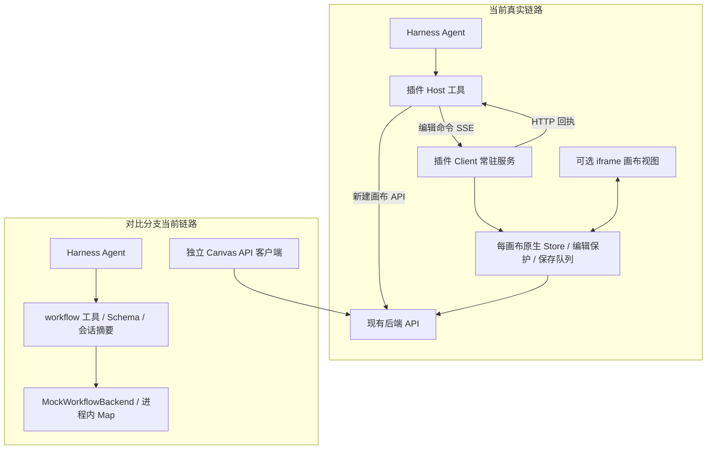

# workflow-op 与现有画布插件：代码对比与取舍结论

> 历史基线说明（2026-10-14）：本报告只对应 `2f162ea`。最新分支已接入远端后端，不能再用本文的默认 Mock 状态描述它。当前调用、通信与协议结论以[77fb977 复审](2026-10-14-workflow-op-77fb977-protocol-review.md)为准；内置发布/部署已排除出本次取舍范围。

日期：2026-10-13。范围：只读代码审查、隔离测试和文档归档；没有合并分支、修改业务代码、安装插件或操作真实账号。

补充：本文主要比较实现状态与部署路径。用户要求剥离 Mock 因素后，协议选型已进一步细化为“workflow 领域接口作为公开协议骨架，融合 alpha.12 字段与可靠性语义，内部执行继续复用插件”；以[协议深度比较](2026-10-13-workflow-protocol-deep-comparison.md)为准。Mock 的默认坐标/端口行为不代表 workflow 协议未要求布局与校验。

## 1. 决策结论

**以现有 desktop-canvas-plugin 的原生执行服务为主，选择性吸收 workflow-op 的 Agent 接口组织与 Shell 内置发布方式。当前不建议整体替换，也不建议同时发布两套独立的画布工具与数据状态。**

原因不是已有投入较多，而是业务目标要求：Agent 和用户操作同一张真实画布，复用原生节点、参数、编辑状态、保存队列与后续生成能力。现有方案已经建立这条执行链；对比分支目前完成的是协议、模拟执行、会话上下文及 API 客户端准备。

另一套实现并非无价值。它在**批量组织操作、临时节点引用、分层查询、运行时操作指导、会话摘要、内置部署**方面更完整。这些恰好可以补现有方案的易用性与交付缺口。

“写在 Shell 仓库内”“作为插件发布”“在 Host 执行”“由 Client 原生服务执行”是不同维度。插件可以随 Shell 永久内置；源码位置不决定执行质量，也不决定是否需要打开画布。

## 2. 比较基线与证据强度

| 对象 | 本次基线 | 证据边界 |
|---|---|---|
| workflow-op 分支 | `2f162eac46952ea2ff39d53f33161d128dfc1e78` | 通过 Git 拉取、独立临时目录审阅和测试，未切换当前工作区 |
| 当前 Shell | `eb4fb89ed326f0494a99f828b54725b456c0b989` | 保留原有 README 与讨论文档改动 |
| 共同 Shell 基线 | `29718822b36a232eeabe202b77fed6ae44256338` | 分支相对该基线：34 个文件，+2826/-34 |
| 当前插件 | 本地 `0.3.0-alpha.12` 工作区 | 包含尚未提交的实施代码；不能只比较插件 Git HEAD，否则会漏掉已完成能力 |
| 当前插件验证 | 既有 alpha.12 归档：插件 172、Web 266 测试通过；实际 Core 隔离加载通过 | 本轮复核代码和归档，没有重新跑全部插件测试；alpha.12 完整真实账号图编辑验收仍待反馈 |
| 既有真实账号验证 | 用户报告 103161 对话建画布/节点成功；103165 图片素材闭环已有归档 | 不能扩大为所有 alpha.12 新能力已经通过真实账号验收 |

分支的工具入口明确实例化 `new MockWorkflowBackend()`；README 也明确说明五个真实 API 尚未用于 `workflow_*` 工具。这是代码事实，并非根据缺少手测记录推测。[工具入口](https://github.com/Boxser567/insight-desktop-shell/blob/2f162eac46952ea2ff39d53f33161d128dfc1e78/packages/insight-workflow-op/src/index.ts#L22-L29)、[分支 README](https://github.com/Boxser567/insight-desktop-shell/blob/2f162eac46952ea2ff39d53f33161d128dfc1e78/packages/insight-workflow-op/README.md)。

若其他 Agent 在此提交之外另有未推送实现或实账演示，需要用对应提交重新比较；本报告不评价未提供的代码。

## 3. 对方实际完成了什么

### 3.1 协议与 11 个工具

新增 `packages/insight-workflow-protocol`，集中领域类型、输入输出 Zod 校验和 `WorkflowBackend` 接口；`insight-workflow-op` 注册以下工具。

| 工具（均带 workflow_ 前缀） | 当前行为 | 对现有方案的价值 |
|---|---|---|
| get_node_definition | 一次查询一个或多个节点类型的概览 | 可以补统一能力发现，减少 Agent 靠 README 猜能力 |
| search_models / get_model_setting | 搜索模拟模型、读取参数与默认值 | “先筛选，再取详情”值得吸收；目录应换成原生配置与当前账号权限 |
| create_workflow / list_workflows | 在进程内 Map 创建、列举工作流 | 我们已真实创建；真实画布列表仍值得补 |
| get_workflow / list_nodes / get_node | 摘要、结构、完整视图以及字段过滤 | 可以改进上下文体积与定位效率 |
| apply_workflow_patch | 顺序处理增改删节点、增删边、重命名，支持 dryRun 和 clientId | 是最值得借鉴的组合操作接口，但目前只保证内存草稿的提交行为 |
| execute_workflow / get_workflow_run | 返回 mock=true 的运行记录，状态保持 running | 是执行契约草稿，不是已打通原生生成、进度或产物链路 |

模拟节点包括 text/image/audio/video/poseTool/highDefinitionTool。后两种有模拟数据结构，不代表原生工具已经可执行；更不代表抠图已实现。当前四个模型为静态 mock 模型，没有外部素材导入和可用参考图生图模型。[模拟实现](https://github.com/Boxser567/insight-desktop-shell/blob/2f162eac46952ea2ff39d53f33161d128dfc1e78/packages/insight-workflow-op/src/mock-workflows.ts#L49-L69)。

工具执行时同时校验输入与输出，并将 Zod 转成 DSH 支持的 Schema。这比手工分别维护大量工具说明更容易统一，但该分支仍手写 TypeScript 类型和 Zod 两份契约，尚非单一来源自动生成；DSH 投影会舍弃不支持的数值约束和部分字典细节，最终合法性仍由执行时 Zod/业务校验决定。[Schema 投影](https://github.com/Boxser567/insight-desktop-shell/blob/2f162eac46952ea2ff39d53f33161d128dfc1e78/packages/insight-workflow-op/src/dsh-schema.ts)。

### 3.2 Agent 会话接入

- 注册模型可调用的运行时 `insight-workflow` Skill，描述查询、选择模型、批量建图的顺序。
- 保存每个 Agent 最近使用的工作流 ID，在上下文注入最新的本地摘要。
- 从匹配的成功工具调用/结果恢复工作流，不把用户文本中随意出现的 ID 当作权威绑定。
- 支持会话恢复与清空。这里的“当前工作流”指对话最近使用对象，不是用户在 Web 画布当前选中的节点。

这是现有方案应吸收的交互设计。接真实业务后，缓存还须按账号/环境隔离，恢复后验证对象可访问性，写入仍以实时版本为准。它不能替代编辑保护，也不需要因此立即恢复此前暂停的完整业务模板 Skill。[会话实现](https://github.com/Boxser567/insight-desktop-shell/blob/2f162eac46952ea2ff39d53f33161d128dfc1e78/packages/insight-workflow-op/src/index.ts#L31-L100)。

### 3.3 五个真实 API 的客户端封装

`createCanvasApi()` 封装 `saveOrUpdate`、`get`、`listNodeSetting`、`partialUpdate`、`list`，由 Host 通过现有 Main 私有通道获取当前登录凭证。已处理固定服务地址、禁止携凭证重定向、超时、销毁取消、部分响应校验及原生图 JSON 解析。

**API 客户端已经写好，不等于工具已调用它。** 当前工具入口没有创建它，也没有真实 `WorkflowBackend` 将协议映射为原生操作。

值得肯定的是 `CanvasGraph` 保留未知原生字段，测试覆盖 group/parentId 等内容未被丢弃；没有直接把后端完整图强制转换成精简 Agent DTO。后续必须延续这条边界。[API 实现](https://github.com/Boxser567/insight-desktop-shell/blob/2f162eac46952ea2ff39d53f33161d128dfc1e78/packages/insight-workflow-op/src/canvas-api.ts)。

### 3.4 随 Shell 安装、升级和修复

增加 workflow-op 构建，加入 bundled profile，将 profile 版本从 8 提升为 9，加入安装器管理包集合，并处理旧 profile 迁移和受管包复制。

这一部分比当前手动 tgz 交付更接近“画布永久内置客户端”的目标。应借鉴其发布路径，最终装入选定的真实插件与所需 Client/Web 资源，不应把模拟执行器也作为正式业务一起启用。[发布集成](https://github.com/Boxser567/insight-desktop-shell/blob/2f162eac46952ea2ff39d53f33161d128dfc1e78/src/main/state/bundled-profile.ts)。

## 4. 两套能力逐项对照

“已实现”在下表中特指本地当前代码；与真实账号手测是否完成分开判断。

| 维度 | 当前插件 alpha.12 | workflow-op 本次提交 |
|---|---|---|
| 不打开画布进行操作 | 已有 Client 常驻服务，无需 iframe | Mock 在 Host 内工作；真实 API 可从 Host 调用，尚未接工具 |
| 真实画布创建与读取 | 已接现有 API/服务 | 工具只读写 Map；有独立真实 API 封装 |
| 普通节点增改删 | 已接原生 Store 和保存；有类型/字段边界 | Mock patch 支持；没有接原生 Store/持久化 |
| 文本正文 | 可以直接写入文本内容 | 当前创建/更新契约有 prompt，没有直接写正文的字段 |
| 节点连线 | 原生端口；增删、保 ID 改接、输入排序；类型/容量/重复/新环校验 | Mock 增删边；端口默认 output/input；未校验原生端口/容量/重复/新环 |
| 素材导入 | 附件读取、上传/登记、原生上传图片节点 | 无 Agent 导入工具 |
| 模型参数 | 当前账号原生配置、权限、模式切换和参数联动；公开查询/配置目前集中 image/video | 通用查询契约较丰富；实际仅静态 mock 模型 |
| 坐标 | auto/absolute/after；复用原生尺寸与局部批量布局；不重排全图 | 可以显式传位置/尺寸；省略位置时所有节点为 0,0 |
| UI 同时编辑 | 原生共享 Store、编辑 guard、严格队列版本校验 | 尚无 UI 接入/并发协作 |
| 保存回执 | 区分 saved/rejected/submission_unknown；确认版本；未知提交先读后判断 | patch 的 applied 只表示内存更新；真实 API 错误尚未区分发送前失败与发送后未知 |
| 批量组合 | 有局部批量能力，但没有通用跨操作 patch/clientId 协议 | 有；是明显可吸收项 |
| 查询与上下文 | 分页、截断、可信版本；缺少统一能力入口及当前画布自动摘要 | 查询视图/过滤和会话摘要更系统；缺少真实版本和有界分页 |
| 生成、模板、抠图 | 原生业务存在，公开 Agent 桥未开放 run；特殊工具创建/模板仍未完成 | 有执行工具名称，但没有真实执行器/完成状态/产物 |
| 内置产品发布 | 独立插件包；本阶段主要用 tgz 验收 | 已加入 Shell 构建/profile 迁移与修复路径 |

工具 7 个对 11 个、节点类型数量，都不能直接换算成“掌握了画布多少百分比”。应按真实任务衡量，例如“导图→抠图→文案与参考图连线→出图→修改重跑”。截至这两个基线，双方都还不能通过 Agent 完成这一整条真实链路。

## 5. 执行位置与状态所有权：真正的架构差异

分支的 API 客户端与工具间目前没有连接。未来若做 Host 直接改图，会形成另一种可行架构，但需要先完成原生节点语义、版本控制、用户草稿协调和 UI 同步，不能只替换 `new MockWorkflowBackend()` 就结束。

当前本地桥用 SSE 把 Host 命令送给 Client，Client 调现有业务 API 后以 HTTP 回传结果。它不是新建云端业务服务，也不等同于后端提供了覆盖所有业务的任务 SSE。现有原生生成结果监听仍是已有能力；公开 Agent 生成/进度接入尚待完成。

本项目目前要求“不打开画布视图”，现有服务已满足；它仍依赖 Shell 的 Client 运行与会话桥在线。如果未来要求 **Client 也退出后仍能由后台 Agent 调图**，才需要重新评估纯 Host 业务引擎。即使如此，优先抽出可共享的原生引擎供 UI/Host 调用，避免再实现一套长期独立演进的节点规则。

Host 可以继续负责创建、列表和独立元数据查询；**同一张活动画布的节点/边修改，必须经同一个协调执行入口**。不能让 Host 直接 partialUpdate 与 Client Store 队列同时成为无协调的写入者。

## 6. 迁入真实业务前必须解决的问题

以下评价针对“能否直接用于真实业务”，不把有意简化的 Mock 当成作者声称已完成的生产实现。

### 6.1 不能用 Map 的原子提交承诺后端事务

Mock 克隆整个工作流，所有操作校验通过后替换 Map，失败保留原值。这一原型行为正确表达了批量意图，但现有后端是否对节点和边组合更新提供全部原子保证，本轮没有证明。

接入建议：先在原生执行服务内形成整批变更草稿，统一校验，复用保存队列发一次支持的 `partialUpdate`（其参数已含 addNodes/updateNodes/deleteNodeIds/allEdges）。**不能循环调用多个现有单节点工具，然后把最后的成功称为原子提交。** 后端组合更新的失败语义未验证前，契约只承诺“本地预检全部通过才提交”，不承诺服务器事务；若接口不满足，再缩小支持的组合范围，而非暗中拆成多次写入。

### 6.2 幂等与 dryRun：已复现的两个契约问题

`mock-workflows.ts:187–225` 仅以 workflowId + idempotencyKey 查缓存，未校验请求内容，且在 dryRun 分支前命中缓存。

- 同一个键先提交重命名 first，再提交 second，会返回旧的 applied=true，但名称仍为 first。
- 用一个已提交的键做 dryRun，也会返回 applied=true，与“试运行始终 false”的 Schema 说明冲突。

应吸收我们的请求内容指纹/目标匹配保护；dryRun 与提交独立定义重放语义。还要限制缓存容量、定义生命周期；双方现有内存去重都不等于跨进程重启的持久幂等。[相关代码](https://github.com/Boxser567/insight-desktop-shell/blob/2f162eac46952ea2ff39d53f33161d128dfc1e78/packages/insight-workflow-op/src/mock-workflows.ts#L187-L225)。

### 6.3 版本与未知提交不能丢失

workflow patch 输入输出没有 expectedVersion/confirmedVersion；真实 API 的 versionNumber 也只是可选参数，updateCanvas 返回类型没有确认版本。网络中断/超时/销毁都折叠为 REQUEST_FAILED，无法判断已发出的写入是否已落库。

真实接入需要保留当前机制：在队列执行时检查版本，只有可信回执才返回 saved；发送后无法确认时返回 submission_unknown，保留可核对的节点 ID，不自动重写。会话“最新摘要”是定位提示，不能代替版本条件。[API 错误及请求代码](https://github.com/Boxser567/insight-desktop-shell/blob/2f162eac46952ea2ff39d53f33161d128dfc1e78/packages/insight-workflow-op/src/canvas-api.ts#L147-L225)。

### 6.4 原生节点语义必须复用

额外隔离探针确认：Mock 接受虚构端口、同向重复边和新增循环；省略坐标会重叠；新增节点未执行就标记 running；image 更新可切到所选 mock 模型不支持的模式。这些不能原样进入真实画布。

Agent DTO 只负责表达意图，不应替代原生持久化节点：group、parentId、上传/工具产物属性、尺寸、媒体内容和任务状态必须保留。节点构造、连线和模型联动继续使用插件现有 native util / policy / Store，而不是复制 Mock 的 createNode/applyOperation。

### 6.5 模型响应仍需真正适配

分支的 getModelParams 声明 data 是模型 Map，实际只是直接转发 listNodeSetting。当前 Web 的 `loadNativeModels()` 要求的是 `data[0].config` JSON 字符串，再经原生转换；另外单独加载模型与工具权限。

这说明现有 API 封装的类型声明还不能直接充当 Agent 的可用模型目录。接入时应以真实环境响应及原生转换为准，合并权限，不能把静态 mock 模型或原始 JSON 直接暴露给 Agent。[现有初始化](</Users/boxser.shi/Documents/harness/desktop-canvas-plugin/canvas-app/src/canvas-initialization.ts:51>)。

### 6.6 两边都需要收口的工程问题

- **现有插件**：跨 Host/Client 桥带来生命周期复杂度；逐次工具调用增加往返；手工 Schema/解析器/说明需同步；Web legacy 副本需明确上游同步方式；alpha.12 最新实账矩阵仍待完成。这些是维护成本，不能用测试数量掩盖。
- **现有插件**：大量已完成业务变更尚在工作区。后续合并前应形成可追溯基线与包版本，并核对客户端真正加载的版本，避免再次依据 alpha.10 README 判断 alpha.12 能力。
- **对比分支**：查询与 operations 缺少业务上界，full 返回完整图；API 模块直接导入 Shell 源文件，协议包之外的执行包仍耦合 Shell；后台执行接口还没有 signal、会话/账号上下文及统一保存结果。
- **共同问题**：同一凭证通道不必维护两套近似实现；我们已有 `desktop-token.ts` 使用相同 Main 私有消息。可以统一可测试的凭证适配器，但凭证永不进入工具参数/输出或会话摘要。

## 7. 具体选取清单与文件落点

以下是后续实施建议，本轮未修改这些业务文件。插件路径相对 desktop-canvas-plugin；Shell 路径相对 insight-desktop-shell。

| 对方代码/设计 | 取舍 | 建议落点与边界 |
|---|---|---|
| `workflow-protocol` 类型、Zod、输出契约 | 吸收契约集中管理方式，逐步迁移 | 先整理插件 `src/shared/canvas-agent-protocol.ts` / `canvas-bridge-protocol.ts` 与工具定义；真有跨包消费者时再抽独立包，不为统一目录重写全部协议 |
| `index.ts` 当前工作流摘要、成功工具历史恢复 | 适配吸收，优先级高 | 插件 Host 增加独立 `canvas-session-context.ts`；接入现有 tools 注册；按会话/账号/环境隔离，保存成功才更新引用 |
| `workflow-skill.ts` 操作指导 | 吸收基础操作说明 | 从实际注册能力生成/维护精简运行时指导；明确未开放生成，不推动此前暂停的完整场景 Skill |
| 节点定义和模型分层查询 | 吸收，但换真实来源 | 接 `agent-graph-read.ts`、`agent-model-policy.ts`、原生注册/权限；区分 UI 支持与 Agent 已开放，过滤与分页必须有界 |
| patch + clientId + dryRun | 吸收接口思想，执行实现重新适配 | 新增内聚的 `agent-batch-policy.ts`，接 `agent-adapter.ts` 与 `flowStoreCore.ts` 队列；复用 node/edge/model/placement policy；不复制 Map 执行器 |
| MockWorkflowBackend | 保留为隔离测试替身 | 不作为正式数据源，不在生产注册 mock 生成能力 |
| `canvas-api.ts` 五 API | 选择性补充缺少的列表查询，不复制整个客户端 | 已有创建/读取/上传/持久化路径保留；普通编辑不新增绕开 Store 的 Host 写入口 |
| `canvas-credential.ts` | 比较后统一适配器 | 与现有 `src/host/desktop-token.ts` 合并重叠责任，保留取消、dispose、登录错误语义 |
| 构建/profile/安装器受管包 | 吸收部署机制，按真实插件调整 | Shell `scripts/prepare-bundled-profile.mjs`、构建脚本、`src/main/state/bundled-profile.ts`、`installation-owned-bundles.ts`；不仅复制 Host lib，还需 Client 与 canvas-app/dist 等完整资源 |
| `execute_workflow/get_workflow_run` | 留作设计参考，不认定为现成功能 | 后续从原生单节点运行与结果监听开始对接；生成阈值继续按 >30 图片或 >6 视频确认，不增加付费确认 |
| `scripts/prepare-core-runtime.mjs` 下载缓存改动 | 与画布取舍分离 | 分支混入的运行时下载优化单独评审，不随画布方案整体合入 |

对外暂保留现有 `canvas_*` 工具名称。新增 batch/discovery 时只开放一套权威工具，不让 Agent 在 canvas_* 与 workflow_* 两个“当前画布”之间自行选择。如果以后决定统一改名，应提供明确兼容迁移；不是本次获得优势的必要条件。

## 8. 三条路线如何选

| 路线 | 好处 | 需要承担的工作 | 判断 |
|---|---|---|---|
| 用 workflow-op 整体替换 | 协议、上下文与 Shell 内置路径整齐 | 补真实 backend、原生映射、上传、UI 协调、保存可靠性、布局与全部实账验证 | 目前不选；不是省掉一层桥就完成替换 |
| 插件原生服务为主，吸收接口与部署 | 保留真实业务，补批量与会话效率，风险可分阶段控制 | 少量适配、批量执行设计、发布迁移 | **推荐当前路线** |
| 长期抽共享业务引擎，由 Host 与 Web 复用 | 有机会减少 Client 生命周期依赖，支撑真正后台任务 | 解耦浏览器/Store/媒体运行依赖，并迁移 UI 状态所有权 | 当“不依赖 Client 的后台运行”成为需求再立项；不作为当前必须前置 |

因此并非“现有技术永远最佳”。在当前不改后端、复用成熟 Web、无需打开画布视图的约束下，保留现有执行底座的收益最大；分支中的上层组织方式则值得反向补入。

## 9. 建议下一轮顺序与验收门槛

| 步骤 | 目标 | 完成标准 |
|---|---|---|
| 1. 固定版本与能力事实 | 给两个实现形成统一可核对的边界 | 插件源/包/已加载版本对应；只注册真实可用能力；完成 alpha.12 已有 G01–G06 实账矩阵，不扩大为生成测试 |
| 2. 补会话摘要与能力发现 | Agent 准确知道“当前画布”和“可以做什么” | 新会话/恢复/清空/切账号不会误用画布；能力说明来自真实注册；失败/unknown 不报告操作成功；无需完整模板 Skill |
| 3. 做一个小范围批量建图入口 | 减少逐节点往返，吸收 clientId | 一批创建“文本+两个空图节点+合法连接”；原生尺寸/放置生效；dryRun 无持久化；过期版本/编辑中/非法连线拒绝；相同键不同内容拒绝；断网后不重复建节点 |
| 4. 内置 Shell 交付 | 结束每次手动替换 tgz 的易错路径 | 新装、升级、同版本修复能加载完整真实插件；保留用户其他插件；旧手装副本无双注册；不打开画布也可操作；提供版本及回退路径 |
| 5. 继续真实业务闭环 | 从图 CRUD 走向耳机素材产出 | 复用原生运行/监听，先单节点真实生成，再现有抠图工具与关联节点；结果可见、失败可解释、修改后可重跑、大批量按阈值确认 |

步骤 3 和 4 不应演变成全面协议重构，更不能把“迁移全部工具到新包”作为步骤 5 的前置。完整场景模板与 Skill 仍按此前决定暂缓。新增工具时只扩充对应真实能力、字段与验收用例。

一次有代表性的融合验收可以是：Agent 引用当前真实画布，在不打开视图的情况下 dryRun 新建文案和两张空图的关联结构；提交后回执包含版本及临时 ID→真实 ID 映射；打开画布确认节点、端口和位置一致；用户编辑节点时让 Agent 修改，必须遵守已有冲突保护；最后关闭再读取确认持久化。此验收不调用模型、不把模拟运行当作生成完成。

## 10. 本轮验证记录与限制

- 分支工具/协议/API/凭证：4 个测试文件，**19/19 通过**。
- 分支 profile 与 Shell 契约：2 个测试文件，**20 通过、1 跳过**；跳过的是已生成 bundled profile 检查，临时快照没有生成安装目录。
- 协议包、workflow-op 包的 TypeScript `--noEmit`：均通过。
- 额外 6 个隔离探针全部符合预期：复现不同 payload 幂等冲突未报错、dryRun 缓存语义、非法连线、默认重叠/运行状态、正文/版本字段缺口、image 模式校验缺口。**探针通过表示问题已被复现，不表示这些行为正确。**
- 没有启动另一套真实账号生成、打出 Shell 安装包或复验当前插件全套业务。没有测得两套的端到端耗时/token 成本，本文不据代码量宣称性能优劣。

隔离测试使用当前 Shell 已安装的工具链与 Core，通过临时目录软链接复用依赖，未对比分支执行新的依赖安装。详见 [审查证据](evidence/2026-10-13-workflow-op-comparison-checks.json) 与 [可复现探针源码](evidence/2026-10-13-workflow-op-review-probes.test.ts.txt)。当前插件完整历史证据见 [alpha.12 验收摘要](../implementation/2026-10-13-agent-graph-edit-checks.json)。

当前插件重点代码入口：

- [Host 工具与真实保存调度](</Users/boxser.shi/Documents/harness/desktop-canvas-plugin/src/host/canvas-tools.ts>)、[图编辑工具](</Users/boxser.shi/Documents/harness/desktop-canvas-plugin/src/host/canvas-graph-tools.ts>)。
- [Client 常驻服务生命周期](</Users/boxser.shi/Documents/harness/desktop-canvas-plugin/src/client/canvas-service.ts>)、[原生服务适配](</Users/boxser.shi/Documents/harness/desktop-canvas-plugin/canvas-app/src/agent-adapter.ts>)。
- [Store 与持久化队列](</Users/boxser.shi/Documents/harness/desktop-canvas-plugin/canvas-app/legacy/src/store/flowStoreCore.ts:1490>)、[原生连线规则复用](</Users/boxser.shi/Documents/harness/desktop-canvas-plugin/canvas-app/src/agent-edge-policy.ts>)、[自动放置](</Users/boxser.shi/Documents/harness/desktop-canvas-plugin/canvas-app/src/agent-node-placement.ts>)。
