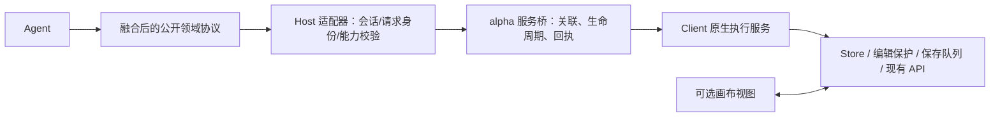

# workflow-op 与 alpha.12：协议深度比较及合并策略

> 历史基线说明（2026-10-14）：本报告只对应 `2f162ea`。最新 `77fb977` 已删除 clientId、dryRun、patch idempotencyKey 等字段，并接入远端写入。当前取舍以[最新复审](2026-10-14-workflow-op-77fb977-protocol-review.md)为准：保留插件执行与通信底座，选择性借鉴公开契约设计；不预设整套协议迁移或合并。下文拟议协议从未实施。

日期：2026-10-13。最新远端分支核对后仍为 `2f162eac46952ea2ff39d53f33161d128dfc1e78`。比较对象是该提交的 workflow-protocol / 工具注册契约，与 desktop-canvas-plugin `0.3.0-alpha.12` 的公开工具、共享领域契约和 v3 服务桥。**不把 Mock 实现的成熟度纳入协议优劣评分。** 本文是设计结论，拟议接口尚未实现。

## 1. 修订后的结论：按协议层选择主方案

**以 workflow-op 的领域接口组织作为下一版公开 Agent 协议的骨架，合入 alpha.12 的原生业务表达和可靠性语义；内部通信及业务执行继续复用 alpha.12。**

这比“维持 alpha.12 接口，零散补几个工具”更进一步：公开协议应从逐项 CRUD 升级为“发现 → 查询 → 组合修改 → 执行 → 结果”。但公开协议重整不意味着将业务搬到 Shell Host，也不意味着替换原生 Store。

| 层次 | 主要采用哪套 | 为什么 |
|---|---|---|
| Agent 公开工具组织 | **workflow-op** | 能力发现、查询视图、判别操作、批量 patch、运行对象，覆盖长期工作流任务 |
| 节点/参数/素材领域契约 | **融合** | workflow 结构化类型及参数描述更完整；alpha.12 的文本正文、素材、原生端口、坐标策略与动态模型值不可丢 |
| 写入、错误和并发契约 | **alpha.12 为主** | 版本、确认回执、未知提交、恢复建议已有明确语义；补 workflow 的错误定位、批量 ID 映射和操作级幂等 |
| Host ↔ Client 通信协议 | **alpha.12 为主** | 两端生命周期、路由、请求关联与多阶段回执是独立职责；workflow 的领域接口没有必要复制它 |
| 原生执行/保存 | **alpha.12 复用** | 此项是接入方式，不作为本轮协议选型的加减分；协议下的适配器仍调用现有业务 |

上一轮报告中的三项需要澄清：

1. workflow 的 `NodeCreateBase.position` 已规定省略时自动布局；Mock 将坐标设为 0,0 是实现差距，**不是协议没有自动布局**。协议缺的是 alpha.12 那样明确的 auto/absolute/after 策略和坐标系。
2. `AddEdgeOperation` 已要求省略端口时解析并校验；Mock 接受非法端口不能证明协议允许非法连线。真正缺口是缺少可发现的端口/容量信息，以及没有明确列出重复、循环、管理边等规则。
3. 不因 Mock 暂未落地而否定批量事务和运行协议；只检查这些承诺是否完整、能否映射到不改后端的既有接口。

## 2. 同层比较：不要把公开工具与内部消息混为一谈

workflow 的 `WorkflowToolContracts` 是领域 API；alpha.12 同时包含三类内容：

- **公开工具**：`canvas_create/get/node_edit/edges/models/assets/asset_import`。
- **执行服务命令**：`CanvasOperation`，如 node.add、node.configure、edge.reorder。
- **运输消息**：v3 的 canvas.prepare、canvas.command、accepted/started/settled、contextId、connectionId 等。

模型只应填写业务意图与必要前置条件。sessionId、connectionId、contextId、bridgeKey、deadline、AbortSignal 由宿主提供，不能为了统一协议加入模型必填参数。



同一个协议可以有不同执行适配器。`WorkflowBackend.execute()` 提供这一方向，但其接口还需补充宿主执行上下文；不能把 `WorkflowBackend` 等同于“必须 Host 直调后端”。

## 3. 逐项比较与选择

### 3.1 工具组织、类型与模型可见 Schema

| 项目 | workflow-op | alpha.12 | 选择 |
|---|---|---|---|
| 领域契约集中化 | 独立包维护输入、输出、Schema、工具描述 | 已有共享类型和解析器，但工具 Schema、素材类型等分散在 Host | 采用独立领域包组织；不合并运输、渲染依赖 |
| 条件参数 | operation/node/create/changes 使用判别联合 | 内部 CanvasOperation 是联合；公开 node_edit 是 action + 多个可选字段，运行时再判断组合 | 采用 workflow 判别联合，让模型直接看到合法组合 |
| 工具输出 | 结构化对象 Schema，执行时校验输出 | 多数公开工具声明 string，内部对象 JSON.stringify 后返回 | 新协议用结构化输出；旧工具保留兼容序列化 |
| 查询/修改分工 | 专门查询工具 + 一个组合 patch | 工具较少，单工具承担不同 action/view | 采用领域分工；不机械把工具数量越多当越好 |
| 契约单一来源 | TypeScript 与 Zod 仍双份手写 | 类型、手写解析、公开 Schema 也需同步 | 新契约优先 Schema→推导 DTO 类型；仅维护必要业务语义校验 |

workflow 的优势是真实的：`op=add_node` 不会与 `edgeId` 等不相关字段混在同一个工具对象里，返回结果也更易被宿主和 Agent 理解。alpha.12 的内部结构并不差，主要差距在公开暴露的一层。

不过 DSH Schema 投影不是完整 JSON Schema：数值范围及部分动态字典细节会被弱化。迁入后仍须保留执行时校验，并把关键约束写入精简字段说明，不能只依赖模型按 Schema 生成正确参数。[workflow Schema](https://github.com/Boxser567/insight-desktop-shell/blob/2f162eac46952ea2ff39d53f33161d128dfc1e78/packages/insight-workflow-protocol/src/workflow-schemas.ts)、[alpha 工具定义](</Users/boxser.shi/Documents/harness/desktop-canvas-plugin/src/host/canvas-tools.ts:22>)。

### 3.2 发现能力：workflow 的方向更好，但尚不足以指导 Agent

workflow `NodeDefinition` 只有 nodeType、description、supportedModelTypes；查询还要求调用方事先知道一个或多个枚举值。它不能独立回答“你有哪些能力”，也不能表达抠图节点需要几张输入图、某账号能否创建/执行、为什么暂不可用。

alpha.12 在读取**已存在节点**时可返回 ports、allowedInputTypes、canConfigureGeneration，信息更接近真实操作，但没有完整类型发现入口。

融合后的能力描述应包括：

- 类型 ID、名称、用途；可查询全部已注册类型或指定多个类型。
- `supportedActions`：read/create/update/delete/connect/configure/run 中哪些经 Agent 开放。
- 账号可用性及不可用原因；**UI 已有能力不等于 Agent 已接通能力**。
- 输入输出端口、媒体类型、容量、必要输入、是否产生受管理的产物节点。
- 创建/修改参数定义或可继续查询的配置引用、默认值策略。
- 能力目录版本；只有已实现适配器的类型才允许写入。

保留 `type` 判别思想，但合法分支来自已注册能力，不长期把整个画布封死在六种枚举中。未知节点可返回有界只读摘要；Agent 不能因参数允许 JSON 就创建任意代码节点。所谓“Agent 自研节点”后续更适合先表达为已注册节点的子图组合。

### 3.3 创建节点：workflow 参数完整，alpha 对轻交互更友好

workflow 的模型节点创建要求 model，非文本还要求 modelType，可同次提供提示词和技术参数；其 `size` 是期望尺寸，与 measured 区分，语义清楚。alpha.12 可以只提供类型、标题或正文，复用原生默认；但指定模型要另行 configure，创建协议不足以一次表达最终目标。

**选择：保留 workflow 的一次完整创建，同时保留 alpha 的可省略默认与文本正文。**

拟议创建字段：`type/title/text/prompt/configuration/placement`，其中 `configuration={modelType?,model?,params?}`。按节点类型生成合法分支：text 才能带正文，工具节点使用已注册参数定义；普通媒体允许先创建空节点。

明确规则：

1. 文本正文 `text` 和生成提示词 `prompt` 分开，不以 prompt 冒充已经写好的文案。
2. 未指定配置时使用当前账号可用的原生默认，回执返回实际解析的配置；创建与保存不会触发生成。
3. 用户/模板明确指定但当前不可用的模型、参数，应返回可定位错误；不能默默替换。
4. 只有缺少业务必要输入且不能可靠推断时再追问。技术默认值无需让不熟悉 AI 的用户逐项选择。
5. `size` 将来可作为受控显示尺寸请求；它不是生成分辨率，不等同于 measured。未开放原生尺寸调整适配器前不宣称可编辑。

这同时解决 alpha 的多步配置和 workflow 的强制模型选择负担。[创建类型定义](https://github.com/Boxser567/insight-desktop-shell/blob/2f162eac46952ea2ff39d53f33161d128dfc1e78/packages/insight-workflow-protocol/src/workflow-agent-tools.type.ts#L401-L481)。

### 3.4 模型参数：采用 workflow 的描述结构，扩展动态性

| 项目 | workflow-op | alpha.12 | 融合决策 |
|---|---|---|---|
| 元数据 | label、控件类型、default、min/max/step、maxPrompt | field、editable、标量 choices、min/max | 以 workflow 元数据为基础，保留 editable/账号权限 |
| 枚举值类型 | choices/default 限 string | string/number/boolean/null | 保留真实标量类型；数量 1 不应转成字符串 "1" |
| 配置发现 | 搜索摘要 → 完整设置 | canvas_models 返回目录/选项，节点读取给当前参数 | 保留分层发现，同时支持针对当前节点/候选参数解析有效选项 |
| 模式扩展 | image/video/audio 的 modelType 是闭合枚举 | modelType 为发现得到的字符串 | 公共协议允许已发现的模式 ID；执行按真实目录验证 |
| 嵌套参数 | JsonObject 与 ParameterPatch 可表达 | 仅标量，明确不开放高级嵌套 | 按能力白名单逐项开放；不能直接把任意 JsonObject 写入原生 params |
| 版本 | 无配置版本字段 | catalogVersion + expectedCatalogVersion | 保留目录版本，并在依赖目录的写入时验证 |

还需修正 workflow 两个内部不对称：

- 读取/修改支持 additionalParameters，但基础节点创建 Schema 没有该字段；新模型特有参数不能直接在创建时表达。
- 同时存在具名参数、additionalParameters、seniorParams、senoirParameters，默认参数又缺少明确路径规则；需要定义读写映射与冲突优先级。

建议对外统一 `configuration.params` 与参数路径元数据，创建提交值，修改使用受控 `{set,unset}`；不再要求 Agent 了解 legacy 的拼写和嵌套存储布局。`unset` 表示恢复缺省语义并重新计算依赖，不等于设置 null；输出返回解析后的值和发生的联动。内部适配器负责映射原生位置。

条件参数可用 `dependsOn`/候选配置解析表示，不能只返回脱离当前选择的全部 choices。Schema 合法不代表“模型、模式、分辨率、时长、参考素材”组合合法。

### 3.5 查询：workflow 表达能力更强，alpha 一致性更完整

workflow 的 summary/structure/full 与 all/any/比较/supports 可以减少不必要的全图读取；alpha 的节点 ID 定位、图分页与可信版本更适合编辑前读取。

采用组合：

- 保留 summary、structure、detail/full 的分层意图；full 必须明确为“Agent 可读投影”，不能称为可回写的原生全量图。
- 保留直接 IDs/type/model 等高频条件。高级 filters 仅允许公布的字段与操作符，不让模型猜任意 `data.params.*` 存储路径。
- 模型查询把 nodeType/modelType/model 作为直接定位字段，能力约束再用 supports。避免简单定位也必须构造一套通用 DSL。
- `get_model_setting` 用已选模型精确定位；“选择默认模型”显式表达默认策略，不继续隐含“过滤结果第一项”。
- 保留分页、大小上限、truncatedFields、missingNodeIds、consistency、snapshotVersion/catalogVersion。第一页之后校验同一快照，冲突后重读。
- 图有节点页与边页，允许某页边的端点未出现在该节点页；不能据此误判悬空边。alpha 的两套 offset 可以继续由适配器承接，无需为接口美观改造后端游标。

workflow 查询协议没有分页续读与快照一致性字段；alpha 的 summary 输出又缺少统一状态/版本/截断描述。这两处都需修订。[查询与模型条件](https://github.com/Boxser567/insight-desktop-shell/blob/2f162eac46952ea2ff39d53f33161d128dfc1e78/packages/insight-workflow-protocol/src/workflow-schemas.ts#L163-L186)、[alpha 读取契约](</Users/boxser.shi/Documents/harness/desktop-canvas-plugin/src/shared/canvas-agent-protocol.ts:93>)。

### 3.6 批量 patch：采用 workflow，扩展 alpha 原有动作

这是 workflow 最值得作为主协议的部分：有序 operations、判别联合、clientId、existing/created 引用、dryRun、createdNodes/createdEdges 映射，以及 operationIndex/path 错误定位。

融合时必须补齐：

| 契约点 | 推荐规则 |
|---|---|
| 操作集合 | 保留 add/update/delete node、add/delete edge；合入 configure、保 ID reconnect、reorder；不是只映射最小公约数 |
| 临时引用 | NodeReference 同时用于连线、配置、更新与 after 放置；只能引用本批次更早声明的节点，禁止未声明/前向/已删除引用 |
| 多层原生节点 | 一次工具创建若由原生业务生成工具节点和产物节点，返回逻辑主节点及原生创建 ID 集合；受管理边仍不可随意改写 |
| 版本 | 整批一个 expectedVersion；在原生队列实际执行时检查，不能只在 Host 入队前检查 |
| 无效操作 | 在发送前完成整批预检，返回具体 operationIndex/path；不修改 Store/后端；提交时再次校验版本及必要状态 |
| dryRun | 只读预检，无保存/上传/执行、无永久 ID 分配；返回临时引用与解析结果；不是锁，不保证稍后提交仍成功 |
| 幂等 | 业务操作键与请求 ID 分开；同键必须绑定账号/环境/画布/内容指纹，内容不同拒绝；dryRun 不消费提交键 |
| 规模 | 规定 operations、节点、边、深度及字节上限；具体值按适配能力测定，不能把生成数量确认阈值当编辑上限 |
| 副作用范围 | 首版图 patch 排除素材上传、媒体执行、跨画布复制；它们有独立外部副作用，无法靠一份图草稿回滚 |
| 重命名 | workflow 把 rename_workflow 放在图事务内；现有图 partialUpdate 不承载名称，需单独元数据入口，或先证明同一 API 可原子提交；首版从图 patch 移出 |

**原子性是契约问题，不是 Mock 问题。** workflow 已承诺全部事务提交。在“后端不改”前提下，需要先验证既有 API 的组合更新语义。可先固定首版只支持一次 partialUpdate 能承载的图操作；本地统一预检成立，后端原子事务承诺须有证据。绝不能用循环执行旧工具伪装成一批原子提交。

alpha 的保存队列、guard、native policy 应在服务内复用；Host 不逐个调用旧模型工具来完成 patch。

### 3.7 写入结果、错误和幂等：alpha 为主，workflow 补诊断

workflow 用 applied/valid 两个布尔表达结果，可描述提交/预检，但缺少持久化版本和不确定效果；Schema 甚至允许 applied=true/valid=false 同时出现。alpha 的 saved/rejected/submission_unknown 判别联合更适合作为主状态。

推荐结果联合（概念草案）：

```ts
type PatchResult =
  | { status: 'preview'; baseVersion: string; effects: PlannedEffects; warnings: Diagnostic[] }
  | { status: 'saved'; version: string; unchanged: boolean;
      createdNodes: CreatedNodeReference[]; createdEdges: CreatedEdgeReference[];
      affectedNodeIds: string[]; affectedEdgeIds: string[]; warnings: Diagnostic[] }
  | { status: 'rejected'; effect: 'none'; errors: Diagnostic[] }
  | { status: 'submission_unknown'; version: string | null;
      attemptedEffects: AttemptedEffects; error: Diagnostic };
```

公共字段还包含 canvasId、requestId；具体类型在实施时定义。未知结果中的 ID 必须标记为“本次尝试涉及”，不能放进“已创建成功”集合。error 采用两者并集：code、message、operationIndex、path、结构化 details、retry 建议。alpha 的 retry 枚举比单个 retryable 布尔更准确；workflow 的字段/操作位置更便于 Agent 修复参数。

公共错误码应表达业务处置，如 VERSION_CONFLICT、EDITOR_BUSY、INVALID_PARAMETER、SUBMISSION_UNKNOWN；旧 FRAME_* 或底层 SSE 错误由适配器映射，不把运输层所有细节永久固化进领域包。版本冲突、编辑中、未知提交也必须保持不同恢复建议。

同一 tool call 重投、模型下一次发起相同业务意图、进程重启，是三种不同重试。alpha 以会话/callId 推导 requestId，主要处理同次调用重放；workflow 的显式 idempotencyKey 更适合业务操作跨调用重试，但需要定义有效期和保存范围。**两者都不能仅凭字段名称保证跨重启 exactly-once。** 对无法确认的提交继续读后核对，不自动另起键重做。

### 3.8 素材与输出：必须将 alpha 能力纳入独立协议

workflow 的 Node.value 混合文本和产物列表，运行输出有 artifactIds，但没有素材解析/导入契约。alpha 有 attachment / canvas_node 两类明确来源，以及上传、保存、素材登记分阶段结果；这些是用户上传耳机图场景的必要协议。

保留独立 asset/list/import 接口：来源引用由宿主授权解析，不能让模型填写本地文件路径或任意 OSS 写地址。逐步引入有类型的 AssetRef/ArtifactRef，包含媒体类型、来源节点/任务、输出序号等可用信息；不要把“产物 URL 数组”当作连线。

素材导入回执必须分别表示 upload、node save、asset registration。节点 saved 而素材登记失败，不意味着可以再次新增节点。全局 error.effect 也要明确是“图未修改”还是“没有任何外部副作用”；alpha 现有部分输出依靠额外 asset 字段表达，值得在共享契约里正规化。

### 3.9 坐标与图关系：合入 alpha 的明确语义

保留 workflow 的可选位置/尺寸意图，采用 alpha `placement=auto|absolute|after` 作为统一放置表达。不要同时接受 position 与 placement 而没有优先级。

- auto：复用原生尺寸后安排新节点；不移动已有节点。
- absolute：明确画布世界坐标；若未来支持组内创建，要另外明确 parentId/局部坐标。
- after：在锚点附近按规则延展，可按用户约束允许与无关已有节点重叠；**不会自动建边**。
- 同批 after 可以引用更早的 clientId；绝不能要求 Agent 手算所有坐标。
- 图读取保留 ports、allowedInputTypes、parentId、size；合入 reconnect 与目标入边 reorder。多参考图顺序是生成输入语义，不是美观排序。

### 3.10 执行与事件：workflow 的生命周期骨架更好，需补范围与状态

workflow 分离 execute_workflow 与 get_workflow_run，这是长期运行任务的正确方向。alpha 的内部 RunReceipt 只有单节点 taskId/数量/版本；公开桥尚未开放，此处只比较已定义契约。

需修订的协议点：

1. workflow execute 返回 queued/running，但 WorkflowRun 只能 running/success/failed，queued 无法被查询结果表达；节点也缺少未运行状态。应拆开“提交状态”“节点当前状态”“一次 run 状态”。
2. 单独修改某张图后，只运行该节点/必要依赖是明确业务场景；execute 不能只有整个 workflowId。增加 scope（node/subgraph/workflow）及依赖策略，但仅开放原生执行器已经支持的组合。
3. 执行绑定 expectedVersion、解析后的输入/参数和预计生成数量。confirmationToken 绑定这次预检的对象及内容，而不是通用通行证。
4. 继续采用用户规则：图片 >30 张或视频 >6 条需确认；小范围不增加付费确认。不是仅因为有 token 字段就每次弹确认。
5. 任务提交未知不等于执行失败；停止等待也不等于后端取消。未实现取消接口时不宣称能取消任务。
6. get_run 保留作恢复/主动核对，正常进度通过宿主订阅事件更新，避免 Agent 连续轮询。事件最少带 runId/taskId、canvasId、nodeId、事件序号/版本、状态及错误/产物引用；必须区分传输重连序号与图保存版本。

后端不提供事件时，继续复用原生已有监听，在 Client/Host 内转为领域事件。SSE 的采用不会自动消除已有原生监听，也不会自动提供持久断线补发。[执行类型](https://github.com/Boxser567/insight-desktop-shell/blob/2f162eac46952ea2ff39d53f33161d128dfc1e78/packages/insight-workflow-protocol/src/workflow-agent-tools.type.ts#L647-L690)。

## 4. 统一哪些标识，哪些必须分离

| 字段/对象 | 含义与决定 |
|---|---|
| canvasId / workflowId | 当前后端是一张画布的同一 ID，不新建第二张映射表。建议公共协议使用 canvasId，workflowId 由兼容适配器映射；保持字符串，不转 Number |
| expectedVersion / version | 图持久化版本，来自可信读取/回执；不得用目录版本或事件序号替代 |
| catalogVersion | 模型/权限/能力配置快照版本；动态参数写入可附对应前提 |
| clientId | 本批次临时节点/边引用；不是请求身份，不发给后端作为真实画布 ID |
| requestId | 一次宿主调用/传输关联，宿主生成 |
| operationKey（兼容 idempotencyKey） | 一次业务修改的重试身份；由宿主维护并限定复用范围，不能只依赖模型记住随机字符串 |
| runId / taskId | 一次领域运行与原生任务关联；单任务可直接映射，多任务时仅做轻量关联，不重建原生调度器 |
| protocolVersion | 通信兼容版本，独立于图版本；公开领域 Schema 版本也与 SSE 桥版本分离 |
| connectionId / contextId / sessionId | 内部路由与生命周期；从宿主上下文传递，模型不填写 |

## 5. 一个能说明合并价值的实际协议例子

场景：已导入耳机原图，给当前画布添加文案和一张待生成主图，并把文案、原图连接到主图。这里只保存结构。

alpha.12 至少需要 2 次新增 + 1 次指定生成配置 + 2 次连线，约 5 次写工具调用；每次消费上一版本。workflow 可在一次 patch 中表达建图意图，但现有契约缺正文、保存版本等。本例比较的是逻辑工具调用次数，不是已测得的时延/token 节省。

以下是**融合草案**；ID/模型均为示意，模型参数必须来自能力查询：

```json
{
  "canvasId": "103161",
  "expectedVersion": "12",
  "expectedCatalogVersion": "目录查询返回的版本",
  "operations": [
    {
      "op": "add_node", "clientId": "copy",
      "node": { "type": "text", "title": "首屏文案", "text": "轻装出发，让好声音随行", "placement": { "mode": "auto" } }
    },
    {
      "op": "add_node", "clientId": "hero",
      "node": {
        "type": "image", "title": "耳机首屏卖点图",
        "prompt": "保留参考产品外观，结合上游文案制作首屏营销图",
        "configuration": { "modelType": "reference_image_to_image", "model": "目录返回的模型ID", "params": { "gen_count": 1 } },
        "placement": { "mode": "after", "anchor": { "kind": "created", "clientId": "copy" } }
      }
    },
    {
      "op": "add_edge", "clientId": "copy_to_hero",
      "source": { "kind": "created", "clientId": "copy" },
      "target": { "kind": "created", "clientId": "hero" }
    },
    {
      "op": "add_edge", "clientId": "original_to_hero",
      "source": { "kind": "existing", "nodeId": "已导入原图节点ID" },
      "target": { "kind": "created", "clientId": "hero" }
    }
  ],
  "dryRun": false
}
```

Host 补 requestId/业务操作身份/会话身份，原生服务解析端口和坐标、整体校验，然后在队列中检查版本并保存。结果为 saved + 真实 version + clientId→真实 ID 映射 + 实际配置/警告；未知提交返回 submission_unknown。不会因为节点配置完整就自动生成。

如果用户随后说“把这张图换成通勤场景”，使用节点引用更新提示词，再明确执行该节点；不需要重建画布或重跑全部工作流。运行协议为此保留 scope。

## 6. 代码与包层面的合并方式

### 6.1 推荐保留与重组

| 来源 | 处理 |
|---|---|
| workflow `WorkflowToolContracts`、判别 operation、NodeReference、Created*Reference、ToolError 定位 | 作为新版领域协议主要起点，补充上述字段和动作 |
| workflow ParameterSchema、summary/detail、运行对象 | 保留设计，修订值类型、动态模式、状态和分页 |
| workflow `Query` | 保留有限过滤能力；常见模型/节点定位用直接字段，公布可过滤字段，限制长度与复杂度 |
| workflow Backend 接口 | 保留协议与适配器分离；增加宿主注入的 ExecutionContext（signal/requestId/作用域等），不暴露为模型参数 |
| alpha Version/ReadReceipt/SaveReceipt/UnknownReceipt/Failure | 成为融合协议的可靠性基础；加错误路径、批量效果与结构化警告 |
| alpha NodePlacement/GraphPort/GraphEdge/素材引用 | 合入公共领域包；素材接口当前散落的局部类型一并收口 |
| alpha v3 服务桥与 CanvasServiceRuntime | 保留职责；领域类型改为导入共享包。旧 Frame v2 类型单列 legacy，不再与公开 DTO 混在同一主文件 |
| alpha 原生 adapter/policy/Store | 继续复用；新增批量服务入口与必要参数适配，不把业务逻辑复制到协议包或 Shell |

包布局建议以已有 `@insight-ai/insight-workflow-protocol` 为起点，经修订后形成纯 TypeScript/Schema 领域包。插件通过固定版本依赖/构建接入；**不能为了复用包而直接导入 Shell 的 src 路径**。v3/v4 运输协议继续属于插件内部。

### 6.2 公开工具命名与迁移

选择 workflow 的接口组织不要求立刻改成 workflow_* 名称。建议保留产品中的 canvas 命名：新增能力发现、批量 patch、精确查询/运行接口，语义按融合契约实现。

兼容期间：

1. alpha.12 旧工具输入输出保持不变，成为共享命令服务的薄适配器；不是新工具再去调用旧工具。
2. 新工具用结构化结果，不把旧 JSON 字符串再嵌进新输出。
3. 同一新会话选择一套主要写入口。若 Core 支持按配置选择注册工具，用版本化工具集切换；否则分发布阶段迁移，避免永久同时展示两套相似写工具。
4. 历史会话仍能解析旧结果和引用；回归通过前不删除旧入口。
5. 公共 Schema 变更、内部桥变更分别管理。alpha v3 严格校验现有 action，新 patch 不能直接发给旧 Client。首版批量能力建议随 Host/Client 成对发布并升级桥版本，旧桥明确拒绝不支持能力；不静默降级为循环单步执行。

### 6.3 文件级实施分组（建议，未执行）

| 分组 | 主要文件 | 验收目标 |
|---|---|---|
| 领域包重整 | workflow `packages/insight-workflow-protocol/src/workflow-agent-tools.type.ts`、`workflow-schemas.ts`、`workflow-backend.ts`；按 reads/nodes/parameters/patch/results/runs 拆模块 | 纯协议可独立测试；创建、更新、查询字段对称；没有浏览器/Store依赖 |
| alpha 兼容层 | 插件 `src/shared/canvas-agent-protocol.ts`、`src/host/canvas-tools.ts`、`canvas-graph-tools.ts`、`canvas-asset-tools.ts` | alpha.12 原有调用与结果不变；新旧接口归入同一执行服务 |
| 能力与模型描述 | `canvas-app/src/agent-graph-read.ts`、`agent-model-policy.ts`、原生注册表；新增 Host 发现入口 | 不暴露未接通动作；默认值/数字布尔选项/模式级联与 UI 一致 |
| 批量适配 | 新增内聚 `canvas-app/src/agent-batch-policy.ts`；`agent-adapter.ts`、`legacy/src/store/flowStoreCore.ts` | 一次预检/一次队列提交；复用原生构造、端口、坐标、保护；不模拟全量图覆盖 |
| 桥接扩展 | `src/shared/canvas-bridge-protocol.ts`、`src/host/canvas-bridge.ts`、`src/client/canvas-command-endpoint.ts` | 版本不匹配明确失败；取消/断线/未知提交保留原语义 |
| 发布接入 | Shell `scripts/prepare-bundled-profile.mjs`、`src/main/state/bundled-profile.ts` 等 | 单一真实执行插件，旧包无双注册；这组不是协议选型的前置 |

## 7. 合并顺序与验收：避免大重写

1. **冻结融合协议与兼容矩阵。** 用本报告场景对两套字段逐一映射，先做协议测试；不修改保存执行器。正文、配置、嵌套参数、版本、素材、边序不能迁移丢失。
2. **先迁只读契约与结构化输出。** 能力发现、参数元数据、图投影和分页先适配 alpha；验证未知原生节点仍可读，不把只读 DTO 当存储格式。
3. **新增小范围 patch。** 先支持普通节点和连线/configure/placement，不含上传、执行、重命名。验证 dryRun、clientId、过期版本、编辑中、非法组合、同键异内容、保存未知等协议行为。
4. **将单项旧工具映射到同一命令服务。** 历史输入/输出兼容，批量和单步使用相同校验、同一 Store/队列；需要稳定版本和真实保存验收后切主工具集。
5. **继续原生运行与工具节点接入。** 采用修订后的 run 协议逐项开放；不因协议中已有类型就宣称全部能力完成。完整业务模板 Skill 仍按之前决定暂缓。

必须覆盖的契约用例：

- 只给正文即可创建文本；指定模型与省略默认两种路径均返回实际配置。
- 创建与修改同一模型特有参数一致；数字/布尔选项保持类型；非法/未授权嵌套参数拒绝。
- 本批次新增节点可被后续配置/连线/放置引用；错误含操作索引和字段路径。
- reconnect 保留边 ID，reorder 保留输入语义，删除节点同步去边；未知工具管理边不被误改。
- dryRun 无副作用；提交重新检查版本；unknown 不伪装 rejected/none，不自动重做。
- 页间版本变化可识别；旧会话结果可恢复；服务桥版本不兼容明确报错。
- queued 的执行回执能被下一次运行查询表示；未运行节点有合适状态；停止等待不报告任务已取消。

## 8. 本轮证据与限制

本轮只运行了 **10 个协议表达探针，全部通过**，直接调用两套解析器，不导入 MockBackend、不调用 Store/网络。它们覆盖：批量引用、正文与默认、嵌套参数、创建/更新不对称、选项值类型、动态模式、queued 状态不一致、版本/未知回执、错误定位、操作规模与布尔状态组合。

“通过”表示代码契约行为与报告一致，不代表所有现有契约都是正确设计，也不代表融合协议已实现。没有重复跑上轮业务测试；没有修改业务代码或安装任何插件。

- [探针源码](evidence/2026-10-13-protocol-comparison-probes.test.ts.txt)
- [本轮核对证据](evidence/2026-10-13-protocol-comparison-checks.json)
- [上一轮实现与部署对比](2026-10-13-workflow-op-architecture-comparison.md)：保留执行事实；协议选型以本篇为准。

未测端到端 token/耗时，不能据静态工具数断言谁更便宜；批量有减少依赖往返的结构优势，详细 Schema 也会增加工具描述体积，应在接入同一模型/同一场景后测量。当前尚未证明后端组合更新的事务保证，融合协议不得先承诺超出实际接口的原子性。
