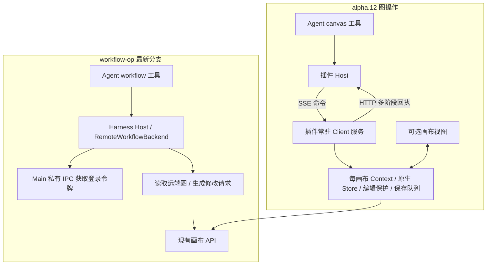

# Overu 最新 workflow-op 与 alpha.12：调用、通信、协议复审

日期：2026-10-14。范围仅为画布接入规则；未修改业务代码、未切换工作分支、未合并、未安装插件、未调用真实账号业务 API。本文替代 10 月 13 日报告中针对旧分支的当前选型建议；旧报告仍保留其固定提交下的事实。

## 1. 结论

**继续以 alpha.12 的插件执行服务、通信桥和原生业务规则为接入主线；选择性借鉴 workflow-op 的公开工具契约组织、结构化输出和会话上下文设计。当前不整套迁入 `RemoteWorkflowBackend`，也不把最新 workflow 协议直接指定为统一标准。**

新分支把远端 CRUD 接通了，这是明确进展。但它采用“Host 直接读写后端”的独立路径，尚未与现有画布的 Store、编辑保护、原生校验及状态同步接合。对本项目而言，替换现有路径会引入第二份业务规则与写入状态，迁移成本超过目前可以确认的收益。

这不意味着所有 API 必须经过 Client。alpha.12 的空画布创建、部分摘要查询本来就在 Host；需要统一归属的是**节点、连线、配置等图修改**。可以按操作选择位置，但不能让同一类图修改同时由两套不协调的执行器处理。

## 2. 本次确切比较了什么

| 对象 | 固定基线 |
| --- | --- |
| 最新远端 `origin/main` | `29718822b36a232eeabe202b77fed6ae44256338` |
| 最新 `origin/feature/workflow-op` | `77fb977d686ae09e6a48834e1a55c049f56ba737` |
| 两者 merge-base | 同上述 `origin/main` |
| 上轮审查分支 | `2f162eac46952ea2ff39d53f33161d128dfc1e78` |
| 本轮新增提交 | Overu，`77fb977`，2026-10-14 11:22:29 +08:00，`feat: implement remote workflow backend and integrate with canvas API` |
| 当前本地 Shell | 仍为 `main` / `eb4fb89`；没有 reset、checkout、merge |
| 对照插件 | `0.3.0-alpha.12` 原包，以及升级 alpha.13 前的源文件留存 |

本次同时拉取 main 和 feature，先以 `origin/main...origin/feature/workflow-op` 识别 Overu 的完整工作，再以 `2f162ea..77fb977` 识别新增差异。当前 feature 相对远端 main 的五个提交作者均为 Overu；新增提交改动 14 个文件，集中于 workflow 两个包及测试，**没有新增内置发布/安装脚本改动**。本轮未把历史发布改动列入取舍。

本地插件目录已是 alpha.13，不能直接当 alpha.12 使用。本次对 alpha.13 升级前留存的 16 份上轮已记录源文件逐一比对 SHA-256，全部匹配；alpha.12 tgz SHA-256 仍为 `a6d1737a2070bd32a4c7fbe4aa9ea6f483878d0546ad7f5f9e732d7042e34dda`。未把 alpha.13 的冷上下文及配置故障修复计入 alpha.12。

## 3. 最新提交改变了哪些判断

| 变化 | 本次确认 | 对选型的影响 |
| --- | --- | --- |
| 默认后端 | `apply()` 改用 `RemoteWorkflowBackend`，不再默认内存 Mock | 上轮“模型工具只操作 Mock”已过时 |
| 真实 API 接入 | 创建、列表、读取、节点/边 patch、重命名接到远端；图修改使用 partialUpdate | 可作为独立 Host API 接入实践参考；仍未完成真实账号验证 |
| 批内引用 | 删除 `clientId`、`NodeReference`；结果按新增操作顺序返回 `{id}` | 新节点与其连线必须至少分两次提交；上轮“一次创建完整关联子图”的协议优势不再存在 |
| 预检/幂等 | patch 删除 `dryRun`、`idempotencyKey` | 不再拥有这两项公共契约；执行协议仍有 idempotencyKey，但远端执行不可用 |
| 模型参数 | 删除模型节点 `additionalParameters`；保留固定具名参数，工具节点保留 params patch | 缩小了输入面，但真实模型扩展参数仍缺统一映射 |
| 标识字段 | get/update/delete 节点、delete 边统一为 `id` | 属于命名选择，不值得为此迁移现有 canvasId/nodeId/edgeId |
| 重命名与图修改 | 远端实现拒绝在一批中混合，避免调用两种 API 冒充一笔事务 | 值得保留这个边界；不等于已经证明后端 partialUpdate 的原子性 |
| 会话恢复 | 从成功工具历史恢复画布 ID/摘要；无法恢复摘要时提示先读取 | 对连续对话有价值；恢复的是定位线索，不是可写版本或权限 |
| 运行能力 | 两个执行/运行查询工具仍注册，但远端调用明确报错 | 11 个工具名不等于 11 项可用业务能力；没有新增真实生成链路 |

依据：[本次完整提交差异](https://github.com/Boxser567/insight-desktop-shell/compare/2f162eac46952ea2ff39d53f33161d128dfc1e78...77fb977d686ae09e6a48834e1a55c049f56ba737)、[最新 patch 契约](https://github.com/Boxser567/insight-desktop-shell/blob/77fb977d686ae09e6a48834e1a55c049f56ba737/packages/insight-workflow-protocol/src/workflow-agent-tools.type.ts#L543-L620)。

## 4. 调用和通信：两条路径的实质差异

### workflow-op

- 工具先做 Zod 输入校验，调用后端适配器，再做输出校验；Host 直接通过固定 API 获取/保存数据。
- 登录凭据走 Main→Harness 私有进程通道；不是让模型填写 token。这一点与 alpha 的安全边界方向一致，不构成需要替换的优势。
- 写前获取后端图及 `versionNumber`，构造草稿和差异，提交一次 partialUpdate。读到的原始未知字段在更新已有节点时尽量保留。
- 这条调用链不需要 Client 或 iframe 处理命令。但没有新增图变化事件、Client Store 同步、草稿互斥或上下文失效协议。
- `WorkflowBackend.execute(name,input)` 没有宿主执行上下文；工具执行参数中的 signal/callId 没传给后端。HTTP 有超时和插件 dispose 中止，但它们不等于单次 Agent 调用取消。

### alpha.12

- 图操作走已实现的 v3 服务桥：`canvas.prepare` 建立/绑定上下文，`canvas.command` 携带业务命令，Client 回传 `accepted/started/settled`。
- `sessionId/connectionId/contextId/requestId/deadline` 由宿主处理，模型填写业务参数；三阶段回执中的 accepted/started 不代表已保存。
- 业务由插件常驻 Client 服务执行；打开画布只是挂接视图，正常设计不以 iframe 存在为条件。**Client 运行环境仍需存活**，并非 Shell 关闭后继续运行。
- 沿用原生保存队列检查版本、编辑中保护、节点忙碌保护、真实端口/模型校验；UI 与 Agent 操作共享业务状态。
- 现有 SSE 是本地命令/上下文桥，不应被描述为已经完成所有生成进度事件或持久断线重放。真实生成仍未通过公开桥开放。

**通信取舍：保持 alpha 的图写入通道。** Host 直写链路更短，也适合将来确有“完全无 Client”需求的独立服务；当前目标是复用成熟画布。若同时保留两个写入器，必须额外解决 Store 失效、未保存草稿、在途生成、版本与回执协调，这不是新增一条 SSE 通知即可自动解决的。

源码：[工具与后端绑定](https://github.com/Boxser567/insight-desktop-shell/blob/77fb977d686ae09e6a48834e1a55c049f56ba737/packages/insight-workflow-op/src/index.ts#L100-L121)、[Host API](https://github.com/Boxser567/insight-desktop-shell/blob/77fb977d686ae09e6a48834e1a55c049f56ba737/packages/insight-workflow-op/src/canvas-api.ts#L194-L283)、[alpha 服务桥契约](</Users/boxser.shi/Documents/harness/desktop-canvas-plugin/src/shared/canvas-bridge-protocol.ts:3>)。最后一份文件本次哈希与 alpha.12 相同。

## 5. 值得借鉴与保持现状的明确清单

| 领域 | 建议 | 最小采用边界 |
| --- | --- | --- |
| 输入契约组织 | **借鉴**判别联合及集中领域契约 | 让模型看到每个 action 的合法组合；不为了统一名字重命名全部工具，也不重写内部桥 |
| 输出契约 | **借鉴**结构化输出与运行时校验 | 保留 alpha 的 saved/rejected/submission_unknown 等状态，把现有 JSON 字符串输出逐步正规化 |
| 能力发现 | **借鉴**节点定义→模型概要→参数详情的分层 | 数据源必须来自原生注册、当前配置与账号权限；补 actions、ports、可用原因，不能照搬固定六类型/闭合模式枚举 |
| 模型参数描述 | **借鉴** label/default/min/max/step 等描述 | 保留真实标量值、动态模式、catalogVersion 和原生条件参数解析；不得只展示约束而不执行校验 |
| 连续对话上下文 | **借鉴**从成功历史恢复当前画布 ID | 只恢复定位与历史摘要；修改前取得 confirmed 当前版本，不能把历史摘要当权威状态 |
| 批量修改 | **保留为后续候选** | 有明确多节点场景再增加一个小批量入口；复用 native policy/queue，不迁入第二个图引擎 |
| 原生字段保留 | **借鉴其兼容意识，保持现有实现** | API 投影不能覆盖未知原生字段、parentId、taskInfo、产物；alpha 同样应继续保持这一原则 |
| 版本、编辑互斥、回执 | **保持 alpha** | 不能用“写前自动读最新版本”替换 expectedVersion；不能把 HTTP 成功等同于严格保存回执 |
| 端口和连线 | **保持 alpha** | 原生端口发现/默认解析、类型/容量/重复/循环校验、reconnect/reorder 及受管理边保护 |
| 自动放置与尺寸 | **保持 alpha** | auto/absolute/after、原生尺寸、只放新节点；after 仍允许约定范围内重叠，不做全图重排 |
| 文本正文/图片素材 | **保持 alpha** | text 与 prompt 分离；保留 attachment/canvas_node 来源及上传、保存、登记分阶段结果 |
| 请求重放与取消 | **保持 alpha，注明边界** | 同 call 的指纹与回执缓存继续保留；不夸大为跨重启 exactly-once，未知结果不能自动重试 |
| Host 直写图、CDN 配置、独立节点构造 | **不直接采用** | 目前会绕开或重复现有业务；未证明收益前不迁移 |
| 执行、模板、完整版 Skill | **不扩展本轮范围** | 可讨论未来协议，但不能把未接通的 execute 工具注册当已有生成能力 |

alpha.12 也有欠缺：公开工具的条件字段及输出 Schema 不够清晰，没有全类型可用能力目录，新增并配置模型分多步，缺少组合 patch。保留底座不是否认这些问题。只需针对欠缺补接口，当前没有必要采用整套新协议替换。

## 6. 阻止直接采用新写入链路的具体问题

### 6.1 最新后端版本不等于 Agent 理解的版本

新 patch 不接收 expectedVersion。它读当前后端图，再把刚读到的版本送给 partialUpdate。这能在后端正确校验时保护“读取后至提交前”的竞争，**不能保护 Agent 先前读取后已经过时的决策**。

探针 R06：Agent 读到 v3 的 prompt，用户保存新 prompt 到 v4；Agent 基于 v3 生成修改。新后端重新读到 v4，并携带 v4 提交旧内容改写，仍成功进入保存请求。alpha 的 expectedVersion 在原生队列实际执行时校验，能拒绝这种过时提交；本地草稿另由 guard 保护。

结论：保留 Agent 已读版本作为前提，不由适配器悄悄“升级”为当前版本。依据：[远端读取与提交](https://github.com/Boxser567/insight-desktop-shell/blob/77fb977d686ae09e6a48834e1a55c049f56ba737/packages/insight-workflow-op/src/remote-workflow.ts#L231-L298)、[alpha 队列校验](</Users/boxser.shi/Documents/harness/desktop-canvas-plugin/canvas-app/legacy/src/store/flowStoreCore.ts:1499>)。

### 6.2 新远端路径实际复用了测试图修改器的生产行为

不再以“Mock 不完整”为由评价协议。但现在 `RemoteWorkflowBackend.patch()` 明确创建 `MockWorkflowBackend(models,false)` 并调用其 patch；以下行为已经进入真实 API 请求构造路径：

- R03：显式填写不存在的端口、重复边、反向形成环的边，均可进入 updateCanvas；不是仅在孤立 Mock 中成立。
- R04：两个未指定位置的新节点均保存为 `(0,0)`，新节点 `taskInfo.status` 为 running，却没有发起执行。
- R05：模型目录声明时长最大 10 秒，提交 999 秒仍可进入保存请求；当前只核对模型/模式存在，不完整校验参数组合。

Schema 允许省略 handles，远端却要求必须显式提供；节点发现又没有端口列表（R02）。Agent 无法仅靠发现协议完成合法连线。不能让它读取既有边猜端口，更不能把通用 output/input 当原生端口。

结论：如果需要批量草稿功能，应复用或抽取原生纯计算规则；**不要复制当前 createNode/applyOperation 作为插件的新业务真相**。依据：[远端复用入口](https://github.com/Boxser567/insight-desktop-shell/blob/77fb977d686ae09e6a48834e1a55c049f56ba737/packages/insight-workflow-op/src/remote-workflow.ts#L235-L254)、[实际被调用的图修改方法](https://github.com/Boxser567/insight-desktop-shell/blob/77fb977d686ae09e6a48834e1a55c049f56ba737/packages/insight-workflow-op/src/mock-workflows.ts#L220-L294)。

### 6.3 保存回执和请求重试缺乏副作用语义

`updateCanvas` 调用成功后直接返回草稿结果 applied=true，未验证保存版本；公开结果也没有版本字段。网络失败、业务冲突等在 API 层大多归为 REQUEST_FAILED，没有表达“尚未发送”“明确拒绝”“可能已经写入”的区别。

R07 使用注入 API 模拟“已保存，但响应丢失”：第一调用抛 REQUEST_FAILED；相同新增请求再调用，会创建第二个 ID。**这是允许重试时可产生重复的机制复现，不表示 Harness 已实测必然自动重试。**

结论：沿用 alpha 的未知结果隔离、禁止自动重试及读后核对，不因去掉幂等字段而省略这条要求。alpha 的进程内同 call 去重也不等于跨调用/跨重启永久幂等。

### 6.4 模型发现、读取投影还不能完整代表成熟画布

- `getModelParams()` 当前无环境分支，固定请求测试 CDN；README 所述“生产沿用画布服务接口”与代码不一致。原生 alpha 可用配置覆盖或 API，并独立加载模型/工具权限，新适配器未读取这些账号权限。
- R09：choice 的数字值不符合 string-only Schema，被 `parameterMap` 静默丢弃，Agent 看不到对应约束/默认值。
- R08：只读取/修改节点 A，也会先投影全部节点；另一个基础节点缺少当前协议要求的 modelType 就使整个操作失败。未知类型直接被过滤，摘要计数也是支持子集，却未标记遗漏。
- 上传节点、普通生成节点、工具产物缺少 alpha 的 contentType/capability 区分；协议允许四种媒体加两种工具，不代表这些 native 类型的创建和修改规则已经完整接通。
- 运行状态将缺失或未识别状态归为 running；不能据此准确判断是否可编辑。

结论：可借鉴发现接口形式，配置与投影必须适配原生真实数据；只读摘要应允许未知/不兼容节点，写入再按已实现能力收紧。依据：[配置来源](https://github.com/Boxser567/insight-desktop-shell/blob/77fb977d686ae09e6a48834e1a55c049f56ba737/packages/insight-workflow-op/src/canvas-api.ts#L256-L270)、[节点/配置投影](https://github.com/Boxser567/insight-desktop-shell/blob/77fb977d686ae09e6a48834e1a55c049f56ba737/packages/insight-workflow-op/src/remote-workflow.ts#L31-L118)。

## 7. 批量能力如何取舍，避免过度整合

最新分支可以一次新增多个独立节点，也可以一次修改已有节点及它们的边；由于新 ID 只能在返回后取得，**“新增文案节点 + 新增图片节点 + 将二者相连”仍须先建节点再建边**。alpha.12 目前逐项调用，同样没有完整子图原子接口。不能再沿用上轮“直接迁入 workflow patch 就能一批建完”的判断。

如果后续场景确实需要一批创建关联子图，最小设计应满足：

1. 一批一个 expectedVersion；原生队列执行时再检查，仍服从编辑/在途状态保护。
2. 本地临时引用解决批内依赖。永久 ID 仍由实现方生成；是否用 clientId 或操作索引是次要选择，不能迫使 Agent 编造真实 ID。
3. 用同一原生构造、边策略、模型解析和放置函数预检草稿，再通过现有一次图更新接口保存。
4. 回执沿用 saved/rejected/submission_unknown，增加操作位置和临时引用映射；一次 HTTP 不自行宣称后端事务保证。
5. 上传、执行、重命名不要混进首版图 patch。dryRun 只有实际使用场景再开放，不为看起来完整而提前新增工具。

这是一项待决定的独立增量，不是本次批准实施；也不需要迁入 workflow-op 整个包或同时暴露两套写入工具。

## 8. 后续若采用，按文件和职责挑选

| workflow 文件 | 可取部分 | 本次决定 |
| --- | --- | --- |
| `workflow-agent-tools.type.ts` / `workflow-schemas.ts` | 领域契约集中、判别结构、查询层次、错误位置 | 选取结构思想；不整文件复制固定节点/参数/状态定义 |
| `dsh-schema.ts` | 适配 Harness 支持的 Schema 子集 | 需要公开结构化契约时定向评估；数值范围会被投影弱化，业务验证仍在服务端 |
| `index.ts` | 结构化输出、成功历史恢复、工具注册方式 | 可拆成单独的小改动；不要一起切换默认后端，宿主 signal/callId 仍应保留 |
| `workflow-backend.ts` | 公开工具与执行器分离 | 只有真实多实现需求才抽取；当前可直接适配现有服务，不再造多余层 |
| `remote-workflow.ts` | 保存原始未知字段、拒绝跨 API 混合事务的边界 | 不迁入当前图写入路径 |
| `mock-workflows.ts` | 测试夹具 | 不迁入生产节点构造/连线/布局/参数规则 |
| `canvas-api.ts` / `canvas-credential.ts` | 固定端点与私有鉴权模式 | alpha 已有对应能力；避免重复维护，测试 CDN 规则不采用 |
| `workflow-skill.ts` | 调用顺序与类型定义分离 | 只借鉴维护分工；完整版业务 Skill 仍暂缓 |

建议先收敛一张“对外字段→原生方法→成功/失败回执”映射表，再分别决定能力发现与结构化输出的最小补充，最后才按真实批量场景评估 patch。**此处没有把 protocol 包拆分、SSE 重做、工具改名、Host 写入迁移列为前置任务。**

## 9. 验证和限制

- 在临时 git archive 快照运行分支原有五组相关测试：**27 通过、3 失败**，共 30 项。失败全部在 canvas-api.test.ts：旧模型 API 路径、序列化配置解析、CDN 返回值 `.data` 预期与新实现不一致。未修复测试或业务代码，也没有据此断言所有真实 API 不可用。
- 两个包的 TypeScript 检查通过。
- 新增 **10 个临时审查探针全部通过**，覆盖 R01–R10。通过表示已复现报告中的行为，包含缺口和兼容保留，不是生产可用性认证。探针调用真实 RemoteWorkflowBackend，通过注入 fake API 观察请求；不调用真实账号或网络业务接口。
- 使用 Shell 现有依赖（Node 24.9.0、Vitest 4.1.10、Zod 4.5.4），未按分支 lockfile 重新安装，未跑整仓/发布测试，不做性能结论。
- alpha.12 的既有可靠性设计并非全部无缺陷：最新人工归档记录了首次权威读取、配置 502 连锁封写及刷新体验问题；alpha.13 已另有修复，但不计入本次 alpha.12 比较。选择保留执行底座仍需继续完成这些独立手测。
- 未验证远端 partialUpdate 的事务原子性、真实 API 新分支实账保存、并发多端和 UI 同步效果；报告中的模拟竞争/丢包结果已明确标注。

证据：[本轮检查摘要](evidence/2026-10-14-workflow-op-77fb977-checks.json)、[审查探针源码](evidence/2026-10-14-workflow-op-77fb977-probes.test.ts.txt)、[alpha.12 手测及独立 alpha.13 修复记录](../implementation/2026-10-14-alpha12-feedback-and-alpha13-fixes.md)。
